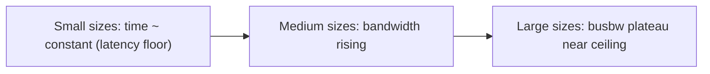

## Why this matters

`nccl-tests` is the standard benchmark for collective performance on NVIDIA GPU clusters. It is
what vendors use in acceptance tests, what cluster operators run after every maintenance window,
and what you will be asked to interpret in a design review or an interview. It is also easy to
misread: the most-quoted number in its output, "bus bandwidth", is not a measurement of any bus,
and the "Avg bus bandwidth" printed at the end is rarely the number that matters.

If you can turn an nccl-tests table into a sentence like "this two-node run reaches 87 % of the
network ceiling at large sizes, the latency floor is 35 µs, and node 7 is the outlier," you can
accept or reject a cluster with confidence. This lesson shows how.

## Concepts

### The binaries

nccl-tests builds one binary per collective, for example:

| Binary | Collective |
|---|---|
| `all_reduce_perf` | All-reduce |
| `all_gather_perf` | All-gather |
| `reduce_scatter_perf` | Reduce-scatter |
| `broadcast_perf`, `reduce_perf` | Broadcast, reduce |
| `alltoall_perf` | All-to-all |
| `sendrecv_perf` | Point-to-point send/receive |

### Common flags

| Flag | Meaning | Typical value |
|---|---|---|
| `-b` | Minimum message size in bytes (suffixes K, M, G accepted) | `8` |
| `-e` | Maximum message size | `8G` (large enough to reach the plateau) |
| `-f` | Multiplication factor between sizes | `2` |
| `-g` | GPUs per thread (per process) | `1` with one MPI rank per GPU |
| `-t` | Threads per process | `1` with MPI |
| `-c` | Check results for correctness (1 = on) | `1` for acceptance, `0` to speed up long sweeps |
| `-n` | Timed iterations per size | `20` or more for stable numbers |
| `-w` | Warm-up iterations per size (not timed) | a few |
| `-d`, `-o` | Data type and reduction operation | defaults (float, sum) are fine for bandwidth tests |

Run any binary with `-h` to see the full flag list for your version; defaults can differ between
releases.

### Two bandwidths

- **Algorithm bandwidth (algbw)** = S / t, where S is the message size reported in the size column
  and t the time per operation. It is what the application "experiences".
- **Bus bandwidth (busbw)** = algbw × a factor that depends on the collective and on n, the number
  of ranks. It converts the result into the bandwidth that the **busiest link** of an optimal
  algorithm would have to sustain, so it can be compared with hardware link speeds and stays
  comparable as n changes.

Factors, per nccl-tests' PERFORMANCE.md:

| Collective | busbw = algbw × | Why |
|---|---|---|
| All-reduce | 2(n-1)/n | Each rank sends and receives 2(n-1)/n of the data (reduce-scatter + all-gather) |
| Reduce-scatter | (n-1)/n | Each rank sends (n-1)/n of the data |
| All-gather | (n-1)/n | Each rank receives (n-1)/n of the data |
| Broadcast | 1 | Pipelined: each link carries the full message once |
| Reduce | 1 | Same as broadcast in reverse |

For all-gather and reduce-scatter, the size nccl-tests reports is the size of the full (gathered)
buffer; PERFORMANCE.md explains the conventions in detail, and you should read it once end to end.

> [!ANALOGY]
> Algorithm bandwidth is like a delivery company quoting "your parcel arrived in a day". Bus
> bandwidth is like the company measuring how busy its trucks were: for an all-reduce, nearly twice
> the parcel's weight travelled on each truck. Comparing truck utilization with truck capacity tells
> you whether the fleet is efficient. Where it breaks down: algorithms with in-network reduction
> (SHARP, NVLS) send less data than the formula assumes, so the "truck utilization" they report can
> exceed what the trucks physically carried.

## How it works

### Building and running

```bash
# Build with MPI support (paths are examples)
git clone https://github.com/NVIDIA/nccl-tests.git
cd nccl-tests
make MPI=1 MPI_HOME=/usr/mpi CUDA_HOME=/usr/local/cuda NCCL_HOME=/usr

# 2 nodes x 8 GPUs, one MPI rank per GPU
mpirun -np 16 -N 8 --hostfile hosts \
  -x NCCL_DEBUG=WARN -x NCCL_IB_HCA -x NCCL_SOCKET_IFNAME \
  ./build/all_reduce_perf -b 8 -e 8G -f 2 -g 1 -c 1 -n 20 -w 5
```

Under Slurm, `srun --ntasks-per-node=8 --gpus-per-node=8 ./build/all_reduce_perf ...` is the
equivalent; container launch details depend on your site.

### Reading the output

```text
# Illustrative output (2 nodes x 8 H100, 8 x 400G per node; not a reference result; rows trimmed)
# nThread 1 nGpus 1 minBytes 8 maxBytes 8589934592 step: 2(factor) warmup iters: 5 iters: 20 validation: 1
#
#                                                      out-of-place                     in-place
#       size        count   type  redop  root    time   algbw   busbw #wrong    time   algbw   busbw #wrong
#        (B)   (elements)                         (us)  (GB/s)  (GB/s)          (us)  (GB/s)  (GB/s)
           8            2  float    sum    -1    38.1    0.00    0.00      0    37.6    0.00    0.00      0
        1024          256  float    sum    -1    40.2    0.03    0.05      0    39.9    0.03    0.05      0
       65536        16384  float    sum    -1    55.0    1.19    2.23      0    54.6    1.20    2.25      0
     1048576       262144  float    sum    -1   120.0    8.74   16.38      0   119.1    8.80   16.51      0
    16777216      4194304  float    sum    -1   420.0   39.95   74.90      0   418.3   40.11   75.20      0
   134217728     33554432  float    sum    -1  1050.0  127.83  239.68      0  1046.2  128.29  240.54      0
  1073741824    268435456  float    sum    -1  6200.0  173.18  324.71      0  6188.0  173.52  325.35      0
  8589934592   2147483648  float    sum    -1 46500.0  184.73  346.37      0 46420.0  185.05  346.97      0
# Out of bounds values : 0 OK
# Avg bus bandwidth    : 97.3
```

Column by column:

| Column | Meaning |
|---|---|
| size / count / type | Message size in bytes, element count, data type (count = size / 4 for float) |
| redop / root | Reduction operation; root rank (-1 when not applicable) |
| out-of-place vs in-place | Separate send and receive buffers vs one buffer; usually similar |
| time | Average time per operation in µs |
| algbw, busbw | GB/s, where GB = 10^9 bytes |
| #wrong | Elements that failed validation (with `-c 1`); must be 0 |
| Avg bus bandwidth | Mean of busbw over all sizes in the sweep, including tiny ones |

Check the arithmetic on the last row: algbw = 8,589,934,592 B / 46.5 ms ≈ 184.7 GB/s;
busbw = 184.7 × 2 × 15/16 ≈ 346.4 GB/s.

### The shape of the curve



- **Latency region** (bytes to tens of KB): time barely changes with size. The floor (about 38 µs
  here) is the α cost of the chosen algorithm and protocol across the nodes.
- **Transition** (hundreds of KB to tens of MB): NCCL switches protocols and algorithms; small
  bumps in the curve at these points are normal.
- **Plateau** (hundreds of MB and up): busbw approaches the hardware ceiling. This is the region to
  compare with your expectation.

The final "Avg bus bandwidth" (97.3 GB/s above) mixes all of these regions. It is useful as a
quick regression indicator for the **same** sweep parameters, but it is not the peak bandwidth and
should not be compared across different `-b`/`-e` ranges.

### What ceiling should you expect?

Derive it from the hardware and the algorithm instead of copying someone else's number:

- **Single node (NVLink only)**: the ceiling is the per-GPU NVLink bandwidth in one direction (on
  the order of several hundred GB/s on recent NVSwitch systems). NVLS can push all-reduce results
  above what a plain ring achieves.
- **One GPU per node**: the ring crosses the network at every hop, so busbw is bounded by the NIC:
  a 400 Gb/s NIC is 50 GB/s raw, and a good result is a high fraction of that.
- **Multi-node, one NIC per GPU, ring**: each ring passes through each node once, so a node only
  has to send 2(n-1)/n × S across all its NICs combined. With k NICs per node, the network-side
  ceiling of busbw is therefore about k × the per-NIC rate: for 8 × 400 Gb/s, about 400 GB/s, also
  capped by the NVLink ceiling. The illustrative 346 GB/s above would be about 87 % of that.
- **In-network reduction (CollNet/SHARP, NVLS-Tree)**: less data crosses the network than the ring
  formula assumes, so busbw can exceed the ceilings above. That is expected, not a bug.

Treat these as first-order estimates; protocol overheads, PCIe and GPU-NIC topology, and congestion
all lower the practical value.

```widget
allreduce-sim
```

Use the widget's alpha-beta model to reproduce the shape of the curve: set α to tens of µs and the
bandwidth to the per-ring bottleneck, then sweep message sizes.

## In practice

### A test campaign that finds problems

| Stage | Command shape | What it catches |
|---|---|---|
| 1. Single node, all GPUs | `all_reduce_perf -b 8 -e 8G -f 2 -g 1` with 8 ranks | NVLink/NVSwitch issues, P2P disabled, GPU problems |
| 2. Node pairs | Same test, 2 nodes, every pair (or a sample) | A bad NIC, cable, optic or leaf port; per-node misconfig |
| 3. Rail/leaf groups | Nodes under one leaf, then across leaves | Leaf uplink problems, ECMP/AR behaviour |
| 4. Full scale | All nodes, all-reduce and all-to-all | Spine capacity, congestion, polarization, incast |
| 5. Repeat | Same tests 10-20 times, different node orders | Hash-collision variance, intermittent links |

Pairwise testing is the workhorse: if node 7 pairs badly with everyone and the rest pair well, node
7 (or its links) is the problem. With N nodes you can run N/2 disjoint pairs in parallel, rotating
partners.

```text
# Illustrative pairwise sweep summary at 8 GiB all-reduce (busbw, GB/s)
pair       busbw
n01-n02    347
n03-n04    345
n05-n06    346
n07-n08    211   <- investigate: re-pair n07 and n08 with known-good nodes
n09-n10    348
```

### Comparing alltoall

`alltoall_perf` exercises every rank-to-rank path and is sensitive to spine capacity, adaptive
routing and incast. A cluster can look perfect on all-reduce (rings are neighbour traffic and
rail-friendly) and still have a problem that only all-to-all exposes.

> [!TIP]
> Save every nccl-tests run with its environment (NCCL version, driver, firmware, env vars, node
> list). A bandwidth number without that context cannot be compared with anything later.

> [!INTERVIEW]
> "An nccl-tests all-reduce across 16 GPUs shows algbw 185 GB/s and busbw 346 GB/s at 8 GB. Is that
> good, and why are the two numbers different?" A strong answer: busbw = algbw × 2(n-1)/n
> = 185 × 1.875; it normalizes to the per-link load of a bandwidth-optimal ring so results compare
> across rank counts and with hardware speeds. Then build the ceiling: 2 nodes with 8 × 400G NICs
> each give about 400 GB/s network ceiling for ring busbw, so ~87 % is healthy. Mention that the
> "Avg bus bandwidth" averages all sizes and that #wrong must be zero.

## Common pitfalls

- **Quoting "Avg bus bandwidth" as peak.** Symptom: reports that look disappointing or inconsistent.
  Cause: the average includes latency-bound small sizes and depends on the sweep range. Fix: quote
  busbw at a stated large size (for example 8 GiB) and the sweep parameters.
- **Comparing algbw across different rank counts.** Symptom: "all-reduce got slower when we
  added nodes." Cause: algbw for all-reduce naturally falls as n grows. Fix: compare busbw.
- **Stopping the sweep too early.** Symptom: busbw still climbing at the largest size. Cause: `-e`
  too small to reach the plateau. Fix: extend to several GB where memory allows.
- **Ignoring #wrong.** Symptom: non-zero values dismissed as noise. Cause: data corruption from
  faulty GPUs, memory, NICs or software bugs. Fix: treat any non-zero #wrong as a serious fault and
  isolate the node.
- **Reading SHARP/NVLS results with ring expectations.** Symptom: "busbw exceeds NIC speed, the
  test is broken." Cause: in-network reduction moves less data than the formula assumes. Fix: know
  which algorithm ran (NCCL INFO output) before judging.
- **Running once.** Symptom: a cluster accepted on one good run shows variance later. Cause:
  collisions and intermittent faults. Fix: repeat runs and pairwise sweeps.

## Key takeaways

- algbw = size / time; busbw = algbw × factor (all-reduce 2(n-1)/n, all-gather and reduce-scatter
  (n-1)/n, broadcast and reduce 1).
- busbw is comparable with hardware link speeds and across rank counts; algbw is not.
- The curve has a latency floor, a transition and a bandwidth plateau; judge the plateau.
- "Avg bus bandwidth" averages all sizes; quote busbw at a large stated size instead.
- Derive the expected ceiling from NICs, NVLink and algorithm; in-network reduction can exceed ring
  ceilings.
- Pairwise and repeated runs find bad nodes and variance; #wrong must always be zero.
