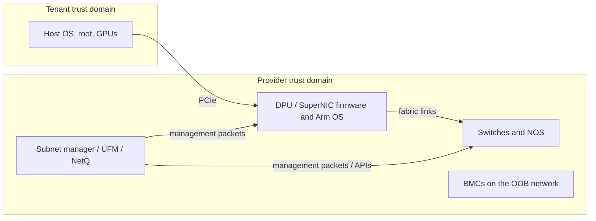

## Why this matters

AI back-end fabrics were designed for one goal: move bytes between GPUs as fast as physics allows.
Security was handled by keeping the fabric closed: no users, no Internet, one owner. That assumption
is weakening. GPU clouds rent bare-metal servers to tenants who have root on the host, model weights
and training data are among the most valuable assets a company owns, regulated workloads demand
encryption in transit, and the fabric is now large enough that "nobody untrusted is ever plugged in"
is an operational hope rather than a control.

RDMA makes this harder than ordinary networking. The data path bypasses the kernel, so host
firewalls never see it. A remote NIC writes directly into application (and GPU) memory once it holds
the right key. InfiniBand fabrics are controlled by management packets that any port can, in
principle, send. And encryption at 400-800 Gb/s per port is only practical in NIC hardware. This lesson
builds the threat model, then walks through the controls that exist today and how mature each one is,
so that you can answer a security review without either hand-waving or overselling.

## Concepts

### What an attacker wants, and where they can stand

| Asset | Example threat | Where the attacker stands |
|---|---|---|
| Data in GPU or host memory | Read model weights or training data; corrupt gradients | Another tenant's host, a compromised node, a rogue device on the fabric |
| Fabric control plane | Reprogram routing or partitions; become master SM | Any host that can send management packets (IB), or a switch management session |
| Availability | Pause storms, SM takeover, flooding the subnet administrator | Any host on the fabric |
| Management systems | Take over UFM, NetQ, switch NOS, BMCs | Front-end or out-of-band network, stolen API tokens |
| Firmware | Implant in NIC, DPU or switch firmware | Supply chain, a privileged host user flashing images |

Two attacker positions matter most in an AI cluster: **a tenant with root on a bare-metal host**
(GPU clouds) and **a compromised node inside a single-owner cluster** (lateral movement after a
breach of the front-end). Design for both.

### Why RDMA changes the threat model

The protections from `why-rdma` (memory registration, protection domains, connected QPs, partitions)
stop *accidental* misuse. Against an adversary they have specific weaknesses:

- **Kernel bypass.** Once a QP is set up, packets are produced and consumed by the NIC. Kernel
  firewall rules (nftables, iptables) on the host do not see RoCE traffic that the NIC terminates in
  hardware, and host intrusion detection that watches sockets sees nothing.
- **The rkey is a bearer capability.** Anyone who can send a correctly formed packet with a valid QP
  number, packet sequence number and rkey for a registered region gets the access that region allows.
  No per-request authentication happens.
- **No packet authentication on the wire.** The RoCEv2 ICRC (`rocev2-encapsulation`) and InfiniBand's
  CRCs are integrity checks against bit errors, not cryptographic authentication: anyone who can craft
  a packet can compute a valid CRC. NVIDIA's InfiniBand security guide is explicit that IB keys are
  not involved in cryptographic operations: they are access tokens, not cryptographic keys.

Academic work has shown that these are practical, not theoretical, concerns. The ReDMArk study
(USENIX Security 2021) demonstrated packet injection by impersonation, unauthorized memory access and
denial-of-service attacks against InfiniBand-architecture RDMA (including RoCE) and RNIC
implementations, and concluded that existing mechanisms are insufficient against both in-network and
end-host attackers.

> [!ANALOGY]
> RDMA security without encryption is like a hotel where room keys are magnetic cards that are never
> checked against the guest list: the lock only asks "is this a valid card for this door?" Partitions
> are the floors your lift card lets you reach. That works well while every guest is honest and nobody
> can copy cards. It breaks when a guest can read card numbers off the wire (no encryption) or print
> their own cards (spoofed packets), and the analogy itself breaks on scale: the "doors" are millions
> of memory pages being opened thousands of times per second, so any real check must run in NIC
> hardware.

### Trust boundaries



Draw this for every design. The questions it forces: which component enforces isolation (host, NIC,
DPU or switch)? Can the party you do not trust change that component's configuration? In a single-owner
training cluster the host may be trusted; in a bare-metal GPU cloud it is not, which is why policy has
to live on the DPU (`nics-dpus-supernics`) and the switches, managed from a network the tenant cannot
reach (`multi-tenancy-isolation`).

## How it works

### Hardening an InfiniBand subnet

InfiniBand's control plane is the subnet manager (`subnet-manager-routing`), and it talks to every port
with management datagrams (MADs). The defences, per NVIDIA's InfiniBand security guide, are keys and
filters at several layers:

| Control | What it protects | How it works |
|---|---|---|
| **P_Key** (partition key) | Data-plane reachability | 16-bit key in every packet; full or limited membership; enforced by HCAs and by switch ports facing hosts, so a host cannot use a partition the SM did not give it |
| **M_Key** (management key) | Port and switch configuration | The SM sets an M_Key per adapter port (one per switch); at protection levels 2-3 no management command is accepted without the right key, and a mismatch is dropped, optionally raising a "bad M_Key" trap |
| **SA_Key** | Subnet administrator records | Sensitive SA operations (setting or deleting records) must present the key |
| **SM_Key** and an allowed-SM list | Who may be master | SM instances share a random SM_Key used during handover; an allowed list of SM GUIDs makes the master ignore unknown SMs |
| **Per-class keys** (VS, CC, N2N, AM) | Vendor tools, congestion control, node-to-node and SHARP aggregation management | Each management class gets its own key; the SHARP Aggregation Manager also assigns a per-job key |
| **SMP firewall on the HCA** | Hosts sending subnet management packets | HCA firmware blocks a host from sending or receiving SMPs (QP0), intended for bare-metal and multi-tenant hosts; NVIDIA's Secure Host feature stops a root user from changing that firmware setting back |

Three of these deserve emphasis:

1. **P_Key enforcement on switches** is what makes partitions hold against a malicious host. An HCA
   enforces its own partition table, but a tenant with root controls that host. The switch port facing
   the host passes only the partitions the host is allowed, and drops the rest.
2. **M_Key with a protection level** turns "any port can reconfigure the fabric" into "only the SM can".
   NVIDIA's guidance is a protection level of 2 and a lease period of 60 seconds when M_Key is enabled.
3. **The rogue-SM problem** is both a reliability and a security issue: an extra OpenSM with higher
   priority becomes master and reprograms the fabric. An allowed-SM GUID list, an SM_Key and blocking
   SMPs from non-SM hosts close it.

> [!WARNING]
> None of these keys encrypt anything. P_Keys travel in clear text in every packet, so they are not
> secrets at all: partitions hold only because switches enforce them. A management key that leaks
> (for example, read from a compromised host or captured on a mirror port) can be replayed. Randomize
> the management keys and use the subnet manager's periodic key update rather than static values.

Pick the tenant design, then let host B1 forge tenant A's P_Key with switch enforcement on and off: the key value is no secret, and only the switch port stops the forged packet.

```widget
pkey-membership
```

### RoCEv2 and Ethernet: isolation without fabric keys

Ethernet has no subnet manager and no M_Key. Isolation comes from routing and filtering:

- **A closed compute fabric**: no default route, no route leaking to the front-end, and RoCE traffic
  (UDP destination port 4791) accepted only between compute subnets. Leaf ACLs can enforce "UDP 4791
  only from compute subnets", which also stops a host on the wrong network from reaching QPs.
- **VRFs and EVPN** per tenant (`multi-tenancy-isolation`), with the VTEP on the leaf or on a DPU the
  tenant cannot configure.
- **Anti-spoofing at the edge**: per-port source-address checks on leaf switches or DPUs, so a host can
  send only from the addresses it was assigned. Without this, an attacker inside the fabric can forge
  the source of RoCE packets, which is the precondition for the impersonation attacks above.

These controls shrink who can reach a QP. They do not authenticate packets; only cryptography does.

### Encryption options at line rate

At 400 Gb/s a NIC handles roughly 12 million packets per second with 4 KB frames and over 30 million
with 1,500-byte frames; at 800 Gb/s twice that. Software
encryption on the host is out of the question for the back-end fabric, so every realistic option is
**inline in the NIC, DPU or switch ASIC**. The options differ in what they protect and how mature they are
for RDMA:

| Option | Scope | Keys | Status for AI fabrics (as of 2026) |
|---|---|---|---|
| **IPsec packet (full) offload** | End to end between hosts, IP layer | IKE or orchestrator, per security association (SA) | NVIDIA documents IPsec packet offload, including IPsec over RoCE, on crypto-enabled ConnectX-6 Dx/Lx, ConnectX-7 and BlueField-2 and later; it needs Linux 6.6 or newer and has documented throughput caveats on older generations. Check release notes for your NIC and speed |
| **MACsec** (IEEE 802.1AE) | One link (hop by hop) | MKA from IEEE 802.1X | Protects cables and patch panels between two MACsec endpoints; traffic is in clear text inside each switch. Port-speed support varies by ASIC and SKU |
| **PSP** | End to end, per layer-4 connection | Per-connection keys derived from an SPI and an on-device master key | Designed by Google for NIC offload at hyperscale and open-sourced in 2022; the Linux PSP framework (added in kernel 6.18) currently covers TCP; NVIDIA ships a PSP gateway *sample* application for BlueField-3 and ConnectX-7 and later. Not a drop-in RDMA encryption scheme today |
| **UEC TSS** | End to end, per secure domain (a group of endpoints) | One secure-domain key distributed by a management entity, optionally per-source keys via a KDF | Optional sublayer of Ultra Ethernet Transport; only for UET traffic, and only on endpoints that implement it |

Why so many? Each trades off differently:

- **IPsec** is a standard everyone audits, but classic IPsec keeps state per SA in NIC tables. Google's
  2022 PSP announcement explained that IPsec did not meet its needs because it stores full encryption
  state in hardware tables with modest update rates and lacks keys per layer-4 connection.
- **PSP** avoids that by making the NIC nearly stateless: on receive, the key is derived from the
  packet's SPI and a master key held on the device. Google reported that software encryption of RPCs
  had cost about 0.7% of its processing power, and that PSP offload saved 0.5% as of 2022.
- **MACsec** is cheap and transparent to RDMA, but it only protects links. A compromised switch, or an
  attacker who is a legitimate host on the fabric, is not stopped.
- **UEC TSS** was designed for collective traffic, where every member of a job talks to every other
  member. Per-pair keys would explode; a shared secure-domain key with a key-derivation function keeps
  key state per endpoint constant.

### Inside the UEC Transport Security sublayer

Per the UEC design paper (section 3.4), TSS:

- Authenticates the packet-delivery and semantic headers, the payload and the IP addresses, and lets
  the operator choose which parts are encrypted, a trade-off between information leakage and network
  visibility.
- Treats switches as untrusted, but still lets them do their jobs: ECN marks and packet trimming are not
  authenticated, and are handled so that, for example, trimmed packets cannot create new delivery
  contexts.
- Uses AES-GCM with a 256-bit key and a 16-byte authentication tag by default. Because all members of a
  secure domain share a key, nonce reuse is the central risk; each packet carries a counter made of an
  epoch and a per-sender packet count, masked before use.
- Protects against replay by closing and reopening an encrypted delivery context before its packet
  sequence numbers wrap, and by establishing starting sequence numbers securely.
- Adds a 12-byte header (16 bytes with explicit source identifiers) plus the 16-byte tag.

The cost in bytes is small: 12 + 16 = 28 bytes on a 4,096-byte payload is about 0.7%. The real costs
are elsewhere: NIC silicon that can run AES-GCM at line rate, a key-management service (the secure
domain management entity) that every job depends on, and operational processes for rotation and
membership changes.

> [!NOTE]
> The UEC specification moves quickly. Version 1.0 was released in June 2025, followed by 1.0.1-1.0.3
> maintenance releases, and the consortium published version 1.1 on 12 October 2026 (per its
> specification-history page, checked October 2026). Check which
> version and profile a product implements, and whether it implements TSS at all.

### Firmware and supply-chain integrity

The NIC and DPU are part of the fabric's security boundary, so their firmware matters:

- NVIDIA's firmware tools documentation describes **secure firmware update** on ConnectX-4 and later:
  the device verifies the digital signature of a new image before activating it.
- BlueField DPUs (BlueField-2 and later) support **UEFI secure boot** of the Arm OS, per the BlueField
  BSP documentation.
- Fleet consistency (one validated firmware version, checked at burn-in, see `fabric-validation-burn-in`)
  is also a security control: an unexpected version on one node is an anomaly to investigate.

### The management plane is the biggest door

Most real compromises of infrastructure come through management, not through crafted RDMA packets.
Everything that can reconfigure the fabric deserves the protection of a production control plane:

- **Out-of-band network and BMCs**: isolated, reachable only from jump hosts, no default credentials,
  firmware patched (`storage-and-frontend-networks`).
- **Switch NOS**: central authentication and authorization (TACACS+ or RADIUS), per-user accounts, no
  shared admin passwords, management-plane ACLs, SSH and HTTPS only, configuration changes through the
  automation pipeline (`network-automation-for-ai`).
- **Fabric managers (UFM, NetQ) and their REST APIs**: role-based access, short-lived tokens stored in a
  secrets manager, audit logs shipped off the box. A UFM account that can edit partitions can undo every
  P_Key decision you made.
- **Tenants never reach management**: in multi-tenant designs the tenant host must not be able to reach
  the SM, UFM, NetQ, switch management or DPU Arm interfaces.

## In practice

### InfiniBand: key settings in the subnet manager

NVIDIA's practical guidelines name the configuration options below for OpenSM (`opensm.conf`) and UFM.
Parameter names and defaults vary by release, so treat this as a checklist to verify against the
documentation for your SM version, not as a file to paste.

```text
# illustrative excerpt: values are placeholders, not recommendations to copy
m_key_per_port           TRUE
m_key_protection_level   2              # recommended when M_Key is enabled
m_key_lease_period       60
sm_key                   <random 64-bit value>
sa_key                   <random 64-bit value>
allowed_sm_guids         <GUIDs of the production SMs>
periodic_key_update      1440           # minutes; rotates per-class keys
```

The same guide recommends making end nodes **limited** members of the default partition (in UFM,
`default_membership = limited`), so tenants can reach shared services but not each other, and blocking
SMPs on every non-SM host with the adapter firmware parameter `SM_DISABLE` (set with `mlxconfig`; query
it first and follow the guide for your adapter). On hosts with Secure Boot and kernel lockdown, MFT may
be unable to reach the adapter's non-volatile configuration at all (`mlxconfig ... q` fails), so plan
this step for provisioning, with Secure Boot off or a signed MFT kernel module.

### Is there exactly one, expected master?

```bash
sminfo
```

```text
sminfo: sm lid 1 sm guid 0x0002c90300aabbcc, activity count 98321 priority 15 state 3 SMINFO_MASTER
```

*(Illustrative.)* Alert when the master GUID changes to anything outside the allowed list.

### Partition violations on switch ports

Partition enforcement drops are counted in the standard port counters. NVIDIA's UFM documentation defines
the receive constraint-error counter (`PortRcvConstraintErrors` in `perfquery` output) as packets
received on a switch port and discarded because inbound partition enforcement is on and the packet
failed the partition key (or IP version) check, or because raw packets are filtered, and
`PortXmitConstraintErrors` as the outbound equivalent.

```bash
perfquery <lid> <port>
```

```text
# illustrative, trimmed
PortRcvConstraintErrors:.........12
PortXmitConstraintErrors:........0
```

On a host-facing port, a rising receive constraint counter means that host is sending with a P_Key it
does not hold: a misconfiguration at best, a probe at worst. UFM also raises events for bad P_Keys and
bad M_Keys; route them to the security team, not only to the network on-call.

### RoCE: verifying IPsec offload

When IPsec packet offload is configured (with `ip xfrm` and the NIC vendor's procedure), confirm that the
security associations exist and that traffic is counted against them:

```bash
ip -s xfrm state
```

RoCE packets never pass through the kernel network stack, so there is no software fallback for them:
NVIDIA's documentation notes that IPsec over RoCE needs packet (full) offload. Confirm with a capture on
a mirror port that the RoCE traffic leaves as ESP rather than clear UDP 4791. Then measure. Run
`ib_write_bw` (`perftest-benchmarking`) with and without the policy on the same pair of hosts, and
compare bandwidth and CPU use. If training bandwidth collapses while host CPU rises, something is going
through the kernel in software, for example NCCL falling back from RDMA to TCP sockets that the kernel
now encrypts.

### A security review checklist for an AI fabric

| Question | Good answer |
|---|---|
| Who can reach the compute fabric at L3? | Only compute NICs; no default route; ACLs on UDP 4791 |
| Can a tenant host change its own isolation? | No: P_Keys enforced on switches, policy on a DPU the tenant cannot configure |
| Who can become master SM? | Only listed GUIDs with the SM_Key; SMPs blocked on hosts |
| Are management keys random and rotated? | Yes, periodic key update enabled |
| Is data encrypted in transit, and where? | Stated explicitly: none, per link (MACsec), or end to end (IPsec/PSP/TSS), with the reason |
| How do we detect violations? | Constraint-error counters, SM/UFM security events, master-change alerts in the SIEM |
| How is firmware trusted? | Signed images, secure boot on DPUs, one validated version fleet-wide |

## Common pitfalls

- **Trusting host firewalls for RDMA.** Symptom: a security audit says "host firewall blocks all
  inbound", yet RoCE traffic flows. Cause: the NIC terminates RoCE in hardware, bypassing the kernel
  firewall. Fix: enforce reachability on switches (ACLs, VRFs) and DPUs.
- **Partitions enforced only on HCAs.** Symptom: isolation holds in tests but not against a tenant with
  root. Cause: a malicious host can ignore its own table. Fix: enable partition enforcement on switch
  ports facing hosts and watch `PortRcvConstraintErrors`.
- **Default or static management keys.** Symptom: a leaked key from one incident still works months
  later. Cause: M_Key, SA_Key and others set once and never changed. Fix: random keys and periodic key
  update.
- **An unlisted SM wins the election.** Symptom: fabric-wide reconfiguration after maintenance. Cause:
  OpenSM started on a test host with high priority. Fix: allowed-SM GUIDs, SM_Key, SMPs blocked on hosts,
  alerts on master change.
- **Calling MACsec end-to-end encryption.** Symptom: compliance documents claim data is encrypted in
  transit through the fabric. Cause: MACsec protects links; data is clear inside every switch. Fix:
  state the scope precisely, and use IPsec, PSP or TSS where end-to-end protection is required.
- **Enabling encryption without measuring.** Symptom: training throughput drops after a "security
  hardening" change. Cause: traffic falling back to software or hitting an offload limit. Fix: confirm
  hardware offload, benchmark before and after, and check NIC release notes for throughput limits.
- **Forgetting the management plane.** Symptom: a well-isolated data plane, but a UFM or switch admin
  account with a shared password. Fix: AAA, RBAC, short-lived API tokens, an isolated OOB network and audit
  logs.

## Key takeaways

- RDMA bypasses the kernel, treats the rkey as a bearer capability and has no packet authentication;
  CRCs (including the RoCEv2 ICRC) detect errors, not forgery.
- InfiniBand security is layered access control: P_Keys enforced on switches, M_Key, SA_Key, SM_Key,
  per-class keys, an allowed-SM list and SMP blocking on hosts, with random, rotated keys.
- Ethernet isolation comes from a closed fabric, ACLs, VRFs/EVPN and edge anti-spoofing, with policy on
  DPUs when tenants own the host.
- Encryption at 400-800G must be inline: IPsec packet offload (works for RoCE on supported NICs), MACsec
  (per link only), PSP (per-connection, offload-friendly, TCP-focused today) and UEC TSS (per secure
  domain, optional, UET only).
- The management plane (BMCs, NOS, UFM/NetQ, APIs) and firmware integrity are where most real risk lives.
- Detect violations with constraint-error counters, SM security events and master-change alerts.
