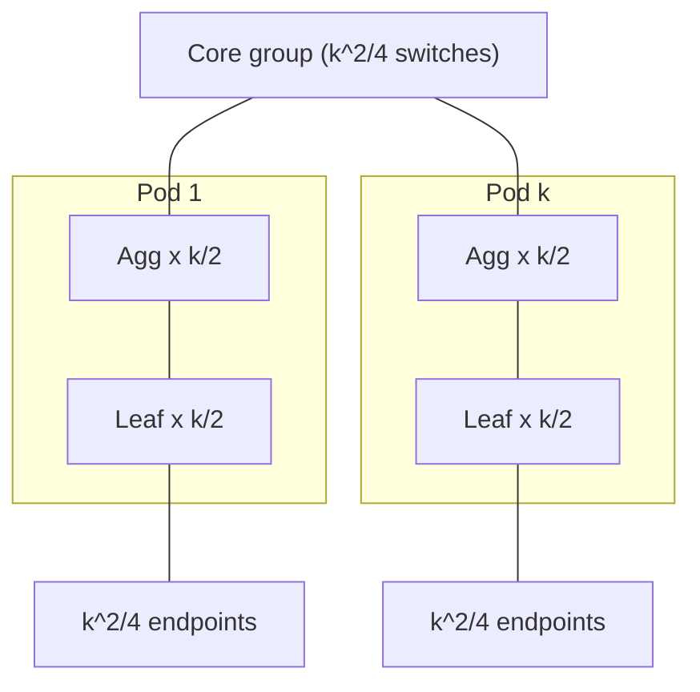

## Why this matters

Every AI cluster proposal eventually becomes a spreadsheet: how many switches, how many cables, how
many transceivers, how many watts, and how many GPUs can we add before we need another tier? The
numbers are large (a few thousand GPUs already means many thousands of optical modules) and the
optics alone can rival the switches in cost. An architect who cannot derive these counts from first
principles cannot check a vendor quote, cannot defend a design in review, and cannot see the
moment when a third switching tier (and its extra latency, power and failure surface) becomes
unavoidable.

The good news is that a non-blocking fat tree is pure arithmetic. Three formulas and a few
counting rules cover almost every sizing question you will be asked.

## Concepts

### Vocabulary

| Term | Meaning |
|---|---|
| **Radix *k*** | Number of ports of a switch at the speed you are designing for |
| **Endpoint** | A host NIC port (in AI fabrics: one GPU's NIC) |
| **Tier** | A layer of switches: leaf (tier 1), spine/aggregation (tier 2), core (tier 3) |
| **Non-blocking (1:1)** | Each switch has as much bandwidth up as down |
| **Oversubscription *r*:1** | Downlink bandwidth is *r* times uplink bandwidth at a tier |
| **Bisection bandwidth** | Bandwidth across the worst-case cut that splits endpoints in half |

### Two tiers: *k*^2 / 2

Build a non-blocking leaf-spine from identical *k*-port switches:

1. Each leaf uses *k*/2 ports down (to endpoints) and *k*/2 up (to spines).
2. Each leaf connects once to each spine, so there are *k*/2 spines.
3. Each spine has *k* ports, one per leaf, so there are at most *k* leaves.
4. Endpoints = leaves x down-ports = *k* x *k*/2 = ***k*^2 / 2**.

Switches = *k* + *k*/2 = **3*k*/2**. Leaf-spine links = *k* x *k*/2 = ***k*^2 / 2** (equal to the
endpoint count, as 1:1 requires).

### Three tiers: *k*^3 / 4

The classic three-tier fat tree (Al-Fares et al., 2008) is built from *k* **pods**:

1. A pod has *k*/2 leaves and *k*/2 aggregation switches, forming a two-tier Clos where each leaf
   connects to every aggregation switch in its pod.
2. Each leaf has *k*/2 endpoints, so a pod has (*k*/2) x (*k*/2) = ***k*^2 / 4** endpoints.
3. Each aggregation switch has *k*/2 ports up to the core. There are (*k*/2)^2 = ***k*^2 / 4** core
   switches, each with one port to every pod, so at most *k* pods.
4. Endpoints = *k* pods x *k*^2/4 = ***k*^3 / 4**.



Switches = *k* pods x *k* switches per pod + *k*^2/4 core = ***k*^2 + *k*^2/4 = 5*k*^2 / 4**.
Links per layer: endpoint-leaf, leaf-aggregation and aggregation-core are each ***k*^3 / 4**.

### The formulas at a glance

| Quantity | Two-tier | Three-tier |
|---|---|---|
| Max endpoints | *k*^2 / 2 | *k*^3 / 4 |
| Leaves | *k* | *k*^2 / 2 |
| Spines / aggregation | *k* / 2 | *k*^2 / 2 |
| Core | none | *k*^2 / 4 |
| Total switches | 3*k* / 2 | 5*k*^2 / 4 |
| Switch-to-switch links | *k*^2 / 2 | 2 x *k*^3 / 4 = *k*^3 / 2 |
| Worst-case switch hops | 3 | 5 |
| Bisection bandwidth | endpoints / 2 x link rate | endpoints / 2 x link rate |

> [!ANALOGY]
> A fat tree is a telephone exchange hierarchy in which every trunk group is as wide as the lines
> below it: local exchange, tandem, transit. Telephone networks were deliberately oversubscribed
> (not everyone calls at once); an AI training job is the rare caller pattern where *everyone does*
> call at once, which is why compute fabrics are built 1:1.

## How it works

### Worked example 1: 64-port 400G switches

*k* = 64 (for example a Quantum-2 class switch with 64 NDR 400G ports; check your datasheet).

**Two tiers.**

1. Endpoints = 64^2 / 2 = 4,096 / 2 = **2,048**.
2. Leaves = 64; spines = 32; switches = 96.
3. Leaf-spine links = 2,048.
4. Bisection bandwidth = 2,048 / 2 x 400 Gb/s = 1,024 x 400 Gb/s = **409.6 Tb/s**.

**Three tiers.**

1. Endpoints = 64^3 / 4 = 262,144 / 4 = **65,536**.
2. Pods = 64, each with 32 leaves + 32 aggregation = 64 switches, so 64 x 64 = 4,096 pod switches.
3. Core = 64^2 / 4 = **1,024**; total = 4,096 + 1,024 = **5,120** (check: 5 x 64^2 / 4 = 5 x 4,096 / 4 = 5,120).
4. Links: leaf-aggregation 65,536 and aggregation-core 65,536, so **131,072** switch-to-switch links.

### Worked example 2: port splitting to radix 128

Some 51.2 Tb/s switches offer 64 x 800G ports that can each be split into 2 x 400G (for example
Spectrum-4 class Ethernet switches; port-split support and limits are platform and software
specific). As a 400G switch, *k* = 128.

1. Two-tier endpoints = 128^2 / 2 = 16,384 / 2 = **8,192** x 400G.
2. Leaves = 128, spines = 64, switches = **192**.
3. Three-tier endpoints = 128^3 / 4 = 2,097,152 / 4 = **524,288**: far beyond any single training
   fabric built so far, but it shows how fast radix compounds.

Splitting does not create bandwidth: 64 x 800G = 128 x 400G = 51.2 Tb/s per switch either way. It
trades per-port speed for radix, and radix is what flattens the tree.

| Same 51.2 Tb/s switch used as | *k* | Two-tier max | Endpoint speed |
|---|---|---|---|
| 64 x 800G | 64 | 2,048 | 800G |
| 128 x 400G (split) | 128 | 8,192 | 400G |
| 256 x 200G (split, if supported) | 256 | 32,768 | 200G |

### Worked example 3: 4,096 GPUs at 400G, two designs

You need a 1:1 rail-optimized compute fabric for 512 servers x 8 GPUs = **4,096** 400G endpoints.

**Design A: 64-port 400G switches.** 4,096 > 2,048, so two tiers are not enough. Build a partial
three-tier fat tree:

1. Pod size = *k*^2 / 4 = 1,024 endpoints (32 leaves x 32 endpoints), so 4,096 / 1,024 = **4 pods**.
   With 8 rails, each pod is 4 rail-optimized SUs of 32 servers.
2. Leaves = 4 x 32 = **128**; aggregation = 4 x 32 = **128**.
3. Aggregation uplinks = 128 x 32 = 4,096; core switches = 4,096 / 64 = **64**. (A full *k* = 64 core
   would be 1,024 switches; a partial build uses fewer core switches with several links to each pod.
   Group them in planes so every aggregation switch reaches every pod equally.)
4. Switches = 128 + 128 + 64 = **320**.
5. Switch-to-switch links = 4,096 (leaf-aggregation) + 4,096 (aggregation-core) = **8,192**.
6. Worst case: 5 switch hops.

**Design B: 64 x 800G switches split to 128 x 400G.** 4,096 <= 8,192, so two tiers suffice:

1. Leaves = 4,096 / 64 down-ports = **64**.
2. Uplinks = 64 x 64 = 4,096; spines = 4,096 / 128 = **32**.
3. Switches = 64 + 32 = **96**.
4. Switch-to-switch links = **4,096**.
5. Worst case: 3 switch hops.

| | Design A (k = 64, three tiers) | Design B (k = 128, two tiers) |
|---|---|---|
| Switches | 320 | 96 |
| Switch-to-switch links | 8,192 | 4,096 |
| Worst-case switch hops | 5 | 3 |

Design B uses fewer than a third of the switches and half the inter-switch links. The caveats a
review must check: whether the larger-radix platform supports your transport (InfiniBand versus
Ethernet), the breakout optics needed for split ports, and the larger failure domain of a single
128-port leaf (64 servers on one rail instead of 32).

```widget
fabric-sizer
```

### Counting transceivers

Rules, applied consistently:

1. An **optical** link needs a transceiver at **each end**; a copper (DAC/ACC/AEC) link needs none,
   and an AOC is a cable with optics built in (count it as a cable, not two modules).
2. A **twin-port** module (for example an 800G OSFP carrying 2 x 400G) serves **two ports**, so
   modules = ports / 2 on that side.
3. Count each side separately when the module types differ (host versus switch).

Design B, all-optical, assuming single-port 400G modules on hosts and twin-port 2 x 400G modules on
switches:

1. Host side: 4,096 modules.
2. Leaf down-ports: 4,096 ports / 2 = 2,048 modules.
3. Leaf-spine: 4,096 links x 2 ends = 8,192 ports / 2 = 4,096 modules.
4. Total = 4,096 + 2,048 + 4,096 = **10,240** modules, i.e. 2.5 per GPU.

Design A with the same module assumptions: host 4,096 + leaf down 2,048 + inter-switch 8,192 links x
2 ends / 2 = 8,192, total = **14,336** modules (3.5 per GPU). The extra tier costs 4,096 modules,
plus their power (see the optics lesson).

### Oversubscription

At a leaf with *k* ports, *d* down and *u* up, oversubscription = (*d* x down speed) / (*u* x up
speed). With equal speeds and ratio *r*:1, *d* = *k r* / (*r* + 1) and *u* = *k* / (*r* + 1).

Example: 64-port leaves at 3:1 have *d* = 64 x 3 / 4 = 48 and *u* = 64 / 4 = 16.

1. Two-tier max endpoints = 64 leaves x 48 = **3,072** (versus 2,048 at 1:1), with 16 spines.
2. Worst-case bandwidth per endpoint when all leave the leaf at once = 16 x 400 / 48 = **133 Gb/s**,
   one third of line rate.

That is perfectly reasonable for a front-end or storage network and unacceptable for a compute
fabric where a synchronous all-reduce runs at the speed of its slowest link. Rail-optimized compute
fabrics in the published RAs are 1:1.

> [!WARNING]
> "Non-blocking" on paper is not non-blocking in practice. Static ECMP can hash two elephant flows
> onto one uplink while another sits idle, so a 1:1 fabric can still congest. Sizing gives you the
> capacity; adaptive routing, packet spraying or careful flow placement (module m07) lets you use it.

## In practice

### A sizing helper you can trust

Writing the arithmetic as code catches mistakes and documents assumptions. A minimal sketch:

```python
import math

def two_tier(n_endpoints: int, k: int, r: int = 1):
    """Non-blocking (r=1) or r:1 leaf-spine with identical k-port switches."""
    down = k * r // (r + 1)
    up = k - down
    leaves = math.ceil(n_endpoints / down)
    if leaves > k:
        raise ValueError("needs a third tier or larger radix")
    spines = math.ceil(leaves * up / k)
    return {"leaves": leaves, "spines": spines,
            "switches": leaves + spines, "isl": leaves * up}

print(two_tier(4096, 128))      # {'leaves': 64, 'spines': 32, 'switches': 96, 'isl': 4096}
print(two_tier(2048, 64))       # {'leaves': 64, 'spines': 32, 'switches': 96, 'isl': 2048}
print(two_tier(3072, 64, r=3))  # {'leaves': 64, 'spines': 16, 'switches': 80, 'isl': 1024}
```

Extend it with a cable-length model and module types per link class, and you have the core of a
bill-of-materials generator.

### Sanity checks before you send a quote

- **Endpoints = leaf-spine links** at 1:1 in two tiers. If not, something is miswired on paper.
- **Spine ports used <= spine ports available**, and leaf uplinks divide evenly across spines
  (otherwise ECMP is uneven).
- **Spares**: add a percentage for failed optics and cables (the optics lesson discusses failure
  rates); never order exactly the computed count.
- **Reserved ports** for management appliances, storage gateways or border links reduce
  endpoint capacity.

## Common pitfalls

- **Using k^2 instead of k^2/2.** Symptom: a design promises twice the endpoints. Cause:
  forgetting half the leaf ports go up. Fix: derive from down-ports x leaves, never from total ports.
- **Forgetting the radix is per speed.** Symptom: a "64-port" switch is assumed for 800G endpoints
  when it has 64 x 400G. Cause: mixing physical cages and logical ports. Fix: state *k* at the design
  speed (cages x ports per cage).
- **Uneven uplink distribution.** Symptom: some spines run hotter. Cause: 32 uplinks spread over a
  spine count that does not divide 32. Fix: choose spine counts that divide the leaf uplink count.
- **Counting optics per link instead of per end.** Symptom: half the needed transceivers ordered.
  Cause: one module assumed per optical link. Fix: two ends, then divide by ports per module.
- **Ignoring partial-build core layout.** Symptom: some pods reachable through fewer core paths.
  Cause: core switches cabled ad hoc in a partial three-tier build. Fix: organize core into planes
  so each aggregation switch has equal reach to all pods.

## Key takeaways

- Two-tier fat tree: *k*^2/2 endpoints, 3*k*/2 switches, *k*^2/2 leaf-spine links.
- Three-tier fat tree: *k*^3/4 endpoints, 5*k*^2/4 switches, *k*^3/4 links per layer.
- For *k* = 64: 2,048 and 65,536 endpoints; for *k* = 128 (port-split 51.2 Tb/s switches): 8,192 and
  524,288.
- Port splitting trades per-port speed for radix; higher radix removes tiers, switches, optics and
  hops.
- Count transceivers per link end, then divide by ports per module.
- Oversubscription *r*:1 increases endpoints but cuts worst-case bandwidth to 1/*r*; compute fabrics
  stay 1:1.
