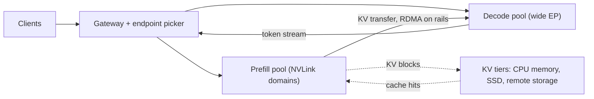

## Why this matters

`inference-networking` introduced prefill and decode, the KV cache and disaggregated serving. That
is enough to explain an inference cluster; it is not enough to build one. A production serving
fabric for large models in 2026 carries three kinds of traffic that a training-centric design
handles badly: **gigabyte-scale KV cache transfers** that sit on the time-to-first-token path,
**microsecond-sensitive all-to-all** for mixture-of-experts (MoE) decode spread over a hundred or more
GPUs, and **cache traffic between GPUs, CPU memory and storage** that decides whether a prompt is
recomputed or reused.

A training fabric is judged by bus bandwidth on large collectives. An inference fabric is judged by
tail latency per token and per request under a mixed, bursty load, and its failure modes are quieter:
time to first token creeps up because KV transfers cross the spine, decode latency jitters because
expert all-to-all shares a queue with cache offload, or a cluster wastes GPUs because the ratio of
prefill to decode capacity was guessed. This lesson gives you the numbers and the design rules.

## Concepts

### The serving fabric has five traffic classes

| Class | Path | Size and shape | What it is sensitive to |
|---|---|---|---|
| Requests and token streams | Front-end network, gateway to workers | Small, long-lived HTTP/gRPC streams | Routing decisions, connection handling |
| Tensor-parallel collectives | NVLink domain | Small all-reduces every layer, every step | Latency (kept off the scale-out fabric) |
| Expert-parallel all-to-all | NVLink plus scale-out RDMA fabric | Small, uneven messages, every MoE layer, every step | Tail latency, congestion, path spreading |
| KV cache transfer (prefill to decode) | Scale-out RDMA fabric (or NVLink inside a domain) | Hundreds of MB to GB per request, point to point | Per-request completion time, rail alignment |
| KV cache tiering and weight loading | PCIe to CPU memory, local NVMe, storage network | Large blocks, read on cache hit or cold start | Bandwidth, and contention with the classes above |

Design starts by deciding which network carries each class, then sizing each one for the metric it
is sensitive to.

### Disaggregation is a placement problem

The DistServe paper frames disaggregated serving as a placement problem driven by cluster bandwidth.
With fast cross-node networking, prefill and decode instances can sit on any two nodes. With limited
cross-node bandwidth, it places the prefill and decode segments of the same pipeline stage on the
same node, so that KV transfers, which only ever flow between **corresponding layers**, ride NVLink.
The paper quantifies why it matters on a slow network: one 512-token request on OPT-66B carries about
1.13 GB of KV cache, so 10 requests per second need about 90 Gb/s to hide the transfer, while its
testbed had 25 Gb/s between nodes.

On a modern rail-optimized RDMA fabric the first case applies, but the insight survives: KV traffic
flows between matching layers and, with matching parallel layouts, between matching GPU ranks. That
is what lets you keep it rail-aligned.

### Pool ratios come from token budgets, not guesses

How many GPUs go to prefill and how many to decode depends on the workload's input and output token
counts and on how many tokens per second each pool can process within its latency target. DeepSeek's
published inference overview for V3/R1 (H800 GPUs) gives a concrete reference: a prefill deployment
unit of 4 nodes (32 GPUs, EP32) and a decode unit of 18 nodes (144 GPUs, EP144). Over a 24-hour
window it reported about 73.7k input tokens/s per prefill node (including cache hits) and about
14.8k output tokens/s per decode node, with 608B input and 168B output tokens in total.

A rough split from those averages, assuming every node is busy all day:

```
prefill node-seconds ~  608e9 / 73.7e3  =  8.25e6 node-seconds
decode node-seconds  ~  168e9 / 14.8e3  =  11.35e6 node-seconds
prefill share       ~  8.25 / (8.25 + 11.35)  =  about 42%
```

This is an illustration derived from published averages, not DeepSeek's actual fleet split. The
lesson is the method: a chat workload with short answers shifts capacity to prefill, a reasoning
workload that generates thousands of tokens shifts it to decode, and an autoscaler that resizes the
two pools independently (Dynamo's Planner sizes pools against latency targets; llm-d's Workload Variant
Autoscaler is aware of prefill and decode roles) changes
the traffic matrix between them over the day.

> [!ANALOGY]
> A disaggregated serving cluster is like a content delivery network with separate ingest and edge
> tiers: ingest (prefill) produces an object (the KV cache) once, edges (decode) serve it for a long
> time, and the mid-tier network between them must move every new object fast enough that the first
> viewer does not wait. The analogy breaks on lifetime and locality: a KV cache is consumed by one
> GPU, usually within milliseconds of being produced, and is useless anywhere else unless it is
> explicitly cached for reuse.

## How it works

### Worked example: sizing the prefill-to-decode KV traffic

Assumptions (state them in every design review):

- A 70B-class dense model with grouped-query attention: about **327,680 bytes of KV per token** in
  BF16 (`inference-networking` derives this).
- Average prompt **4,096 tokens**, all of it transferred to decode (no prefix reuse on the decode side).
- Aggregate load **200 requests/s**.
- Prefill instances are TP8 on 8-GPU nodes; each instance sustains **50,000 prompt tokens/s**
  (an assumption; measure your own engine).
- Each GPU has one 400G NIC (**50 GB/s** per direction) on its own rail.

Steps:

1. KV per request: 4,096 x 327,680 B = **1.34 GB**.
2. Aggregate KV traffic: 200 x 1.34 GB = **268 GB/s, about 2.15 Tb/s** from the prefill pool to the
   decode pool.
3. Prefill instances needed: 200 x 4,096 / 50,000 = 16.4, so **17 instances (136 GPUs)**.
4. Average KV egress per prefill NIC: 268 GB/s / 136 = **about 2 GB/s (16 Gb/s)**, a few percent of
   a 400G link.
5. Per-request transfer time if all 8 NICs of the instance send in parallel: 1.34 GB / (8 x 50 GB/s)
   = **3.4 ms**. Through a single NIC: 1.34 / 50 = **27 ms**.

The average load is small; the **burst** is what matters. Every request's KV must arrive before decode
can start, so step 5, not step 4, is the TTFT cost. Two design consequences follow:

- Spread each transfer over all of the instance's NICs. With TP, each GPU already holds only its own
  KV heads (with 8 KV heads and TP8, one head per GPU), so each GPU sends its slice through its own
  NIC, in parallel, on its own rail.
- Overlap the transfer with compute. Splitwise triggers an asynchronous transfer of each layer's KV
  as soon as that layer finishes, and reports keeping the overhead below 7% of prompt computation
  (it serializes the transfer for small prompts instead, where per-layer overhead outweighs the gain).
  With layer-wise streaming, the exposed transfer time shrinks to roughly the last layer's share.

Change one assumption and redo the math: models with compressed KV (for example multi-head latent
attention) cut step 1 by a large factor, and longer prompts raise it linearly.

### Rail alignment for KV transfers

In a rail-optimized fabric (`rail-optimized-topology`), GPU *k* of every node sits on rail *k*. If the
prefill instance and the decode instance use the same TP degree and the same mapping of KV heads to
ranks, GPU *k* of the prefill node sends to GPU *k* of the decode node: the transfer stays on rail *k*
and, within one scalable unit, on that rail's leaf. Things go wrong when layouts differ:

| Prefill layout | Decode layout | KV traffic pattern | Fabric impact |
|---|---|---|---|
| TP8 | TP8, same head mapping | Rank k to rank k | Rail-aligned, one leaf hop within an SU |
| TP8 | TP4 replicas or wide EP with DP attention | Each prefill rank feeds a different set of decode ranks | Cross-rail flows, through the spine or via NVLink forwarding at the receiver |
| Any | Decode instance in another SU | Same rail, different leaf | Spine traversal; competes with other cross-SU traffic |

Decode with wide EP often uses data-parallel attention (DeepSeek's decode unit uses DP144 for the
attention part), so a request's KV lands on one decode GPU rather than being split across eight. Then
the receive side, not the send side, becomes the single-NIC bottleneck of step 5. Put prefill and
decode pools that exchange KV in the same SU where you can, and let the scheduler know which nodes
are "near" each other.

### KV transfer engines

Serving frameworks do not call verbs directly for KV movement; they use a transfer library that
hides the transport and the memory type:

- **NIXL** (NVIDIA Inference Xfer Library) targets point-to-point communication in inference
  frameworks such as Dynamo. It abstracts CPU and GPU memory and file, block and object storage
  behind one API, with transports as plugins: UCX is the one most examples use, GPUDirect Storage plugins use
  cuFile, and the repository also lists Mooncake, POSIX, object storage and libfabric plugins among
  others. Peers are represented by agents that exchange metadata, optionally through etcd.
- The **Mooncake Transfer Engine**, from Moonshot AI's KVCache-centric serving architecture, supports
  RDMA, TCP, NVMe-oF, NVLink and other transports, selects devices by topology (for example NUMA
  affinity), aggregates several RDMA NICs for one transfer and fails over to alternative paths. Its
  README reports up to about 87 GB/s on 4 x 200 Gb/s and 190 GB/s on 8 x 400 Gb/s RoCE networks for a
  40 GB transfer (which it equates to the KV cache of 128k tokens on a Llama-3-70B model, consistent
  with the 327,680 bytes per token used above). vLLM and SGLang document it as a backend for disaggregated serving, and it is also
  available as a NIXL plugin.

For the network engineer, two properties of these engines matter: whether a transfer is spread over
several NICs (step 5 above), and which NIC each GPU buffer uses (a GPU sending through a NIC on the
other CPU socket loses GPUDirect locality, as `pcie-numa-topology` explains). Check both in the
engine's logs or configuration rather than assuming. These projects change quickly; as of 2026,
verify backend names and options against the version you deploy.

### KV cache tiers make storage part of the latency path

Prefix reuse pays off at scale. DeepSeek reported that 56.3% of input tokens (342B of 608B) hit its
**on-disk** KV cache over the 24-hour window. Mooncake's design pools the underused CPU, DRAM and SSD
resources of the GPU cluster into a disaggregated KV cache. Dynamo's KV Block Manager offloads blocks along a
hierarchy from GPU to CPU memory to SSD to remote storage. Each tier is a network decision:

| Tier | Path | Design question |
|---|---|---|
| Host memory of the same node | PCIe | Enough PCIe headroom next to the GPU-NIC traffic? |
| Local NVMe | PCIe | GPUDirect Storage path or bounce through the CPU? |
| CPU memory or SSD of other nodes | Compute or storage RDMA fabric | Which network, and in which traffic class? |
| Remote storage | Storage network | Read bandwidth during a burst of cache hits |

A cache hit only helps if reading the KV is faster than recomputing it, so the remote tiers must
deliver hundreds of MB to GB per request within a TTFT budget. That turns the storage network
(`storage-and-frontend-networks`) from a checkpoint pipe into a latency-sensitive serving path.

### Wide expert parallelism: latency-bound all-to-all

Large MoE models are served with experts spread across many GPUs, so that each GPU holds few experts
and has memory left for KV cache. DeepSeek's decode unit spreads routed experts over 144 GPUs (two
routed experts per GPU). Every MoE layer of every decode step then needs a **dispatch** all-to-all
(tokens to their experts) and a **combine** all-to-all (results back). With DeepSeek-V3's hidden size
of 7,168, each token sent to a destination is about 7 KB in FP8 (dispatch) or 14 KB in BF16 (combine).

DeepEP's v1.2.1 README gives a sense of scale on H800 GPUs with 400 Gb/s ConnectX-7 InfiniBand NICs:
its low-latency kernels, designed for decode and tested with RDMA only (128 tokens per batch, top-8
experts, FP8 dispatch, BF16 combine), took roughly 77-194 us for dispatch and 114-369 us for combine,
across 8 to 256 EP ranks. Multiply a few hundred microseconds by tens of
MoE layers and you approach the whole per-token budget implied by DeepSeek's reported 20-22 output
tokens/s (about 45-50 ms per token). That is why DeepSeek overlaps communication with computation by
splitting each batch into two microbatches and pipelining them.

What this asks of the fabric:

- **Tail latency, not bandwidth.** The slowest of hundreds of peers sets the step time. A congested
  link that adds 50 us to one flow adds it to the whole step.
- **Path spreading.** DeepEP's v1.2.1 README recommends adaptive routing under heavy network load and
  static routing under light load; its current README (as of 2026, after a major rewrite) recommends
  adaptive routing under all load conditions. Treat both as one operator's experience and measure on
  your own fabric.
- **Traffic isolation.** The README notes that InfiniBand virtual lanes can isolate traffic and
  recommends separating expert-parallel traffic from other workloads. On RoCE the equivalent is a
  dedicated traffic class (`qos-trust-and-mapping`).
- **Congestion control is a choice, not a default.** DeepEP v1.2.1 states that congestion control was
  disabled in DeepSeek's production environment because they had not observed significant
  congestion, and the current README recommends disabling it for maximum-bandwidth workloads only
  after validating the fabric. That is a decision for a dedicated, well-understood fabric, not a
  general recommendation for a shared one.

> [!NOTE]
> DeepEP is evolving fast. The v1.2.1 README (September 2025) describes separate normal kernels (for
> training and prefill) and low-latency kernels (for decode) built on NVSHMEM. The README on the main
> branch as of 2026 describes a unified API built on NCCL's GIN backend and says NVSHMEM is no longer a
> dependency. Check the version you run before reasoning about its transport.

## In practice

### The front-end: routing is a cache decision



Classic L4 load balancing ignores where a request's prefix is cached. Inference gateways add a
routing component that looks at worker state. The Kubernetes **Gateway API Inference Extension**
turns an Envoy external-processing-capable gateway into an inference gateway in which an **endpoint
picker** chooses a model-server replica using signals such as prefix-cache status and LoRA adapter
availability; as of 2026 the full endpoint picker has moved to the **llm-d** project (a CNCF Sandbox
stack for Kubernetes), while the extension repository keeps the InferencePool API and a lightweight
reference picker. **Dynamo**'s router routes on worker load and KV cache overlap. Whatever you use,
the network consequences are similar: request routing determines where KV is computed, where it is
transferred and how often the remote tiers are hit.

### Model loading and autoscaling

Autoscaling a decode pool means loading hundreds of GB of weights onto new GPUs within minutes or
seconds. Options, in rising order of network demand on the compute fabric: local NVMe caches,
storage-network reads, and GPU-to-GPU weight streaming from replicas that already hold the model
(Dynamo's ModelExpress component streams weights GPU-to-GPU via NIXL and NVLink, per the project
README). Budget this traffic; a scale-up event during a traffic spike adds bulk transfers exactly
when latency-sensitive traffic peaks.

### A design checklist (illustrative)

```text
[ ] KV bytes/token computed from the real model config (attention type, dtype)
[ ] Aggregate KV Gb/s between pools at peak request rate, and per-request transfer time
[ ] Prefill and decode layouts compatible (same TP mapping) or cross-rail traffic budgeted
[ ] Pools that exchange KV placed in the same SU; scheduler aware of "nearness"
[ ] Transfer engine spreads each transfer over all local NICs; NIC-GPU affinity verified
[ ] EP all-to-all in its own traffic class / VL; small-message latency measured at full EP size
[ ] KV tiers mapped to networks; storage read bandwidth sized for cache-hit bursts
[ ] Weight loading path for autoscaling sized and kept off the EP traffic class
```

### What to measure

Run the KV transfer path in isolation (the transfer engine's own benchmark, or `ib_write_bw` between
a prefill and a decode node on each rail) and then under load. For EP, measure dispatch and combine
latency at the target EP size with the library's test programs, and watch percentile latencies, not
averages. Correlate TTFT spikes with fabric counters on the rails between the pools
(`telemetry-counters`).

> [!INTERVIEW]
> "You are designing the network for a disaggregated serving cluster for a large MoE model. Where do
> you start?" A strong answer separates the traffic classes; sizes KV transfer from bytes per token,
> prompt length and request rate, and points out that per-request transfer time (spread over all NICs,
> streamed layer by layer) matters more than average bandwidth; keeps prefill-to-decode transfers
> rail-aligned and inside an SU; treats wide-EP all-to-all as a tail-latency problem with its own
> traffic class and adaptive routing; maps KV cache tiers to the storage network; and makes routing
> prefix-cache aware. Bonus: the prefill-to-decode ratio follows input and output token counts and
> changes with the workload.

## Common pitfalls

- **Sizing KV links for the average.** Symptom: plenty of idle bandwidth, yet TTFT is high under
  load. Cause: each request's GB-scale transfer goes through one NIC or is not overlapped. Fix: spread
  transfers over all of the instance's NICs and stream KV layer by layer.
- **Mismatched parallel layouts.** Symptom: spine utilisation rises when disaggregation is enabled.
  Cause: prefill and decode use different TP layouts, so KV crosses rails. Fix: align layouts or
  budget the cross-rail traffic and place pools in the same SU.
- **EP all-to-all sharing a queue with bulk traffic.** Symptom: decode inter-token latency jitters
  when cache offload or weight loading runs. Cause: one traffic class for everything. Fix: a separate
  class or virtual lane for EP, and rate-aware placement of bulk transfers.
- **Copying another operator's fabric settings.** Symptom: drops or unfairness after disabling
  congestion control. Cause: settings from a dedicated, validated fabric applied to a shared one. Fix:
  start from a validated configuration and change one setting at a time with measurements.
- **Forgetting the storage tier.** Symptom: cache hit rate is high but TTFT does not improve. Cause:
  remote KV reads are slower than recompute. Fix: size storage read bandwidth for cache-hit bursts or
  keep hot prefixes in faster tiers.
- **Trusting fast-moving project docs from last year.** Symptom: a design depends on a library feature
  that has been removed or renamed. Fix: pin versions and re-read release notes (DeepEP, NIXL, llm-d
  and Dynamo all changed significantly during 2025-2026).

## Key takeaways

- An inference fabric carries five traffic classes; size each for its own metric (latency, burst
  completion time or bandwidth).
- KV traffic between prefill and decode is modest on average but GB-scale per request; spread it over
  all local NICs, stream it layer by layer, and keep it rail-aligned within an SU.
- The prefill-to-decode ratio follows from input and output token budgets and changes with the workload.
- KV transfer engines (NIXL, the Mooncake Transfer Engine) hide transports and memory types; verify
  their NIC selection and multi-NIC behaviour.
- KV cache tiers put CPU memory, SSD and the storage network on the TTFT path.
- Wide-EP MoE decode turns small-message all-to-all tail latency into the critical fabric metric:
  isolate it, spread paths and measure percentiles.
