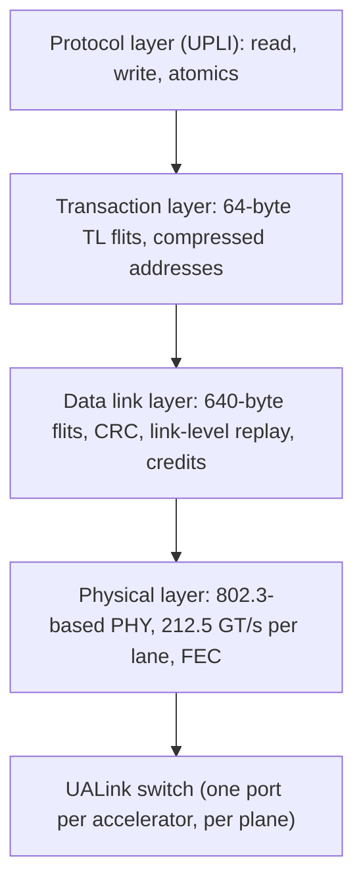

## Why this matters

`scale-up-domains-nvl72` showed why the size of the scale-up domain decides where tensor and expert
parallelism can run, and how much traffic is left for the scale-out fabric. Until recently the
answer to "how do I build a large scale-up domain?" had one practical product line: NVLink and
NVLink Switch. Every other accelerator vendor, and every hyperscaler building its own accelerator,
needed an alternative, and 2025 produced several at once: the **UALink** 200G 1.0 specification
(April 2025), Broadcom's **Scale-Up Ethernet (SUE)** framework and a switch chip built for it, the
Open Compute Project's **ESUN** workstream (October 2025), and NVIDIA's own **NVLink Fusion**, which
opens NVLink to third-party CPUs and accelerators.

As of 2026, an architect is expected to compare these on more than headline bandwidth. Some are
published specifications with products still arriving, some are shipping silicon with a young
software ecosystem, and some are rack designs announced for future GPU generations. Mixing those
categories is how design reviews go wrong. This lesson gives you the requirements, the mechanisms
and the arithmetic to make the comparison honestly.

## Concepts

### What a scale-up fabric must do

A scale-up fabric is not "a faster scale-out network". Its job is to make the memory of many
accelerators usable as if it were nearly local:

| Requirement | Why | What it rules out |
|---|---|---|
| Memory semantics: load, store, atomics | Kernels on one accelerator read and write another's memory directly; no message setup per transfer | A pure send/receive or verbs-style API as the only interface |
| Very low latency (hundreds of ns per hop) | Tensor-parallel and expert-parallel exchanges sit inside every layer | Deep switch pipelines, large store-and-forward buffers, software in the path |
| Reliable delivery at the link | A lost load or store cannot wait for an end-to-end transport timeout | Relying on end-to-end retransmission alone over a lossy fabric |
| Small, efficient headers | Many transfers are 64-256 bytes; a 50-byte header on a 64-byte payload wastes almost half the link | Full Ethernet + IP + UDP + transport stacks per small access |
| Very high bandwidth per accelerator | The point of scale-up is an order of magnitude more than the NIC | Designs limited to one or two 400G/800G ports |
| Short reach, compact domain | Latency and copper reach limits | Long optical paths across the data hall (today) |

Classic RoCEv2 over standard Ethernet fails several of these at once: verbs instead of load/store,
roughly 60 bytes of Ethernet, IP, UDP and InfiniBand transport headers and trailers per packet,
more with an RDMA extended header (see `rocev2-encapsulation`), end-to-end recovery, and PFC instead of a reliable link. Every open
scale-up effort is, in essence, a set of answers to this table.

### The landscape at a glance (as of 2026)

| Effort | What it is | Who defines it | Status to verify |
|---|---|---|---|
| NVLink / NVLink Switch | Proprietary memory-semantic fabric | NVIDIA | Shipping (NVL72 class); larger domains on NVIDIA's roadmap |
| NVLink Fusion | NVLink IP and chiplets offered to third-party CPUs and accelerators | NVIDIA | Announced with partners; check product availability per partner |
| UALink | Open memory-semantic accelerator interconnect with its own stack over an Ethernet-derived PHY | UALink Consortium | Specifications published; products announced by members |
| Broadcom SUE / SUE-T | Ethernet-based scale-up transport for accelerator endpoints | Broadcom, contributed to OCP | Spec 1.0 contributed; switch silicon shipping |
| ESUN | Open Ethernet switching and framing for scale-up | OCP Networking Project workstream | Workstream started October 2025; no finished spec assumed |
| Google TPU ICI | Direct-connect torus links between TPU chips, with optical circuit switches between cubes | Google (in-house) | In production on Google's TPUs; not a merchant product |

> [!WARNING]
> "Supports UALink", "scale-up Ethernet ready" and "NVLink Fusion partner" are three very different
> statements. Ask for the spec version, the silicon that implements it, whether it ships today, and
> which collective library runs on it in production.

## How it works

### UALink: a purpose-built stack on an Ethernet PHY

The UALink Consortium was incorporated in October 2024 and ratified the **UALink 200G 1.0**
specification on 8 April 2025, with a board drawn from Alibaba, AMD, Apple, Astera Labs, AWS, Cisco,
Google, HPE, Intel, Meta, Microsoft and Synopsys. Its design reuses Ethernet where Ethernet is cheap
and proven (SerDes, cables, connectors, retimers) and replaces everything above the physical layer.

The stack, per the consortium's white paper:

| Layer | Job | Key facts from the white paper |
|---|---|---|
| Protocol layer (UPLI) | Read, write and atomic requests and responses between an Originator and a Completer | Same ordering model for local, host-attached and remote accelerator memory |
| Transaction layer (TL) | Packs protocol channels into 64-byte TL flits; compresses addresses | Compressed request header 8 bytes; write response and flow control 4 bytes each; example efficiency 95.2% |
| Data link layer (DL) | Packs TL flits into 640-byte DL flits with a 32-bit CRC; link-level replay; credit-based flow control; link-partner message service | Replay on a 640-byte flit basis |
| Physical layer (PL) | IEEE 802.3-based PHY with modifications | 212.5 GT/s signalling for a 200 GT/s data rate; reduced FEC interleave for lower latency; a 640-byte flit fits exactly one RS(544,514) codeword |



Topology and scale:

- Lanes group into links of x1, x2 or x4. Four lanes form a **station** with up to 800 Gb/s in each
  direction. A lower-speed 106.25G lane option also exists.
- **UALink switches** connect up to **1,024 accelerators** in a **pod**; each accelerator has a unique
  10-bit routing identifier. Each switch port connects to a distinct accelerator, so an accelerator
  with N ports attaches to N switches (planes).
- The white paper's design targets are cable lengths under 4 m, a request-to-response round trip
  under 1 microsecond, and pods spanning 1-4 racks.
- A pod can be partitioned into **virtual pods** by partitioning switch ports, which gives
  scale-up multi-tenancy, comparable in spirit to InfiniBand partitions.
- **UALinkSec** provides optional encryption and authentication of protocol channels, aimed at
  physical attackers and at confidential-computing tenants.
- Communication between pods is not specified by UALink; that is the scale-out network's job.

As of late 2026 the consortium's specification page also lists a UALink Common 2.0 specification
(introducing in-network compute), separate 200G and 128G data link/physical layer specifications, a
chiplet specification aligned with UCIe 3.0 and a manageability specification. Check the page for
current versions; the pace of releases has been fast.

> [!NOTE]
> UALink reuses the Ethernet **PHY**, not Ethernet **framing**. A UALink port is not an Ethernet
> port, and a UALink switch is not an Ethernet switch, even though both use the same SerDes, cables
> and FEC.

### Ethernet for scale-up: SUE and ESUN

The opposite approach keeps Ethernet framing and switching and fixes what scale-up needs.

**Broadcom SUE and Tomahawk Ultra.** Broadcom published a Scale-Up Ethernet framework in 2025 and,
in July 2025, announced shipment of the Tomahawk Ultra switch for scale-up and HPC. As reported from
Broadcom's announcement: 250 ns switch latency at 51.2 Tb/s, line rate for 64-byte packets, an
optimized Ethernet header reduced from 46 to 10 bytes while remaining Ethernet compliant, link-layer
retry (LLR), credit-based flow control (CBFC), in-switch collectives, and sub-400 ns
accelerator-to-accelerator latency with SUE including switch transit. Treat these as vendor
figures under vendor-chosen conditions until you measure them.

**OCP ESUN.** On 13 October 2025 the Open Compute Project announced the **Ethernet for Scale-Up
Networking (ESUN)** workstream, with initial members AMD, Arista, Arm, Broadcom, Cisco, HPE
Networking, Marvell, Meta, Microsoft, NVIDIA, OpenAI and Oracle. Its scope, per OCP:

- **In scope:** open, standards-based Ethernet **switching and framing** (initially L2/L3) for
  lossless, error-resilient single-hop and multi-hop scale-up topologies, including protocol headers
  and error handling.
- **Out of scope:** host-side stacks, non-Ethernet protocols, application-layer solutions and
  proprietary technologies.
- **Split of work:** the endpoint side lives in a separate workstream renamed **SUE-T
  (SUE-Transport)**, seeded with Broadcom's SUE version 1.0 contribution.
- **Alignment:** ESUN intends to engage with the Ultra Ethernet Consortium and IEEE 802.3.

| Problem with stock Ethernet for scale-up | Ethernet-side fix | Same idea elsewhere |
|---|---|---|
| Header overhead on small transfers | Compact or optimized headers | UALink 8-byte compressed request headers |
| Bit errors cause end-to-end retransmits | **LLR**: retransmit the corrupted frame on that one link | UALink DL link-level replay; UEC LLR (`ultra-ethernet`) |
| Congestion drops, PFC side effects | **CBFC**: sender transmits only with receiver credits | InfiniBand credits (`ib-flow-control-vls`); UALink DL credits |
| Latency of large, deep-buffer switches | Low-latency, shallow-pipeline switch silicon | NVSwitch, UALink switches |

The trade-off is clear: UALink optimizes the whole stack for memory semantics and needs its own
switch ecosystem; scale-up Ethernet keeps Ethernet tooling, silicon and operations knowledge and
pays some protocol efficiency for it. Vendors now blur the line: AMD's Helios rack, per AMD's product
page (as of 2026), uses "UALink over Ethernet (UALoE)" scale-up cartridges to connect up to 72
MI455X GPUs, with up to 260 TB/s of aggregate scale-up bandwidth quoted by AMD for an announced rack.

### NVLink Fusion: opening the proprietary fabric

NVIDIA describes **NVLink Fusion** as NVLink connectivity and IP that lets hyperscalers deploy
custom CPUs and custom accelerators (XPUs), including chiplet-based designs, into NVIDIA's rack-scale
platform, with NVLink-C2C for coherent chip-to-chip attachment. As of 2026, NVIDIA's page cites NVLink 6
connecting 72 accelerators all-to-all at 3.6 TB/s per accelerator (bidirectional, NVIDIA's
convention) and roadmap domain sizes up to 1,152. Two cautions: these are NVIDIA figures for
announced platforms, and "open" here means licensable, not a multi-vendor standard.

### Direct-connect alternatives: Google TPU ICI

Not every scale-up fabric is switched. Google's documentation describes TPU chips connected by
copper **inter-chip interconnect (ICI)** links inside a 4x4x4 **cube** of 64 chips, with cube boundary
links joined through optical links and reconfigurable **optical circuit switches (OCS)** into a 3D
torus or twisted torus (on v4, v5p and TPU7x). A torus avoids packet switches for most hops, but
bandwidth between two arbitrary chips depends on the path, and collectives must be topology-aware.

## In practice

### Worked example: domain size versus switch count

Assumptions, stated explicitly (a hypothetical design, not a product):

- Each accelerator has **32 UALink-style lanes** at 200 Gb/s per direction.
- Switch ASIC: **512 lanes** at 200 Gb/s (102.4 Tb/s, the capacity class of 2025-generation flagship
  switch chips), single tier, one port per accelerator per switch.
- All figures per direction.

1. Per-accelerator bandwidth: 32 x 200 Gb/s = 6.4 Tb/s = **800 GB/s per direction**, whatever the
   port width.
2. **x4 ports (stations)**: 32 / 4 = 8 ports per accelerator, so **8 switch planes**. Each switch has
   512 / 4 = 128 ports, so the domain holds **128 accelerators** with 8 switches.
3. **x1 ports**: 32 ports per accelerator, so **32 planes**. Each switch has 512 ports, so the domain
   holds **512 accelerators**, with 32 switches.
4. Switches per accelerator: 8 / 128 = 0.0625 in both cases. Narrower ports buy a 4x larger
   single-hop domain at the same switch count per accelerator, but 4x more cables per accelerator
   and switch, and each plane must stay healthy for full bandwidth.

Compare with NVLink 5 (`scale-up-domains-nvl72`): 900 GB/s per direction per GPU across 72 GPUs.
Bandwidth per accelerator is similar in this hypothetical design; the domain size is limited by
switch radix, port width and the cabling that fits in 1-4 racks.

### Worked example: header efficiency on small transfers

For a 256-byte write payload (the maximum write payload in the UALink white paper's example),
ignoring preamble, inter-frame gap and FEC, which hit every option equally:

| Header per transfer | Efficiency = 256 / (256 + header) |
|---|---|
| 46 bytes (Broadcom's quoted "standard" figure) | 256 / 302 = **84.8%** |
| 10 bytes (Broadcom's optimized header) | 256 / 266 = **96.2%** |
| UALink packing example (white paper) | **95.2%** (20 data flits in 21 TL flits) |

At 64-byte payloads the gap widens sharply: 64 / 110 = 58.2% with a 46-byte header versus
64 / 74 = 86.5% with 10 bytes. Small headers matter most for exactly the fine-grained traffic
scale-up exists for.

```widget
nvlink-generations
```

Use the widget to keep the units straight: NVLink figures are bidirectional totals; the worked
examples above are per direction.

### An evaluation checklist for any scale-up proposal

| Question | Why it matters | Red flag |
|---|---|---|
| Which spec version, and which silicon implements it? | Specs and products move at different speeds | "Compliant" with no named switch and accelerator |
| Ships today, or roadmap? | Design for what you can buy and support | Rack plans quoted as if available |
| Per-accelerator bandwidth, per direction | Like-for-like comparison | Aggregate rack bandwidth only, or bidirectional vs unidirectional mixing |
| Measured latency, load-to-use, under load | Switch latency is one part of the path | Only an idle switch-transit figure |
| Memory model: load/store, atomics, coherence, ordering | Decides what kernels and libraries can do | "Memory semantics" with no ordering details |
| Collective library support (NCCL, RCCL, vendor library) and in-network compute | Training and inference only see the library | No production library release named |
| Failure handling: lost lane, lost plane, lost switch | A plane down cuts bandwidth for every accelerator | No degraded-mode behaviour documented |
| Partitioning and security | Multi-tenant scale-up | No virtual-pod or encryption story |

> [!ANALOGY]
> UALink versus scale-up Ethernet resembles Fibre Channel versus iSCSI in storage networking: one is
> a purpose-built stack with tight guarantees, the other rides a ubiquitous ecosystem and closes the
> gap with enhancements. The analogy breaks on timescale: scale-up accesses are hundreds of
> nanoseconds, so header bytes and switch pipeline depth matter far more than they did for storage.

## Common pitfalls

- **Treating a specification as a product.** Symptom: a design depends on a 1,024-accelerator pod
  that the switch silicon you can actually buy may not build in one hop. Cause: reading the spec's maximum as a product
  capability. Fix: size from named silicon (radix, port width) and confirm availability dates.
- **Confusing the PHY with the protocol.** Symptom: plans to "plug UALink into the Ethernet
  switches". Cause: UALink reuses Ethernet SerDes and FEC but has its own link and transaction
  layers. Fix: UALink needs UALink switches; Ethernet scale-up needs switches that support the
  chosen scale-up features.
- **Comparing aggregate rack numbers.** Symptom: "260 TB/s beats 130 TB/s" arguments. Cause:
  aggregate scale-up bandwidth mixes GPU count, generation and bidirectional counting. Fix: divide
  down to per-accelerator, per-direction figures for the same generation.
- **Ignoring header overhead on small transfers.** Symptom: measured efficiency far below line
  rate for fine-grained traffic. Cause: full Ethernet/IP/UDP headers on 64-256-byte accesses. Fix:
  ask for efficiency at the transfer sizes your kernels use.
- **Forgetting the software path.** Symptom: fast links, slow collectives. Cause: the collective
  library does not yet use the fabric's memory model or in-network compute. Fix: require a named,
  production library release in the evaluation.
- **Overlooking plane failures.** Symptom: one cable fault slows a whole training job. Cause: each
  accelerator spreads bandwidth over many switch planes. Fix: monitor per-plane health and define
  degraded-mode scheduling, as for NVLink domains.

## Key takeaways

- A scale-up fabric needs memory semantics, sub-microsecond latency, link-level reliability, small
  headers and very high per-accelerator bandwidth; stock RoCE over Ethernet provides few of these
  unchanged.
- UALink 200G 1.0 (April 2025) defines protocol, transaction, data link and physical layers on an
  802.3-based PHY: 200G lanes, 800 Gb/s stations, 640-byte flits with link-level replay and credits,
  and pods of up to 1,024 accelerators.
- Ethernet scale-up keeps Ethernet framing and switching and adds compact headers, LLR and CBFC:
  Broadcom SUE (contributed to OCP as SUE-T) for endpoints, OCP ESUN (October 2025) for switching
  and framing.
- NVLink Fusion opens NVLink to third-party CPUs and accelerators as licensable IP; it is not a
  multi-vendor standard.
- Domain size follows from switch radix and port width: narrower ports give larger single-hop
  domains at the cost of more planes and cables.
- Judge every option by shipping silicon, per-direction per-accelerator bandwidth, measured latency,
  memory model, collective-library support and failure behaviour, as of the date you evaluate.
