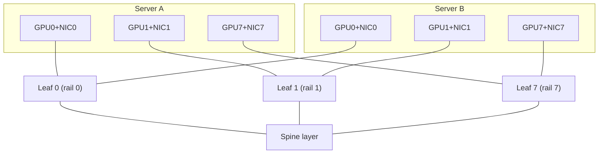
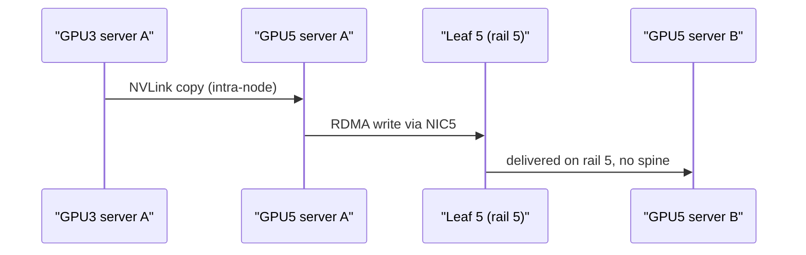

## Why this matters

A modern GPU server is not one network endpoint, it is eight (or more) of them. Each GPU usually has
its own 400G or 800G NIC sitting on the same PCIe switch, and NCCL drives all of those NICs at line
rate at the same time. How you wire those NICs into leaf switches decides whether the dominant
collective traffic crosses one switch or three, whether your spine layer carries most of the load or
very little of it, and how a single leaf failure affects a job.

Get this wrong and nothing visibly breaks: links come up, `ibstat` is green, the job runs. It just
runs slower, with more ECMP collisions on the spines and more exposure to congestion from other
jobs. Rail-optimized wiring is the default answer in NVIDIA's DGX SuperPOD reference architectures
and in many hyperscale designs, and as an architect you need to be able to explain *why*, size it,
and know when a cheaper "rail-only" variant is defensible.

## Concepts

### A rail is "the same GPU index on every server"

Number the GPUs inside each server 0 to 7, and give each GPU its "own" NIC (NIC *i* is the one on
the same PCIe switch as GPU *i*). A **rail** is the set of NIC *i* across all servers. In a
**rail-optimized** fabric, rail *i* plugs into its own leaf switch (or group of leaves), so:

- GPU 3 on server A talking to GPU 3 on server B crosses exactly **one** switch: leaf 3.
- GPU 3 on server A talking to GPU 5 on server B must cross rails: either up through a spine, or
  first over NVLink inside server A to GPU 5 and then out of NIC 5 (this is PXN, below).



### Why the same index is the busy pair

Training frameworks lay out parallelism so that the heaviest, most latency-sensitive traffic stays
inside the server on NVLink, and the inter-node traffic connects **corresponding** GPUs:

| Parallelism | Typical placement | Who talks across servers |
|---|---|---|
| Tensor parallel (TP) | Inside one NVLink domain | Usually nobody (stays on NVLink) |
| Data parallel (DP / FSDP) | Across servers | GPU *i* with GPU *i* of the other replicas |
| Pipeline parallel (PP) | Across servers | Stage boundary: GPU *i* to GPU *i* of the next stage |
| Expert parallel (EP) | Across or within servers | All-to-all: **every GPU with many others**, cross-rail |

NCCL's ring and tree algorithms reinforce this: when they build inter-node channels, they prefer to
leave a server through the NIC of the GPU that is local to it and enter the peer server on the same
index, which is exactly one rail. So DP all-reduce, FSDP all-gather/reduce-scatter and PP
send/receive map onto the rail leaves with no spine traversal *within one rail group*.

```widget
parallelism-map
```

### Rail-optimized versus top-of-rack

The classic enterprise design puts all NICs of a server into the same top-of-rack (ToR) switch. Take
64-port 400G switches and a 1:1 (non-blocking) target, so a leaf uses 32 ports down and 32 up:

| Design | Servers per leaf | Same-index traffic between two servers |
|---|---|---|
| ToR (all 8 NICs to one leaf) | 32 / 8 = **4 servers** | Same leaf only if both servers are among those 4; otherwise leaf, spine, leaf |
| Rail-optimized (NIC *i* to leaf *i*) | **32 servers** per rail leaf | Always one leaf for 32 servers (256 GPUs) |

The rail design gives the same number of leaves and the same spine uplink count, but the "one hop
domain" for the dominant traffic grows from 4 servers to 32 servers. That is the whole trick: you
have not bought more switches, you have rotated the wiring by 90 degrees.

> [!ANALOGY]
> Think of a ToR design as a set of village roads that each serve one street completely, and a rail
> design as eight express lines that each connect the same platform number in every station. If
> passengers mostly travel "platform 3 to platform 3", express lines win. The analogy breaks down
> for all-to-all traffic: a passenger going from platform 3 to platform 5 must change lines, which
> in a GPU server happens over NVLink (cheap) rather than on the platform (expensive).

## How it works

### Sizing a rail-optimized scalable unit

Assumptions, stated explicitly: 8 GPUs per server, one 400G NIC per GPU, 64-port 400G leaf switches
(for example a Quantum-2 class InfiniBand switch exposing 64 NDR ports through 32 twin-port OSFP
cages; check your switch datasheet), non-blocking leaves (32 down, 32 up).

1. Servers per rail leaf = down-ports = **32**.
2. Rails = NICs per server = **8**, so one group of 32 servers needs **8 leaves**.
3. GPUs in the group = 32 x 8 = **256**. This is the shape NVIDIA calls a *scalable unit (SU)* in
   the DGX H100/B200 SuperPOD reference architectures.
4. Uplinks leaving the SU = 8 leaves x 32 = **256** x 400G, which equals the 256 x 400G entering
   from GPUs: 1:1, as intended.

Scaling out with a two-tier Clos of the same 64-port switches (radix *k* = 64): the maximum number of
leaves is *k* = 64 (each spine has one port per leaf), so the maximum is 64 / 8 = **8 SUs**, i.e.
8 x 256 = **2,048 GPUs**, which matches the two-tier fat-tree limit *k*^2 / 2 = 64^2 / 2 = 2,048
endpoints. Spines needed = 64 leaves x 32 uplinks / 64 ports = **32 spines**. Beyond 2,048 GPUs you
need a third tier or a larger radix (the next lesson works through it).

```widget
fabric-sizer
```

### Where spine traffic comes from

In the rail design, a spine sees traffic only when:

1. **Same rail, different SU**: GPU 3 in SU 1 to GPU 3 in SU 2 goes leaf 3 (SU 1), spine, leaf 3
   (SU 2). Many designs wire spines in rail-aligned groups so this stays within one "rail plane";
   the exact spine grouping is a design choice to check in the reference architecture you follow.
2. **Cross-rail, without PXN**: GPU 3 to GPU 5 on another server goes leaf 3, spine, leaf 5.
3. **Non-GPU traffic** that you chose to converge onto the compute fabric (rare; see the storage lesson).

DP and PP traffic within an SU therefore never touches the spine. That reduces ECMP collision
exposure (fewer flows hashed onto spine uplinks) and reduces the blast radius of a spine failure.

### PXN: turning cross-rail hops into NVLink hops

NCCL 2.12 introduced **PXN** (PCI x NVLink). When GPU 3 on server A must send to GPU 5 on server B,
NCCL can instead move the data over NVLink to GPU 5 on server A, which then sends it out of NIC 5
into rail 5, arriving at server B on the correct rail. Effects:

| Without PXN | With PXN |
|---|---|
| Cross-rail message crosses leaf, spine, leaf | Message crosses NVLink, then one rail leaf |
| Spine must carry all-to-all traffic | Spine carries little or none of it |
| Each GPU sends to *N* destinations through its own NIC | Messages bound for the same NIC are aggregated, fewer, larger network sends |

NVIDIA's blog on NCCL 2.12 reported roughly doubled all-to-all performance in its tests from this
change; treat that as a vendor benchmark, not a guarantee for your cluster. PXN is on by default in
recent NCCL versions; `NCCL_PXN_DISABLE=1` turns it off and `NCCL_P2P_PXN_LEVEL` tunes when it is
used (see the NCCL environment variable documentation for your release before relying on exact
semantics).



> [!NOTE]
> PXN costs NVLink bandwidth and a little GPU memory for staging. Because NVLink bandwidth per GPU
> is an order of magnitude higher than NIC bandwidth (for example 900 GB/s per direction on
> 5th-generation NVLink versus 50 GB/s per direction for a 400G NIC), the trade is usually very
> favourable.

### The rail-only proposal

In 2023 Weiyang Wang, Manya Ghobadi and co-authors (MIT and Meta) published *"Rail-only: A Low-Cost
High-Performance Network for Training LLMs with Trillion Parameters"*. Their argument, simplified:

- In LLM training with TP inside the NVLink ("high-bandwidth") domain, they observed that most
  inter-node traffic flows within a rail; little traffic genuinely needs any-to-any connectivity.
- So **remove the spine layer entirely**. Each rail becomes an independent network (a single
  switch or its own small Clos). Any cross-rail traffic is first forwarded over NVLink, PXN-style,
  to the GPU on the right rail.
- The authors reported large reductions in network cost and power (tens of percent in their
  modelled configurations) with little or no loss in training iteration time for the workloads they
  studied. These are the authors' modelled results; read the paper for assumptions before quoting
  figures.

The trade-offs a design review should raise:

| Concern | Why it matters |
|---|---|
| All-to-all (MoE expert parallelism) | Every cross-rail byte must transit NVLink first; the paper discusses this overhead, which grows with EP traffic. |
| Scale of one rail | A single 64-port switch with no uplinks serves 64 servers, i.e. 64 x 8 = 512 GPUs. Bigger rails need their own two-tier Clos: 64^2 / 2 = 2,048 servers, i.e. 16,384 GPUs across 8 rails. |
| Failure handling | If NIC 5 on one server dies, that server has no direct path into rail 5; all its rail-5 traffic must be relayed by another GPU, or the node must be drained. |
| Non-collective traffic | Storage, checkpoint, and inference traffic may not follow rail patterns; most designs keep these on separate networks anyway. |
| Software assumptions | Correctness does not depend on topology, but performance depends on NCCL (or your library) always routing via NVLink first. |

The fair summary: rail-only is a credible research design for training clusters dominated by
DP/PP/FSDP, and it shows how much of a spine layer is underused in rail-optimized fabrics. Production
reference architectures (such as DGX SuperPOD) still ship with full spines because they must serve
arbitrary jobs, arbitrary placements and MoE models.

> [!INTERVIEW]
> **"Why does a rail-optimized fabric connect GPU *i* of every server to leaf *i*?"** A strong
> answer: inter-node collective traffic (DP, FSDP, PP) flows between corresponding GPU indices
> because TP stays inside NVLink and NCCL builds channels NIC-local; putting each index on its own
> leaf makes that traffic one switch hop for a whole scalable unit, keeps it off the spines, and
> reduces ECMP collisions. Then add the caveat: cross-rail all-to-all needs either the spine or PXN
> over NVLink, and that is why rail-only designs are attractive for some workloads and risky for MoE.

## In practice

### Step 1: confirm GPU-to-NIC affinity on the host

Rail wiring only helps if "NIC *i*" really is the NIC closest to GPU *i*. Read the topology matrix:

```text
# Illustrative output of: nvidia-smi topo -m   (trimmed)
        GPU0  GPU1  ...  NIC0  NIC1  NIC2 ...
GPU0     X    NV18  ...  PIX   SYS   NODE
GPU1    NV18   X    ...  SYS   PIX   NODE
...
NIC Legend:
  NIC0: mlx5_0
  NIC1: mlx5_3
```

Read it as: GPU0 shares a PCIe switch (`PIX`) with `mlx5_0`, GPU1 with `mlx5_3`. Note that the RDMA
device names are not necessarily in GPU order, which is exactly why you build the mapping from this
table instead of assuming `mlx5_i` belongs to GPU *i*.

```widget
pcie-topo
```

### Step 2: confirm NIC-to-leaf wiring

On InfiniBand, `iblinkinfo` (infiniband-diags) lists every switch port and the node description on
the other end. On Ethernet, LLDP (`lldpctl` from lldpd, or `lldptool`) shows the switch name and
port each host interface is plugged into. Build a table like this and check it against the plan:

```text
# Illustrative cabling audit (built from iblinkinfo / LLDP data)
host       gpu  rdma_dev  leaf          leaf_port   expected_leaf  OK?
node017    0    mlx5_0    su1-rail0     17          su1-rail0      yes
node017    1    mlx5_3    su1-rail1     17          su1-rail1      yes
node017    2    mlx5_4    su1-rail3     17          su1-rail2      NO  <- swapped with GPU3's cable
node017    3    mlx5_5    su1-rail2     17          su1-rail3      NO
```

A swapped pair like this still passes link tests; it only shows up as cross-rail traffic hitting
the spine.

### Step 3: confirm NCCL sees the rails

Run an all-reduce with `NCCL_DEBUG=INFO` (optionally `NCCL_DEBUG_SUBSYS=INIT,GRAPH`) and read which
NIC each channel uses. `NCCL_TOPO_DUMP_FILE` writes the topology NCCL detected to an XML file you can
inspect. In a correct rail design, the graph lines show each GPU using its local NIC, and
`nccl-tests` bus bandwidth across two servers in the same SU approaches the per-NIC line rate.

### Step 4: measure spine utilization

With DP-style jobs running inside one SU, spine uplink counters should stay near zero. If they do
not, either a job spans SUs (expected), PXN is disabled, or the cabling is crossed. Spine traffic is
a cheap and powerful health signal for a rail fabric.

## Common pitfalls

- **Swapped rail cables.** Symptom: one server pair is slower than others in two-node
  `nccl-tests`, and spine counters show traffic for a job that fits in one SU. Cause: NIC 2 cabled
  to leaf 3 and vice versa. Fix: audit with `iblinkinfo`/LLDP against the cabling plan; label both
  cable ends with rail and port.
- **Assuming `mlx5_i` belongs to GPU *i*.** Symptom: the host-side mapping and the cabling plan
  disagree. Cause: PCIe enumeration order is not GPU order. Fix: derive affinity from
  `nvidia-smi topo -m` and pin it in the inventory.
- **Disabling PXN while debugging and forgetting it.** Symptom: all-to-all heavy (MoE) jobs slow
  down and spine load rises. Cause: `NCCL_PXN_DISABLE=1` left in a job template. Fix: audit
  environment variables in job launchers.
- **Undersizing spines because "rails do not need them".** Symptom: cross-SU jobs and MoE jobs
  congest. Cause: oversubscribing the spine layer of a rail-optimized fabric without workload
  evidence. Fix: keep 1:1 unless you run a rail-only style design deliberately and accept its limits.
- **Topology-blind scheduling.** Symptom: a 256-GPU job lands on servers from four different SUs
  and gets lower bandwidth than an identical job on one SU. Cause: the scheduler ignores the rail
  group. Fix: use topology-aware placement (for example Slurm topology plugins or a Kubernetes
  scheduler with topology hints).

## Key takeaways

- A rail is "NIC *i* of every server"; a rail-optimized fabric connects rail *i* to leaf (group) *i*.
- DP, FSDP and PP traffic flows between same-index GPUs, so a rail leaf serves it in one hop for a
  whole scalable unit (32 servers, 256 GPUs with 64-port 400G leaves).
- Same switch count as a ToR design, but a 90-degree rotation of the wiring grows the one-hop domain
  from 4 servers to 32.
- PXN moves cross-rail traffic onto NVLink first, keeping all-to-all off the spines and aggregating
  messages.
- Rail-only (Wang et al., 2023) removes spines entirely; it is attractive for DP/PP-dominated
  training and weaker for MoE all-to-all, arbitrary placement and failure handling.
- Verify the rail mapping end to end: GPU to NIC (`nvidia-smi topo -m`), NIC to leaf (`iblinkinfo`
  or LLDP), and NIC choice in NCCL (`NCCL_DEBUG=INFO`).
