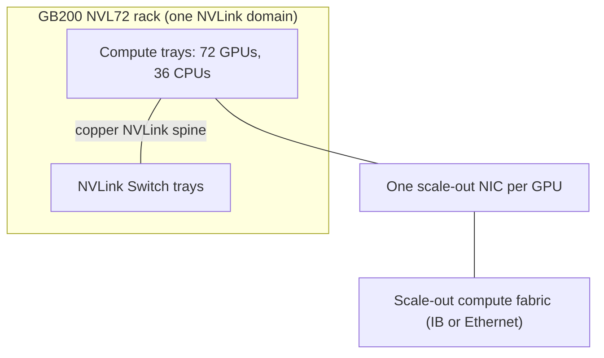

## Why this matters

Every AI cluster has two networks for GPU-to-GPU traffic. The **scale-up** network (NVLink and
NVLink Switch in NVIDIA systems) connects a group of GPUs with memory-semantic, very high bandwidth
links over short copper. The **scale-out** network (InfiniBand or Ethernet through RDMA NICs)
connects those groups to each other across the data hall. The boundary between them, the size of
the **NVLink domain**, decides which parallelism strategies are cheap, how much traffic the
scale-out fabric must carry, and how the hall is powered and cooled.

For years that boundary was the 8-GPU server. With GB200 NVL72, NVIDIA moved it to a 72-GPU rack,
and announced roadmaps push it further. An architect must be able to quantify what a larger domain
buys (traffic removed from the scale-out fabric, faster TP and EP) and what it costs (rack power
density, liquid cooling, a larger failure domain, vendor-specific technology).

## Concepts

### Scale-up versus scale-out

| Property | Scale-up (NVLink domain) | Scale-out (RDMA fabric) |
|---|---|---|
| Semantics | GPU memory load/store and DMA across GPUs | RDMA verbs over IB or Ethernet |
| Per-GPU bandwidth | Hundreds of GB/s per direction | Tens of GB/s per direction (400G-800G NICs) |
| Latency | Lowest (no NIC, no host stack) | Higher (NIC, switches, transport) |
| Reach | Within a server or rack (copper) | Across the data hall (optics) |
| Size | 8 GPUs (HGX) to 72 GPUs (NVL72) per domain | Thousands to tens of thousands of GPUs |
| Typical traffic | Tensor parallel, expert parallel all-to-all | Data parallel, pipeline parallel, cross-domain EP |

### NVIDIA's NVLink generations (as published by NVIDIA)

| System | NVLink generation | GPUs per NVLink domain | Per-GPU NVLink bandwidth (NVIDIA figure, bidirectional) |
|---|---|---|---|
| DGX/HGX H100 | 4th | 8 | 900 GB/s |
| GB200 NVL72 | 5th | 72 | 1.8 TB/s |

NVLink bandwidth is quoted **bidirectional**: 1.8 TB/s per GPU means about **900 GB/s in each
direction**, from 18 links per GPU in NVIDIA's description. NVIDIA has announced future generations
with higher per-GPU bandwidth and larger domains; treat roadmap figures as plans until shipping
documentation confirms them.

### GB200 NVL72 in one paragraph

A GB200 NVL72 rack contains 36 Grace CPUs and 72 Blackwell GPUs in compute trays, plus **NVLink
Switch trays** that connect all 72 GPUs into a single NVLink domain through a copper cable spine at
the back of the rack. NVIDIA quotes about 130 TB/s of aggregate NVLink bandwidth for the rack
(72 x 1.8 TB/s = 129.6 TB/s). The rack is liquid cooled and draws on the order of a hundred-plus
kilowatts (check NVIDIA's facility documentation for the exact figure for your configuration).
Each GPU still has its own scale-out NIC for the compute fabric.



> [!ANALOGY]
> Scale-up versus scale-out is like a chassis backplane versus the network between chassis. A
> modular router's fabric cards connect line cards with enormous bandwidth inside one box; the
> network between routers is slower but spans the building. NVL72 is the step of making the
> "chassis" a whole rack. The analogy breaks on semantics: NVLink lets a GPU read and write another
> GPU's memory directly, which no router backplane exposes to applications.

## How it works

### Compare bandwidth on the same basis

The most common mistake in scale-up versus scale-out comparisons is mixing bidirectional bytes with
unidirectional bits. Convert both to **GB/s per direction**:

1. NVLink 5 per GPU: 1.8 TB/s bidirectional / 2 = **900 GB/s** per direction.
2. 400G NIC: 400 Gb/s / 8 = **50 GB/s** per direction.
3. 800G NIC: 800 Gb/s / 8 = **100 GB/s** per direction.
4. Ratio with 400G: 900 / 50 = **18x**. With 800G: 900 / 100 = **9x**.

(Comparing 1.8 TB/s against 50 GB/s would claim 36x, double the true ratio.)

### Worked example: one all-reduce, two networks

Assumptions: a 1 GB gradient bucket, ring all-reduce across N = 72 GPUs, bandwidth term only
(ignoring latency, protocol overhead and in-network reduction such as NVLink SHARP, which would help
NVLink further).

1. Bytes each GPU sends in a ring all-reduce = 2 (N - 1) / N x S = 2 x 71 / 72 x 1 GB = **1.972 GB**.
2. Over NVLink at 900 GB/s: 1.972 / 900 = **2.19 ms**.
3. Over a 400G NIC at 50 GB/s: 1.972 / 50 = **39.4 ms**.
4. The ratio is the 18x from above, as expected for a bandwidth-bound collective.

This is why TP, which runs collectives inside every layer's forward and backward pass, is kept
inside the NVLink domain.

### Worked example: expert parallelism, 8-GPU versus 72-GPU domains

Assumptions: a mixture-of-experts layer with an EP group of **64 GPUs**, tokens routed uniformly
across the 64 GPUs (a simplification; real routing is skewed), destinations counted including the
sender itself.

| | HGX-class (8-GPU NVLink domain) | NVL72 (72-GPU domain) |
|---|---|---|
| Servers or racks spanned by the EP group | 64 / 8 = 8 servers | 1 rack (64 <= 72) |
| Share of all-to-all destinations reachable on NVLink | 8 / 64 = **12.5%** | 64 / 64 = **100%** |
| Share that must cross the scale-out fabric | **87.5%** | **0%** |

In the 8-GPU case nearly nine-tenths of every all-to-all crosses NICs that are 18x slower than NVLink
(at 400G). In the NVL72 case the same EP group never leaves the rack, and the scale-out fabric
carries only DP and PP traffic, which is rail-friendly. Large NVLink domains and rail-optimized
scale-out fabrics are complementary, not competing, designs.

```widget
parallelism-map
```

### Scale-out bandwidth per rack

An NVL72 rack still needs a substantial scale-out fabric connection. With one NIC per GPU:

1. 400G-class NICs: 72 x 400 Gb/s = **28.8 Tb/s** per rack.
2. 800G-class NICs: 72 x 800 Gb/s = **57.6 Tb/s** per rack.

At 800G that is more than one entire 51.2 Tb/s switch per rack. Which NIC generation applies depends
on the system (ConnectX-7 class in early GB200 designs, ConnectX-8 class in GB300 designs, per
NVIDIA's documentation; confirm for your build), and the published SuperPOD RA defines how those
NICs map onto rails and leaves.

### Trade-offs an architect must weigh

| Factor | Bigger scale-up domain | Implication |
|---|---|---|
| TP/EP performance | Much higher | Larger models and MoE layers train and serve efficiently |
| Scale-out traffic | Lower (mostly DP/PP remains) | Possibly smaller or more oversubscribable scale-out for some workloads, though RAs keep it 1:1 |
| Power density | On the order of 100+ kW per rack | Liquid cooling, facility redesign |
| Reach | Copper, so the domain must be physically compact | Domains are bounded by the rack (or adjacent racks) |
| Failure domain | One rack is one domain | A failed GPU, tray or NVLink switch tray affects a 72-GPU unit; schedulers must handle partial domains and spares |
| Ecosystem | Proprietary (NVLink) today | Open alternatives are emerging |

### Open scale-up: UALink and others

The **UALink Consortium**, formed in 2024 by companies including AMD, Cisco, Google, HPE, Intel,
Meta and Microsoft (membership has changed over time; check the consortium site), published its first specification (UALink 200G 1.0) in
2025, describing a memory-semantic accelerator interconnect that the consortium states can scale to
up to 1,024 accelerators per pod. Ethernet-based scale-up approaches have also been proposed by
switch vendors. As of this writing these are early: products, interoperability and real-world
performance should be validated rather than assumed. The architectural question they raise is the
same one NVL72 answers: how big should the domain of memory-semantic, very high bandwidth
connectivity be, and what does it cost?

> [!INTERVIEW]
> **"What does a 72-GPU NVLink domain change about scale-out network design?"** Strong answer:
> convert bandwidth to the same basis (900 GB/s versus 50-100 GB/s per direction, so 9-18x), then
> show that TP and most EP all-to-all move onto NVLink (for example a 64-way EP group goes from 87.5%
> scale-out traffic to 0%), leaving DP/PP on a rail-optimized fabric. Then cover the costs: rack-level
> power and liquid cooling, copper reach limits, a 72-GPU failure domain, and a still-large scale-out
> requirement of 28.8-57.6 Tb/s per rack.

## In practice

### Inspecting NVLink on a server

`nvidia-smi topo -m` shows `NV#` entries between GPUs (the number of NVLink connections between the
pair), and `nvidia-smi nvlink --status` lists per-link state and speed. On HGX systems the NVSwitch
fabric is brought up by NVIDIA Fabric Manager; on multi-node NVLink systems such as NVL72, NVIDIA's
NVLink management software and recent drivers expose fabric membership (for example, recent
`nvidia-smi -q` output includes fabric fields such as a cluster UUID and clique ID on such systems;
check the documentation for your driver).

```text
# Illustrative, trimmed output of: nvidia-smi nvlink --status -i 0
GPU 0: <GPU name> (UUID: GPU-xxxxxxxx)
         Link 0: <per-link speed> GB/s
         Link 1: <per-link speed> GB/s
         ...
         Link 17: <inactive>          <- one link down: GPU still works, with less NVLink bandwidth
```

```widget
pcie-topo
```

### NCCL and the NVLink domain

NCCL detects the NVLink topology and uses it automatically. Two settings worth knowing (verify
semantics for your NCCL release in the environment variable documentation):

- `NCCL_NVLS_ENABLE` controls the NVLink SHARP (NVLS) algorithms that use in-switch reduction on
  NVSwitch-based systems.
- `NCCL_MNNVL_ENABLE` controls multi-node NVLink support, used when an NVLink domain spans multiple
  compute trays or nodes, as in NVL72.

Run `nccl-tests` with `NCCL_DEBUG=INFO` and confirm that intra-domain collectives use NVLink (and
NVLS where expected) rather than falling back to the network.

### Scheduling for NVLink domains

Make the scheduler aware of the domain: place TP and EP groups inside one NVLink domain, prefer
filling domains completely, and define how to handle a domain with a failed GPU or tray (run smaller
jobs on it, or hold spares). A job split across two NVL72 racks for no reason loses most of the
benefit worked out above.

## Common pitfalls

- **Comparing bidirectional NVLink to unidirectional NIC speed.** Symptom: claims of 36x advantage
  that do not match measurements. Cause: 1.8 TB/s (bidirectional) compared with 400 Gb/s
  (one direction, in bits). Fix: convert both to GB/s per direction (900 versus 50, so 18x).
- **EP groups larger than the domain.** Symptom: MoE layers dominated by network time. Cause: an EP
  group spanning several domains pushes most all-to-all onto NICs. Fix: size EP to fit the NVLink
  domain where the model allows, or accept and size the scale-out fabric for it.
- **Ignoring degraded links.** Symptom: one GPU in a domain is consistently slow in collectives.
  Cause: an inactive NVLink or a degraded switch tray reduces that GPU's bandwidth. Fix: monitor
  per-link state and drain or repair degraded domains.
- **Topology-blind placement across racks.** Symptom: TP-heavy jobs run far slower than expected.
  Cause: the scheduler split a TP group across two NVLink domains. Fix: expose domain membership to
  the scheduler and constrain TP/EP groups to one domain.
- **Under-planning facility power and cooling.** Symptom: racks cannot be energized at full
  density. Cause: planning for air-cooled 30-40 kW racks with rack-scale systems on the order of
  100+ kW. Fix: involve facilities early; liquid cooling is a requirement, not an option.

## Key takeaways

- Scale-up (NVLink) is memory-semantic, very high bandwidth and short reach; scale-out (RDMA NICs) is
  slower per GPU but spans the hall.
- NVIDIA quotes 1.8 TB/s per GPU (bidirectional) for 5th-generation NVLink; per direction that is
  900 GB/s, 18x a 400G NIC and 9x an 800G NIC.
- GB200 NVL72 puts 72 GPUs in one NVLink domain, so TP and most EP traffic leave the scale-out
  fabric; a 64-way EP group goes from 87.5% network traffic (8-GPU domains) to 0%.
- Each NVL72 rack still needs 28.8 Tb/s (400G NICs) to 57.6 Tb/s (800G NICs) of scale-out bandwidth.
- Bigger domains cost rack power density, liquid cooling, copper reach limits and a larger failure
  domain.
- UALink and other open scale-up efforts are emerging; validate claims before designing around them.
