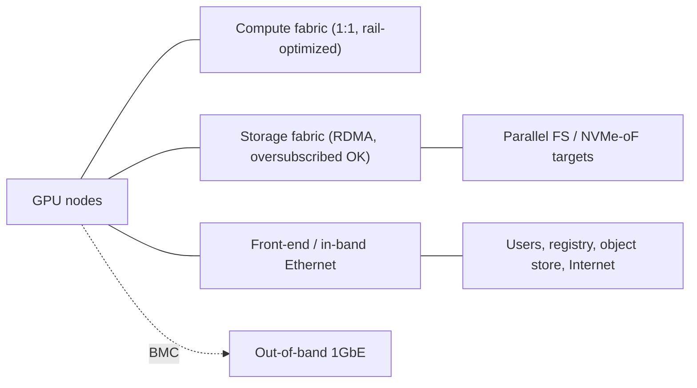

## Why this matters

The compute fabric gets most of the attention, but a training job also has to **read** its data,
**write** checkpoints, **restart** from them after failures, and be **launched, monitored and
reached** by people and orchestration systems. Each of those flows has a different shape, and when
they land on the wrong network they cause some of the most confusing performance problems in AI
clusters: all-reduce slowing every 30 minutes (checkpoints), jobs that take an hour to restart
(restore storms), or a node that cannot be recovered remotely because its management path shares
fate with the data path.

A master-level architect sizes these networks from workload arithmetic, not from habit, and knows
where oversubscription is safe (storage and front-end, usually) and where it is not (compute).

## Concepts

### Four networks, revisited



| Network | Traffic | Shape | Oversubscription |
|---|---|---|---|
| Compute | Collectives | All nodes at line rate, rail-aligned | 1:1 |
| Storage | Dataset reads, checkpoints, restores | Many clients to few servers; bursty | Often acceptable, sized to the storage backend |
| Front-end / in-band | SSH, schedulers, Kubernetes, containers, object storage, inference requests | North-south, many small flows plus image pulls | Yes, typical enterprise ratios |
| OOB | BMC, switch and PDU management | Tiny, but must always work | Irrelevant; availability matters |

### Storage traffic shapes

1. **Dataset reads.** Mostly streaming reads during training; small-file or random-access patterns
   for some datasets (images, tokenized shards). Data loaders prefetch, so modest sustained
   bandwidth usually suffices, but the first epoch or a cold cache can be demanding.
2. **Checkpoint writes.** Every *N* minutes, every rank writes its shard of model and optimizer state
   at once. Short, intense, synchronized bursts.
3. **Checkpoint restore.** After a failure, every rank reads its shard simultaneously. A slow restore
   multiplies the cost of every failure.

### GPUDirect Storage

**GPUDirect Storage (GDS)** creates a direct DMA path between storage and GPU memory, so data does
not bounce through a CPU memory buffer. Applications use the **cuFile** API (directly or through a
framework or library that supports it). Requirements, in summary (check the GDS documentation for
your release):

- A GDS-capable path: local NVMe, or a remote filesystem or NVMe-oF client whose driver supports
  GDS (several parallel filesystem vendors support it).
- The NVIDIA GDS kernel components installed and loaded, with compatible driver versions.
- Sensible PCIe topology: the storage NIC (or NVMe drive) should share a PCIe switch with the
  target GPU; crossing the CPU interconnect erodes the benefit.

When GDS is not usable, cuFile can fall back to a compatibility mode through host memory; that works,
but it is not the fast path, so verify which mode you are in.

```widget
pcie-topo
```

### Protocols and filesystems

| Option | What it is | Network transport |
|---|---|---|
| **NVMe over Fabrics (NVMe-oF)** | Remote NVMe block devices | RDMA (RoCE or InfiniBand), TCP, Fibre Channel |
| **Parallel filesystems** | Lustre (for example DDN EXAScaler), IBM Storage Scale, WEKA, BeeGFS and others | Native RDMA clients on IB or RoCE |
| **NFS over RDMA** | NFS with RDMA transport (some scale-out NAS products use this with multipathing) | RoCE or InfiniBand |
| **Object storage (S3-style)** | Datasets and archived checkpoints | Usually TCP over the front-end network |

> [!ANALOGY]
> The storage fabric is the SAN of the AI cluster: a separate network, sized to the storage
> arrays rather than to the hosts, with its own failure domain. The analogy breaks where AI
> checkpoints differ from enterprise I/O: instead of many independent applications with
> statistically smooth demand, thousands of ranks write at exactly the same second.

## How it works

### Worked example: checkpoint sizing

Assumptions (state them, because every one is a lever):

- Model: **70 billion** parameters, trained with mixed precision and the Adam optimizer.
- Checkpoint contents per parameter: BF16 weights (2 bytes) + FP32 master weights (4 bytes) + Adam
  first and second moments (4 + 4 bytes) = **14 bytes**. Real checkpoints vary with the framework,
  sharding and what is saved.
- Target: the synchronous part of a checkpoint should take **60 s** or less.

1. Checkpoint size = 70 x 10^9 x 14 bytes = 980 x 10^9 bytes = **980 GB**.
2. Required write bandwidth = 980 GB / 60 s = **16.3 GB/s**, i.e. 16.3 x 8 = **131 Gb/s** aggregate.

That is small. Now scale the model to **1 trillion** parameters with the same assumptions:

1. Size = 10^12 x 14 = **14 TB**.
2. Bandwidth = 14,000 GB / 60 s = **233 GB/s**, i.e. 233 x 8 = **1.87 Tb/s** aggregate.

Compare with the compute fabric of a 1,024-GPU cluster: 1,024 x 400 Gb/s = **409.6 Tb/s** of
injection bandwidth. Even the trillion-parameter checkpoint needs well under 1% of that. The
storage *network* is rarely the bottleneck; the storage *backend* (servers, drives, metadata) usually
is. Techniques such as asynchronous checkpointing (copy to host memory, then drain in the
background) relax the requirement further.

### Worked example: storage fabric for 4 SUs

Assumptions: 128 nodes, each with **2 x 400G** storage ports (an assumption for illustration;
check your server and RA), 64-port 400G switches, and a storage backend delivering about
**400 GB/s** (3.2 Tb/s) of aggregate throughput.

1. Node storage ports = 128 x 2 = **256**.
2. Node-side capacity = 256 x 400 Gb/s = 102.4 Tb/s (12.8 TB/s), 32 times the backend's 3.2 Tb/s.
   A 1:1 storage fabric would be wasted.
3. Use 3:1 leaves: 48 down, 16 up. Leaves = ceil(256 / 48) = ceil(5.33) = **6** (288 ports, 32
   spare).
4. Uplinks = 6 x 16 = **96** x 400G = 38.4 Tb/s (4.8 TB/s), still 12 times the backend's throughput,
   which leaves room for restore storms, backend growth and uneven load.
5. Spines = ceil(96 / 64) = **2**; storage servers attach to dedicated storage leaves or the spines,
   per the storage vendor's design.

The principle: **size the storage fabric to the storage backend plus headroom**, and keep each
node's storage ports at full rate so a single node can still read quickly.

```widget
fabric-sizer
```

### Separate fabric or converged?

| Design | How | Benefits | Risks |
|---|---|---|---|
| **Separate storage fabric** (SuperPOD default) | Dedicated NICs and switches | Checkpoint bursts never touch collectives; independent upgrades | More NICs, switches, optics |
| **Converged on compute NICs** | Storage traffic shares the compute fabric | Fewer parts; very high per-node bandwidth | Bursts collide with all-reduce; many-to-few pattern loads spines and crosses rails |
| **Converged on front-end** | Storage over the north-south Ethernet (often with DPUs) | Natural for multi-tenant clouds and object storage | Front-end must carry RDMA well (QoS, lossless or good congestion control) |

Converged designs are not wrong, but they need explicit traffic classes, bandwidth guarantees (for
example ETS weights on Ethernet, or separate virtual lanes on InfiniBand) and validation under
simultaneous checkpoint and all-reduce load.

### Front-end (in-band) network

The front-end network is ordinary, well-engineered data-center Ethernet: leaf-spine, BGP, often
EVPN-VXLAN for tenant separation (see m03 and the multi-tenancy lesson). It carries cluster control
(Slurm, Kubernetes API and kubelets), container image pulls, logging and metrics, user SSH and
notebooks, object storage access, and for inference clusters, user requests. Sizing heuristics:

- Per-node front-end bandwidth of tens to a few hundred Gb/s is typical, far below compute.
- Oversubscription in typical enterprise ranges is acceptable, but watch **synchronized bursts**:
  1,000 nodes pulling a 20 GB container image at job start is 20 TB of traffic converging on the
  registry. Use registry caches or peer-to-peer distribution.
- Internet and corporate connectivity go through border leaves and firewalls; never through the
  compute fabric.

### Out-of-band network

OOB connects every BMC, switch management port, PDU, storage controller and appliance on a simple
1GbE network with its own uplinks, ideally independent of the in-band network's failure domain.
It must keep working when everything else is broken, so keep it simple: no dependencies on cluster
DNS or authentication that live on the cluster itself.

## In practice

### Verifying the GDS path

The GDS package ships tools such as `gdscheck` (reports whether the platform and filesystems support
GDS) and `gdsio` (an I/O benchmark that can compare GPU-direct and CPU-bounce paths). Their exact
options depend on the release; see the GDS documentation. A useful acceptance test is to run the
same read benchmark in GDS mode and in compatibility mode and confirm the GDS mode is faster and uses
less CPU.

### Verifying RDMA to storage

- From a client, `ib_write_bw` or `ib_read_bw` (perftest) to a storage server's RDMA interface
  confirms link rate and RDMA health independently of the filesystem.
- For NFS over RDMA, the Linux client mounts with the `proto=rdma` option (NFS/RDMA conventionally
  uses port 20049); check your NAS vendor's guidance for recommended options.
- For parallel filesystems, use the vendor's client tools to confirm the RDMA transport is in use
  rather than a TCP fallback.

### Checkpoint drill

Before production, run a realistic checkpoint at full scale while an all-reduce benchmark runs, and
record: checkpoint duration, all-reduce bus bandwidth during the checkpoint, and restore time from a
cold cache. This single test exposes undersized backends, converged-fabric interference and
missing GDS.

```text
# Illustrative drill record
nodes=128  ckpt_size=14TB  write_time=71s  (target 60s)  -> backend-limited
allreduce busbw during ckpt: 362 GB/s vs 365 GB/s baseline  -> no interference (separate fabric)
restore (cold): 9m40s  -> metadata servers saturated; review FS config
```

## Common pitfalls

- **Sizing storage fabric 1:1 by node count.** Symptom: a huge, mostly idle storage network.
  Cause: copying compute-fabric rules. Fix: size to backend throughput plus headroom.
- **Ignoring restore time.** Symptom: each failure costs far more than the lost compute since the
  last checkpoint. Cause: restore is a read storm on metadata and data servers. Fix: test cold
  restores at scale; tune the filesystem and caching.
- **GDS silently in compatibility mode.** Symptom: high CPU use and lower throughput than expected.
  Cause: missing kernel module, unsupported filesystem mount or poor PCIe affinity. Fix: check with
  the GDS tools and fix the prerequisites.
- **Container pull storms on the front end.** Symptom: job start takes many minutes. Cause: every
  node pulls the same image from one registry. Fix: local caches, pre-pull, or peer-to-peer
  distribution.
- **OOB depending on the cluster.** Symptom: during an outage nobody can reach the BMCs. Cause: OOB
  authentication or DNS hosted on cluster services. Fix: make OOB self-contained.

## Key takeaways

- Storage traffic is many-to-few and bursty: dataset reads, synchronized checkpoint writes and
  restore storms.
- Size checkpoints as parameters x bytes per parameter (about 14 bytes with mixed-precision Adam, an
  assumption) and divide by the target time; even large models need a small fraction of the compute
  fabric's bandwidth.
- Size the storage fabric to the storage backend plus headroom; oversubscription is acceptable there.
- GPUDirect Storage removes the CPU bounce buffer but needs supported drivers, filesystems and good
  PCIe affinity.
- Separate storage fabrics are the safe default; converged designs need explicit classes and
  validation under combined load.
- Front-end and OOB are ordinary Ethernet with their own failure domains; plan for synchronized
  bursts such as container pulls.
