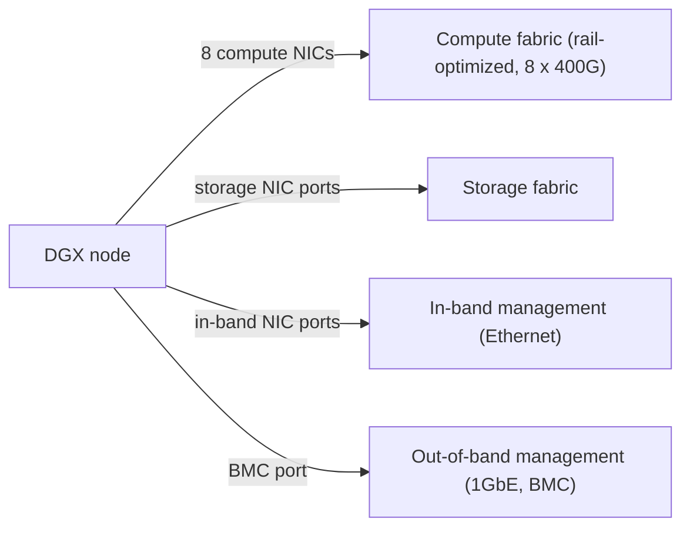

## Why this matters

Very few teams design an AI cluster from a blank sheet. Most start from a vendor **reference
architecture (RA)**: a validated bill of materials, cable map, rack elevation and network design that
the vendor has built, tested and will support. NVIDIA's **DGX SuperPOD** RAs are the most widely
copied of these; even clusters built from OEM servers and third-party switches borrow their shape:
rail-optimized compute fabric, scalable units of 32 servers, and four physically separate networks.

As an architect you must be able to do two things with an RA. First, **explain it**: why 32 nodes,
why eight leaves, why a separate storage fabric. Second, **adapt it**: different node counts,
growth in phases, Ethernet instead of InfiniBand, or a rack-scale NVL72 system instead of 8-GPU
servers. Copying an RA without understanding its arithmetic is how clusters end up with spine layers
that cannot grow, or out-of-band networks with no free ports.

> [!WARNING]
> Exact counts (nodes per SU, switch models, spine counts, cable types) differ between RA versions
> and system generations. Everything numeric below is either derived from stated assumptions or
> attributed to NVIDIA's published documents; always check the current RA for your generation
> before ordering hardware.

## Concepts

### The scalable unit

A **scalable unit (SU)** is the repeatable building block. In the DGX H100 and DGX B200 SuperPOD
RAs it is **32 DGX systems** (8 GPUs each, so 256 GPUs) plus the rail leaf switches that serve them.
The number 32 is not arbitrary. It falls straight out of the switch radix you met in the previous
lesson:

| Assumption | Value |
|---|---|
| Compute NICs per DGX (one per GPU) | 8 x 400G |
| Leaf switch | 64 ports of 400G (Quantum-2 class NDR, 32 twin-port OSFP cages) |
| Leaf split for non-blocking | 32 down, 32 up |
| Servers per rail leaf | 32 |
| Leaves per SU | 8 (one per rail) |

An SU is therefore the largest group of servers in which **every same-index GPU pair is one switch
hop apart**. Larger SuperPODs are built by connecting several SUs through a spine layer (and, for
the largest builds, a core layer).

### Four networks, physically separate



| Network | Carries | Typical technology in the RAs | Why separate |
|---|---|---|---|
| **Compute** (east-west) | NCCL collectives, GPU-to-GPU RDMA | InfiniBand NDR (DGX H100/B200), rail-optimized fat tree; Spectrum-X Ethernet is an alternative in some NVIDIA designs | Must be lossless, non-blocking and free of non-collective noise |
| **Storage** | Dataset reads, checkpoints, GPUDirect Storage | InfiniBand or RoCE Ethernet to a parallel file system | Bursty checkpoint traffic must not collide with all-reduce |
| **In-band management** | SSH, Slurm/Kubernetes control, container pulls, monitoring, user access, Internet egress | Ethernet with routing to the corporate network | Normal IP services, firewalls, tenancy; no RDMA tuning |
| **Out-of-band (OOB)** | BMC (Redfish/IPMI), switch management ports, PDUs | 1GbE Ethernet | Reach a node or switch even when its OS or data ports are down |

### What the server brings to each network

For the DGX H100 generation, NVIDIA's user guide lists (summarized; check the guide for your exact
model): **4 OSFP cages serving 8 single-port ConnectX-7** adapters at up to 400 Gb/s for the compute
fabric, **2 dual-port QSFP112** adapters (ConnectX-7 on DGX H100; BlueField-3 DPUs on DGX B200) for
storage and in-band traffic, plus a BMC port and lower-speed management Ethernet. Note the twin-port
detail: each compute OSFP cage carries **two** 400G NICs, and the twin-port transceiver has two
separate fiber connectors, so the two halves of one cage go to **two different rail leaves**.

> [!ANALOGY]
> A SuperPOD is like a classic service-provider PoP: a high-capacity core for customer traffic
> (compute fabric), a separate SAN (storage), a management VRF for operators (in-band) and a
> console/terminal-server network that works when everything else is down (OOB). The analogy breaks
> on the compute fabric: in a PoP no single customer saturates every link at once, while one
> training job can drive every compute port at line rate simultaneously.

## How it works

### Worked example: one SU, by hand

Assumptions as in the table above. Count everything in the compute fabric for one SU:

1. GPUs: 32 nodes x 8 = **256**.
2. Node-to-leaf 400G links: 256 (one per GPU NIC).
3. Rail leaves: **8**, each with 32 node-facing ports.
4. Leaf uplinks: 8 x 32 = **256** x 400G, all of which go to the spine layer when the SU is part of a
   larger pod. Aggregate GPU injection bandwidth = 256 x 400 Gb/s = 102.4 Tb/s, and uplink bandwidth
   is the same 102.4 Tb/s: 1:1.
5. Node-side transceivers: 32 nodes x 4 twin-port OSFP = **128**.
6. Leaf-side transceivers for node links: 256 ports / 2 ports per twin-port module = **128**.

A **single-SU** cluster does not strictly need spines, because there is no other SU to reach; but
cross-rail traffic without PXN still needs a path between rail leaves, so even small builds usually
deploy a spine layer (or the RA's equivalent) to keep the fabric fully connected.

### Worked example: four SUs in two tiers

Now 4 SUs = 128 node slots = 1,024 GPUs.

1. Leaves: 4 x 8 = **32**.
2. Leaf uplinks: 32 x 32 = **1,024** x 400G.
3. Spines (64 ports each): 1,024 / 64 = **16**.
4. Each leaf connects to each spine with 32 uplinks / 16 spines = **2** parallel links.
5. Leaf-spine transceivers (all optical, twin-port on both ends): 1,024 links x 2 ends / 2 ports per
   module = **1,024** modules.
6. Node-leaf transceivers: 128 nodes x 4 = 512 on nodes, plus 1,024 leaf ports / 2 = 512 on leaves,
   so **1,024** modules.
7. Compute fabric total: 1,024 + 1,024 = **2,048** twin-port modules for 1,024 GPUs, i.e. two
   800G-class transceivers per GPU in this layout.

> [!NOTE]
> NVIDIA's published DGX H100 SuperPOD RA describes its full four-SU configuration as **127** DGX
> systems rather than 128, because leaf ports are also needed to attach fabric management (the UFM
> appliance). Treat this as an example of why real RAs deviate slightly from ideal arithmetic, and
> confirm the current figure in the RA.

### Growing in phases without recabling

Suppose you deploy 2 SUs now and 2 more next year. Two choices:

| Plan | Day-one spines | Links per leaf-spine pair on day one | Day-two work |
|---|---|---|---|
| A: size spines for today | 16 leaves x 32 / 64 = 8 | 32 / 8 = 4 | Add 8 spines and **recable every leaf** from 4 links per spine to 2 |
| B: size spines for the end state | 16 | 32 / 16 = 2 | Add 16 new leaves and plug them into the free spine ports; existing cables untouched |

In plan B each spine uses 16 leaves x 2 = 32 of its 64 ports on day one, and the remaining 32 ports
are reserved for the second phase. You pay for 8 extra spines up front, but you avoid moving
256 of the 512 live leaf uplinks (16 per leaf) on a production fabric. Many architects choose B
when the second phase is funded. Note that NVIDIA's published DGX H100 and B200 RA tables size the
spine per configuration (4 spines for 1 SU, 8 for 2 SUs, 16 for 3 or 4 SUs), so a phased build has
to make this choice explicitly rather than inherit it from the RA.

```widget
fabric-sizer
```

### Fabric management

InfiniBand fabrics need a **subnet manager**. SuperPOD RAs place it on UFM (Unified Fabric Manager)
appliances attached to the fabric, typically redundant, rather than on a compute node. On Ethernet
variants the equivalent role is split between the routing protocol (BGP is common), the switch
management platform and telemetry tooling. Either way, the RA reserves ports for these appliances,
which is part of why "every port goes to a GPU" is never quite true.

### Storage, in-band and OOB at SU scale

A rough port budget for one SU (assumptions marked; real RAs differ in details):

| Network | Per node | Per SU (32 nodes) | Plus |
|---|---|---|---|
| Storage | 2 ports (one per dual-port adapter, assumed) | 64 ports | Storage system ports, management appliances |
| In-band | 2 ports (assumed, bonded) | 64 ports | Head nodes, login nodes, gateways |
| OOB | 1 BMC | 32 ports | Management ports of 8 compute leaves, storage and in-band switches, PDUs, appliances |

The OOB line is the one most often undersized: switches, PDUs, storage controllers and UFM all need
OOB ports, and a 48-port 1GbE switch fills up faster than the node count suggests.

### Racks and power

A DGX H100 system is rated by NVIDIA at roughly 10 kW maximum, and DGX B200 higher (check the
current user guide). With a 40 kW air-cooled rack budget (assumption), that is 4 systems per rack,
so a 32-node SU needs about 32 / 4 = **8 compute racks**, plus racks for leaf/spine switches,
storage and management. Rack power, not switch radix, often sets the physical layout and thus cable
lengths, which the optics lesson turns into transceiver choices.

The planner's power calculator starts with the four-SU example above (2,048 twin-port modules). Change the media per link class, or move server links to copper, and see what it does to optics power per GPU.

```widget
optics-planner
```

### GB200 NVL72: the rack becomes the unit

With **GB200 NVL72**, NVIDIA's rack-scale system puts 72 Blackwell GPUs and 36 Grace CPUs into one
NVLink domain in a single liquid-cooled rack. The DGX SuperPOD built on DGX GB200 systems changes
the design unit:

- The node is now effectively the **rack**: 72 GPUs that share 5th-generation NVLink at 1.8 TB/s per
  GPU (NVIDIA's figure, bidirectional).
- NVIDIA's announced SuperPOD configuration groups **8 NVL72 racks (576 GPUs)** as a building
  block; check the current RA for the exact SU definition and how it scales.
- There are now **five** networks to plan: the NVLink fabric inside the rack, plus the compute,
  storage, in-band and OOB networks between racks. (In NVIDIA's DGX GB200 RA, storage and in-band
  share one physical Ethernet fabric, so five logical networks run on four physical fabrics.)
- The scale-out compute fabric is still one NIC per GPU, rail-aligned, on Quantum InfiniBand or
  Spectrum-X Ethernet, with per-GPU speed depending on generation (400G-class ConnectX-7 in early
  GB200 designs, 800G-class ConnectX-8 in GB300-generation designs; confirm in the RA).

Because so much TP and EP traffic stays on NVLink inside the rack, the scale-out fabric carries
mainly DP/PP traffic, which reinforces the rail-optimized design. The scale-up lesson explores this.

## In practice

### Reading an RA like an architect

Work through a published RA with these questions, in order:

1. **What are the fixed rules?** Rail mapping, 1:1 compute fabric, separate storage fabric. These
   carry the vendor's performance validation; deviating may lose support.
2. **What is deployment-specific?** Number of SUs, storage vendor, rack power, cable lengths, in-band
   integration with your corporate network.
3. **Where are the reserved ports?** UFM, management appliances, storage controllers, border
   gateways. Count them before you promise "N nodes".
4. **What is the growth path?** Is the spine sized for the end state? Is there a core tier option?
5. **What is the failure domain?** One leaf failure removes one rail for 32 nodes. Does your
   scheduler drain those nodes, or does NCCL fall back to other rails? Know which.

### A design checklist (illustrative)

```text
# Illustrative SU acceptance checklist
[ ] 8 rail leaves, 32 node ports each, mapping GPU i -> leaf i verified (iblinkinfo/LLDP audit)
[ ] 32 uplinks per leaf, spread evenly across the spine group
[ ] Spine ports reserved for planned future SUs, documented in the cable plan
[ ] Subnet manager / UFM redundant pair connected and master elected
[ ] Storage fabric: each node reaches storage on both adapters
[ ] In-band: bonded links up, VLAN/VRF per design, DNS/NTP reachable
[ ] OOB: every BMC, switch mgmt port and PDU reachable; spare ports >= 10%
[ ] Two-node and full-SU nccl-tests results recorded as baseline
```

### Translating an RA to Ethernet

Many organizations build the same shape with Spectrum-X or other 400G/800G Ethernet switches. The
arithmetic is identical (a 64-port 800G switch can be split to 128 x 400G on some platforms, which
changes the SU size; see the sizing lesson). What changes is the control plane (BGP instead of a
subnet manager), the congestion and load-balancing features (PFC/ECN, adaptive routing), and
validation (RoCE QoS consistency on every hop).

## Common pitfalls

- **Spines sized for phase one.** Symptom: expansion requires a maintenance window to recable
  hundreds of uplinks. Cause: spine count derived from today's leaves. Fix: deploy the end-state
  spine count (plan B) or design an explicit core tier for growth.
- **Forgetting reserved ports.** Symptom: the last node of the last SU has no leaf port. Cause:
  UFM/management appliances consume leaf ports. Fix: count appliances in the port budget, as the RA
  does (127 rather than 128 nodes in the DGX H100 four-SU example).
- **Converging storage onto compute "to save switches".** Symptom: periodic all-reduce slowdowns
  aligned with checkpoint writes. Cause: storage bursts share compute links and buffers. Fix: keep a
  separate storage fabric, or isolate storage traffic class and capacity explicitly.
- **Undersized OOB.** Symptom: some PDUs or switch management ports are unreachable; recovery
  needs a site visit. Cause: OOB sized by node count only. Fix: count every managed device.
- **Treating RA numbers as universal.** Symptom: a B200 or GB200 build copies H100 counts. Cause:
  copy-paste from an older RA. Fix: always work from the RA for your exact generation.

## Key takeaways

- A DGX SuperPOD is built from scalable units; in the H100/B200 RAs an SU is 32 nodes and 256 GPUs
  on 8 rail leaves, which follows directly from a 64-port leaf split 1:1.
- Four separate networks (compute, storage, in-band, OOB) isolate traffic with very different
  requirements; NVL72-based designs add the in-rack NVLink fabric as a fifth.
- Four SUs in two tiers: 32 leaves, 1,024 uplinks, 16 spines, 2 links per leaf-spine pair, about
  two twin-port transceivers per GPU in the compute fabric (assuming all-optical links).
- Size spines for the end state to grow without recabling.
- Real RAs reserve ports for fabric management and appliances (the DGX H100 four-SU example lists
  127 nodes); always verify counts in the RA for your generation.
