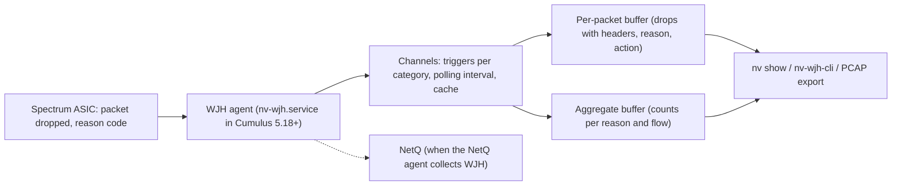

## Why this matters

`telemetry-counters` taught you to read counters: a port's discard counter rose by 4,000 in the last
minute. That tells you *that* something dropped, and roughly *where*. It does not tell you which
packets, from which flow, at which queue, or **why**: a full buffer, a missing route, a VLAN that is
not allowed on the port, an ACL, a bad tunnel header. In an AI fabric the "why" decides the fix. A
buffer drop on the lossless RoCE priority means PFC or headroom is wrong; a blackhole-route drop means
the control plane lost a prefix; a VLAN filter drop means someone mis-cabled or misconfigured a port.
They all show up in the same discard counter.

Congestion has the same problem in a different form. A collective is slow and ECN marks are rising,
but on which hop of a leaf-spine-leaf path is the queue building, and how high does it get in the
microseconds that matter? Polled counters averaged over 10 seconds cannot answer that
(`streaming-telemetry-gnmi`). This lesson covers the three tools that can: **drop-reason telemetry**,
**in-band (per-packet, per-hop) telemetry**, and **hardware histograms**. NVIDIA's professional AI
networking exam lists diagnosing congestion and loss "using in-band telemetry and NVIDIA What Just
Happened (WJH)" as a task (blueprint as of October 2026).

## Concepts

### Four levels of visibility

| Level | Question it answers | Example tools | Cost |
|---|---|---|---|
| Aggregate counters | How many drops, pauses, marks on this port or queue? | `ethtool -S`, switch port and queue counters, `perfquery` | Very low; always on |
| Drop events with reasons | Which packets were dropped, where, and why? | NVIDIA WJH on Spectrum switches; Linux devlink traps on switchdev drivers | Low; samples or aggregates of dropped packets |
| Distributions (histograms) | How full did this queue get, how often, and how long did packets wait? | ASIC queue-length, latency and counter histograms | Low to moderate; hardware sampling at roughly microsecond intervals (1,024 ns by default on Spectrum) |
| Per-packet path telemetry | What did each hop do to this packet (queue, latency, utilisation)? | INT, IFA, IOAM | Header bytes or export packets per hop; collector capacity |

They are complementary. Counters tell you where to look, drop reasons tell you what kind of
problem it is, histograms tell you how bad congestion is at timescales your pollers miss, and
in-band telemetry pins congestion to a hop on a specific path.

### A taxonomy of drops

NVIDIA's What Just Happened groups drops into six categories. They are a useful taxonomy for any
vendor:

| Category | Examples (per the Cumulus Linux WJH documentation) | What it usually means in an AI cluster |
|---|---|---|
| L1 | Port down reasons such as link training failure | Bad optic or cable, FEC or speed mismatch (`link-layer-ber-fec`) |
| L2 | VLAN tagging mismatch, ingress spanning-tree filter | Port or VLAN misconfiguration, often on host-facing ports after a change |
| L3 | Blackhole route, non-routable packet, TTL too small | Missing route (BGP session down, prefix not advertised), routing loop, wrong addressing |
| Tunnel | Decapsulation error | EVPN/VXLAN problems on the front-end (`evpn-vxlan-frontend`) |
| Buffer | Tail drop, WRED | Congestion; on a lossless priority, a PFC or headroom fault |
| ACL | Ingress port ACL, egress router ACL | Security policy doing its job, or an over-broad rule |

> [!NOTE]
> Buffer drops are not automatically a fault. On a lossy class, tail drops under congestion are
> normal. On the lossless RoCE priority, *any* buffer drop is a fault: PFC should have paused the
> sender first (`lossless-misconfigurations`). The priority of the dropped packet is the first thing
> to read.

### In-band network telemetry

In-band telemetry makes the data plane report on itself, per packet and per hop. Three families
matter:

| Family | Origin and status (as of 2026) | Model |
|---|---|---|
| **INT** (In-band Network Telemetry) | P4.org Applications Working Group; Dataplane Specification v2.1 dated 2020-11-11 | Three modes (below) with roles *source*, *transit* and *sink* |
| **IFA** (Inband Flow Analyzer) | IETF individual Internet-Draft `draft-kumar-ippm-ifa`, first authors from Broadcom; the draft is expired (last revision -08, April 2024) but implementations exist in switch and NIC silicon | Per-hop flow metadata in a transport-agnostic header |
| **IOAM** (In Situ OAM) | IETF Standards Track, RFC 9197 (May 2022) defines the data fields | Trace options in which each node writes a record (pre-allocated or incremental) |

The INT specification defines three modes:

- **INT-XD (eXport Data)**, formerly "postcard" mode: switches export metadata for watched flows
  directly to a collector; packets are not modified.
- **INT-MX (eMbed instruct(X)ions)**: the source embeds instructions; every hop sends its metadata
  straight to the collector; packets do not grow per hop.
- **INT-MD (eMbed Data)**: instructions and metadata both ride in the packet, and each hop appends
  its record. This is classic hop-by-hop INT and modifies packets the most.

The metadata the INT specification defines includes node ID, ingress and egress interface
identifiers, ingress and egress timestamps, **hop latency**, **queue occupancy**, **buffer
occupancy** and egress link transmit utilisation. IOAM's trace data fields are similar (node ID,
interface IDs, timestamps, transit delay, queue depth, buffer occupancy), mostly 4-octet fields,
with 8-octet "wide" variants of node and interface IDs. Every field you enable costs bytes at every hop, which is why fabrics usually enable
in-band telemetry for selected flows or probes, not for all traffic.

> [!ANALOGY]
> Counters are the toll-booth totals at each motorway exit. Drop-reason telemetry is the police
> report for every car that did not arrive: where it stopped and why. In-band telemetry is a
> logbook in the car that every toll booth stamps with the time and the length of the queue it
> waited in. Where it breaks down: the logbook makes the car heavier at every booth (header
> overhead), so you only hand it to some cars.

### Where in-band telemetry shows up in AI fabrics

You will meet it in two roles. As an **operations tool**, it answers "which hop is congested on this
path". As a **congestion-control signal**, it feeds the sender precise per-hop state: HPCC is built
on INT (`congestion-control-algorithms`), and NVIDIA's DOCA Programmable Congestion Control
reference code for BlueField-3 includes a switch-telemetry algorithm that sends IFA2 probe packets
and receives last-hop switch congestion metadata back. Spectrum-X's congestion control is described
by NVIDIA as telemetry-based (`spectrum-x-architecture`); NVIDIA does not publish its internals.

## How it works

### WJH on a Spectrum switch



Per the Cumulus Linux documentation (5.18): the WJH service is enabled by default; you assign drop
categories (*triggers*) to named *channels*, each trigger to one channel only; a channel has a
polling interval (5-300 s) and an aggregate cache size (500-5000). The output includes the drop
reason **and a recommended action**, the drop group, severity, source and destination MAC and IP,
ports, VLAN and timestamps. Two documented constraints matter in practice: buffer-drop monitoring
needs Spectrum-2 or later and uses a SPAN destination (so it competes with your mirror sessions), and
when the NetQ agent runs on the switch you must disable the WJH service because NetQ collects WJH
data directly. The agent's service name changed in 5.18 (`nv-wjh.service`; earlier releases use
`what-just-happened.service`).

### The same idea on Linux: devlink traps

Switch ASICs driven by upstream Linux switchdev drivers expose dropped packets through **devlink
traps**. The kernel documentation defines trap types *drop*, *exception* and *control*, and generic
drop traps such as `ingress_vlan_filter`, `blackhole_route`, `tail_drop` and `early_drop` (RED).
Dropped packets can be reported to user space with metadata (reason, timestamp, input port) through
netlink and the kernel's drop monitor. The `mlxsw` driver for Spectrum ASICs is one of the drivers
with trap documentation. Conceptually this is the same as WJH: a reason code attached to a dropped
packet.

### Locating a congested hop with in-band telemetry

Illustrative example: a RoCE flow from a host on leaf L1 to a host on leaf L4 crosses
L1 → S2 → L4. INT-MD (or probes) return these per-hop records for one packet:

| Hop | Egress port | Hop latency | Queue occupancy | Egress TX utilisation |
|---|---|---|---|---|
| L1 | uplink to S2 | 1.1 µs | 3 KB | 61% |
| S2 | downlink to L4 | 38.6 µs | 1.9 MB | 99% |
| L4 | host port | 1.4 µs | 6 KB | 58% |

Reading it: end-to-end switch transit is about 41 µs, and 94% of it (38.6 / 41.1) is spent in one
queue, the spine's downlink towards L4, which is running at line rate. At 400 Gb/s (50 GB/s), 1.9 MB
of queue drains in 1.9 / 50,000 s, about 38 µs, consistent with the hop latency. That is the
signature of many senders converging on L4 through one spine: incast or an ECMP or adaptive-routing
imbalance into L4 (`incast-and-congestion-hotspots`), not a problem on the source leaf. Counters would
show ECN marks on S2 too, but only in-band telemetry ties them to this flow's path and quantifies
the delay.

### Histograms: the shape of congestion

A polled queue-depth sample every 10 seconds almost never lands inside a 50 µs burst. Spectrum ASICs
instead sample queues in hardware (the Cumulus documentation gives a default sample interval of 1,024
ns) and count samples into **10 bins**:

- bin 0 covers 0 up to the minimum boundary (default 960 bytes);
- bins 1-8 split the range from the minimum to minimum + histogram size into eight equal bins;
- bin 9 covers everything above that.

Worked example with the documentation's sample values (`bin-min-boundary 960`, `histogram-size 12288`):

1. Max = 960 + 12,288 = 13,248 bytes.
2. Bin width = 12,288 / 8 = 1,536 bytes.
3. Bins: 0 = [0, 960), 1 = [960, 2,496), 2 = [2,496, 4,032), ..., 8 = [11,712, 13,248), 9 = ≥ 13,248.

Boundaries are rounded down to the ASIC cell size (the documentation lists 96, 144 and 192 bytes for
Spectrum-1, Spectrum-2/3 and Spectrum-4); 960 and 1,536 are multiples of 192, so they survive on
Spectrum-4 unchanged. Choose the range so the interesting region falls in bins 1-8: for a lossless
queue, put the top of the range near the ECN threshold or PFC XOFF so bin 9 means "we reached the
point where the fabric starts pushing back".

The histogram types documented for Spectrum are egress queue length (Spectrum-1 and later), ingress
queue length, port counters (packets, bytes, CRC) and **latency** (these three on Spectrum-2 and later). Thresholds
can trigger actions: write a snapshot file, log to syslog, or collect further data.

```widget
telemetry-sampling
```

Use the widget to see the same burst through a 10-second poller, a watermark and a fine-grained
sampler: the histogram is the fine-grained sampler, summarised.

### When the "drop" is not congestion: hardware resources

Some L3 drops come from the forwarding hardware running out of table space, not from a bad
configuration. Cumulus Linux synchronises kernel routes into the ASIC; per its documentation, when
the required hardware pools fill, new routes can push existing routes from fully to partially
allocated. `cl-resource-query` reports software-maintained utilisation of host, neighbour, route
and ECMP entries against their maxima, and `nv show platform asic <asic-id> resource` shows
hardware global and ACL resources (with high watermarks). A front-end or EVPN leaf that suddenly
blackholes some prefixes after a growth step is worth checking here before blaming routing.

## In practice

Commands follow the Cumulus Linux 5.x documentation; NVUE syntax changes between releases, so check
the command reference for yours. Output is **illustrative**.

### WJH: what is being dropped, and why

```bash
nv show system wjh channel                     # channels, triggers, total drops
nv show system wjh packet-buffer               # recent dropped packets with reason
nv show system wjh aggregate-buffer            # counts per reason/flow over time
nv show system wjh l1-buffer                   # layer-1 events (link down reasons)
nv action export system wjh packet-buffer      # write the drops to a PCAP file
```

```text
# illustrative, trimmed: nv show system wjh packet-buffer (columns, reason and action wording vary by release)
Drop group  Drop reason - Recommended action                                Severity  Src IP:Port      Dst IP:Port      Port
----------  -------------------------------------------------------------  --------  ---------------  ---------------  -----
BUFFER      Tail drop - Monitor network congestion                         Warning   10.3.0.21:61944  10.3.4.17:4791   swp31
L3          Blackhole route - Validate routing table for this destination  Warning   10.3.0.21:49152  10.9.7.3:4791    swp31
```

How to read these two lines:

1. **UDP destination port 4791 is RoCEv2.** A buffer tail drop of RoCE traffic should not happen if
   that traffic is on the lossless priority. Check which priority it was classified into: if it
   landed in a lossy queue, the DSCP marking or trust mapping is wrong (`qos-trust-and-mapping`); if
   it was in the lossless queue, headroom or PFC is wrong (`buffers-headroom-ets`).
2. **The blackhole drop** points at a destination prefix with no usable route. Check BGP for that
   prefix, then ASIC resources if routing looks correct.

To configure which categories a channel watches, the documented form is
`nv set system wjh channel <channel> trigger <category>` followed by `nv config apply`; drop filters
(`drop-filter`), the polling interval and cache size are set under the same channel. On 5.18 and
later, the Linux-level client is `nv-wjh-cli poll` with `--data drops|aggregates|l1` and
`--output-type table|json|pcap`, which is convenient for scripts and for attaching JSON to a ticket.

### Histograms

```bash
nv set system telemetry state enabled
nv set system telemetry histogram egress-buffer bin-min-boundary 960
nv set system telemetry histogram egress-buffer histogram-size 12288
nv set system telemetry histogram egress-buffer sample-interval 1024
nv set interface swp1-8 telemetry histogram egress-buffer traffic-class 3
nv set interface swp1-8 telemetry histogram latency traffic-class 3 threshold action log
nv config apply
```

Watch the lossless traffic class (3 in many RoCE designs; use your fabric's mapping). A histogram
whose mass stays in bins 0-1 with occasional bin 9 excursions on a few spine downlinks during
all-to-all phases is the visual fingerprint of incast. Mass spread evenly into bins 6-9 for long
periods is sustained overload: a capacity, oversubscription or routing problem rather than bursts.
Histogram data can also be exported through the switch's OpenTelemetry export, per the Cumulus
documentation, so it reaches the same pipeline as your gNMI data.

### Resource checks

```bash
sudo cl-resource-query
nv show platform asic <asic-id> resource global
```

```text
# illustrative, trimmed: sudo cl-resource-query
IPv4 host entries:      1820,   4% of maximum value  41360
IPv4 route entries:    78110,  94% of maximum value  82720     <- close to the limit
```

### Putting the tools together

| Symptom | First tool | What confirms it |
|---|---|---|
| Discards on one leaf port, RoCE slow on one node | WJH packet buffer on that leaf | Buffer drops on the RoCE priority → PFC/headroom; L2 drops → VLAN/port config |
| ECN marks everywhere, collective slow at scale | Histograms on spine downlinks | Bin 9 bursts during all-to-all → incast; sustained high bins → capacity |
| One path slow, others fine | In-band telemetry or probes on that path | One hop with high hop latency and queue occupancy |
| Prefixes unreachable after growth | WJH L3 drops, then `cl-resource-query` | Blackhole reason plus route tables near maximum |

```widget
counter-decoder
```

## Common pitfalls

- **Treating all buffer drops alike.** Symptom: "congestion, nothing to fix" while RoCE retransmits
  climb. Cause: drops on the lossless priority were read as normal tail drops. Fix: always check the
  priority of the dropped packets; lossless-class drops mean PFC, headroom or classification is broken.
- **Running WJH and the NetQ agent's WJH collection at the same time.** Symptom: missing or
  inconsistent WJH data. Cause: the documentation says to disable the WJH service when the NetQ agent
  runs on the switch. Fix: pick one collector per switch.
- **Forgetting the SPAN cost.** Symptom: a mirror session cannot be created, or buffer-drop monitoring
  silently stops. Cause: buffer-drop monitoring uses a SPAN destination. Fix: budget mirror resources,
  and remove the buffer category before reclaiming the SPAN destination.
- **Enabling in-band telemetry for all traffic.** Symptom: lower goodput, MTU problems, an overwhelmed
  collector. Cause: per-hop metadata adds bytes and export packets for every packet. Fix: watch-lists,
  sampling or probes; keep the MTU budget for added headers.
- **Badly chosen histogram range.** Symptom: everything lands in bin 0 or bin 9. Cause: bin range not
  matched to the queue's operating region. Fix: set the minimum and size so bins 1-8 span the region
  up to your ECN/XOFF thresholds.
- **Blaming routing for resource exhaustion.** Symptom: some prefixes blackholed although BGP shows
  them. Cause: ASIC route or ECMP tables full. Fix: check `cl-resource-query` and ASIC resources;
  summarise routes or redesign the table profile.

## Key takeaways

- Counters say *how many*; drop-reason telemetry says *which packets and why*; histograms say *how
  bad and how often*; in-band telemetry says *which hop on which path*.
- WJH classifies drops as L1, L2, L3, tunnel, buffer and ACL, with a recommended action; Linux
  devlink traps expose the same idea for switchdev drivers.
- On the lossless RoCE priority any buffer drop is a configuration fault; on lossy classes tail
  drops under congestion are expected.
- INT has three modes (XD export, MX embedded instructions, MD embedded data); IFA and IOAM are
  related approaches; all trade header or export overhead for per-hop visibility.
- Spectrum histograms sample queues in hardware (1,024 ns by default) into 10 bins; set the range so
  the region up to your ECN and PFC thresholds is resolved.
- Not every L3 drop is a routing bug: check hardware resources with `cl-resource-query` and the ASIC
  resource view.
