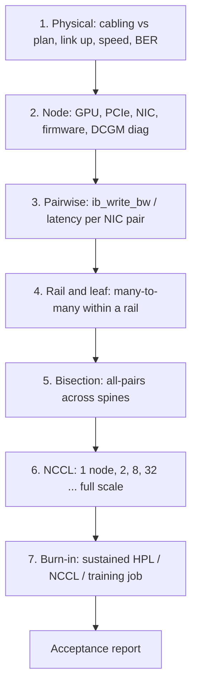

## Why this matters

A new AI cluster is thousands of GPUs, thousands of NICs and tens of thousands of optics and cables installed by people working fast under deadline. Statistically, some of those cables are in the wrong port, some optics are marginal, some PCIe slots have trained at reduced width and some GPUs will die in their first week. None of that is visible from "all links up". If you hand the cluster to the training team without systematic validation, they will find the problems for you, one 3 a.m. job failure at a time, and every finding will cost a restart of a job that occupies the whole cluster.

Validation and burn-in convert that random stream of production incidents into a planned, measurable acceptance process. The goal is not "it works" but "every component performs within a defined tolerance of its expected value, under sustained load, and we have the data to prove it". This lesson describes the stages, the tools at each stage and the acceptance criteria that make the process objective.

## Concepts

### Validate bottom-up, scale up gradually

Each stage assumes the previous one passed. Testing at full scale first is tempting and wasteful: an 8,192-GPU all-reduce that is 15 % slow tells you nothing about where the problem is.



| Stage | Question answered | Typical tools |
|---|---|---|
| Physical | Is every cable where the plan says, at the right speed, with healthy BER? | LLDP (`lldpctl`, NOS `show lldp`), `ibnetdiscover`/`ibdiagnet`, `mlxlink`, `ethtool -m` |
| Node | Is every server internally healthy and identical? | `nvidia-smi`, `dcgmi diag`, `lspci -vv`, firmware inventory, `nvidia-smi topo -m` |
| Pairwise | Does every NIC deliver line rate to a peer? | `ib_write_bw`, `ib_write_lat` (perftest) |
| Rail / bisection | Does the fabric deliver under many-to-many load without loss? | perftest at scale, vendor cluster tools, switch counters |
| Collective | Does NCCL reach expected bus bandwidth as scale grows? | nccl-tests (`all_reduce_perf`, `all_gather_perf`, `alltoall_perf`) |
| Burn-in | Does it stay healthy for days under realistic heat and load? | HPL, long nccl-tests loops, DCGM long diagnostics, a real training job |

### Golden values and tolerance bands

Every test needs an expected value. Derive it from the hardware, then confirm it on a known-good reference node or pair:

- **Pairwise RDMA write bandwidth**: close to line rate minus protocol overhead. On a 400 Gb/s port, well-tuned large-message `ib_write_bw` typically reports in the high 300s of Gb/s; establish your own reference.
- **NCCL all-reduce bus bandwidth**: within one node limited by NVLink; across nodes limited by the network. For ring all-reduce on 8-GPU nodes with one NIC per GPU, NCCL spreads channels across all eight NICs, so large-message busbw is bounded roughly by the node's aggregate NIC bandwidth (8 x 400 Gb/s is about 400 GB/s); measured values are somewhat lower, and in-network or NVLink-assisted algorithms (SHARP, NVLS) change the picture. Treat this as an order-of-magnitude model and measure your own reference.
- **Tolerance**: each node, pair or link must be within a percentage (for example 5 %) of the reference value, *and* the distribution must be tight. The outliers are the defects.

> [!ANALOGY]
> This is the AI-cluster version of turning up a carrier circuit with an RFC 2544 or Y.1564 test before handing it to the customer. The difference is scale and coupling: a carrier tests each circuit independently, while an AI fabric must also be tested as one coupled system, because a collective is only as fast as its slowest link, and failures appear only when thousands of flows interact.

## How it works

### Stage 1: physical validation

**Cabling against the plan.** The source of truth (NetBox, Nautobot or a cabling spreadsheet generated from the design) says "leaf-r3-07 port 12 connects to node-0457 NIC 3". Validation compares that intent with what the devices discover:

- On Ethernet, every switch and host runs LLDP. Collect neighbour tables from every switch (via NOS CLI, API or gNMI) and from hosts (`lldpctl` from lldpd, or the NIC's LLDP agent), then diff against the plan.
- On InfiniBand, `ibnetdiscover` produces the discovered topology and `ibdiagnet` can compare against a reference topology file and report mismatches, as can UFM's topology comparison features (check the version documentation for the exact options).

Typical defects are swapped cables between two ports on the same switch (easy to miss: both links are up), a node plugged into the wrong rail's leaf (breaks rail alignment and shows up later as poor all-reduce bandwidth), and links that came up at a lower speed or width.

**Speed, width and FEC.** Every link must be at its designed speed (for example 400G or NDR), designed lane count and FEC mode. Check `ethtool <netdev>` (Speed, Duplex) and `ethtool --show-fec <netdev>` on hosts, the NOS's interface view on switches, and `ibstat`/`iblinkinfo` on InfiniBand.

**Signal quality.** For each link, record pre-FEC (raw) BER, post-FEC (effective) BER or uncorrectable counts, and optics DDM values (temperature, laser bias, Tx/Rx power per lane) via `mlxlink` and `ethtool -m`. Compare against vendor thresholds and against the population: a link whose raw BER is two orders of magnitude worse than its siblings is suspect even if it is still technically within spec. Soak links under traffic before measuring, because BER measured on an idle link for a few seconds is not meaningful at low error rates; you need enough bits to observe errors.

### Stage 2: node validation

Each server should be identical. Collect and diff:

- GPU count, model, driver version, VBIOS; NIC model and firmware (`ibv_devinfo`, `mlxfwmanager` or `flint` query); BIOS settings that matter (for example IOMMU/ACS behaviour, power profiles).
- PCIe link state for every GPU and NIC: `lspci -vv` and compare `LnkSta` (current) to `LnkCap` (capability). A NIC at Gen5 x16 that trained at Gen5 x8 or Gen4 x16 silently halves or worsens its achievable bandwidth.
- Topology: `nvidia-smi topo -m` must match the reference (each NIC on the expected PCIe switch next to its GPU).
- GPU health: `dcgmi diag -r 3` (or the level your DCGM version recommends for acceptance) for memory, PCIe bandwidth, and stress tests.

### Stage 3: pairwise RDMA tests

perftest measures raw RDMA bandwidth and latency between two ports without NCCL in the way. Run it NIC-to-NIC along each rail, which in a rail-optimized fabric exercises leaf paths, and across rails, which exercises spines. With GPUDirect, include GPU memory (`--use_cuda`) so that PCIe paths between GPU and NIC are validated too.

All-pairs testing of N NICs is O(N²) and impractical at scale; instead use **structured patterns**: each NIC to a partner on the same leaf, each NIC to a partner on a different leaf (forcing spine traversal), rotating partners in rounds so every leaf-spine link is exercised. In each round, run all pairs simultaneously, so the fabric is loaded, not idle.

### Stage 4-5: rail and bisection load

The bisection test answers: when half the cluster sends to the other half at full rate, does the fabric deliver the designed bisection bandwidth without drops? This exercises every spine uplink concurrently, which is where ECMP hashing imbalance, miscabled uplinks, wrong routing or a single bad spine link show up.

```widget
ecmp-collision
```

Use the widget to see why bisection tests often show lower-than-expected bandwidth with static ECMP and a small number of large flows: collisions on uplinks cap some flows. The test is not "broken" in that case; it is telling you something real about how your load balancing will behave with collective traffic.

NVIDIA and other vendors provide cluster validation tooling that automates parts of stages 2-5 (for example ClusterKit, a node and fabric assessment tool distributed with NVIDIA HPC-X in some releases, and UFM-based fabric validation). Capabilities and packaging change between releases, so check the current documentation rather than relying on a specific feature list.

### Stage 6: NCCL at increasing scale

nccl-tests measure what training jobs actually do. Scale in steps, and stop when a step fails its criteria:

1. **Single node** (8 GPUs, NVLink only): validates NVLink/NVSwitch and NCCL installation.
2. **Two nodes**: first test of the network path, per rail.
3. **One leaf / scalable unit** (for example 32 nodes): validates the rail-optimized leaf layer.
4. **Multiple scalable units**, then **full scale**: validates spines and, where present, the third tier.

At each step, sweep message sizes (for example 8 B to 8 GB, factor 2) and record bus bandwidth (`busbw`) at large sizes and latency at small sizes. Expected large-message bus bandwidth should stay roughly flat as scale grows for a well-built non-blocking fabric with ring or tree algorithms; a step drop between two scales localizes the problem to the newly added layer.

```widget
allreduce-sim
```

The simulator shows why bus bandwidth, not algorithm bandwidth, is the metric to compare across scales: bus bandwidth normalizes for the algorithm's data movement, so it should remain near the per-GPU network limit as N grows, while latency-dominated small messages degrade with N.

### Stage 7: burn-in

Burn-in is sustained, realistic stress for days, to trigger infant-mortality failures (GPUs, HBM, optics, PSUs, fans) before production. Common components:

- **HPL** (High-Performance Linpack, the NVIDIA-optimized version in containers): maximizes GPU power and heat; reveals thermal and power delivery problems and unstable GPUs.
- **Long nccl-tests loops** at full scale: sustains fabric load and heats optics and switches.
- **DCGM long diagnostics** (`dcgmi diag -r 4` where supported) on each node.
- **A real training job** (or a representative synthetic model), because it combines compute, collectives and storage I/O in realistic phases.

During burn-in, the telemetry pipeline records everything: per-link BER trends, flaps, FEC uncorrectables, PFC/ECN rates, XID errors, throttling events. Failures are triaged, components replaced and the affected nodes re-validated from stage 2.

### Acceptance criteria

Make them explicit and numeric, agreed with the vendor and integrator before delivery. An illustrative set:

| Area | Criterion (illustrative; set your own) |
|---|---|
| Cabling | 100 % of links match the plan; zero unplanned links |
| Links | All at designed speed/width/FEC; raw BER below vendor threshold with margin; zero uncorrectable FEC errors during a defined soak |
| Stability | Zero link flaps during burn-in window (for example 72 h) |
| Node | All GPUs/NICs at expected PCIe Gen and width; DCGM diagnostics pass; firmware and drivers at the approved baseline |
| Pairwise | Every NIC pair within 5 % of reference RDMA bandwidth |
| Collective | Full-scale all-reduce busbw within X % of the reference value at large messages; no node more than Y % below median in per-node tests |
| Lossless | Zero drops on the RoCE priority during tests; no PFC storm events |
| Burn-in | N hours of HPL and training without hardware faults; failures replaced and re-tested |

## In practice

### Pairwise bandwidth with perftest

Server side on node A, NIC mlx5_0 (RoCE, GID index chosen for RoCEv2):

```bash
ib_write_bw -d mlx5_0 -x 3 -s 1048576 -D 10 --report_gbits
```

Client side on node B:

```bash
ib_write_bw -d mlx5_0 -x 3 -s 1048576 -D 10 --report_gbits nodeA
```

`-x` is the GID index (RoCE only; check `show_gids` or `rdma link`/sysfs to choose the RoCEv2 entry), `-s` the message size, `-D` duration in seconds. Add `-q 4` for multiple QPs, and `--use_cuda=<gpu-index>` (in CUDA-enabled builds) to source and sink in GPU memory.

Illustrative output (trimmed):

```text
 #bytes     #iterations    BW peak[Gb/sec]    BW average[Gb/sec]   MsgRate[Mpps]
 1048576    443030         371.82             371.65               0.044303
```

371 Gb/s average on a 400 Gb/s port is a plausible healthy result. A pair at 190 Gb/s is a defect to chase: check PCIe `LnkSta` of both NICs, link speed, and port counters.

### Running a structured pair matrix

A small driver script (Python, Ansible or a scheduler job) generates rounds of pairs, launches servers then clients in parallel, collects results to CSV and flags outliers. The important design points:

- Run all pairs in a round **concurrently**, so the fabric is loaded.
- Record **both ends** (host, NIC, leaf port) so a slow pair can be triangulated: if node A is slow with every partner, A is the problem; if only one pair is slow, look at the path between them.
- Snapshot switch and NIC counters before and after each round.

### nccl-tests at scale

```bash
mpirun -np 256 -N 8 --hostfile hosts.txt \
  -x NCCL_DEBUG=WARN \
  ./build/all_reduce_perf -b 8 -e 8G -f 2 -g 1
```

`-b`/`-e` set min and max message size, `-f 2` doubles each step, `-g 1` uses one GPU per process. Launcher options and NCCL environment depend on your scheduler (Slurm `srun`, MPI flavour) and fabric (for example `NCCL_IB_HCA`, and `NCCL_IB_GID_INDEX` on RoCE when auto-detection is not right).

Illustrative tail of output (trimmed):

```text
#       size         count   type   redop    time   algbw   busbw  #wrong
  1073741824     268435456  float     sum    5807  184.90  368.36       0
  2147483648     536870912  float     sum   11590  185.29  369.13       0
  4294967296    1073741824  float     sum   23160  185.45  369.45       0
# Avg bus bandwidth    : 168.2
```

Read the large-message `busbw` (here about 369 GB/s; for all-reduce busbw = algbw x 2(n-1)/n, almost exactly 2x at 256 ranks) against your reference, and check `#wrong` is 0 (data corruption would show here). The "Avg bus bandwidth" averages over all sizes including tiny latency-bound messages, so it is not the headline number.

### Finding the bad node in a collective

When full-scale busbw is low, bisect: split the host list in halves and run each half, keep splitting the slow half. Alternatively run many small jobs (2 nodes each, or 1 scalable unit each) concurrently and rank them. A single slow node usually shows up as every job containing it being slow.

### Decision table during validation

| Symptom | Likely cause | Evidence | Fix |
|---|---|---|---|
| Pair test slow with every partner of node A | Node A: PCIe downtrained, wrong NUMA, NIC firmware | `lspci -vv` LnkSta, `nvidia-smi topo -m`, firmware inventory | Reseat card/riser, fix BIOS, update firmware |
| Only cross-leaf pairs slow | Spine uplink or ECMP issue | Switch uplink counters, per-uplink utilisation | Fix cabling/routing; consider adaptive routing |
| busbw fine at 2 nodes, drops at 32 | Leaf layer: miscabled rail, oversubscribed or failed uplinks | LLDP vs plan, switch counters | Recable to the plan |
| busbw drops only at full scale | Spine / third tier, routing, congestion control tuning | Spine PFC/ECN, drops, WJH | Fix spine links, tune ECN/AR |
| Link passes at turn-up, flaps during burn-in | Marginal optic heating up | BER trend vs temperature, `ethtool -m` | Replace optic, retest |
| HPL fails on one node | GPU/HBM or power issue | DCGM diag, XID errors | RMA GPU or board |

> [!INTERVIEW]
> "You are handed a newly built 1,024-GPU cluster. How do you accept it?" A strong answer is staged and numeric: cabling diff against the source of truth, link speed/FEC/BER checks, node uniformity (PCIe width, topology, firmware, DCGM diag), structured concurrent perftest pairs, bisection load with zero drops on the lossless class, nccl-tests at increasing scale with expected busbw per step, then a multi-day burn-in (HPL, long NCCL loops, a real job) with telemetry, and written acceptance criteria agreed in advance. Mention that every failed component triggers re-validation of that node and that results become the baseline for later regression checks.

## Common pitfalls

- **Testing at full scale first.** Symptom: "it's 12 % slow" with no way to localize. Cause: skipping stages. Fix: validate bottom-up and scale NCCL in steps.
- **Idle-link BER checks.** Symptom: links pass BER checks, then accumulate errors in production. Cause: too few bits observed and optics not at operating temperature. Fix: measure BER after a soak under traffic.
- **Sequential pair tests.** Symptom: every pair passes, but the fabric fails under load. Cause: one pair at a time never stresses shared uplinks. Fix: run concurrent rounds and add bisection tests.
- **Trusting "link up".** Symptom: rail alignment broken, poor busbw. Cause: cables swapped or in the wrong leaf, but links are up. Fix: LLDP/topology diff against the plan.
- **Headline from "Avg bus bandwidth".** Symptom: numbers look terrible or inconsistent. Cause: the average includes latency-bound small sizes. Fix: compare large-message busbw and small-message latency separately.
- **No written criteria.** Symptom: disputes with the integrator about whether the cluster is "done". Cause: acceptance defined by feel. Fix: agree numeric criteria and test procedures before delivery.
- **Throwing away the results.** Symptom: no reference when performance regresses after an upgrade. Cause: validation data not stored. Fix: keep results as the baseline and rerun the same suite after changes.

## Key takeaways

- Validate bottom-up: physical, node, pairwise, rail/bisection, NCCL at increasing scale, then burn-in.
- Compare intended cabling (source of truth) with discovered topology; links being up proves nothing about correct placement.
- Measure BER, PCIe width and topology on every component, and look for outliers against the population.
- Run pair tests concurrently in structured rounds; add bisection load to stress spines and load balancing.
- Use large-message busbw from nccl-tests per scale step; a drop between steps localizes the faulty layer.
- Burn-in for days with HPL, NCCL and real jobs to catch infant mortality, with numeric acceptance criteria agreed in advance.
