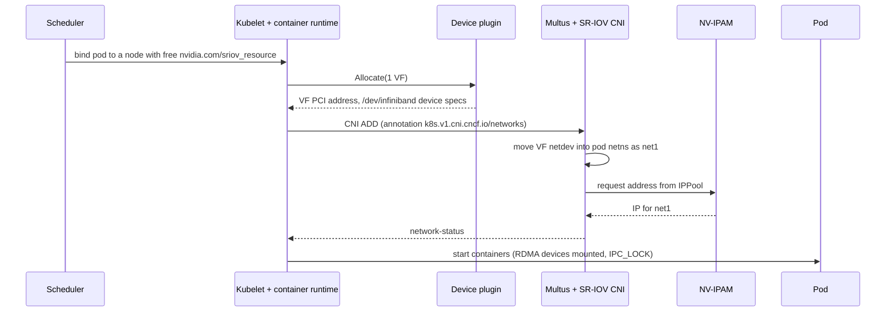

## Why this matters

A growing share of AI training and most AI inference runs on Kubernetes. Kubernetes was designed for
web services: every pod gets one virtual Ethernet interface (`eth0`) from the cluster's primary CNI
plugin, an overlay or routed pod network, and no access to host devices. That is exactly wrong for
an RDMA workload. A default pod sees no `/dev/infiniband` devices, has no interface on the compute
fabric, cannot pin memory for registration, and knows nothing about which NIC sits next to which GPU.
NCCL in such a pod quietly falls back to TCP sockets over `eth0`, and a job that should run at
hundreds of Gb/s per GPU runs at a small fraction of that, with no error.

The fix is a stack of Kubernetes extensions (device plugins, Multus, specialised CNI plugins, IPAM,
driver containers) that are tedious to assemble by hand and must match the NIC driver and firmware on
every node. NVIDIA packages them as the **NVIDIA Network Operator**, and NVIDIA's professional AI
networking certification lists deploying and verifying it as an exam topic (as of October 2026; see
`exam-strategy`). This lesson shows what each piece does, how a pod gets its RDMA interfaces, and how
to prove that it works before a training team finds out the hard way.

## Concepts

### What a pod needs to do RDMA

Recall from `rdma-on-linux` and `nccl-configuration` what an RDMA process needs. In Kubernetes terms:

| Requirement | Why | Kubernetes mechanism |
|---|---|---|
| RDMA device files (`/dev/infiniband/uverbs*`) | Verbs talk to the NIC through them | A **device plugin** advertises a resource; the kubelet mounts the devices into pods that request it |
| A network interface on the fabric | RoCE GIDs come from interface IPs; NCCL needs addresses for the peer exchange | **Multus** attaches extra interfaces (`net1`, `net2`, ...) through a CNI plugin |
| An IP address per extra interface | RoCEv2 is routed IP traffic | An **IPAM** plugin (for example NVIDIA's NV-IPAM) |
| Pinned memory | `ibv_reg_mr` pins pages | `IPC_LOCK` capability and an adequate memlock limit |
| Matching drivers and libraries | Kernel driver on the host, rdma-core in the image | Driver container (DOCA-OFED) or host drivers; user-space libraries in the image |
| GPU-NIC locality | GPUDirect RDMA is fast only across a short PCIe path | Topology Manager (NUMA level), or DRA attributes (PCIe level) |

### The building blocks

- **Device plugins** are DaemonSets that register an extended resource with the kubelet, for
  example `rdma/rdma_shared_device_a` or `nvidia.com/sriov_resource`. Pods request the resource in
  `resources.limits` like they request `nvidia.com/gpu`, and the scheduler counts it.
- **Multus CNI** is a meta-plugin. The primary CNI still provides `eth0`; Multus reads the pod
  annotation `k8s.v1.cni.cncf.io/networks`, finds the named **NetworkAttachmentDefinition**
  (`apiVersion: k8s.cni.cncf.io/v1`), and calls the CNI plugin it describes to add `net1` and so on.
  The result is reported in the `k8s.v1.cni.cncf.io/network-status` annotation.
- **CNI plugins for the secondary network**: SR-IOV CNI (moves a virtual function into the pod),
  macvlan (a MAC-level child of a host interface), host-device (moves a whole interface into the
  pod) and IPoIB CNI (an IPoIB child interface on InfiniBand).
- **IPAM**: NV-IPAM allocates addresses from `IPPool` objects, handing each node a block
  (`perNodeBlockSize`) so allocation stays local and fast.

### Four ways to give a pod the fabric

| Model | What the pod gets | Isolation | Density | Typical use |
|---|---|---|---|---|
| **Host networking** (`hostNetwork: true`) | All host interfaces and RDMA devices | None: the pod is in the host's network namespace | One job per node in practice | Quick tests, single-tenant clusters run like bare metal |
| **RDMA shared device** + macvlan or IPoIB | A child interface plus shared access to the parent's RDMA device | Network namespace per pod; RDMA device shared | Many pods per NIC (up to `rdmaHcaMax`) | Mixed workloads, many small pods |
| **SR-IOV VF** + SR-IOV CNI | A dedicated virtual function with its own RDMA device | Strong: a dedicated VF per pod, hardware queues per VF | Up to the configured VFs per port | Training and multi-tenant clusters |
| **Host device** | A whole physical interface moved into the pod | Exclusive | One pod per interface | Special cases (DPDK, legacy applications) |

NVIDIA's quick-start documentation is organised around these same scenarios: SR-IOV network with
RDMA, host device network with RDMA, IPoIB with RDMA shared device, macvlan with RDMA shared device,
and SR-IOV InfiniBand network with RDMA.

> [!ANALOGY]
> Think of a GPU node as a building with eight high-speed lifts (the rail NICs). Host networking
> hands every tenant the master key to all lifts. The shared-device model gives each tenant a door
> to a lift lobby they share. SR-IOV gives each tenant their own lift car running in the same shaft:
> hardware-separated queues on the same physical port. Where it breaks down: the shaft (the physical
> port and the fabric beyond it) is still shared, so SR-IOV isolates access, not bandwidth. Performance
> isolation is a fabric problem (`multi-tenancy-isolation`).

### The NVIDIA Network Operator

The Network Operator is installed with Helm and reconciles custom resources into DaemonSets. In the
v26.x documentation the components fall into two groups:

| Scope | Components |
|---|---|
| Per node (in `NicNodePolicy` or `NicClusterPolicy`) | DOCA-OFED driver container, RDMA shared device plugin, SR-IOV device plugin |
| Cluster-wide (only in `NicClusterPolicy`) | Multus CNI, CNI plugins, IPoIB CNI, NV-IPAM, NIC Configuration Operator, DOCA Telemetry Service, Spectrum-X Operator, IB Kubernetes, NIC Feature Discovery |

`NicClusterPolicy` is a singleton named `nic-cluster-policy`. Recent releases add **NicNodePolicy**,
which selects a group of nodes with a `nodeSelector` so heterogeneous clusters (say, ConnectX-7 nodes
and ConnectX-8 nodes) can run different driver or device-plugin settings. The documented rules matter
operationally: a per-node section may live in the cluster policy or in node policies but never both,
two node policies may not select the same node (an admission webhook rejects overlaps; if relabelling
creates one later, the affected policy goes to `Error` and its DaemonSets stop being updated), and there is no automated migration from a cluster-policy-only
deployment. Check the documentation of your operator version: these resources have changed across
releases.

The **SR-IOV Network Operator** (enabled through the Helm chart) adds its own resources:
`SriovNetworkNodePolicy` creates VFs on matching NICs and names the resource, and `SriovNetwork`
generates the NetworkAttachmentDefinition that pods reference.

## How it works

### From pod spec to RDMA-capable interface



Two details are easy to miss. First, a RoCE GID is derived from an interface address, so the GID
table the pod sees (and therefore the right `NCCL_IB_GID_INDEX`) depends on `net1`'s addresses inside
the pod's namespace, not on the host's. Second, the RDMA subsystem has a network-namespace mode:
`rdma system set netns shared` makes RDMA devices visible in all namespaces, while
`rdma system set netns exclusive` makes each device visible in only one namespace, and per the
`rdma-system(8)` man page exclusive mode must be set before network namespaces are created. Which
mode a given CNI and plugin combination expects is documented with that combination; check it
rather than changing the mode on a running node.

### GPUDirect RDMA in pods

The GPU Operator and the Network Operator cooperate. The GPU Operator documentation (as of 2026)
recommends the kernel's **DMA-BUF** mechanism over the legacy `nvidia-peermem` module. DMA-BUF needs
the open GPU kernel modules, Linux 5.12 or later and CUDA 11.7 or later, and works with distribution
network drivers as well as DOCA-OFED; the legacy path is selected with `driver.rdma.enabled=true` in
the GPU Operator's Helm values and requires MLNX_OFED or DOCA-OFED. If the network drivers are
installed on the host rather than by the Network Operator, the documented value is
`driver.rdma.useHostMofed=true`. Whichever path you choose, the end test is the same: an RDMA
benchmark that reads GPU memory, between two pods on different nodes.

### Rails, topology and alignment

A rail-optimized 8-GPU node has eight compute NICs, each on its own rail subnet
(`rail-optimized-topology`). In Kubernetes that becomes eight secondary networks, each with its own
IPPool and NetworkAttachmentDefinition (or eight SR-IOV resources), and a training pod that asks for
eight GPUs should get one interface per rail, each the NIC nearest its GPU.

Kubernetes has two alignment tools, at different granularities:

| Tool | Granularity | What it can guarantee |
|---|---|---|
| **Topology Manager** (kubelet, stable since v1.27) with policy `single-numa-node` or `restricted` | NUMA node | GPUs and NICs (from device plugins) come from the same NUMA node(s); CPUs and memory too when the static CPU Manager and Memory Manager policies are enabled |
| **Dynamic Resource Allocation** (DRA, listed as stable in current Kubernetes docs) with a `matchAttribute` constraint | Any attribute drivers publish, for example `resource.kubernetes.io/pcieRoot` | A GPU and a NIC share a PCIe root complex |

NUMA alignment is necessary but not sufficient. On a typical two-socket 8-GPU server each NUMA node
holds four GPUs and four NICs; Topology Manager can keep a pod's devices on the right socket, but it
cannot tell GPU 2 from GPU 3 relative to a given NIC. A pod that gets "a GPU and a NIC on NUMA 0"
may get a pair whose path crosses the CPU root complex (`NODE` in `nvidia-smi topo -m`) instead of
one PCIe switch (`PIX`/`PXB`), which is exactly the slow GPUDirect path from `pcie-numa-topology`.

```widget
pcie-topo
```

DRA addresses this: NVIDIA's documentation shows a `ResourceClaimTemplate` that requests one SR-IOV
VF (device class `sriovnetwork.k8snetworkplumbingwg.io`) and one GPU (device class `gpu.nvidia.com`)
with `matchAttribute: "resource.kubernetes.io/pcieRoot"` across both requests. Two hedges, as of
October 2026: NVIDIA labels its DRA SR-IOV driver a **Tech Preview** not recommended for production,
and it notes that on GB300 NVL72, Vera Rubin NVL72 and HGX Rubin NVL8 systems with ConnectX-8 and
later, the PCIe root that matches a NIC to its GPU is that of the NIC's "Data Direct" sub-interface,
a topology the driver does not yet support. Whole-node scheduling (one training pod per node, all
eight GPUs and all eight NICs) sidesteps the problem and remains the common choice for large jobs.

### InfiniBand partitions from Kubernetes

On an InfiniBand compute fabric the isolation boundary is the P_Key (`multi-tenancy-isolation`). The
**ib-kubernetes** daemon watches pods that use IB SR-IOV networks, reads the partition key from the
network definition and adds the pod's VF GUID to that P_Key through a subnet-manager plugin. Its
README lists a UFM plugin and a no-op example plugin, and notes a limit of 128 P_Keys per node from
the kernel. The effect: a tenant's pods land in the tenant's partition automatically, and a pod in
another partition cannot reach them at the IB layer.

### Driver and firmware lifecycle

The Network Operator can run the NIC driver as a **DOCA-OFED driver container**. Reloading a NIC
driver takes the node's RDMA interfaces down, so the `ofedDriver` section carries an `upgradePolicy`
(`autoUpgrade`, `maxParallelUpgrades`, plus drain and safe-load options) to roll upgrades through the
fleet a few nodes at a time. Read the value carefully: in the documented v26.x example
`maxParallelUpgrades: 0`, and 0 means no limit, so every node reloads its driver at once.
Firmware-level NIC settings (VF count, link type, RoCE QoS) belong to the **NIC Configuration
Operator**, whose `NicConfigurationTemplate` can, per its README, set `numVfs`, `linkType` and a
`roceOptimized` block with `qos.trust: dscp` and a PFC vector (priority 3 by default). It coordinates
with the Maintenance Operator to prepare a node before changing non-volatile firmware settings.
This is the Kubernetes-native version of the host-side automation in `network-automation-for-ai`:
the same invariants (trust DSCP, PFC on the RoCE priority, consistent firmware), enforced by a
controller instead of a playbook.

## In practice

Everything below follows the NVIDIA Network Operator v26.x quick-start documentation; field names
and versions change between releases, so copy manifests from the documentation for your version.
Output is **illustrative**.

### Install and check the operator

```bash
helm repo add nvidia https://helm.ngc.nvidia.com/nvidia
helm repo update
helm install network-operator nvidia/network-operator \
  -n nvidia-network-operator --create-namespace \
  --version <operator-version> \
  --set sriovNetworkOperator.enabled=true --wait

kubectl -n nvidia-network-operator get pods
```

### Shared RDMA device with macvlan (the simplest secondary network)

```yaml
apiVersion: mellanox.com/v1alpha1
kind: NicClusterPolicy
metadata:
  name: nic-cluster-policy
spec:
  rdmaSharedDevicePlugin:
    image: k8s-rdma-shared-dev-plugin
    repository: nvcr.io/nvidia/mellanox
    version: <operator-version>
    config: |
      { "configList": [ { "resourceName": "rdma_shared_device_a",
                          "rdmaHcaMax": 63,
                          "selectors": { "ifNames": ["ens1f0"] } } ] }
  nvIpam: { image: nvidia-k8s-ipam, repository: nvcr.io/nvidia/mellanox, version: <operator-version> }
  secondaryNetwork:
    cniPlugins: { image: plugins, repository: nvcr.io/nvidia/mellanox, version: <operator-version> }
    multus:     { image: multus-cni, repository: nvcr.io/nvidia/mellanox, version: <operator-version> }
```

An `IPPool` (`nv-ipam.nvidia.com/v1alpha1`) supplies the subnet and `perNodeBlockSize`, and a
`MacvlanNetwork` (`mellanox.com/v1alpha1`) names the master interface, the mode (`bridge`), the MTU
and the pool. The pod references the network by annotation and requests the RDMA resource:

```yaml
metadata:
  annotations:
    k8s.v1.cni.cncf.io/networks: macvlan-network
spec:
  containers:
  - name: test
    securityContext:
      capabilities: { add: ["IPC_LOCK"] }
    resources:
      limits: { rdma/rdma_shared_device_a: 1 }
```

### SR-IOV for training pods

The SR-IOV scenario replaces the shared plugin with a `SriovNetworkNodePolicy`
(`sriovnetwork.openshift.io/v1`): `nicSelector.vendor: "15b3"` (the NVIDIA/Mellanox PCI vendor ID),
`isRdma: true`, `numVfs`, `deviceType: netdevice`, `mtu` and a `resourceName` such as
`sriov_resource`. A `SriovNetwork` ties that resource to an IPAM pool and produces the
NetworkAttachmentDefinition. Pods then request `nvidia.com/sriov_resource`.

> [!WARNING]
> The documentation examples use `mtu: 1500` to stay generic. On a RoCE compute fabric that runs
> jumbo frames, set the MTU in the network policy to match the fabric design (`mtu-jumbo-frames`), or
> the pod's interface ends up with a smaller RoCE active MTU (1024 for a 1500-byte netdev) than the rest of the job.

### Verify, bottom up

```bash
# 1. Does the node advertise the resources?
kubectl describe node gpu-node-07 | grep -E 'rdma/|nvidia.com/'
#   nvidia.com/gpu:             8
#   nvidia.com/sriov_resource:  8          (illustrative)

# 2. Did Multus attach the secondary interface, with which IP?
kubectl get pod rdma-a -o jsonpath='{.metadata.annotations.k8s\.v1\.cni\.cncf\.io/network-status}'

# 3. Inside the pod: device, link layer, MTU, GIDs
kubectl exec rdma-a -- ibv_devices
kubectl exec rdma-a -- ibv_devinfo
kubectl exec rdma-a -- ip addr show net1

# 4. RDMA bandwidth between pods on two different nodes (perftest in the image)
kubectl exec rdma-a -- ib_write_bw -d <dev> -R -a --report_gbits
kubectl exec rdma-b -- ib_write_bw -d <dev> -R -a --report_gbits <rdma-a net1 IP>
```

`-R` makes perftest connect through the RDMA connection manager, which resolves the GID from the
pod's IP and avoids guessing a GID index (`perftest-benchmarking`). The GPU Operator documentation
adds a GPUDirect variant with `--use_cuda_dmabuf` between pods that also request `nvidia.com/gpu`.
Finally, run one `nccl-tests` job across two nodes with `NCCL_DEBUG=INFO` and confirm that the log
shows the IB/RoCE network plugin on the expected devices, not the socket transport
(`nccl-debugging`).

> [!TIP]
> Make the two-pod `ib_write_bw` test and the two-node `nccl-tests` run part of node admission:
> a node joins the GPU pool only after its pods reach golden bandwidth on every rail
> (`fabric-validation-burn-in`). It catches missing VFs, wrong MTU and broken GPUDirect before users do.

> [!INTERVIEW]
> "A PyTorch job on Kubernetes trains ten times slower than the same job on bare metal. Where do you
> look?" A strong answer starts with the NCCL log: does it use `NET/IB` or `NET/Socket`? If sockets,
> the pod has no RDMA devices or no secondary interface (check the resource request, the Multus
> annotation and `network-status`). If IB is used, check one interface per rail, GPU-NIC locality
> (NUMA alignment is not PCIe alignment), the GID index and MTU inside the pod, GPUDirect (DMA-BUF or
> nvidia-peermem), and the `IPC_LOCK` capability. Close with the bottom-up verification sequence.

## Common pitfalls

- **Silent socket fallback.** Symptom: training is several times slower in pods than on bare metal,
  no errors. Cause: the pod has only `eth0` (no network annotation, or no RDMA resource requested),
  so NCCL uses TCP. Fix: request the RDMA resource and the secondary networks; check `NCCL_DEBUG=INFO`.
- **Memory registration fails in the pod.** Symptom: `ibv_reg_mr` or NCCL fails with "Cannot allocate
  memory". Cause: no `IPC_LOCK` capability or a low memlock limit in the container runtime. Fix: add
  the capability and raise the limit per your runtime's documentation.
- **NUMA-aligned but PCIe-misaligned.** Symptom: some pods reach full bandwidth, others on the same
  node type reach much less. Cause: Topology Manager aligned NUMA nodes, but the GPU and NIC are on
  different PCIe switches. Fix: whole-node pods, or DRA with a PCIe-root constraint where supported.
- **Wrong GID index inside the pod.** Symptom: RDMA connections time out only in Kubernetes. Cause: a
  hard-coded `NCCL_IB_GID_INDEX` from bare metal that does not match the pod's GID table. Fix: read
  the table inside the pod, or use RDMA CM-based tools for tests.
- **MTU copied from the example.** Symptom: lower bandwidth than bare metal, active MTU 1024. Cause:
  a network policy left at 1500. Fix: set the MTU to the fabric design.
- **Driver container upgrade drops running jobs.** Symptom: jobs fail across many nodes at once
  during maintenance. Cause: an aggressive upgrade policy reloading the NIC driver everywhere (for example
  `maxParallelUpgrades: 0`, which means no limit). Fix: a small non-zero `maxParallelUpgrades`,
  coordinated drains, and upgrades scheduled with the training teams.
- **Policy conflicts.** Symptom: a NicNodePolicy shows `Error` and nodes stop getting updates.
  Cause: two node policies came to select the same node (for example after a node was relabelled).
  Fix: make node selectors disjoint and keep each per-node section in one place.

## Key takeaways

- A default pod has only `eth0` and no RDMA devices; NCCL then falls back to sockets without failing.
- Device plugins expose RDMA resources, Multus attaches secondary interfaces from
  NetworkAttachmentDefinitions, CNI plugins (SR-IOV, macvlan, host-device, IPoIB) create them and
  IPAM addresses them.
- SR-IOV VFs give each pod its own RDMA device and are the usual choice for training; the shared
  RDMA device model trades isolation for density.
- The NVIDIA Network Operator deploys and manages these components (plus the DOCA-OFED driver,
  NV-IPAM, NIC configuration and IB P_Key integration) through NicClusterPolicy and NicNodePolicy.
- GPUDirect RDMA in pods comes from the GPU Operator, with DMA-BUF recommended over nvidia-peermem.
- Topology Manager aligns at NUMA level only; PCIe-level GPU-NIC alignment needs whole-node pods or
  DRA attributes such as `resource.kubernetes.io/pcieRoot`.
- Verify bottom up: operator pods, node resources, `network-status`, `ibv_devinfo` in the pod,
  pod-to-pod `ib_write_bw`, then `nccl-tests` with `NCCL_DEBUG=INFO`.
