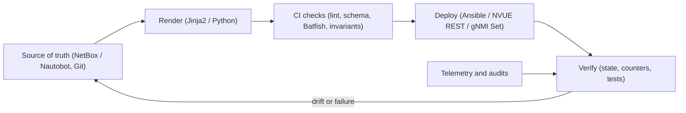

## Why this matters

A lossless RoCE fabric is a system of settings that must agree on every device and every host: the same PFC priority, the same DSCP-to-priority trust map, ECN thresholds on the same queue, the same MTU end to end, consistent buffer profiles, consistent ECMP hashing, and cables that land exactly where the rail-optimized design says. One leaf out of 200 with PFC on priority 4 instead of 3 does not break the cluster; it quietly drops RoCE traffic for 32 nodes, and every job that touches those nodes runs slower. By hand, at this scale, such drift is not a risk, it is a certainty.

Automation in an AI fabric is therefore not mainly about saving typing time. It is about **consistency** (every device rendered from the same intent), **correctness before change** (checks that run before anything touches production), **verifiable change** (proof afterwards that the fabric still matches intent) and **speed of recovery** (re-render and redeploy a replacement switch in minutes). Training clusters are expensive to idle: a change window that takes a 10,000-GPU cluster down for four hours because of a manual mistake burns 40,000 GPU-hours, on the order of a hundred thousand dollars at a few dollars per GPU-hour, before counting the lost training progress.

## Concepts

### Intent, rendering, deployment, verification



| Layer | What lives there | Examples |
|---|---|---|
| Source of truth (SoT) | Devices, roles, sites, racks, IPs, ASNs, cables, port assignments, rail membership, QoS profile name | NetBox, Nautobot, plus YAML in Git for policies |
| Policy / design data | Fabric-wide constants: RoCE priority, DSCP values, ECN thresholds, MTU, buffer profile | Versioned YAML in Git, reviewed like code |
| Templates / renderers | Device-type specific configuration generated from SoT + policy | Jinja2 templates, Python |
| Deployment | Pushing config idempotently, with dry-run and diff | Ansible, NVUE REST API, gNMI Set, Nornir, vendor tools |
| Verification | Operational state matches intent | LLDP vs cabling, BGP sessions, QoS state, counters, NetQ/UFM checks |

The **source of truth** is the single authoritative statement of intent. If a cable, IP or QoS setting is not in the SoT, it should not exist on the network. Conversely, everything on the network should be explainable by the SoT, which is what makes drift detection possible.

### Day 0, day 1, day 2

| Phase | Goal | AI fabric specifics |
|---|---|---|
| Day 0 | Bring a device from factory state to managed | ZTP (zero-touch provisioning): DHCP options point to a provisioning script, which installs the approved NOS image, base config, management access and certificates |
| Day 1 | Full intended configuration | Interfaces, BGP underlay, ECMP/hash settings, QoS (trust, PFC, ECN, buffers), MTU, telemetry subscriptions, host NIC QoS |
| Day 2 | Operate and change safely | Firmware upgrades, adding scalable units, replacing failed switches, tuning ECN thresholds, drift remediation |

### Idempotence and declarative configuration

An operation is **idempotent** when applying it once or many times gives the same result. Declarative tools express the desired state and let the tool compute the difference; imperative scripts list commands and assume a starting state. Idempotence is what makes "run the playbook again" safe after a partial failure, and what allows continuous drift remediation.

Two models are common:

- **Full-config replace**: render the entire device configuration and replace it atomically. Simple to reason about and guarantees no leftover settings, but requires that the template covers *everything* on the device.
- **Partial / merged**: manage specific sections. Easier to adopt incrementally, but leaves room for unmanaged drift outside those sections.

NVIDIA Cumulus Linux's NVUE fits the full-replace model well: the configuration is a structured document (YAML/JSON) with revisions, and `nv config apply` turns a pending revision into the running configuration. Other NOSes offer equivalent candidate/commit or replace semantics.

> [!ANALOGY]
> A service provider uses a provisioning system so that "turn up a new customer VPN on 40 PEs" is a database entry plus a push, not 40 CLI sessions. AI fabrics apply the same discipline, but the intent is more global: a single change such as an ECN threshold applies to every leaf and spine at once, and its blast radius is the entire training cluster. Where the analogy breaks: SP changes are usually per customer and isolated, while in an AI fabric almost every change is fabric-wide and coupled, so staged rollout and fast rollback matter even more.

## How it works

### Modelling the AI fabric in the source of truth

NetBox and Nautobot model devices, interfaces, cables, IP addresses, VLANs/VRFs and custom fields, with REST and GraphQL APIs. For AI fabrics, extend the model with:

- **Rail and plane membership** of each leaf and of each host NIC (custom fields or tags). This is what lets you verify rail alignment automatically.
- **Cable records** for every leaf-host and leaf-spine link, imported from the design tool, which become the expected LLDP neighbour table.
- **Host NIC records** (node, NIC index, PCIe address, GPU affinity) so network telemetry can be joined to GPUs and jobs.
- **Config context / policy references**: which QoS profile, which MTU, which ECMP policy applies to which role.

Keep fabric-wide constants in a reviewed policy file, for example:

```yaml
# policy/roce.yaml (illustrative)
roce:
  lossless_priority: 3
  cnp_priority: 6
  dscp_roce: 26
  dscp_cnp: 48
  ecn: {min_threshold_kb: 150, max_threshold_kb: 1500, probability_pct: 100}
  mtu: {switch: 9216, host: 9000}
```

These values must also drive host configuration (NIC trust mode, PFC enablement and DSCP for RoCE traffic), because the most common lossless misconfiguration is a disagreement between host and switch. The exact numbers are fabric-specific; they come from the design and validation phases.

### Rendering

Templates turn intent into device configuration. For NVUE the output is a YAML document; for other NOSes it may be CLI text or structured JSON. A fragment of an illustrative NVUE-style rendering:

```yaml
# Rendered for leaf-r3-07 (illustrative; validate against your Cumulus Linux release's NVUE schema)
- set:
    interface:
      swp1-32:
        type: swp
        link: {mtu: 9216}
    qos:
      roce:
        enable: on
        mode: lossless
```

On Cumulus Linux 5.x, `nv set qos roce` applies an NVIDIA-recommended RoCE QoS profile (trust, PFC, ECN and buffer settings) in one place; what it configures by default and which knobs it exposes differ by release, so check the release's RoCE documentation and compare with `nv show qos roce` after applying.

### Deployment interfaces

| Interface | Strengths | Notes |
|---|---|---|
| Ansible | Huge ecosystem, inventory from NetBox/Nautobot, check/diff modes | Vendor collections exist (for example an NVIDIA NVUE collection for Cumulus Linux); confirm module names and support in the collection docs |
| NVUE REST API | Structured, revision-based: create revision, patch, apply | HTTPS API on the switch; endpoint and port are documented per release |
| gNMI Set | Model-driven, same paths as telemetry | Coverage depends on NOS support for configuration via gNMI |
| Python (requests, Nornir, pynetbox) | Full control, testable logic | Good for orchestrating multi-step changes and checks |
| ZTP | Day-0 bootstrap | DHCP option points to a script that the switch runs at first boot |

The NVUE REST API follows the same revision model as the CLI: you create a revision, patch configuration into it, then request it to be applied, and you can read back the applied state. The exact base URL, port and authentication options are documented in the Cumulus Linux user guide for your release; do not hardcode assumptions from another version.

### CI for network configuration

Every change goes through a pull request. The CI pipeline runs before a human reviewer looks at it:

1. **Lint and schema**: YAML syntax, schema validation of policy and SoT data (for example, every leaf has exactly one rail; every host NIC has a cable).
2. **Render**: generate configs for all devices; show the diff against currently deployed configs in the PR.
3. **Invariant checks** specific to AI fabrics:
   - PFC enabled on exactly the lossless priority, on every RoCE-facing port and every fabric link.
   - The DSCP trust map sends the RoCE DSCP to the lossless priority and the CNP DSCP to its configured priority, everywhere.
   - ECN enabled on the lossless queue, thresholds below PFC XOFF headroom logic per the design.
   - MTU consistent: switch MTU >= host MTU + headers, the same on every fabric link.
   - Each host NIC connects to a leaf of its own rail.
   - ECMP hash fields and seeds as designed.
4. **Model-based analysis** (optional but powerful): tools such as Batfish parse configurations for supported NOSes and answer questions like "are all BGP sessions compatible?" or "is this prefix reachable from every leaf?" before deployment. Check Batfish's supported-vendor list for your NOS.
5. **Lab or digital twin**: apply to a virtual or physical staging fabric (for example NVIDIA Air, which NVIDIA's certification pages call NVIDIA DSX Air as of 2026, for Cumulus Linux, or containerlab for supported NOSes) and run smoke tests.

### Safe rollout on day 2

- **Canary**: deploy to one leaf (or one rail) first, verify, then expand in waves. In a rail-optimized fabric, changing one rail at a time limits the impact to one NIC per node, which NCCL tolerates better than losing whole nodes.
- **Drain where possible**: coordinate with the scheduler to drain nodes behind a leaf before disruptive changes.
- **Pre and post checks**: capture state before (BGP neighbours, LLDP, QoS state, counter rates), apply, capture after, diff. Automatic rollback if checks fail.
- **Change annotations**: every deployment writes an event (who, what, which devices) to the telemetry system so dashboards show it as a vertical line. This turns "what changed?" from an archaeology exercise into a lookup.

## In practice

### Pulling inventory from NetBox with Python

```python
# Illustrative: list leaf-to-host cables for one rail using pynetbox
import os, pynetbox

nb = pynetbox.api("https://netbox.example.net", token=os.environ["NETBOX_TOKEN"])
leaves = nb.dcim.devices.filter(role="ai-leaf", cf_rail=3)   # custom field "rail"
for leaf in leaves:
    for iface in nb.dcim.interfaces.filter(device_id=leaf.id):
        if iface.cable and iface.connected_endpoints:
            peer = iface.connected_endpoints[0]
            print(leaf.name, iface.name, "->", peer.device.name, peer.name)
```

The `cf_rail` filter assumes you created a custom field named `rail`; field names and filter syntax depend on your NetBox version and data model.

### Verifying cabling against intent

Combine SoT cables with live LLDP. Illustrative output from a verification job:

```text
CHECK lldp-vs-sot  rail=3  leaves=8  ports=256
  OK        248
  MISMATCH    6
    leaf-r3-04 swp17  expected node-0213:nic3  observed node-0214:nic3   # swapped pair
    leaf-r3-04 swp18  expected node-0214:nic3  observed node-0213:nic3
    leaf-r3-06 swp02  expected node-0301:nic3  observed node-0301:nic2   # wrong rail!
    ...
  MISSING     2
    leaf-r3-07 swp30  expected node-0388:nic3  observed (no neighbour)
```

The swapped pair may still forward if both nodes sit in a shared rail subnet, but it breaks per-port addressing (for example /31 point-to-point links to each NIC) and your telemetry joins, so fix it too; the wrong-rail entry breaks rail alignment and must be fixed before acceptance.

Inject miswires into a small rail-optimized pod and watch the LLDP-versus-plan check classify each one, with what it would do to a running job:

```widget
cabling-validator
```

### Applying a change with NVUE

On a Cumulus Linux switch, the CLI equivalent of what automation does via the API:

```bash
nv set interface swp1-32 link mtu 9216
nv config diff          # show pending changes against applied config
nv config apply         # apply the pending revision
nv show qos roce        # read back RoCE QoS state
```

Automation should do the same steps: stage, diff, apply, verify. Prefer applying a fully rendered configuration (replace) so that manual changes are overwritten in a controlled way and drift cannot accumulate.

### Ansible play structure

```yaml
# Illustrative structure; module names depend on the collection you use
- name: Deploy AI fabric leaf config
  hosts: ai_leaves
  serial: 1                      # canary-style: one device at a time
  gather_facts: false
  tasks:
    - name: Pre-check - capture BGP and LLDP state
      ansible.builtin.include_tasks: tasks/precheck.yml
    - name: Render and apply full configuration
      ansible.builtin.include_tasks: tasks/apply_nvue.yml
    - name: Post-check - compare with pre-check and run invariants
      ansible.builtin.include_tasks: tasks/postcheck.yml
```

`serial` limits how many hosts Ansible changes at once; combine with `max_fail_percentage` to stop a rollout early when post-checks fail.

### Host-side automation

Remember the other end of every link. Host NIC settings (trust mode, PFC priorities, RoCE mode, MTU, firmware) must be automated from the same policy file. Tools vary (vendor utilities such as `mlnx_qos` from MLNX_OFED/DOCA for trust and PFC, `mlxconfig` for firmware parameters, netplan or NetworkManager for MTU, the cluster's configuration management for packages). A host agent or a daily audit job compares the actual host state with policy and reports drift.

### Decision table: automation failure modes

| Symptom | Likely cause | Evidence | Fix |
|---|---|---|---|
| One leaf's nodes slower after a change | Change applied partially, or one device rejected it | Deployment logs, `nv config diff` on that leaf, QoS state | Fail the rollout on any device error; re-apply idempotently |
| Drift found by audit | Manual hotfix during an incident | Audit diff vs rendered config | Fold the fix into SoT/policy, re-render, deploy |
| New scalable unit poor busbw | Cabling or rail data wrong in SoT | LLDP vs SoT check | Correct SoT or cables, re-verify |
| Rollout stuck at canary | Post-check invariant failing | CI/post-check report | Fix the template or policy, not the device |
| Host-switch QoS mismatch | Host config managed separately from switch policy | Host trust/PFC state vs policy | Drive both from one policy file |

> [!INTERVIEW]
> "How would you roll out an ECN threshold change across a 300-switch AI fabric?" A strong answer: change the value in the versioned policy, open a PR, CI renders all configs, shows the diff and runs invariant checks, test in a lab or digital twin with a representative traffic pattern, then roll out in waves (one leaf, then one rail, then the rest) with pre/post checks of ECN mark rates, PFC rates, drops and nccl-tests or job step time, an automatic stop on regression, and a change annotation in telemetry. Mention rollback by reverting the commit and redeploying, which idempotence makes safe.

## Common pitfalls

- **Partial templates with full-replace deployment.** Symptom: a deployment wipes a setting someone added by hand (for example a telemetry subscription). Cause: the template does not model everything on the device. Fix: model it in the template, or use a merge model for that section deliberately.
- **Source of truth that is not true.** Symptom: verification jobs flood with mismatches, people stop trusting them. Cause: SoT populated once from a spreadsheet and never reconciled. Fix: make SoT the only path to change and reconcile discovered state continuously.
- **Automating switches but not hosts.** Symptom: drops on the lossless class after a host image change. Cause: host trust/PFC settings drift from switch policy. Fix: one policy file drives both, with host audits.
- **No canary.** Symptom: a bad change hits all 300 switches at once. Cause: parallel push without staged waves. Fix: `serial`-style waves, stop on post-check failure.
- **Non-idempotent scripts.** Symptom: re-running a failed job creates duplicate settings or errors. Cause: imperative command lists. Fix: declarative state, diff-then-apply.
- **Secrets in Git.** Symptom: credentials leaked in repository history. Cause: device passwords in inventory files. Fix: vault or secrets manager, short-lived tokens, mTLS for APIs.
- **Hand fixes during incidents never folded back.** Symptom: the next deploy reverts the fix and the incident returns. Cause: no process to update SoT. Fix: every manual change gets a follow-up PR before the incident is closed.

## Key takeaways

- In AI fabrics, automation is about consistency and verifiable change; drift on one device silently slows many jobs.
- The source of truth (NetBox/Nautobot plus versioned policy) holds cabling, rails, addressing and lossless QoS constants for switches and hosts.
- Day 0 is ZTP, day 1 renders full intended config, day 2 is safe change: canary waves, pre/post checks, change annotations.
- Prefer idempotent, declarative, full-replace configuration; NVUE's revision model (stage, diff, apply) fits this well.
- CI must enforce AI invariants: PFC priority, trust maps, ECN on the right queue, MTU, rail alignment, ECMP settings.
- Verify after every change with state and counters, and fold every manual fix back into the source of truth.
