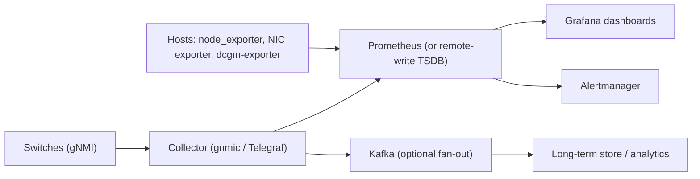

## Why this matters

The previous lesson listed the counters that matter. This lesson is about getting them off thousands of devices, often enough to be useful, without melting the devices or the monitoring system. A large AI cluster may have tens of thousands of switch ports and NIC ports, each with dozens of interesting counters per priority. Classic SNMP polling every five minutes gives you a smooth average that hides everything that hurts AI jobs: microbursts that fill a buffer for 200 microseconds, a PFC storm that lasts four seconds, a link that flaps twice in a minute.

AI traffic is synchronized and bursty. Every rank starts the same all-reduce at roughly the same moment, so congestion arrives in waves that last milliseconds to seconds. A telemetry system that samples once every few minutes will report a fabric at 30 % average utilization while jobs are suffering from repeated 100 % incast bursts. Streaming telemetry, with model-driven data (OpenConfig/YANG), push-based transport (gNMI) and a time-series pipeline (Prometheus or similar, with Grafana), is the standard answer.

## Concepts

### Pull versus push

| Aspect | SNMP polling | Streaming telemetry (gNMI) |
|---|---|---|
| Direction | Collector polls each OID | Device pushes updates on a subscription |
| Encoding | ASN.1/BER, MIB-defined | Protobuf (or JSON) over gRPC/HTTP2, YANG-modelled paths |
| Typical interval | Minutes | Seconds (sampled) or immediate (on change) |
| Device cost | Per-request CPU walk, scales poorly | Device schedules its own export; usually more efficient |
| Data model | Vendor MIBs, many gaps for QoS/PFC | OpenConfig plus vendor-native YANG models |
| Security | SNMPv3 | TLS with certificates (mTLS), per-RPC credentials |

SNMP is not useless; many teams keep it for inventory and legacy monitoring. But for per-priority PFC, ECN and buffer data at second-level resolution, model-driven streaming is where vendors put their effort.

### The data model: paths

gNMI addresses data by **path**, a hierarchical path through a YANG tree, for example (OpenConfig):

```text
/interfaces/interface[name=swp1]/state/counters/in-octets
/interfaces/interface[name=swp1]/state/oper-status
/qos/interfaces/interface[interface-id=swp1]/output/queues/queue[name=3]/state/transmit-pkts
```

OpenConfig models are vendor-neutral, but coverage of AI-specific data (PFC per priority, ECN marks, buffer watermarks) varies a lot between NOSes and releases, and is often only available in vendor-native models. Expect to mix OpenConfig paths for the basics with vendor paths for the lossless details; check your NOS's supported-paths documentation rather than assuming a path exists.

### Subscription modes

gNMI's `Subscribe` RPC has three modes, and STREAM has three submodes:

| Mode | Behaviour | Use it for |
|---|---|---|
| ONCE | Device sends current values once, then closes | Ad-hoc snapshots, inventory |
| POLL | Client triggers each update on an open stream | Rarely used; controlled polling |
| STREAM / SAMPLE | Device sends values every `sample_interval` | Counters: bytes, packets, pauses, ECN marks, drops |
| STREAM / ON_CHANGE | Device sends only when a value changes | State: oper-status, BGP session state, LLDP neighbours, config |
| STREAM / TARGET_DEFINED | Device chooses per leaf (typically counters sampled, state on change) | Convenience when the device implements it well |

Two optional knobs refine SAMPLE: `suppress_redundant` (do not send a leaf whose value did not change) and `heartbeat_interval` (send anyway at least this often, so the collector knows the device is alive). For ON_CHANGE, a heartbeat also protects against missed updates.

> [!ANALOGY]
> SAMPLE is like an SNMP poll the device schedules for you; ON_CHANGE is like an SNMP trap, but structured, reliable over a TCP stream and covering any modelled leaf. Where the analogy breaks: a trap is fire-and-forget UDP, whereas a gNMI subscription is a long-lived session whose loss you detect (and must alert on), and whose initial sync gives you the full current state when it starts.

### The collection pipeline

A typical open pipeline looks like this:



Components:

- **Collectors** terminate gNMI subscriptions (gnmic, Telegraf's gNMI input, or a vendor collector such as NetQ or UFM Telemetry) and convert updates into metrics.
- **Host exporters** cover the other half: node_exporter (which can expose some InfiniBand counters), a NIC/RDMA exporter that reads `ethtool -S` and `hw_counters`, and `dcgm-exporter` for GPUs.
- **TSDB**: Prometheus for the near term, often with remote-write to a horizontally scalable store (Thanos, Cortex/Mimir, VictoriaMetrics) for retention and scale.
- **Dashboards and alerts**: Grafana and Alertmanager.
- **Correlation keys**: every metric needs labels that let you join network to compute: switch, port, peer host, NIC, rail, GPU index, job ID. The cabling source of truth provides the port-to-host mapping.

## How it works

### gNMI on the wire

gNMI is a gRPC service running over HTTP/2, normally protected with TLS. A collector opens a `Subscribe` stream with a `SubscriptionList` (prefix, list of paths, mode, encoding). The device first sends the current state of every subscribed leaf, then a `sync_response` marker, then incremental `Notification` messages, each with a timestamp (nanoseconds since epoch) and a set of path/value updates. The timestamp comes from the device, which matters: rate computations should use device timestamps, not collector receive time, to avoid artefacts when the collector is busy.

Ports differ by vendor and NOS (there is no single universal port; 57400 and 9339 are common), and authentication can be username/password over TLS, mTLS, or both. Check your NOS's gNMI server documentation.

### Choosing intervals

Every interval is a trade-off between resolution, device CPU, network overhead and TSDB cardinality. A practical starting point for an AI back-end fabric (tune to your platform's limits):

| Data | Mode | Interval (order of magnitude) | Why |
|---|---|---|---|
| Interface bytes/packets | SAMPLE | 10 s, down to 1 s on platforms that support it | Utilisation and imbalance |
| PFC rx/tx per priority, ECN marks, drops | SAMPLE | 1-10 s | Short events matter; rates matter |
| Buffer occupancy / watermarks | SAMPLE (watermark) | 1-10 s, read peak-since-last-read | Instantaneous samples miss microbursts |
| Oper status, flaps, LLDP neighbours | ON_CHANGE | immediate | Discrete events |
| Optics DDM (temperature, Rx power) | SAMPLE | 60 s | Slow-moving |
| FEC corrected / uncorrectable, BER | SAMPLE | 30-60 s | Trend detection |
| Configuration/state (BGP, routes) | ON_CHANGE | immediate | Change correlation |

The key trick for buffers: an instantaneous occupancy sample every 10 seconds will almost never land inside a 100-microsecond burst. Use **watermarks** (peak occupancy since the last read, cleared on read) or histograms when the ASIC provides them. The sample interval then becomes the window over which you ask "what was the worst moment?", which is the right question.

See it for yourself: switch between instant samples, averages and watermarks at 10 s and 1 ms, and compare the bursts detected and the peak the collector reports.

```widget
telemetry-sampling
```

### High-frequency telemetry

Some ASICs and NOSes offer high-frequency telemetry: buffer and counter snapshots at sub-millisecond to millisecond granularity, exported as bursts of data around events or continuously to a dedicated collector. NVIDIA Spectrum switches, for example, have documented high-frequency telemetry features for buffer and counter histograms; exact availability, granularity and export format depend on the switch generation, NOS and licence, so check the NOS documentation before designing around it. Treat high-frequency data as a **diagnostic microscope**: you enable it on a few ports, for a specific investigation (microbursts, incast patterns of a specific collective), not as a fleet-wide default, because the data volume is orders of magnitude larger than 10-second sampling.

### Cardinality and scale

A back-of-envelope check prevents a TSDB meltdown:

```text
16,000 switch ports x 8 priorities x 6 counters = 768,000 series   (switch lossless counters)
+ 8,000 NIC ports   x ~40 selected counters       = 320,000 series   (host NIC/RDMA)
+ 8,000 GPUs        x ~20 DCGM fields             = 160,000 series
=> ~1.25 million active series, before labels like job_id multiply them
```

At a 10-second interval, that is roughly 125,000 samples per second ingested. That is manageable for a sharded or remote-write setup but painful for a single Prometheus. Rules of thumb: export only curated counters (not the thousands of mostly per-channel counters a ConnectX port prints in `ethtool -S`), keep high-cardinality labels such as job ID in a separate join table or as a recording rule output, and downsample for long-term retention.

### From counters to signals

Raw series become useful through recording rules and alerts:

```yaml
# Illustrative Prometheus rules; metric names depend on your exporter.
groups:
  - name: ai-fabric
    rules:
      - record: port:pfc_rx_pause:rate1m
        expr: rate(switch_pfc_rx_pause_frames_total{priority="3"}[1m])
      - alert: RoceDropsOnLosslessClass
        expr: increase(switch_queue_drops_total{queue="3"}[5m]) > 0
        for: 5m
        labels: {severity: page}
        annotations:
          summary: "Drops on the lossless RoCE queue on {{ $labels.device }} {{ $labels.port }}"
      - alert: PfcOutlierPort
        expr: >
          port:pfc_rx_pause:rate1m
            > on(device) group_left
            10 * quantile by (device) (0.5, port:pfc_rx_pause:rate1m)
        for: 10m
        labels: {severity: ticket}
```

The second alert is the important pattern: alert on **outliers relative to peers**, because "normal" pause rates depend on workload, but in a symmetric rail-optimized fabric a port with ten times the median is almost always a finding.

## In practice

### Exploring a device with gnmic

First discover what the device supports:

```bash
gnmic -a leaf01:9339 -u admin -p "$PW" --skip-verify capabilities
```

Illustrative output (trimmed):

```text
gNMI version: 0.10.0
supported models:
  - openconfig-interfaces, OpenConfig working group, 3.x
  - openconfig-qos, OpenConfig working group, 0.x
  - (vendor-native models ...)
supported encodings:
  - JSON_IETF
  - PROTO
```

`--skip-verify` accepts any server certificate and is for lab use only; in production use `--tls-ca` with your CA. Then take a one-shot look at a path:

```bash
gnmic -a leaf01:9339 -u admin -p "$PW" --skip-verify \
  get --path "/interfaces/interface[name=swp1]/state/counters"
```

And open a sampled subscription:

```bash
gnmic -a leaf01:9339 -u admin -p "$PW" --skip-verify \
  subscribe --path "/interfaces/interface[name=swp1]/state/counters" \
  --mode stream --stream-mode sample --sample-interval 10s
```

Illustrative output (one notification, trimmed):

```json
{
  "source": "leaf01:9339",
  "timestamp": 1729587312004112000,
  "updates": [
    {"Path": "interfaces/interface[name=swp1]/state/counters/in-octets",
     "values": {"interfaces/interface/state/counters/in-octets": 913338204411122}},
    {"Path": "interfaces/interface[name=swp1]/state/counters/in-discards",
     "values": {"interfaces/interface/state/counters/in-discards": 0}}
  ]
}
```

The timestamp is the device's, in nanoseconds. The values are cumulative; the TSDB computes rates.

For oper status, subscribe on change:

```bash
gnmic ... subscribe --path "/interfaces/interface/state/oper-status" --stream-mode on-change
```

### Running gnmic as a collector

In production gnmic runs as a long-lived service from a config file that lists targets, subscriptions and outputs. An illustrative fragment (check the gnmic documentation for the exact schema of your version):

```yaml
targets:
  leaf01:9339: {}
  leaf02:9339: {}
username: telemetry
password: ${GNMIC_PASSWORD}
tls-ca: /etc/gnmic/ca.pem
subscriptions:
  if-counters:
    paths: ["/interfaces/interface/state/counters"]
    mode: stream
    stream-mode: sample
    sample-interval: 10s
  if-status:
    paths: ["/interfaces/interface/state/oper-status"]
    mode: stream
    stream-mode: on-change
outputs:
  prom:
    type: prometheus
    listen: ":9804"
```

Prometheus then scrapes the collector, and the host exporters, on the same cadence.

### Dashboards that work during an incident

Design dashboards around the questions from the counters lesson, keyed to a job:

1. **Job overview**: per-rank step time (from the training framework), nccl-tests or collective bandwidth if logged, and the list of hosts.
2. **Rail heatmap**: one row per rail, one column per leaf port, colour = PFC pause rate or ECN mark rate. Outliers jump out.
3. **Loss panel**: drops on the lossless queue, RDMA `out_of_sequence` and `local_ack_timeout_err` rates per host.
4. **Physical panel**: FEC uncorrectable, BER, flaps, optic Rx power per link.
5. **GPU panel**: DCGM clocks, throttle reasons, XID errors, PCIe and NVLink throughput.
6. **Change annotations**: config pushes, firmware updates, cable work, overlaid as vertical lines.

```widget
pfc-ecn-sim
```

Use the simulator to see why sampling interval matters: a burst that crosses XOFF and drains within a few milliseconds would be invisible to an instantaneous sample every 10 seconds, but shows up clearly in a pause counter delta and in a peak-occupancy watermark.

> [!INTERVIEW]
> "Design the telemetry for a 4,000-GPU RoCE cluster." A strong answer covers sources (switch gNMI, host NIC and RDMA counters, DCGM), modes (sample counters at 1-10 s, on-change for state), buffer watermarks rather than instantaneous occupancy, a collector tier (gnmic/Telegraf or vendor platform) feeding a scalable TSDB, cardinality estimates, labels that join ports to hosts, rails and jobs via the cabling source of truth, peer-outlier alerting, change annotations, and on-demand high-frequency telemetry for microburst investigations. Mention alerting on the telemetry pipeline itself (a silent collector looks like a healthy fabric).

## Common pitfalls

- **Instantaneous buffer samples.** Symptom: buffer graphs always near zero while pauses rise. Cause: sampling occupancy at 10 s misses microsecond bursts. Fix: export watermarks or histograms; use high-frequency telemetry for investigations.
- **Treating "no data" as "healthy".** Symptom: a dashboard is green during an outage. Cause: the gNMI session dropped and the panel shows the last value or nothing. Fix: alert on `up == 0`, on stale series and on subscription resets; use heartbeats.
- **Subscribing to everything.** Symptom: switch CPU high, telemetry lag, TSDB out of memory. Cause: subscribing to whole subtrees at 1 s on every device. Fix: curate paths, use SAMPLE intervals per data class, use `suppress_redundant` where supported.
- **Collector timestamps.** Symptom: rate spikes and dips with no real event. Cause: computing rates on collector receive time while the collector was backlogged. Fix: honour device timestamps in the pipeline.
- **Assuming OpenConfig covers PFC and ECN.** Symptom: missing lossless metrics. Cause: model coverage gaps. Fix: check `capabilities` and NOS docs; use vendor-native paths where needed.
- **No join keys.** Symptom: you can see the bad port but not which job or GPU it affects. Cause: metrics labelled only with device/port. Fix: enrich from the source of truth (port to host/NIC/rail) and from the scheduler (host to job).

## Key takeaways

- AI traffic is synchronized and bursty; minute-level polling averages away the events that hurt jobs.
- gNMI Subscribe: ONCE, POLL, STREAM; STREAM submodes SAMPLE (counters), ON_CHANGE (state), TARGET_DEFINED (device decides).
- Use watermarks or histograms for buffers; reserve high-frequency telemetry for targeted investigations.
- Budget cardinality up front; curate counters and keep high-cardinality labels out of raw series.
- Alert on rates and on peer outliers, and alert on the telemetry pipeline's own health.
- Join network, host and GPU metrics with keys from the cabling source of truth and the job scheduler.
