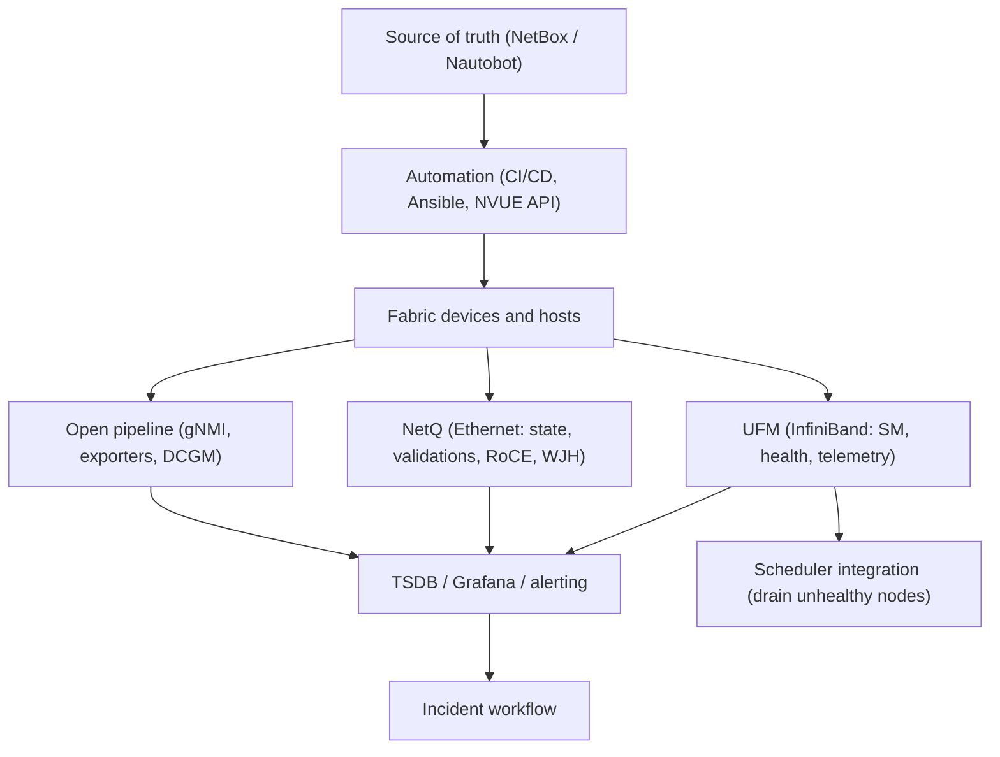

## Why this matters

The previous lessons built an operations toolkit from parts: counters, gNMI collectors, Prometheus, validation scripts, automation pipelines. That approach is flexible and vendor-neutral, and many large operators run it. But it leaves gaps that a fabric-aware platform fills: a topology model that understands what a fat tree or an InfiniBand subnet is, fabric-wide validations ("is MTU consistent everywhere?", "are all BGP sessions up?"), historical state ("what did the routing table look like at 02:14?"), and on InfiniBand, the one function you cannot do without: running and supervising the subnet manager.

NVIDIA's two platforms in this space are **UFM** (Unified Fabric Manager), rooted in InfiniBand, and **NetQ**, rooted in Cumulus Linux Ethernet. Knowing what each does, where they overlap with your open tooling, and where they do not, is part of designing operations for an AI cluster. Product capabilities and packaging change between releases (and NVIDIA has been extending UFM toward Spectrum-X Ethernet), so this lesson focuses on roles and concepts and tells you what to check in the current documentation.

## Concepts

### What a fabric management platform does

| Function | Generic stack (gNMI + Prometheus + scripts) | Fabric platform (UFM / NetQ) |
|---|---|---|
| Counter collection | Yes, if you build exporters | Built in, with fabric-specific counters pre-selected |
| Topology model | You build it from LLDP/SoT | Discovered and visualised; knows switches, hosts, links |
| Validations | You write them | Pre-built checks (for example BGP, MTU, cabling, link health) |
| Historical state | Metrics only, unless you store state | State snapshots over time (NetQ), event history (both) |
| Subnet manager | n/a for Ethernet; OpenSM separately for IB | UFM manages the SM for InfiniBand |
| Vendor knowledge | You encode it | Vendor-maintained health rules and thresholds |
| APIs | Whatever you build | REST APIs and exports into your own stack |

The platform does not replace a source of truth or an automation pipeline: it is primarily an **observe, validate and act** layer. The healthy design treats it as one more data source and one more control interface, integrated with the rest.

> [!ANALOGY]
> In a service provider network, an element management system (EMS) from the equipment vendor sits alongside the provider's own OSS. The EMS understands the boxes deeply (alarms, optics, cross-connects); the OSS owns inventory, orders and customers. UFM and NetQ play the EMS role for an AI fabric. The analogy breaks for InfiniBand: there, UFM is not just observing the fabric, its subnet manager *is* the control plane, so its availability is a production dependency, not a monitoring convenience.

## How it works

### UFM for InfiniBand

An InfiniBand subnet needs a Subnet Manager (SM) to discover the topology, assign LIDs, compute and program forwarding tables (routing engines such as fat-tree or up-down variants), configure partitions (PKeys) and QoS (SL-to-VL mappings), and react to topology changes. The open-source SM is OpenSM; UFM Enterprise runs and manages an SM (based on OpenSM technology) and adds a management layer on top. Typical UFM functions, subject to edition and release:

- **Subnet management**: SM configuration, routing engine choice, high-availability SM (primary and standby UFM servers), partition (PKey) management.
- **Discovery and topology**: fabric map of switches, HCAs and links; comparison against an expected topology to catch miscabling.
- **Monitoring and telemetry**: port counters (the IBTA counters from the counters lesson plus vendor extensions), link speed/width, cable and transceiver information, congestion indicators. A separate UFM Telemetry component focuses on high-rate counter collection and export.
- **Events and health**: thresholds on counters (symbol errors, link-down, receive errors), event history, health reports and fabric-wide diagnostics (comparable to running `ibdiagnet` on demand and on schedule).
- **Actions**: for example disabling or isolating an unhealthy port so the SM routes around it, resetting ports, firmware management of switches, depending on release and permissions.
- **APIs**: a REST API for inventory, ports, events, partitions and actions, which is how UFM integrates with schedulers, dashboards and automation.
- **Analytics**: UFM Cyber-AI (a separate product) applies anomaly detection and predictive analytics to telemetry, for example to flag links likely to fail. Treat predictions as prioritised hints for maintenance, not as ground truth.

NVIDIA has also announced and documented UFM support for Spectrum-X Ethernet fabrics in recent releases. Which features apply to Ethernet, and how they relate to NetQ in your deployment, depends heavily on release and licensing; confirm in the current UFM release notes before planning around it.

### SM high availability and blast radius

Because the SM is the control plane, design for its failure:

- Run at least two SM-capable UFM servers (primary and standby) with SM priorities set so failover is deterministic.
- Make sure only the intended SMs are active: a stray OpenSM running on a compute node with a higher priority can take mastership and reprogram the fabric. `sminfo` (infiniband-diags) shows the current master SM.
- Plan for what an SM restart does: a full heavy sweep on a large fabric takes time, and some changes (such as routing recalculation) can disturb running jobs. Change SM settings in maintenance windows and test them in staging.

### NetQ for Ethernet

NetQ is NVIDIA's network operations tool for Cumulus Linux (and, in supported releases, SONiC and Linux hosts). Its model:

- **Agents** run on switches and optionally hosts and stream state and counters to the NetQ server (on-premises or cloud deployment, depending on release).
- **State over time**: NetQ stores snapshots of state such as interfaces, MAC and route tables, BGP/EVPN sessions, LLDP neighbours and inventory, and lets you query what the network looked like at a past time. This is extremely useful for change correlation: "show me BGP sessions on all spines 10 minutes before the incident".
- **Validations**: `netq check` commands run fabric-wide consistency checks (for example BGP, MTU, interfaces, and others listed in the NetQ CLI reference for your version) and report failures per device.
- **Tracing**: `netq trace` computes the paths between two endpoints across the fabric, including ECMP paths, based on collected state.
- **RoCE and WJH visibility**: recent NetQ releases show RoCE configuration and counters (PFC, ECN, CNP and buffer-related counters per port) and collect What Just Happened drop events from Spectrum switches, so you can see which flows were dropped and why. Exact commands and fields differ by release; check the NetQ CLI reference (for example the `netq show` commands related to RoCE and WJH).
- **Lifecycle management**: in some releases NetQ also handles NOS upgrades and switch inventory.

### Where platforms fit in the operations architecture



Integration points worth building:

- **Topology and inventory reconciliation**: compare the platform's discovered topology with the source of truth automatically; mismatches become tickets.
- **Events into your alerting**: forward platform events (link down, threshold crossings, validation failures) to the same alert routing as everything else, deduplicated.
- **Counters into your TSDB**: export from UFM Telemetry or NetQ (or collect in parallel) so network, host and GPU metrics live on the same dashboards.
- **Scheduler hooks**: when a link or port is marked unhealthy, drain the affected nodes in Slurm or Kubernetes until it is fixed, rather than letting jobs land on a degraded path.

## In practice

### InfiniBand: checking the SM and fabric health

```bash
sminfo                     # which SM is master, its GUID, priority and state
ibdiagnet                  # fabric-wide diagnostics; writes reports and logs
ibqueryerrors              # ports with error counters above thresholds
```

Illustrative `sminfo` output:

```text
sminfo: sm lid 1 sm guid 0x1070fd0300a1b2c4, activity count 5521932 priority 15 state 3 SMINFO_MASTER
```

Check that the GUID belongs to the intended UFM server and that the activity count increases between runs (an SM that is master but not sweeping is a problem). If a different GUID appears, find out where that SM is running before anything else.

Illustrative fragment from an `ibdiagnet` summary (layout varies by version):

```text
-I- Summary
-I- Stage                     Warnings   Errors     Comment
-I- Discovery                 0          0
-I- Lids Check                0          0
-I- Links Check               0          2
-I- Subnet Manager            0          0
-I- Port Counters             3          1
-I- Speed / Width checks      1          0
```

Errors in Links Check and a speed/width warning are where to start: the detailed log names the ports. UFM runs equivalent checks on schedule and shows them in its health views.

### UFM REST API

UFM exposes REST resources for systems, ports, links, events and actions. The base path, authentication method (basic, session or token) and resource names are documented in the UFM REST API guide for each release; a typical integration pattern looks like this (illustrative, adapt to your documented endpoints):

```python
# Illustrative: fetch port data from UFM and flag ports with rising symbol errors
import os, requests

UFM = "https://ufm.example.net"
session = requests.Session()
session.auth = ("svc-monitor", os.environ["UFM_PASSWORD"])
session.verify = "/etc/ssl/certs/corp-ca.pem"

ports = session.get(f"{UFM}/<documented-ports-resource>").json()   # see UFM REST API guide
for p in ports:
    ...  # compare counters with the previous poll, alert on deltas, open a ticket
```

The design point matters more than the endpoint: poll or subscribe, compute deltas, push results into your alerting, and use UFM actions (for example port isolation) only from automation that has the same review and audit trail as configuration changes.

The poll interval of any such integration decides what it can see. Try a 30 s or 5 min interval against a bursty queue and compare instant samples with watermarks.

```widget
telemetry-sampling
```

### NetQ: validations and state history

Commands below exist in NetQ's CLI in recent releases; options and output vary, so check the CLI reference for your version.

```bash
netq check bgp            # fabric-wide BGP session validation
netq check mtu            # MTU consistency across links
netq show interfaces      # interface state across the fabric
netq trace 10.20.3.17 from leaf-r1-01   # paths to a destination from a device
```

Illustrative `netq check mtu` output (trimmed):

```text
mtu check result summary:
Total nodes         : 72
Checked nodes       : 72
Failed nodes        : 1
Rotten nodes        : 0
Warning nodes       : 0

Link MTU Consistency Test   : 1 failure
Hostname     Interface    MTU    Peer          Peer Interface   Peer MTU   Error
leaf-r5-03   swp31        1500   spine-07      swp5             9216       MTU Mismatch
```

One mismatched link out of thousands is exactly the kind of defect that hides from per-device checks and causes intermittent RoCE problems for flows hashed onto that link.

Historical queries are often the fastest way to answer "what changed?". Many `netq show` commands accept a time reference (for example an `around` option) to display state as it was at an earlier time; see the CLI reference for the supported syntax.

### Decision table: using the platform during incidents

| Symptom | Platform evidence | Next step |
|---|---|---|
| IB job failures cluster-wide, routes changing | UFM/SM events: SM failover, heavy sweeps, `sminfo` master changed | Find the cause of the failover or the rogue SM; stabilise mastership |
| One IB port with rising symbol errors | UFM port health / threshold events | Isolate or drain, replace cable/optic, re-check BER |
| RoCE drops behind one leaf | NetQ RoCE counters and WJH drop reasons on that leaf | Compare QoS config with policy; fix via automation |
| Intermittent loss for some flows | `netq check mtu`, `netq trace` paths | Fix the mismatched link found on the path |
| "Nothing changed" but performance dropped | NetQ state history around the time; UFM event history | Correlate with config or topology changes |

## Common pitfalls

- **Rogue subnet manager.** Symptom: IB fabric reprograms unexpectedly, jobs fail. Cause: OpenSM started on a compute node or test server with a higher priority. Fix: check `sminfo`, disable stray SMs, set priorities deliberately, monitor master GUID.
- **Single SM server.** Symptom: fabric cannot react to changes during a UFM outage. Cause: no standby SM. Fix: deploy UFM high availability and test failover.
- **Platform as a silo.** Symptom: engineers must check three UIs during an incident. Cause: events and counters not exported. Fix: forward events and metrics into the shared alerting and dashboards.
- **Unaudited actions.** Symptom: a port was isolated and nobody knows why. Cause: manual actions in the GUI. Fix: drive actions through automation with logs, or at least require ticket references.
- **Assuming feature parity across releases.** Symptom: a runbook command fails after an upgrade. Cause: commands and features change between UFM/NetQ versions. Fix: pin runbooks to versions and test after upgrades.
- **Trusting predictions blindly.** Symptom: healthy links replaced, or real failures missed. Cause: treating analytics output as certain. Fix: use predictions to prioritise inspection, confirm with BER and counters.

## Key takeaways

- Fabric platforms add topology awareness, fabric-wide validations, historical state and vendor health rules on top of raw counters.
- On InfiniBand, UFM manages the subnet manager, which is the control plane: run it highly available and watch for rogue SMs with `sminfo`.
- NetQ provides fabric-wide validations (`netq check`), path tracing, state history and, in recent releases, RoCE counters and WJH drop visibility for Ethernet.
- Feature sets change by release and licence (including UFM for Spectrum-X Ethernet); verify in current documentation.
- Integrate platforms with the source of truth, the shared TSDB and alerting, and the scheduler, and drive their actions through audited automation.
