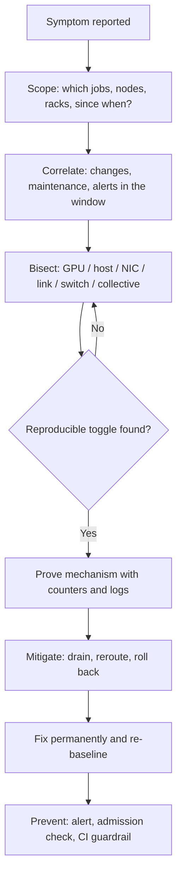

## Why this matters

Knowing every counter is not the same as solving incidents. Real incidents arrive as vague, multi-team symptoms ("checkpoint took 40 minutes", "loss curve has spikes", "jobs on rack 12 keep dying"), with several red herrings, partial evidence, and pressure from people who are paying for thousands of idle GPUs. The difference between a junior and a senior AI fabric engineer is not the number of commands they know; it is how fast they reduce the search space, how carefully they separate cause from consequence, and whether the same incident ever happens twice.

This lesson walks through five incidents written as incident reports. They are **composite, fictionalised scenarios** built from failure patterns that are common in AI fabrics; the names, timestamps and numbers are illustrative, not captures from a specific production system. Read each one actively: before you reach the root cause, stop and decide what you would check next.

## Concepts

### The anatomy of a useful incident report

| Section | What it contains | Common mistake |
|---|---|---|
| Summary | One paragraph: impact, duration, root cause, status | Burying the impact (GPU-hours lost, jobs affected) |
| Impact | Who and what was affected, measured | "Some jobs were slow" with no numbers |
| Timeline | Timestamped facts, including detection and every change | Mixing interpretation into the timeline |
| Evidence | The commands and outputs that proved the hypothesis | Showing only the evidence that fits |
| Root cause | The mechanism, explained end to end | Stopping at the first "why" ("a cable was bad") |
| Fix | What restored service, and what made it permanent | Treating mitigation as the fix |
| Prevention | Concrete, owned, dated actions: alerts, checks, guardrails | "Be more careful next time" |

Reports are **blameless**: they describe how the system (processes, tools, automation) allowed a human or a component to cause harm, not who to blame. That is not softness; it is what makes engineers report problems early and truthfully.

### Evidence hierarchy

Not all evidence is equal. In order of strength:

1. **A reproducible test that toggles the symptom** (exclude node X and the slowdown disappears; include it and it returns).
2. **A counter or log that increments in step with the symptom** and has a known mechanism linking it to the symptom.
3. **A configuration diff** that coincides with the start of the symptom.
4. **Correlation in time** without a mechanism.
5. **Someone's hunch.**

A good investigation climbs this ladder: hunches and correlations generate hypotheses; only reproducible tests and mechanistically linked counters confirm them.

> [!ANALOGY]
> Aviation accident investigation is the right model: reconstruct the timeline from recorders, separate the initiating event from the cascade, and issue recommendations that change the system, not just the pilot. Classic enterprise ticket handling ("rebooted, works now, closing") is the wrong model. Where the analogy breaks: in an AI fabric you can often *reproduce* the failure safely on a drained node, which aviation investigators can rarely do, so you should demand that stronger evidence.

## How it works

### The common investigation loop

Every case below follows the same loop, and you should be able to see it in each timeline.



### Mitigate first, but preserve evidence

Under pressure, the first goal is to restore service, often by draining a node, disabling a link or rolling back a change. Before you do, **capture evidence**: counter snapshots on both ends of the suspect link, NCCL logs, the switch configuration, `lspci` and `nvidia-smi` output. A reboot or a counter clear destroys the information you need for the root cause, and without the root cause you cannot prevent recurrence.

### Separate root cause from side effects

Many signals in an AI fabric are **consequences**. PFC pauses can be caused by congestion that is itself caused by an ECMP collision. Retry-exceeded errors are caused by drops that are caused by a misconfiguration. Thousands of flush errors follow one QP error. When you see many signals, ask of each: "Could this cause all the others, or is it caused by one of them?"

## In practice

### Case 1: the optic that slowed 1,024 GPUs, then killed the job

**Summary.** A 1,024-GPU training job on an InfiniBand fabric ran about 15% slower for two days and then crashed with NCCL timeouts. Root cause: one leaf-to-spine optic with a degrading receiver lane, causing a high post-FEC error rate and eventually link flaps. Impact: roughly 2 days at reduced throughput plus a 3-hour restart from checkpoint.

**Timeline (illustrative).**

| Time | Event |
|---|---|
| Day 1 09:10 | Job owner reports step time up from 1.9 s to 2.2 s, no code change |
| Day 1 10:30 | Compute ruled out: GPU clocks and throttle reasons normal on all ranks |
| Day 1 14:00 | nccl-tests on drained nodes from the job: normal. Ticket parked as "job-specific" |
| Day 3 03:42 | Job crashes: NCCL reports transport errors and timeouts on multiple ranks |
| Day 3 04:15 | On-call runs a fabric-wide error sweep; one spine port stands out |
| Day 3 05:00 | Link disabled, SM reroutes; job restarted from checkpoint |
| Day 3 11:00 | Optic replaced, fibre cleaned, link re-enabled after BER verification |

**Evidence.** A fabric-wide error sweep with `ibqueryerrors` (from infiniband-diags) listed ports whose counters exceeded thresholds. Illustrative output:

```text
Errors for "spine-07" port 23:  [SymbolErrorCounter == 65535] [PortRcvErrors == 20419] [LinkDownedCounter == 4]
Errors for "leaf-31" port 61:   [PortXmitDiscards == 112]
```

The legacy `SymbolErrorCounter` is only 16 bits wide and saturates at 65535, so the swept value only says "a lot". After saving the evidence, the team cleared the port's counters and re-read them (`perfquery <lid> 23`) a minute apart: `SymbolErrorCounter` and `PortRcvErrors` were increasing by thousands per minute; every other spine port was at or near zero. Link diagnostics with `mlxlink` (field names depend on the MFT version; check its documentation) showed an effective (post-FEC) BER several orders of magnitude worse than other links, and module diagnostics showed one receive lane several dB weaker than its neighbours.

**Why the earlier test missed it.** The day-1 nccl-tests used a handful of drained nodes whose traffic did not traverse spine-07 port 23. Only the full job, using that link via its routing, was affected. The leaf `PortXmitDiscards` was a side effect: packets queued towards the failing path were discarded when the link went down.

**Root cause.** A contaminated or damaged connector degraded one lane. FEC corrected most errors, but uncorrectable blocks caused packets to be dropped at the receiver (`PortRcvErrors`). Each dropped packet forced end-to-end transport retransmission, which stretched every collective using that link (the ring waits for its slowest hop). As the lane degraded further, the link flapped (`LinkDownedCounter` = 4); each flap triggered rerouting by the SM and timed out in-flight operations, and the fourth flap crashed the job.

**Fix.** Disabled the link (mitigation), replaced the optic, inspected and cleaned both fibre ends, verified BER over a soak period before re-enabling, cleared counters only after evidence was saved.

**Prevention.**
- Alert on the *rate* of `SymbolErrorCounter` and `PortRcvErrors` per port, and on any `LinkDownedCounter` increment outside maintenance windows.
- Automatically flag links whose effective BER crosses a threshold for isolation by on-call.
- When reproducing "job-specific" slowness, test with the **same nodes and placement** as the job, not a convenient subset.

### Case 2: PFC on the wrong priority after a config push

**Summary.** After a fleet-wide QoS template change on a RoCE fabric, all-to-all-heavy jobs (MoE models) lost 30-50% throughput and some hit `IBV_WC_RETRY_EXC_ERR`. Root cause: the new template enabled PFC on priority 4, while the NICs and the switches' DSCP trust map still placed RoCE traffic (DSCP 26) on priority 3. RoCE was running **lossy**. Impact: about 9 hours of degraded throughput across the cluster.

**Timeline (illustrative).**

| Time | Event |
|---|---|
| 18:00 | QoS template v14 pushed to all leaf and spine switches by automation; CI checks passed (syntax only) |
| 19:30 | First reports of slow MoE jobs; dense-model jobs mostly unaffected |
| 22:10 | Two jobs fail with error 12 (retry exceeded) |
| 01:20 | On-call notices that switch PFC pause counters dropped to zero at 18:00 |
| 02:05 | Diff of template v13 vs v14 shows the PFC priority change |
| 02:40 | Rollback to v13; throughput recovers within minutes |

**Evidence.** On the NICs (`ethtool -S`), the per-priority pause counters for priority 3 stopped incrementing after the change (the NICs still had PFC on priority 3, so the counters existed but stayed flat: the switches no longer paused on 3), while receivers showed RDMA `out_of_sequence` climbing (counter names per the mlx5 counters documentation). Illustrative 60-second deltas on one receiver during an all-to-all burst:

```text
ethtool -S: rx_prio3_pause 0        tx_prio3_pause 0          <- was thousands/min before 18:00
hw_counters: out_of_sequence +48211  packet_seq_err (senders) +31877
```

On the leaf switches, egress drops on the queue carrying priority 3 rose during bursts, and PFC counters on priority 4 were zero because no traffic used it. ECN marking was still active, which is why dense-model jobs (less incast) were mostly fine: DCQCN kept queues short enough most of the time, but MoE all-to-all incast overflowed buffers before rate control could react.

Try this in the simulator: disable PFC and push an incast burst; ECN alone reduces the sending rate only after a round trip, so a fast-filling queue still overflows.

```widget
pfc-ecn-sim
```

**Root cause.** The template refactor renamed a variable and the "lossless priority" default changed from 3 to 4. The CI pipeline validated syntax and schema but not *intent*: it never checked that the PFC-enabled priority matched the priority that the DSCP map assigns to RoCE traffic, nor that it matched the NIC configuration.

**Fix.** Rolled back to v13; then fixed the template and added the checks below before re-releasing.

**Prevention.**
- Intent checks in CI: "the DSCP used by RoCE maps to a priority that has PFC enabled and lossless buffer headroom, on every device", and "CNP DSCP maps to a high-priority queue".
- Canary rollout: one pod first, followed by an automatic nccl-tests all-to-all run, and a comparison of PFC and drop counters against the pre-change baseline.
- Alert when RoCE-priority PFC counters fall to zero cluster-wide while traffic is flowing; that is as suspicious as a storm.

### Case 3: ECMP collisions and polarization on a RoCE fabric

**Summary.** On a two-tier RoCE fabric with two parallel links between each leaf-spine pair, nccl-tests busbw varied run to run between 55% and 95% of baseline, with no errors anywhere. Root cause: low flow entropy (one QP per connection) combined with hash **polarization**, because leaf and spine switches used the same hash function and seed. Impact: chronic 20-30% average throughput loss, discovered during a capacity review.

**Timeline (illustrative).**

| Time | Event |
|---|---|
| Week 1 | Benchmark team reports bimodal nccl-tests results across reruns |
| Week 1 | Telemetry shows some spine-to-leaf links at ~95% utilisation while their parallel twins sit near 20% |
| Week 2 | ECN marks concentrated on a small subset of spine egress ports |
| Week 2 | Lab reproduction: same imbalance with identical hash seeds; balanced after changing spine seed |
| Week 3 | Spine hash seeds changed in a maintenance window; QPs per connection increased in job templates |

**Evidence.** Streaming telemetry of per-interface utilisation showed a striking pattern: for each spine-leaf pair, one of the two parallel links carried most of the traffic. ECN-marked packet counters were high on exactly those links, and NIC CNP counters were elevated on the senders whose flows crossed them. No drops, no link errors. Rerunning the same test changed which links were hot, because new QPs meant new RoCE v2 UDP source ports (on mlx5 the source port is derived from QP information; check your NIC documentation), and therefore new hash results.

```widget
ecmp-collision
```

Use the widget to see how a few elephant flows map onto uplinks under static ECMP, and how adaptive routing or spraying changes the picture.

**Root cause.** Two effects combined. First, *collisions*: with one QP per connection, a ring all-reduce created only a few dozen large flows per leaf, too few for static hashing to spread evenly. Second, *polarization*: the leaf selected a spine using hash bits that were identical to those the spine used to pick between its two parallel links. All flows that a leaf sent to a given spine had already been filtered to share those hash bits, so the spine sent them all down the same parallel link.

**Fix.** Configured a different hash seed per tier on the spines (the exact knob is vendor-specific), and raised `NCCL_IB_QPS_PER_CONNECTION` in job templates to increase entropy (more QPs means more distinct UDP source ports; measure the effect on your workload, since more QPs also costs NIC resources). Evaluated adaptive routing on the switch platform as the longer-term fix.

**Prevention.**
- Fabric acceptance tests that check uplink utilisation balance during all-pairs and all-reduce runs, not just aggregate bandwidth.
- Alerting on the variance of utilisation across ECMP group members.
- Standardised hash configuration per tier in the source of truth, with CI checks.

### Case 4: PCIe downtraining on one node after maintenance

**Summary.** A 256-GPU job (32 nodes) ran 22% slower after a weekend maintenance window. Root cause: on one node whose GPU tray had been replaced, a NIC's PCIe link trained at Gen5 x8 instead of Gen5 x16 because a riser cable was not fully seated. Impact: about 18 hours at reduced throughput for the job.

**Timeline (illustrative).**

| Time | Event |
|---|---|
| Sat 10:00 | node-gpu-117: GPU tray replaced; node passes DCGM diagnostics and returns to pool |
| Mon 08:00 | Job owner reports step time +22% since restart |
| Mon 09:30 | Full-scale nccl-tests confirm a lower busbw plateau; single-node tests all pass |
| Mon 10:15 | Parallel bisection (four groups of eight nodes) isolates the group containing node-gpu-117 |
| Mon 10:40 | Per-rail `ib_write_bw` from node-gpu-117 to a golden node: rail 5 at roughly half of line rate |
| Mon 10:50 | `lspci -vv` on rail 5 NIC: LnkSta Width x8 (downgraded) |
| Mon 11:30 | Node drained, riser reseated, link at x16, job rescheduled |

**Evidence.** Illustrative output under load:

```text
$ sudo lspci -vv -s 0000:c1:00.0 | grep -E 'LnkCap:|LnkSta:'
		LnkCap:	Port #0, Speed 32GT/s, Width x16, ASPM not supported
		LnkSta:	Speed 32GT/s, Width x8 (downgraded)
```

Gen5 x8 delivers roughly half the PCIe bandwidth of x16 (about 252 Gb/s per direction before protocol overhead), so rail 5 of this node could not get near 400G line rate. Because the job's collectives span all rails and every ring step waits for its slowest hop, the whole job slowed.

**Why admission missed it.** The DCGM diagnostic validated the GPUs (including the GPU PCIe links) but not the NIC links, and the admission script checked that the NICs were present and "up", not their PCIe width or achieved bandwidth.

**Fix.** Reseated the riser cable; verified LnkSta x16 and per-rail bandwidth; re-ran single-node and two-node nccl-tests before returning the node.

**Prevention.**
- Admission check: for every GPU and NIC, LnkSta speed and width must equal the platform's expected values under load; fail the node otherwise.
- Per-rail `ib_write_bw` to a golden node as part of return-to-service after any hardware work.
- Telemetry: export PCIe link width/generation per device and alert on any change.

### Case 5: the GID index that moved

**Summary.** After a network-config rollout that added IPv6 addresses to the RoCE interfaces via netplan, jobs that included any node rebooted after the rollout failed with NCCL errors containing "error 12". Root cause: job templates hard-coded `NCCL_IB_GID_INDEX=3`; on rebooted nodes the GID table order changed and index 3 became a RoCE v1 entry. Impact: about 60% of new jobs failed over 5 hours; running jobs were unaffected.

**Timeline (illustrative).**

| Time | Event |
|---|---|
| 09:00 | Netplan change (IPv6 addresses on RoCE interfaces) rolled out; applied at next reboot |
| 09:00-14:00 | Nodes reboot gradually through routine maintenance |
| 11:20 | First job failures; error rate rises through the day |
| 13:10 | Pattern spotted: every failing job includes at least one recently rebooted node |
| 13:40 | GID tables compared between a rebooted and a non-rebooted node |
| 14:05 | Templates updated to the correct selection; failures stop |

**Evidence.** NCCL WARN lines on failing jobs (illustrative, wording varies by version):

```text
NCCL WARN NET/IB : Got completion from peer 10.20.7.14<41213> with status=12 opcode=0 len=0 vendor err 129 (Send) localGid ::ffff:10.20.3.11 remoteGid fe80::...
```

The remote GID being an IPv6 **link-local** address is already a strong hint. Comparing the GID table type for index 3:

```text
non-rebooted node:  /sys/class/infiniband/mlx5_0/ports/1/gid_attrs/types/3  ->  RoCE v2   (::ffff:10.20.3.x)
rebooted node:      /sys/class/infiniband/mlx5_0/ports/1/gid_attrs/types/3  ->  IB/RoCE v1 (link-local)
```

**Root cause.** GID table entries are created as addresses are added to the netdev, so their indices depend on order. The rollout changed that order on reboot. Jobs mixing old and new nodes tried to connect with mismatched GID types and unreachable link-local addresses, so requesters received no ACKs and hit `IBV_WC_RETRY_EXC_ERR` after the timeout and retry budget. The partial-reboot pattern explained why only some jobs failed, which initially pointed the team towards a bad rack.

**Fix.** Updated templates to select the IPv4 RoCE v2 GID explicitly rather than by a fixed index (using the NCCL version's address-family/RoCE-version selection, where supported; otherwise computing the index per node at job start from sysfs).

**Prevention.**
- Admission check asserting that the GID used for RDMA is RoCE v2 on the expected subnet.
- Network change reviews include an "RDMA impact" question for any host addressing change.
- Canary: apply host network changes to a small pool, reboot it, and run a multi-node nccl-tests that mixes canary and non-canary nodes.

### Cross-case decision table

| First symptom | Likely cause (from these cases) | Evidence that confirms it | Fix |
|---|---|---|---|
| Slow job, later crashes; one port with rising errors | Degrading optic or connector | Rate of `SymbolErrorCounter`/`PortRcvErrors`, `LinkDownedCounter`, effective BER, module rx power | Replace optic, clean fibre, verify BER |
| Fleet-wide slowdown starting at a change time; pauses vanish | PFC priority mismatch | Config diff; RoCE-priority PFC counters at zero; receiver `out_of_sequence`; switch queue drops | Roll back; add intent checks |
| Run-to-run variance, no errors, uneven link utilisation | ECMP collisions and polarization | Per-member utilisation and ECN marks; variance across reruns | Hash seeds per tier, more QPs, adaptive routing |
| One-node-dependent slowdown after maintenance | PCIe downtraining | Bisection; per-rail perftest; `lspci -vv` LnkSta | Reseat/replace; admission check |
| Retry exceeded on jobs that include certain nodes | GID index drift | GID type/address at the index; NCCL WARN with odd remote GID | Select GID by type/address |

Replay each case through the triage tree: choose the answers its evidence gives and check that you land on the same root cause.

```widget
troubleshooting-tree
```

> [!INTERVIEW]
> "Tell me about a difficult incident you debugged." Interviewers want structure, not drama: the symptom and impact, how you scoped it, the hypothesis you tested and *discarded*, the evidence that proved the root cause, and the prevention you shipped so it could not recur. Use one of these patterns from your own experience, and be specific about counters and commands. Saying "the first test missed it because it did not use the same nodes as the job" shows real depth.

## Common pitfalls

- **Testing a convenient subset.** Symptom: "benchmarks are fine, so it is the job". Cause: the subset does not traverse the faulty component. Fix: reproduce with the same nodes and placement as the failing job.
- **Clearing counters or rebooting before capturing evidence.** Symptom: the problem disappears and returns weeks later. Cause: the evidence for root cause was destroyed. Fix: snapshot counters, logs and configs before mitigation.
- **Stopping at the first why.** Symptom: "bad cable" closed, then another cable fails unnoticed for days. Cause: no one asked why detection took two days. Fix: every report must answer "why did it happen" and "why did we not catch it sooner".
- **Mistaking side effects for causes.** Symptom: time spent tuning PFC thresholds during an ECMP polarization problem. Cause: congestion signals are consequences of imbalance. Fix: ask which signal could explain all the others.
- **CI that validates syntax but not intent.** Symptom: a valid config breaks lossless behaviour. Cause: no semantic checks. Fix: encode invariants (PFC priority equals RoCE priority, MTU consistent, hash seeds per tier) as tests.
- **Prevention items with no owner or date.** Symptom: the same incident a quarter later. Cause: actions were "noted". Fix: track prevention items like any engineering work.

## Key takeaways

- Incidents follow a loop: scope, correlate with changes, bisect, find a reproducible toggle, prove the mechanism, mitigate, fix, prevent.
- Capture evidence before mitigation; a reboot or a counter clear can erase the root cause.
- Many fabric signals are side effects; look for the one cause that explains all of them.
- Reproduce with the failing job's nodes and paths, not a convenient subset.
- Configuration drift (QoS templates, GID indices) causes as many incidents as hardware; intent-level CI checks and canaries prevent them.
- Every incident should end with an automated check: an alert, an admission test or a CI guardrail.
- Write blameless reports with numbers: impact, timeline, evidence, root cause, fix and owned prevention items.
