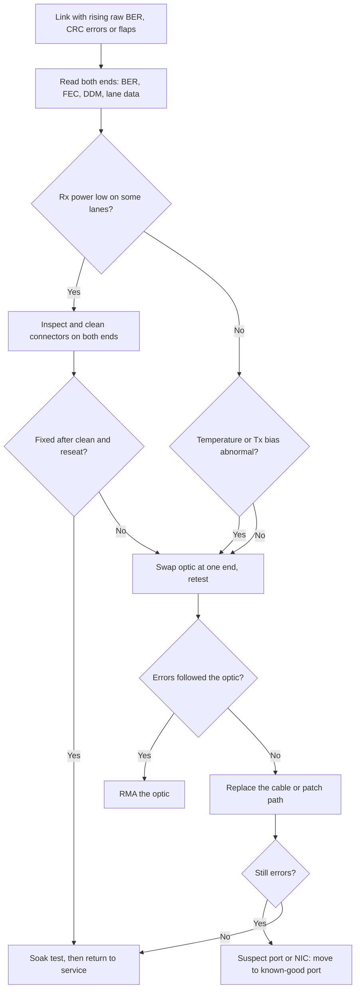

## Why this matters

A modern AI fabric has tens of thousands of 400G and 800G links running PAM4 signalling at
50-100+ Gb/s per lane, through pluggable optics, fibre patch panels and connectors that someone
cleaned (or did not) on a loading dock. At these speeds every link has a non-zero raw bit error rate
by design; forward error correction (FEC) is what makes them usable. That changes how you troubleshoot
the physical layer. "Any error is bad" no longer works: a perfectly healthy link corrects millions of
bit errors per second. What matters is the **margin**: how close the raw error rate is to what FEC can
correct, and whether any errors escape FEC.

Link-layer faults are the most common hardware root cause of degraded AI jobs. A marginal link rarely
goes down cleanly. It corrupts a few packets per minute (each costing an RDMA retransmission or, on
InfiniBand generations that support it, a link-level retransmission), flaps for a second at 3 a.m., or retrains at a lower speed. The
training job sees a straggler or an NCCL timeout and nobody suspects a dusty connector. This lesson
teaches you to read link health quantitatively and isolate the failing part.

## Concepts

### Raw BER, effective BER and uncorrectable codewords

| Term | Meaning | Where measured |
|---|---|---|
| Raw (pre-FEC) BER | Fraction of bits received in error **before** FEC correction | PHY / SerDes, reported by tools such as `mlxlink` |
| Corrected errors | Bits or symbols FEC fixed; no packet impact, but they consume margin | FEC statistics (`ethtool -I --show-fec`, mlx5 PHY counters) |
| Uncorrectable codewords | FEC blocks with more errors than the code can fix; the data is corrupted | FEC statistics; leads to CRC/FCS errors |
| Effective (post-FEC) BER | Error rate that remains after FEC; this is what upper layers experience | Derived from uncorrectable blocks / symbol errors |
| Symbol errors | Errors detected at the symbol (coding) level; meaning depends on the PHY and tool | IB `SymbolErrorCounter`, mlx5 `rx_symbol_err_phy` |

The key mental model: **raw BER measures the health of the channel; effective BER measures the
damage to traffic.** A rising raw BER is an early warning. Non-zero effective BER is already an
incident for RDMA traffic.

### What FEC can and cannot do

Ethernet at 100G per port with 25G NRZ lanes typically uses RS(528,514) "KR4" FEC; PAM4 rates
(50G lanes and above, as in 200G/400G/800G Ethernet) use RS(544,514) "KP4" FEC. Reed-Solomon codes
work on multi-bit symbols (10-bit symbols in these codes) and can correct up to a fixed number of
symbol errors per codeword: 7 for RS(528,514) and 15 for RS(544,514). Errors that are spread out
are easy; **bursts** that put more than that many bad symbols in one codeword are not. InfiniBand
HDR and NDR also rely on FEC for their PAM4 lanes; the exact FEC mode is negotiated and reported by
the tools (check `mlxlink` output and your NVIDIA documentation for the mode in use on your
generation).

A commonly quoted figure is that KP4 FEC can bring a raw BER of around 2.4e-4 down to a post-FEC
error rate that meets the Ethernet target. Treat that as the **cliff**, not the operating point:
production links should run orders of magnitude below it so that temperature, ageing and dust do not
push them over. Vendors publish their own acceptance thresholds (often expressed as a maximum raw BER
in the 1e-6 to 1e-8 range plus zero, or near zero, uncorrectable blocks over a soak period). Use your
vendor's numbers.

### Why tiny effective BER still hurts

Make the numbers concrete. A 400 Gb/s link moves 4 x 10^11 bits per second.

| Effective BER | Errored bits per second at 400 Gb/s | Roughly one error every |
|---|---|---|
| 1e-9 | 400 | 2.5 ms |
| 1e-12 | 0.4 | 2.5 s |
| 1e-15 | 0.0004 | 42 minutes |

Each escaped error typically corrupts a packet, which fails its CRC and is dropped. For RoCEv2 that
means the receiver sees a sequence gap and the sender retransmits (with go-back-N on many NICs, the
whole window behind the lost packet). For a ring all-reduce with thousands of flows, a link that drops
a packet every few seconds can be a measurable straggler; a link at 1e-9 is a disaster.

> [!ANALOGY]
> FEC is like the error-correcting memory (ECC) in a server: a few corrected errors per day are
> normal and invisible, but a DIMM whose corrected-error rate climbs is about to fail, and you replace
> it before it throws an uncorrectable error. Where it breaks down: memory ECC corrects per word with
> tiny overhead and errors are rare; link FEC on PAM4 corrects errors **continuously**, millions per
> second, so "corrected errors present" is never by itself a fault. You alert on the rate and trend.

### Link flaps and retraining

A **flap** is a link going down and up. On Ethernet, the switch logs carrier transitions; the
routing protocol (BGP in most AI fabrics) may withdraw and re-advertise routes, and ECMP groups
change. On InfiniBand, `LinkDownedCounter` increments and the subnet manager may reroute. Each flap
in an RDMA fabric can stall or kill in-flight QPs, causing NCCL errors. A related event is **link
error recovery** (IB `LinkErrorRecoveryCounter`): the link retrains without fully going down, still
pausing traffic for a moment. Also watch for links that come up at a **lower speed or width** than
planned (for example a 4x port at 2x, or 400G at 200G) after a retrain.

## How it works

### The physical chain and its failure modes

```text
 NIC SerDes -> host connector/cage -> transceiver (DSP, laser) -> fibre/connectors/patch panel
           -> transceiver (photodiode, DSP) -> switch cage -> switch SerDes
```

| Part | Typical failure | Signature |
|---|---|---|
| Fibre connector (MPO/MTP, LC) | Dirt, scratched end face, not fully latched | High raw BER on some lanes, low Rx power on those lanes |
| Fibre / patch panel | Tight bend, crushed cable, wrong polarity | Very low or no Rx power, link down or flapping |
| Transceiver | Ageing laser, DSP fault, overheating | Tx bias drifting, temperature high, BER rising over weeks |
| DAC/ACC copper cable | Damaged conductor, too long for the rate | High BER on specific lanes, no optical DDM to read |
| Host/switch SerDes or cage | Rare electrical fault, bent pins | Errors follow the port, not the cable or optic |
| Configuration | FEC mode mismatch, forced speed mismatch | Link does not come up, or up with errors |

Optical faults usually affect **specific lanes**. That is why per-lane data (per-lane BER, per-lane Rx
power) is so useful: a single lane far worse than its siblings points at one fibre pair or one
connector position.

### Isolating the bad part: swap and follow

The classic isolation method: change one component at a time and watch whether the errors follow it.



Always read **both ends**. Errors are measured at the receiver, so a bad transmitter at switch port
A shows up as receive errors on NIC B. Check which direction is bad before you pull anything.

> [!WARNING]
> Inspect fibre end faces with a scope before and after cleaning, and never look into a connector
> with your eye. Reseating without cleaning often moves dust from the ferrule into the mating sleeve
> and makes the next reading worse.

### What the counters mean on each platform

**ConnectX NICs (Ethernet, mlx5 driver), via `ethtool -S`.** Physical-layer counters carry a `_phy`
suffix. Commonly available ones include `rx_crc_errors_phy` (frames with bad FCS),
`rx_symbol_err_phy`, `rx_corrected_bits_phy` and per-lane error counters on some firmware. Check the
kernel's mlx5 counters documentation; availability depends on driver and firmware.

**Generic FEC statistics via ethtool.** Recent kernels and drivers expose FEC statistics through
`ethtool -I --show-fec <dev>` (corrected blocks, uncorrectable blocks, sometimes per lane). The
configured and active FEC mode come from `ethtool --show-fec <dev>`.

**InfiniBand, via `perfquery` (PMA counters).** The standard port counters include
`SymbolErrorCounter`, `LinkErrorRecoveryCounter`, `LinkDownedCounter`, `PortRcvErrors`,
`PortRcvRemotePhysicalErrors`, `LocalLinkIntegrityErrors` and `ExcessiveBufferOverrunErrors`.
`ibqueryerrors` scans the whole fabric for ports whose error counters exceed thresholds, and
`iblinkinfo` shows the speed and width each link negotiated.

**Both, via `mlxlink`.** `mlxlink` (part of NVIDIA Firmware Tools) reads the PHY directly on
ConnectX adapters and NVIDIA switches: operational state, speed, FEC mode, raw and effective BER,
per-lane information, and module (transceiver) data. Section and field names vary between MFT
releases, so read the output rather than scripting against exact strings without checking.

> [!INTERVIEW]
> "A link shows millions of corrected FEC errors. Do you replace it?" A strong answer: not on that
> alone. Corrected errors are expected on PAM4. Look at the raw BER relative to vendor thresholds,
> the trend over days, per-lane balance, uncorrectable blocks and CRC errors, and compare to sibling
> links with the same optic type. Replace or clean when the margin is poor or degrading, or when any
> errors escape FEC. Bonus: mention checking both ends and DDM Rx power per lane.

## In practice

### Step 1: link state, speed and FEC mode

```bash
ethtool eth3 | grep -E 'Speed|Link detected'
ethtool --show-fec eth3
```

```text
# Illustrative output
        Speed: 400000Mb/s
        Link detected: yes
FEC parameters for eth3:
Supported/Configured FEC encodings: Auto RS
Active FEC encoding: RS
```

If the speed is lower than the design (for example 200000Mb/s on a 400G port), the link retrained
down: treat it as a fault even if it carries traffic.

### Step 2: PHY health with mlxlink

```bash
mlxlink -d mlx5_3            # basic state, speed, FEC
mlxlink -d mlx5_3 -c         # add physical counters and BER
mlxlink -d mlx5_3 -m         # add transceiver (module) information
```

```text
# Illustrative output, trimmed; field names differ between MFT releases
Operational Info
----------------
State                           : Active
Speed                           : 400G
Width                           : 4x
FEC                             : Standard_RS-FEC - (544,514)

Physical Counters and BER Info
------------------------------
Time Since Last Clear [Min]     : 4320.0
Effective Physical Errors       : 0
Effective Physical BER          : 15E-255
Raw Physical Errors Per Lane    : 1203994,1187420,1176002,98822310
Raw Physical BER                : 1E-9
Link Down Counter               : 0
Link Error Recovery Counter     : 0
```

Annotation:

- `Effective Physical Errors : 0` and a vanishingly small effective BER: no errors have escaped FEC
  in three days. Traffic is not yet affected.
- `Raw Physical BER : 1E-9` for the whole link looks comfortable, **but** lane 3 has about 80 times
  the raw errors of lanes 0-2. One lane is losing margin. This is the early warning you want: a dirty
  or damaged fibre position, or a weak optic lane.
- `Link Down Counter : 0`: no flaps. Combined with the lane imbalance this link is a candidate for
  a scheduled clean-and-inspect, not an emergency.

### Step 3: optics digital diagnostics (DDM)

```bash
ethtool -m eth3
```

```text
# Illustrative output, trimmed (QSFP-DD / OSFP style, per-lane values)
Module temperature                        : 52.10 degrees C
Module voltage                            : 3.2950 V
Laser tx bias current (Channel 1)         : 7.120 mA
Laser tx bias current (Channel 4)         : 7.080 mA
Transmit avg optical power (Channel 1)    : 0.8913 mW / -0.50 dBm
Rcvr signal avg optical power (Channel 1) : 0.7943 mW / -1.00 dBm
Rcvr signal avg optical power (Channel 2) : 0.7762 mW / -1.10 dBm
Rcvr signal avg optical power (Channel 3) : 0.8128 mW / -0.90 dBm
Rcvr signal avg optical power (Channel 4) : 0.2512 mW / -6.00 dBm
```

Channel 4 receives about 5 dB less light than its siblings: that matches the lane with high raw
errors in `mlxlink` (lanes numbered from 0 there and from 1 here; confirm lane mapping for your
module type). A 5 dB deficit on one lane almost always means a dirty or damaged connector position or
fibre, not a bad receiver. Compare against the module's warning and alarm thresholds, which `ethtool
-m` also prints for most modules. Field names and units vary with module type and ethtool version.

### Step 4: InfiniBand port counters

```bash
perfquery <lid> <port>         # error counters for one port (-x for extended data counters)
ibqueryerrors                  # scan the fabric for ports with errors above thresholds
iblinkinfo                     # negotiated width and speed of every link
```

```text
# Illustrative perfquery output, trimmed
# Port counters: Lid 412 port 17
SymbolErrorCounter:..............1834
LinkErrorRecoveryCounter:........3
LinkDownedCounter:...............1
PortRcvErrors:...................211
PortRcvRemotePhysicalErrors:.....0
PortXmitDiscards:................0
PortXmitWait:....................102938
```

Reading it: symbol errors and receive errors on the same port, plus retrains and a link-down event,
is a physical-layer problem on the link **arriving at** this port. `PortXmitWait` is about congestion
(time the port had data but no credits to send) and is not a physical-layer indicator; do not mix
them up. Take a second reading after a known interval to get rates before acting.

### Step 5: soak and accept

After any repair, clear (or snapshot) the counters, run traffic at line rate for a defined period
(for example `ib_write_bw` bidirectional or an all-pairs test) and check against acceptance criteria:
zero effective errors, raw BER under the vendor threshold with no lane far out of family, no flaps,
correct speed and width.

### Decision table

| Symptom | Likely cause | Evidence command | Fix |
|---|---|---|---|
| High raw BER on one lane, low Rx power on that lane | Dirty or damaged connector / fibre | `mlxlink -c`, `ethtool -m` | Inspect, clean, reseat; replace patch cord |
| High raw BER on all lanes, normal Rx power | Optic DSP or SerDes issue, wrong cable type/length | `mlxlink -c -m` both ends | Swap optic, then cable, then port |
| Non-zero effective errors / uncorrectable blocks | Margin exhausted | `mlxlink -c`, `ethtool -I --show-fec` | Treat as incident: drain traffic, repair now |
| `rx_crc_errors_phy` rising on NIC | Errors escaping FEC on the link into the NIC | `ethtool -S` deltas | Same as above; check switch transmit side |
| Link flaps (`LinkDownedCounter`, carrier changes) | Loose connector, failing optic, thermal | Switch logs, `perfquery`, DDM temperature | Reseat, replace optic, check airflow |
| Link up at lower speed or width | Retrain after errors, bad lane, mismatch | `ethtool`, `iblinkinfo`, `mlxlink` | Repair lane, re-negotiate, verify config |
| Link will not come up | FEC/speed mismatch, polarity, no light | `ethtool --show-fec`, DDM Rx power | Align FEC/speed config; check fibre path |
| Temperature high, Tx bias drifting up | Optic ageing or airflow problem | `ethtool -m` trend | Proactive optic replacement, fix cooling |

## Common pitfalls

- **Alerting on corrected errors.** Symptom: thousands of "FEC error" alerts on healthy links. Cause:
  treating corrected errors as faults on PAM4. Fix: alert on raw BER thresholds, lane imbalance,
  uncorrectable blocks and CRC rates.
- **Reading only one end.** Symptom: you replace the NIC-side optic and errors persist. Cause: the
  errors were caused by the switch-side transmitter or the fibre. Fix: always read both ends and
  establish the bad direction.
- **Reseating without cleaning.** Symptom: BER is worse after the "fix". Cause: contamination moved
  to the mating surface. Fix: inspect with a scope, clean, inspect again.
- **Confusing congestion counters with physical errors.** Symptom: a link with high `PortXmitWait` is
  sent for RMA. Cause: `PortXmitWait` measures credit starvation (congestion), not bit errors. Fix:
  use `SymbolErrorCounter`, `PortRcvErrors` and BER for link health.
- **Ignoring speed downshift.** Symptom: one rail is slow with no errors. Cause: a link retrained at
  half rate. Fix: check negotiated speed and width in monitoring, and alert on deviations from plan.
- **Forcing FEC off to "make it come up".** Symptom: link comes up, then RDMA retransmissions soar.
  Cause: running PAM4 without FEC. Fix: match FEC mode on both ends as the vendor specifies.
- **Clearing counters during an investigation.** Symptom: you lose the evidence of intermittent
  flaps. Cause: reset before snapshot. Fix: snapshot first; clear only when starting a soak test.

## Key takeaways

- On PAM4 links, corrected errors are normal; raw BER is margin, effective BER is damage.
- RS(544,514) KP4 FEC corrects up to 15 symbols per codeword; production links must run far below
  its correction limit, using vendor thresholds.
- Any error that escapes FEC becomes a dropped packet and an RDMA retransmission, so non-zero
  effective errors are an incident.
- Per-lane data (BER and Rx power) localizes faults to a fibre position or connector.
- Read both ends, swap one part at a time, and let the errors tell you which part they follow.
- Flaps, retrains and speed downshifts are link faults even when the link is "up".
- `PortXmitWait` is congestion, not physical-layer health; keep the two diagnoses separate.
