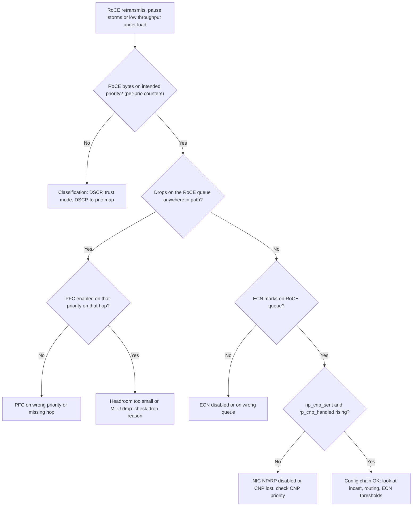

## Why this matters

RoCEv2 performance depends on a chain of settings that must agree on every hop: the application or
NCCL sets a DSCP; the NIC maps it to a priority; every switch trusts that DSCP, maps it to the same
queue, has PFC enabled on that priority with enough headroom, and marks ECN on that queue; the
receiving NIC turns ECN marks into CNPs; and the CNPs travel back on their own high-priority class.
Break any link of that chain and the fabric usually still **works**. Ping works, small RDMA tests pass,
`ib_write_bw` between two idle hosts hits line rate. The failure only appears under real AI load,
as retransmissions, pause storms or bandwidth collapse during all-to-all phases.

That makes lossless misconfigurations some of the most expensive bugs in an AI cluster: they pass
acceptance tests that do not create congestion, and they surface weeks later as "the network is
slow at scale". This lesson catalogues the common mistakes, the evidence each one leaves, and how to
verify the whole chain end to end.

## Concepts

### The intended design (a common reference)

The exact values are a design choice; many NVIDIA-based RoCE deployments use defaults similar to
these (check your vendor's validated design):

| Element | Typical value | Where configured |
|---|---|---|
| RoCE data DSCP | 26 | Application / NCCL (`NCCL_IB_TC`), RDMA CM ToS, or NIC default |
| RoCE data priority / traffic class | 3 | NIC DSCP-to-priority map, switch DSCP-to-TC map |
| PFC enabled on | priority 3 only | NIC (`mlnx_qos --pfc`) and every switch port in the path |
| ECN marking | on the RoCE queue (TC 3) | Switch queue profile (min/max thresholds, probability) |
| CNP DSCP / priority | 48 / 6, strict priority | NIC notification-point settings, switch scheduler |
| Trust mode | DSCP (L3) on NIC and switch | `mlnx_qos --trust dscp`, switch QoS trust |
| MTU | Jumbo (for example 9000+ host, 9216 switch), RDMA path MTU 4096 | Netdev, switch ports, RoCE active MTU |

Note on `NCCL_IB_TC`: it sets the full 8-bit traffic class (ToS byte), not the DSCP. DSCP 26 with
ECT(0) in the ECN bits is 26 x 4 + 2 = 106, which is why values such as `NCCL_IB_TC=106` appear in
deployment guides.

### Failure classes

Every misconfiguration falls into one of four classes:

1. **Classification:** RoCE traffic lands in the wrong priority or queue (wrong DSCP, trust
   mismatch, map mismatch). It loses PFC protection or its ECN profile.
2. **Flow control:** PFC is on the wrong priority, missing on some hop, or has insufficient
   headroom. Packets are dropped under congestion, or the wrong traffic gets paused.
3. **Congestion control:** ECN is disabled, on the wrong queue, has bad thresholds, the NIC does
   not react, or CNPs are delayed. PFC becomes the only brake and pause spreads.
4. **Size:** MTU disagreements cause drops of full-size packets only.

> [!ANALOGY]
> This is like a service-provider QoS deployment where marking, classification, policing and
> queuing have to agree on every router: mark EF at the edge, trust it in the core, put it in the
> priority queue. Forget the trust statement on one core router and voice is silently best-effort on
> that hop. Where it breaks down: in classic QoS a mistake costs some jitter; in a lossless RoCE
> fabric it changes the **loss model**. Traffic that was designed never to be dropped is now
> dropped, and RDMA transports recover from loss far more expensively than TCP does.

## How it works

### 1. PFC on the wrong priority

RoCE is marked DSCP 26 and mapped to priority 3, but PFC is enabled on priority 4 (a typo in a
template, or a different convention between teams). Under congestion the switch queue for priority 3
fills, cannot pause the sender, and tail-drops. Meanwhile priority 4, which carries little or no
traffic, is "protected".

Signature: per-priority byte counters show RoCE on priority 3; pause counters show activity (or
configuration) only on priority 4; switch drop counters climb on the RoCE queue; receivers see
sequence errors and senders retransmit. On an mlx5 host whose own PFC is on priority 4, `ethtool -S`
lists only `prio4` pause counters: `rx_prio3_pause`/`tx_prio3_pause` are absent, because mlx5
exposes them only for PFC-enabled priorities. Any pauses the switch sends for priority 3 then show
up in the switch's per-priority PFC transmit counters, not on the NIC.

### 2. Trust mismatch

Classification can be based on the 802.1p PCP in a VLAN tag (L2 trust) or the DSCP (L3 trust). Most
AI back-end fabrics are routed and untagged, so there **is no PCP** to trust. If the switch is left in
L2 trust, or the NIC is left in PCP trust while the switch uses DSCP, frames are classified into
the default priority (often 0), which is lossy and has no ECN profile.

A subtle variant: the switch trusts DSCP, but the NIC is in PCP trust. The NIC then sends RoCE on
its priority based on its own rules, and, crucially, honours or generates PFC for priorities that
do not match what the switch uses. Both ends must agree.

Use the mapper to reproduce the classification failures: set trust PCP on an untagged link, or a wrong NCCL_IB_TC, and follow the packet to the queue it really lands in.

```widget
dscp-mapper
```

### 3. Partial rollout and missing hops

PFC and ECN are per-hop. A new spine, a replaced leaf, or a port that was missed in a config push
has a default (lossy) profile. Traffic crossing that one hop loses lossless behaviour; traffic on
other paths is fine. Because ECMP spreads flows over many paths, the symptom is that **some flows**
retransmit, depending on hashing, which looks random.

### 4. MTU mismatch

The RDMA path MTU (256-4096 bytes for RoCE) sets the payload size. The NIC derives the usable
RoCE MTU from the netdev MTU: a netdev MTU of 1500 gives an active RoCE MTU of 1024; a jumbo netdev
MTU gives 4096. On the wire a 4096-byte RoCE payload adds Ethernet, IP, UDP, BTH (and possibly
other extension headers) and ICRC overhead, so every switch port in the path must accept frames
larger than 4096 bytes. If one hop has a smaller MTU, it discards every full-size packet: RoCEv2
packets are not fragmented and reassembled in the network, so there is no graceful fallback.

Signature: small messages and latency tests work; large transfers stall, retry and eventually fail
with transport retry errors. Switch interface counters show oversize or MTU-exceeded discards on the
offending hop.

### 5. ECN disabled, misplaced or ignored

DCQCN needs three things: the switch marks ECN (CE) on the RoCE queue when it builds up; the
receiving NIC (notification point, NP) turns CE-marked packets into CNPs; the sending NIC (reaction
point, RP) reduces its rate on CNP. Any missing piece leaves PFC as the only congestion control.
Pause then spreads hop by hop, creating head-of-line blocking and victim flows, and in the worst case
pause storms.

Signature: the RoCE queue sees high occupancy and many PFC frames but **zero** ECN-marked packets
(switch side ECN disabled or on the wrong queue); or the switch marks but the receiver's
`np_cnp_sent` stays at zero (NP disabled for that priority); or CNPs are sent but `rp_cnp_handled`
on the sender stays at zero (RP disabled, or the CNPs are not arriving).

### 6. CNP priority missing or wrong

CNPs are tiny, time-critical packets. If they travel in the default lossy queue, behind bulk
traffic, they arrive late or are dropped. DCQCN then reacts too late, queues build, and PFC triggers.
The usual practice is to send CNPs with their own DSCP mapped to a high-priority (often strict
priority) queue on every switch. A partial version of this bug: CNPs are marked correctly by the NIC,
but the switches do not map that DSCP to a priority queue.

### 7. Headroom too small

PFC only works if the ingress buffer has headroom to absorb the bytes already in flight when pause
is sent: cable propagation delay both ways, the time to finish transmitting the current frame, and
the response time of the peer. Longer cables (for example a new long-distance spine link), higher
speeds or larger MTU need more headroom. Too little headroom causes **ingress drops on a lossless
priority** even though PFC is enabled and pausing.

Use the widget to watch the relationship between queue depth, ECN marking and PFC XOFF/XON: move the
ECN threshold above the XOFF threshold and observe that PFC fires before DCQCN ever gets a chance.

```widget
pfc-ecn-sim
```

### Triage flow



> [!INTERVIEW]
> "PFC is enabled everywhere and you still see drops on RoCE. Name three possible causes and how
> you'd tell them apart." Strong answer: RoCE is not on the PFC-enabled priority (check per-priority
> byte counters and DSCP-to-priority maps); headroom is insufficient on a hop (ingress drops on the
> lossless priority while pause is being sent; drop-reason telemetry such as WJH may say buffer);
> MTU mismatch (only large packets dropped, oversize/MTU counters on one hop). Also: drops caused by
> link errors, which are not buffer drops at all (CRC counters).

## In practice

### Host side: check trust, PFC and the DSCP map

`mlnx_qos` (shipped with NVIDIA OFED / DOCA host packages) shows and sets the NIC's QoS state:

```bash
mlnx_qos -i eth3
```

```text
# Illustrative output, trimmed; layout differs by version
DCBX mode: OS controlled
Priority trust state: dscp
dscp2prio mapping:
        prio:0 dscp:07,06,05,04,03,02,01,00,
        ...
        prio:3 dscp:31,30,29,28,27,26,25,24,
        ...
Receive buffer size (bytes): 130944,130944,0,0,0,0,0,0
PFC configuration:
        priority    0   1   2   3   4   5   6   7
        enabled     0   0   0   1   0   0   0   0
```

Check: trust is `dscp`; DSCP 26 maps to priority 3; PFC is enabled on 3 and only 3. To correct:

```bash
mlnx_qos -i eth3 --trust dscp
mlnx_qos -i eth3 --pfc 0,0,0,1,0,0,0,0
```

Make these persistent through your provisioning system; they do not survive every driver reload or
reboot on their own.

### Host side: is traffic on the priority you think?

The mlx5 driver exposes per-priority counters. Run a load test and take two snapshots:

```bash
ethtool -S eth3 | grep -E 'prio[0-7]_(bytes|pause)|discards_phy|out_of_buffer'
```

```text
# Illustrative 60 s delta during an all-to-all test (misconfigured host)
tx_prio0_bytes:           1,382,113,991,040
tx_prio3_bytes:                      18,240
rx_prio3_pause:                           0
tx_prio3_pause:                           0
rx_discards_phy:                          0
```

RoCE is leaving on priority **0**, not 3: the traffic is unprotected. Typical causes are a NIC in
PCP trust on an untagged fabric, an application not setting the traffic class, or a missing ToS
setting for RDMA CM connections. For RDMA CM based apps, NVIDIA's `cma_roce_tos` utility sets the
default ToS per device (for example `cma_roce_tos -d mlx5_3 -t 106`); NCCL uses `NCCL_IB_TC`.

On some driver versions you will also find per-priority discard counters and pause-storm counters
(`tx_pause_storm_warning_events`, `tx_pause_storm_error_events`). Check the mlx5 counters
documentation for your kernel and driver release.

### Host side: is DCQCN running?

RDMA hardware counters live under `/sys/class/infiniband/<dev>/ports/<port>/hw_counters/`. On
mlx5 devices the congestion-related ones typically include `np_ecn_marked_roce_packets`,
`np_cnp_sent`, `rp_cnp_handled` and `rp_cnp_ignored`; transport-error ones include
`out_of_sequence`, `packet_seq_err`, `local_ack_timeout_err` and `duplicate_request`. Exact names
and availability depend on driver and firmware; check the mlx5 counters documentation.

```bash
cd /sys/class/infiniband/mlx5_3/ports/1/hw_counters
grep . np_ecn_marked_roce_packets np_cnp_sent rp_cnp_handled out_of_sequence packet_seq_err
```

```text
# Illustrative 60 s deltas on a receiver and on a sender in a congested job
receiver: np_ecn_marked_roce_packets 0    np_cnp_sent 0
          out_of_sequence 48,211          packet_seq_err 0
sender:   rp_cnp_handled 0                local_ack_timeout_err 0
```

Interpretation: no ECN marks arriving, no CNPs, and many out-of-sequence packets at the receiver.
Out-of-sequence means packets were lost in the network and the receiver saw a gap. Packets are
being dropped and the fabric is not signalling congestion at all. Next step: switch side, check
ECN configuration on the RoCE queue and drop counters on the path.

If instead `np_ecn_marked_roce_packets` is rising but `np_cnp_sent` is zero, the receiving NIC is not
acting as a notification point for that priority. Older NVIDIA OFED releases exposed per-priority
enable knobs under `/sys/class/net/<if>/ecn/` (for example `roce_np/enable/<prio>` and
`roce_rp/enable/<prio>`); newer stacks may manage these differently. Check the documentation for
your driver release rather than assuming the path exists.

### Host side: MTU chain

```bash
ip link show eth3 | grep -o 'mtu [0-9]*'
ibv_devinfo -d mlx5_3 | grep -E 'max_mtu|active_mtu'
```

```text
# Illustrative output
mtu 9000
                        max_mtu:                4096 (5)
                        active_mtu:             4096 (5)
```

Then confirm every switch port in the path supports frames larger than a 4096-byte RoCE payload
plus headers. A quick probe for the IP path (not RDMA itself) is a do-not-fragment ping at the size
you expect: `ping -M do -s 4200 <peer>` should succeed. Compare large and small RDMA transfers with
perftest; if `-s 1024` succeeds and full-size transfers stall, suspect MTU.

### Switch side

Exact commands depend on the switch OS. On Cumulus Linux 5.x with NVUE, `nv show qos roce` reports
the RoCE mode and the resulting PFC, ECN and DSCP mappings; on SONiC, check the QoS maps, the PFC
priorities per port and the WRED/ECN profiles in the configuration database; on other platforms use
the vendor's QoS show commands. Whatever the OS, verify on **every hop** in the path:

- DSCP 26 is trusted and mapped to the RoCE traffic class.
- PFC is enabled on that priority, transmit and receive, on all relevant ports.
- The RoCE queue has an ECN profile with sensible thresholds (marking starts well before XOFF).
- The CNP DSCP maps to a high-priority (often strict) queue.
- Port MTU covers the largest RoCE frame.
- Per-queue drop counters and drop-reason telemetry (for example What Just Happened on NVIDIA
  Spectrum) are zero for the lossless class under load.

```text
# Illustrative per-queue counters on a leaf port during the bad window
Port swp17  TC   tx_bytes          ecn_marked    pfc_tx_pause   drops
            0    9.1 GB            0             0              0
            3    1.2 TB            0             0              1,882,004
            6    41 MB             0             0              0
```

TC 3 drops with no ECN marks: congestion signalling is not active on this port's RoCE queue, and a
lossless queue should not drop at all. Remember that PFC pauses for this congestion are sent by the
**ingress** ports feeding swp17 (towards the senders), so also check priority-3 PFC transmit counters
on those ports: if they are zero too, PFC is not enabled for priority 3 on this switch. A config diff
against a healthy leaf shows what is missing.

### Decision table

| Symptom | Likely cause | Evidence command | Fix |
|---|---|---|---|
| RoCE bytes on prio 0 | NIC trust PCP on untagged fabric, or app not setting TC | `mlnx_qos -i`, `ethtool -S` per-prio bytes | `--trust dscp`; set `NCCL_IB_TC` / `cma_roce_tos` |
| Drops on RoCE queue, pause on another priority | PFC enabled on wrong priority | `mlnx_qos`, switch PFC config, per-prio pause | Align PFC priority on NIC and all switches |
| Some flows retransmit, others fine | One hop missing lossless config | Per-hop switch counters, config diff | Fix and re-push template; add CI check |
| Large transfers stall, small succeed | MTU too small on a hop | `ip link`, `ibv_devinfo`, switch MTU, oversize counters | Raise switch/host MTU consistently |
| Heavy PFC, zero ECN marks | ECN disabled or on wrong queue | Switch ECN counters per queue | Enable ECN profile on RoCE queue |
| ECN marks arrive, `np_cnp_sent` = 0 | NIC NP disabled for that priority | RDMA `hw_counters` | Enable NP for RoCE priority (driver docs) |
| CNPs sent, `rp_cnp_handled` = 0 | CNPs dropped/delayed, or RP disabled | Sender `hw_counters`, switch CNP queue drops | Map CNP DSCP to priority queue; enable RP |
| Lossless-prio ingress drops while pausing | Insufficient headroom | Switch buffer/headroom stats, WJH reason | Recalculate headroom for cable length/speed |
| Pause storm counters, frozen ports | Stuck receiver or PFC loop | `tx_pause_storm_*`, switch PFC watchdog | Isolate the host; enable PFC watchdog |

## Common pitfalls

- **Testing only without congestion.** Symptom: acceptance passes, production struggles. Cause: an
  idle point-to-point `ib_write_bw` never fills a queue, so PFC, ECN and CNP paths are never
  exercised. Fix: include incast and all-to-all tests and check pause/ECN/CNP counters during them.
- **Checking one switch.** Symptom: "config is correct" yet drops persist. Cause: a missed hop. Fix:
  verify every switch from a source of truth and diff live config against the intended template.
- **Mixing up ToS and DSCP.** Symptom: traffic lands in an unexpected class. Cause: setting
  `NCCL_IB_TC=26` (ToS 26 is DSCP 6) instead of 106. Fix: compute ToS = DSCP x 4 + ECN bits.
- **Assuming PFC prevents all drops.** Symptom: drops on a "lossless" priority. Cause: headroom
  sized for short cables, or link CRC errors. Fix: separate buffer drops from CRC drops; recompute
  headroom when cable lengths or speeds change.
- **ECN thresholds above XOFF.** Symptom: PFC fires constantly; few ECN marks. Cause: the queue
  reaches the pause threshold before the marking threshold. Fix: set ECN marking to start well below
  XOFF.
- **Forgetting the reverse path.** Symptom: DCQCN reacts sluggishly. Cause: CNPs ride a congested
  lossy queue on the way back. Fix: give CNPs their own high-priority DSCP and queue on every hop.
- **Non-persistent host settings.** Symptom: a node behaves differently after reboot. Cause: QoS
  applied by hand. Fix: apply through provisioning and check on node health gates.

## Key takeaways

- A lossless RoCE fabric is a chain: DSCP, trust, priority map, PFC, headroom, ECN, CNP and MTU must
  agree on every hop and on both NICs.
- Most misconfigurations still pass simple tests; only congestion and full-size packets expose them.
- Per-priority byte and pause counters tell you which class the traffic really uses.
- Out-of-sequence and retransmission counters mean loss; ECN/CNP counters tell you whether DCQCN is
  even running.
- Large transfers failing while small ones work is the classic MTU signature.
- CNPs need their own high-priority path; ECN must mark before PFC triggers.
- Verify against a source of truth on every switch, and keep an incast test in acceptance.
