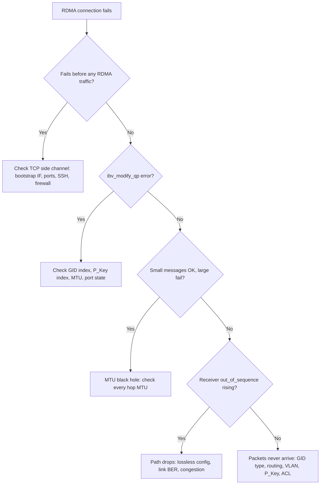

## Why this matters

When an RDMA connection fails, the error usually surfaces far from its cause. NCCL prints `NET/IB : Got completion from peer ... with error 12` (the wording varies by release; newer versions print `status=12` or the status name) and the job dies after a long pause; an MPI job hangs during `MPI_Init`; a storage client reports "transport retry counter exceeded". None of these messages says "your GID index points at an IPv6 link-local address" or "the spine MTU is 1500". A TCP application that hits an MTU black hole often limps along thanks to PMTUD and retransmissions; an RDMA reliable connection gives up after a handful of hardware retries and moves the queue pair into the error state, and in a collective that kills the whole job.

At Level 4 you need a mental model that maps the *stage* of failure to a short list of causes, plus the exact host evidence that confirms each one. Most RDMA connection problems are configuration problems that a well-built admission check would catch: a GID table that changed after a network reconfiguration, a P_Key with limited membership, a firewall that blocks the TCP side channel used to exchange QP numbers. This lesson builds that model.

## Concepts

### Four stages, four classes of failure

An RC (reliable connected) RDMA connection is established in stages. The stage that fails tells you where to look.

| Stage | What happens | Typical failure | First evidence |
|---|---|---|---|
| 1. Out-of-band exchange | Applications exchange QP number, PSN, GID/LID, rkeys over TCP (perftest, NCCL bootstrap, MPI) or via rdma_cm | Hang or "connection refused" before any RDMA traffic | Application timeout; TCP connectivity test on the bootstrap interface |
| 2. QP transitions | RESET → INIT → RTR → RTS via `ibv_modify_qp` | `ibv_modify_qp` returns an error (typically EINVAL) | Error from the modify call: bad GID index, bad P_Key index, unsupported MTU |
| 3. First packets | Requester sends; responder must accept and ACK | `IBV_WC_RETRY_EXC_ERR` on the first operation | Peer never sees packets, or drops them: routing, VLAN, wrong GID type, P_Key mismatch |
| 4. Sustained traffic | Large transfers under load | Errors only for large messages or only under load | MTU black hole, lossy fabric, link errors, congestion |

The RC QP state machine is the backbone of stages 2 and 3:

```widget
qp-state-machine
```

The widget shows which attributes each transition needs. Note where the address information lives: the **RTR** transition takes the address vector (destination GID or LID, source GID index, hop limit, traffic class), the path MTU, the remote QP number and the receive PSN. The **RTS** transition takes the timeout, retry_cnt and rnr_retry. A mistake in any of these appears as a failure on the first packet, not at configuration time.

### The GID table

On RoCE, a port has a **GID table** whose entries are derived from the IP addresses of the associated netdev (and its VLAN interfaces). Each address typically produces two entries: one of type **RoCE v1** (Ethertype 0x8915, layer-2 only, not routable) and one of type **RoCE v2** (UDP destination port 4791, routable over IP). IPv6 link-local addresses create entries too. The **index** of an entry depends on the order in which addresses were added, so it is *not stable* across reconfiguration.

Hard-coding a GID index (for example `NCCL_IB_GID_INDEX=3` or `ib_write_bw -x 3`) works until someone adds an IPv6 address, renames a VLAN interface, or changes netplan. Then index 3 may refer to a different address or a v1 entry, and connections fail or quietly use the wrong source address.

> [!NOTE]
> Recent NCCL releases can select the GID automatically, with variables such as `NCCL_IB_ROCE_VERSION_NUM`, `NCCL_IB_ADDR_FAMILY` and `NCCL_IB_ADDR_RANGE` that steer the choice. Check the NCCL environment-variable documentation for the version you run before relying on them, and prefer automatic selection over a hard-coded index where your version supports it.

### RoCE v1 vs v2

RoCE v1 frames cannot cross a router. In a routed leaf-spine fabric, a sender that picks a v1 GID can reach peers on the same VLAN at best, and nothing behind a router. If one side uses v1 and the other v2, the packets do not match what the responder expects and the connection fails. For rdma_cm-based applications, the default RoCE mode per port is configurable (via the rdma_cm configfs interface under `/sys/kernel/config/rdma_cm/`, or the `cma_roce_mode` helper shipped with some NVIDIA driver packages); check your distribution's documentation for the exact mechanism. In modern AI fabrics the answer is almost always: **use RoCE v2 everywhere**.

### MTU on RDMA

RDMA MTU (the *path MTU* of the QP) is one of 256, 512, 1024, 2048 or 4096 bytes of payload. On RoCE, the port's `active_mtu` is derived from the netdev MTU: with a netdev MTU of 9000 the active MTU is typically 4096; with 1500 it is 1024. The path MTU of a QP is set at RTR, and well-behaved applications use the minimum of both ends. But the endpoints cannot see the **switches**. If a link in the path has a smaller MTU than the RoCE packets need (4096 payload plus headers, a bit over 4.1 KB), large packets are dropped silently. Small messages work, large ones time out: the classic MTU black hole, with no PMTUD to save you.

### P_Keys (InfiniBand partitions)

On InfiniBand, every packet carries a 16-bit **P_Key**. The top bit marks membership: **full** (bit set, e.g. 0xFFFF for the default partition) or **limited** (bit clear, 0x7FFF). Full members can talk to anyone in the partition; **two limited members cannot talk to each other**. The Subnet Manager programs each port's P_Key table, and a QP selects an entry by **P_Key index** at INIT. If the index points at a partition the peer is not in, or both ends are limited members, packets are dropped by the receiving HCA or by switch partition enforcement. Partition violations increment constraint-error counters (for example `PortRcvConstraintErrors` / `PortXmitConstraintErrors` in perfquery output; check your tool's counter names).

> [!ANALOGY]
> A GID index is like referring to "the third address on the badge" instead of the address itself: fine until someone prints a new badge with an extra line. P_Keys behave like private VLANs with community and isolated ports, where isolated (limited) members can only talk to promiscuous (full) members. Where the analogy breaks: a VLAN mismatch fails at layer 2 immediately, whereas an RDMA mismatch often shows up only as a retry timeout seconds later, after the QP has already been "successfully" configured.

## How it works

### What "retry exceeded" really means

An RC requester sends a packet and starts the **local ACK timeout**: 4.096 µs × 2^`timeout` (the `timeout` attribute, 0-31, set at RTS; 0 means infinite). If no ACK or NAK arrives, it retransmits from the last unacknowledged PSN, up to `retry_cnt` times (0-7). When retries are exhausted, the work request completes with **`IBV_WC_RETRY_EXC_ERR`** (status code 12 in `enum ibv_wc_status`), the QP moves to the **error** state and all outstanding work requests complete with `IBV_WC_WR_FLUSH_ERR` (5).

With `timeout` = 20, one timeout is about 4.3 seconds; with 7 retries, the requester gives up after roughly half a minute. That is why NCCL jobs that hit this error often *hang* for tens of seconds first. NCCL exposes these attributes as `NCCL_IB_TIMEOUT` and `NCCL_IB_RETRY_CNT` (defaults vary by version; check the documentation). Raising them hides the problem for longer; it never fixes it.

Retry-exceeded is a symptom, not a cause. It means "the requester got no answer". Possible reasons:

| Cause | Why no ACK arrives |
|---|---|
| Wrong destination GID/LID or wrong source GID | Packets go nowhere or to the wrong host; the peer never sees them |
| RoCE v1 GID on a routed fabric | Packets are not routable past the first hop |
| MTU black hole | Large packets dropped by a switch with a smaller MTU |
| P_Key mismatch or limited-limited | Receiver or switch drops the packets |
| Peer process died, QP already in error | Nothing to answer |
| Lossy fabric under heavy loss (no PFC, link BER) | Retransmissions also lost; transient bursts exhaust retries |
| ACL/firewall dropping UDP 4791 on a router | RoCE v2 packets filtered in the path |

### Related completion errors

| Status (`enum ibv_wc_status`) | Code | Meaning | Common cause |
|---|---|---|---|
| `IBV_WC_RETRY_EXC_ERR` | 12 | Transport retry counter exceeded | Path broken, peer gone, drops (see table above) |
| `IBV_WC_RNR_RETRY_EXC_ERR` | 13 | Receiver-not-ready retries exceeded | Peer has no receive WQE posted (application bug or overloaded receiver); `rnr_retry` too low |
| `IBV_WC_REM_ACCESS_ERR` | 10 | Remote access error | Wrong rkey, address out of the registered region, missing remote access flags |
| `IBV_WC_LOC_PROT_ERR` | 4 | Local protection error | lkey/address mismatch, memory not registered (or GPU memory registration failed) |
| `IBV_WC_WR_FLUSH_ERR` | 5 | Flushed | The QP already went to error; look for the *first* non-flush error |
| `IBV_WC_REM_INV_REQ_ERR` | 9 | Remote invalid request | Operation not permitted on the remote QP, length problems |

The vendor syndrome (the `vendor_err` field) adds detail; its meaning is device-specific, so look it up in the vendor documentation rather than guessing.

> [!WARNING]
> In a log full of errors, the **first** non-flush completion error is the root symptom. Hundreds of `IBV_WC_WR_FLUSH_ERR` (status 5) lines that follow are consequences of the QP entering the error state. Do not chase them.

### What the counters tell you

On mlx5 NICs, RDMA transport counters are exposed under `/sys/class/infiniband/<dev>/ports/<port>/hw_counters/` and via `rdma statistic show`. Counter names and availability vary by kernel and firmware; check NVIDIA's mlx5 counters documentation. Commonly used ones:

| Counter (mlx5, verify on your system) | Increments when | Points to |
|---|---|---|
| `local_ack_timeout_err` | The requester's ACK timer expired (counted at the sender) | Lost packets or lost ACKs in the path, peer unresponsive |
| `packet_seq_err` | A NAK for a sequence error was received (counted at the sender) | Drops in the fabric with a live peer |
| `out_of_sequence` | The responder received packets out of order, i.e. after a gap (counted at the receiver) | Drops in the fabric towards this receiver |
| `implied_nak_seq_err` | A read response or ACK implies missing earlier responses | Drops on the response path |
| `rnr_nak_retry_err` | An RNR NAK was received (counted while the QP's RNR retry limit is not yet exceeded) | Receiver not posting buffers |
| `req_cqe_error` / `resp_cqe_error` | Completions with error on requester / responder side | Correlate with the application's error log |

A useful pattern: if `local_ack_timeout_err` climbs on the sender but `out_of_sequence` is zero on the receiver, the packets are not reaching the receiver at all (addressing, routing, ACL, MTU). If `out_of_sequence` climbs on the receiver, packets arrive with gaps: the path works but drops some (congestion drops, link errors, lossless misconfiguration).

Try the pattern in the decoder: mark `local_ack_timeout_err` rising with `out_of_sequence` flat, then flip `out_of_sequence` to rising, and compare the ranked causes.

```widget
counter-decoder
```

### The side channels

RDMA rarely bootstraps itself. **perftest** tools exchange QP information over a TCP connection (default port 18515, changeable with `-p`) unless you pass `-R` to use rdma_cm. **NCCL** bootstraps over TCP sockets on the interface selected by `NCCL_SOCKET_IFNAME`, using ephemeral ports. **MPI** launchers use SSH and their own TCP channels. A host firewall blocking those ports makes the job hang at initialisation even though the RDMA data path is perfect.

For the RDMA data path itself, host packet filters (iptables/nftables) usually **do not see** hardware-offloaded RoCE traffic, because the NIC handles it without the kernel network stack. Soft-RoCE (`rdma_rxe`) is the exception: it runs over the kernel UDP stack, so a firewall rule dropping UDP 4791 breaks it. On real fabrics, UDP 4791 is blocked by **router ACLs, cloud security groups or firewall appliances** in the path, which typically matters only when traffic is routed between segments.

The same offload hides RoCE from packet capture on the netdev: `tcpdump -i <netdev> udp port 4791` shows nothing on mlx5 while traffic flows. To see the packets on the host, capture on the RDMA device with libpcap's RDMA sniffer (`tcpdump -D` lists it as `mlx5_0 (RDMA sniffer)`; use `tcpdump -i mlx5_0 -w roce.pcap` with the RDMA device name, root, and on Ubuntu an AppArmor profile that allows it), or NVIDIA's `ibdump` on the NVIDIA stack. Otherwise capture on a switch mirror port.

## In practice

### A triage flowchart



### Step 1: verify the port and the GID table

The examples use `mlx5_0`, the device name the NVIDIA stack (MLNX_OFED / DOCA-OFED) gives the first
port. Distro rdma-core names devices after their PCI address instead (for example `rocep3s0f0`), so
take the name from `rdma link show` or `ibv_devices` on your host. A wrong name fails immediately:
`IB device 'mlx5_0' wasn't found` from `ibv_devinfo`, `IB device mlx5_0 not found` from perftest.

The output below is from the reference hosts (host A `10.10.10.1`, host B `10.10.10.2`, netdev MTU 9000):

```bash stack=inbox
ibv_devinfo -d rocep3s0f0 -v | grep -E 'state|active_mtu|link_layer|GID'
```

```text stack=inbox real
			state:			PORT_ACTIVE (4)
			active_mtu:		4096 (5)
			link_layer:		Ethernet
			phys_state:		LINK_UP (5)
			GID[  0]:		fe80:0000:0000:0000:268a:07ff:fe00:11ee, RoCE v1
			GID[  1]:		fe80::268a:7ff:fe00:11ee, RoCE v2
			GID[  2]:		0000:0000:0000:0000:0000:ffff:0a0a:0a01, RoCE v1
			GID[  3]:		::ffff:10.10.10.1, RoCE v2
```

```bash stack=doca
ibv_devinfo -d mlx5_0 -v | grep -E 'state|active_mtu|link_layer|GID'
```

```text stack=doca real
libibverbs: Warning: couldn't load driver 'libionic-rdmav59.so': libionic-rdmav59.so: cannot open shared object file: No such file or directory
			state:			PORT_ACTIVE (4)
			active_mtu:		4096 (5)
			link_layer:		Ethernet
			phys_state:		LINK_UP (5)
			GID[  0]:		fe80:0000:0000:0000:268a:07ff:fe00:11ee, RoCE v1
			GID[  1]:		fe80::268a:7ff:fe00:11ee, RoCE v2
			GID[  2]:		0000:0000:0000:0000:0000:ffff:0a0a:0a01, RoCE v1
			GID[  3]:		::ffff:10.10.10.1, RoCE v2
```

Reading it: `active_mtu 4096` is the RoCE MTU derived from the netdev MTU of 9000; `link_layer:
Ethernet` means RoCE (an InfiniBand port says `InfiniBand`); index 3, the IPv4-mapped RoCE v2 entry, is
the one you want here. `ibv_devinfo` prints RoCE v1 entries in full hexadecimal and RoCE v2 entries in
compressed form; both lines of a pair hold the same address. (The `libionic` warning on the DOCA host
is harmless noise.)

The same information is in sysfs, which works with every stack and is handy for scripts. The NVIDIA
stack also ships a `show_gids` script (mlnx-tools; not part of rdma-core or distro packages) that
prints the whole table: device, port, index, GID, IPv4 address, RoCE version (`v1`/`v2`) and netdev,
ending with `n_gids_found=N`. Use it when present, but do not assume it exists on every host.

```bash stack=inbox
cat /sys/class/infiniband/rocep3s0f0/ports/1/gids/3                 # the GID itself
cat /sys/class/infiniband/rocep3s0f0/ports/1/gid_attrs/types/3      # "RoCE v2" (v1 entries read "IB/RoCE v1")
cat /sys/class/infiniband/rocep3s0f0/ports/1/gid_attrs/ndevs/3      # netdev the GID belongs to
```

```text stack=inbox real
0000:0000:0000:0000:0000:ffff:0a0a:0a01
RoCE v2
ens64f0np0
```

```bash stack=doca
show_gids
```

```text stack=doca real
DEV	PORT	INDEX	GID					IPv4  		VER	DEV
---	----	-----	---					------------  	---	---
mlx5_0	1	0	fe80:0000:0000:0000:268a:07ff:fe00:11ee			v1	ens64f0np0
mlx5_0	1	1	fe80:0000:0000:0000:268a:07ff:fe00:11ee			v2	ens64f0np0
mlx5_0	1	2	0000:0000:0000:0000:0000:ffff:0a0a:0a01	10.10.10.1  	v1	ens64f0np0
mlx5_0	1	3	0000:0000:0000:0000:0000:ffff:0a0a:0a01	10.10.10.1  	v2	ens64f0np0
...
n_gids_found=8
```

The port state needs care too. `rdma link show` prints `state ACTIVE physical_state LINK_UP` for a
healthy port and `state DOWN physical_state DISABLED` when the local netdev is administratively down.

> [!VERIFIED]
> **Taking the peer's netdev down left the local mlx5 port ACTIVE / LINK_UP.**
> On ConnectX-5 (fw 16.29) back to back with DOCA-OFED 3.4, after `sudo ip link set ens64f1np1 down`
> on host B, host A still showed `link mlx5_1/1 state ACTIVE physical_state LINK_UP netdev ens64f1np1`,
> sysfs `4: ACTIVE` / `5: LinkUp`, and `ethtool` `Speed: 100000Mb/s`, `Link detected: yes`: mlx5 keeps the
> PHY of an admin-down port up. Only `ip link set down` on the LOCAL host changed it, to
> `state DOWN physical_state DISABLED` (sysfs phys_state `3: Disabled`). So a healthy-looking local port
> does not prove the peer's interface is up: check both ends, and test with traffic.

> [!TIP]
> Make GID selection a property of the address, not the index. In admission checks, assert that the GID index your jobs use resolves to `RoCE v2` and to the expected subnet on every NIC. A one-line sysfs check in a node health script catches the most common RoCE connection failure before any job runs.

### Step 2: prove the data path with known-good tools

```bash
# Server (node B, 10.10.10.2)
ib_write_bw -d mlx5_0 -x 3 --report_gbits
# Client (node A)
ib_write_bw -d mlx5_0 -x 3 --report_gbits 10.10.10.2
```

`-x` selects the GID index (RoCE). If the client prints the following, the TCP side channel failed (no server running, wrong address or a firewall), not RDMA:

```text real=inbox
Couldn't connect to 10.10.10.2:18515
Unable to open file descriptor for socket connection
 Unable to init the socket connection
```

If perftest fails while TCP ping works, try a minimal test that removes even more variables:

```bash stack=inbox
ibv_rc_pingpong -d rocep3s0f0 -g 3            # server (node B)
ibv_rc_pingpong -d rocep3s0f0 -g 3 10.10.10.2 # client (node A)
```

```text stack=inbox real
  local address:  LID 0x0000, QPN 0x000048, PSN 0x7bb49d, GID ::ffff:10.10.10.1
  remote address: LID 0x0000, QPN 0x000183, PSN 0xa6939e, GID ::ffff:10.10.10.2
8192000 bytes in 0.01 seconds = 11330.57 Mbit/sec
1000 iters in 0.01 seconds = 5.78 usec/iter
```

```bash stack=doca
ibv_rc_pingpong -d mlx5_0 -g 3            # server (node B)
ibv_rc_pingpong -d mlx5_0 -g 3 10.10.10.2 # client (node A)
```

```text stack=doca real
libibverbs: Warning: couldn't load driver 'libionic-rdmav59.so': libionic-rdmav59.so: cannot open shared object file: No such file or directory
  local address:  LID 0x0000, QPN 0x000047, PSN 0xb3948c, GID ::ffff:10.10.10.1
  remote address: LID 0x0000, QPN 0x000086, PSN 0x519117, GID ::ffff:10.10.10.2
8192000 bytes in 0.01 seconds = 11663.29 Mbit/sec
1000 iters in 0.01 seconds = 5.62 usec/iter
```

On RoCE the LID is always 0 and the GID carries the address. When the two sides use GID indices of different types, the exchange fails with a message that says nothing about GIDs. Here the server on node B runs with `-g 3` and the client uses `-g 0`:

```text real=inbox
$ ibv_rc_pingpong -d rocep3s0f0 -g 0 10.10.10.2
client read/write: No space left on device
Couldn't read/write remote address
  local address:  LID 0x0000, QPN 0x00004a, PSN 0x308e57, GID fe80::268a:7ff:fe00:11ee
```

> [!VERIFIED]
> **A mismatched GID index in `ibv_rc_pingpong` failed with `client read/write: No space left on device`.**
> On ConnectX-5 (fw 16.29) back to back, with both the inbox stack (rdma-core 61) and DOCA-OFED 3.4, a
> client on `-g 0` (the fe80 link-local RoCE v1 entry) against a server on `-g 3` (IPv4 RoCE v2) printed
> `client read/write: No space left on device` and `Couldn't read/write remote address` (exit 1), and the
> client's only address line showed `GID fe80::...`. The error reads like a disk or buffer problem; the
> clue is the `GID` the client printed. Compare the `GID` both sides print, and use the same GID type
> (in practice the RoCE v2 entry of the right subnet) on both ends.

To test rdma_cm-based address resolution (what many storage and MPI stacks use), run `rping -s -v` on the server and `rping -c -a 10.10.10.2 -v -C 5` on the client (`rping` is in the `rdmacm-utils` package, often not installed by default), or add `-R` to perftest commands.

Sweep sizes to find an MTU black hole:

```bash
ib_write_bw -d mlx5_0 -x 3 -a --report_gbits 10.10.10.2   # -a: all sizes from 2 bytes up to 8 MiB
```

On a healthy path the sweep runs through every size (here 100G back to back, MTU 9000 on both hosts):

```text real=inbox
 #bytes     #iterations    BW peak[Gb/sec]    BW average[Gb/sec]   MsgRate[Mpps]
 2          5000           0.077181            0.067564            4.222733
 ...
 2048       5000             73.24              72.83  		     4.445205
 4096       5000             94.88              94.81  		     2.893450
 8192       5000             96.15              94.06  		     1.435192
 ...
 8388608    5000             91.96              91.96  		     0.001370
---------------------------------------------------------------------------------------
```

`-a` registers large buffers, so it is also the test that trips over the locked-memory limit:

```text real=doca
$ ulimit -l 8192; ulimit -l
8192
$ ib_write_bw -d mlx5_0 -x 3 -a -F --report_gbits 10.10.10.2
Couldn't allocate MR with error=12
failed to create mr
Failed to create MR
 Couldn't create IB resources
```

> [!VERIFIED]
> **With the default memlock limit of 8192 KiB, `ib_write_bw -a` failed with `Couldn't allocate MR` before any traffic.**
> The Ubuntu 26.04 reference hosts came up with a locked-memory limit of 8192 KiB (the toolkit's
> `setup-rdma-host.sh` flags it). With that limit, DOCA perftest printed `Couldn't allocate MR with
> error=12` (errno 12, ENOMEM), then `failed to create mr`, `Failed to create MR` and
> ` Couldn't create IB resources`; the distro perftest prints `Couldn't allocate MR` without the error
> number. Raise memlock to unlimited for the test user (for example the toolkit's
> `setup-rdma-host.sh --set-memlock`, effective after a new login) before a size sweep.

Illustrative failing output:

```text
 #bytes     #iterations    BW peak[Gb/sec]    BW average[Gb/sec]   MsgRate[Mpps]
 2          5000           0.11               0.11   		     4.222733
 ...
 2048       5000           98.20              97.95  		     5.978027
 4096       5000           ...
 Completion with error at client
 Failed status 12: wr_id 0 syndrom 0x81     <- 12 = IBV_WC_RETRY_EXC_ERR; the syndrome is device-specific
```

Messages up to 2048 bytes produce packets that fit through the broken hop; at 4096 bytes the packets (4096 bytes of payload plus Ethernet, IP, UDP, BTH and ICRC headers, roughly 4.15 KB on the wire) exceed it. In this illustrative case a spine port had been configured with an interface MTU of 4096, copied from the RDMA MTU by mistake: too small for a 4096-byte RoCE payload plus headers. A hop at 1500 would break even earlier, at 2048-byte packets. Now check the MTU on every hop (NIC netdev, leaf ports, spine ports, any router interface) against your design; on switches, remember that L2 and L3 interface MTUs may be configured separately.

### Step 3: check the counters on both sides

```bash
# Snapshot, run the failing test, snapshot again
for c in local_ack_timeout_err packet_seq_err out_of_sequence; do
  printf '%s ' "$c"; cat /sys/class/infiniband/mlx5_0/ports/1/hw_counters/$c
done
```

Illustrative deltas during a failing test:

```text
sender   local_ack_timeout_err +7   packet_seq_err +0
receiver out_of_sequence       +0                     <- nothing arrives: addressing/ACL/MTU, not congestion
```

### Step 4: on InfiniBand, check partitions and paths

```bash
cat /sys/class/infiniband/mlx5_0/ports/1/pkeys/0     # e.g. 0xffff (full member of the default partition)
cat /sys/class/infiniband/mlx5_0/ports/1/pkeys/1     # e.g. 0x8012 (full member of partition 0x0012)
ibstat mlx5_0                                         # state, rate, base LID, SM LID
perfquery <lid> <port>                                # port error counters, look for constraint errors
```

### The decision table

| Symptom | Likely cause | Evidence command | Fix |
|---|---|---|---|
| Job hangs at init, no RDMA error | TCP bootstrap blocked or wrong interface | `NCCL_DEBUG=INFO` log stops at bootstrap; `nc`/`ss` test on the bootstrap interface | Open the ports, set `NCCL_SOCKET_IFNAME` to the right interface |
| Retry exceeded on first operation, receiver counters flat | Wrong GID index or GID type, routing, ACL | `ibv_devinfo -v` GID table, sysfs `gid_attrs/types`, `ip route get <peer>` | Use the RoCE v2 GID of the right subnet; fix routes/ACLs |
| Works within a rack, fails across racks | RoCE v1 in use, or ACL on routed hop blocks UDP 4791 | GID type of the index in use; router ACL counters | Switch to RoCE v2; allow UDP 4791 on fabric ACLs |
| Small messages fine, large messages retry-exceeded | MTU black hole | `ib_write_bw -a` size sweep; MTU on each hop | Make MTU consistent end to end (jumbo on all fabric links) |
| IB: specific node pairs cannot talk | P_Key membership (limited-limited, wrong partition) | sysfs `pkeys/*`, SM partition config, constraint error counters | Fix partition config on the SM; use the right P_Key index |
| `IBV_WC_RNR_RETRY_EXC_ERR` | Receiver not posting receives fast enough | Application logs; `rnr_nak_retry_err` | Fix the application, raise `rnr_retry` (7 = infinite) where appropriate |
| `IBV_WC_REM_ACCESS_ERR` | Wrong rkey or address range | Application debug output | Application or library bug; check memory registration flags |
| Intermittent retry exceeded under load only | Drops in the fabric: PFC/ECN misconfig, link BER | Receiver `out_of_sequence`; switch drop and PFC counters; link BER | Fix lossless config or the link (see the related lessons) |

## Common pitfalls

- **Hard-coded GID index.** Symptom: jobs fail cluster-wide after a netplan or IPv6 change. Cause: the index now points at a different address or a v1 entry. Fix: select by address/type (NCCL auto-selection where supported) and check in admission scripts.
- **Chasing flush errors.** Symptom: thousands of `IBV_WC_WR_FLUSH_ERR` lines. Cause: QP already in error. Fix: find the first non-flush error and its peer.
- **Raising timeouts to "fix" retry exceeded.** Symptom: the job hangs for minutes instead of 30 seconds, then still fails. Cause: the path is broken; retries cannot fix it. Fix: find why packets are not acknowledged.
- **Testing MTU with ping only.** Symptom: `ping -M do -s 8972` works, RDMA still fails. Cause: a different path (ECMP), a different traffic class, or the RDMA test never ran large sizes. Fix: test with the RDMA tool itself across sizes and across several QPs/flows.
- **Assuming iptables matters for hardware RoCE.** Symptom: a firewall rule change is blamed (or credited) for RoCE behaviour. Cause: offloaded RoCE bypasses the kernel stack. Fix: look at router ACLs and the TCP bootstrap path instead; with Soft-RoCE, host firewalls do matter.
- **Ignoring the bootstrap interface.** Symptom: NCCL picks `docker0` or a management interface and hangs. Cause: auto-detection chose the wrong interface. Fix: set `NCCL_SOCKET_IFNAME` explicitly.
- **Limited P_Key on both ends.** Symptom: two compute nodes in the same partition cannot talk, but both reach the storage server. Cause: both are limited members; only the server is full. Fix: decide membership deliberately in the SM partition configuration.

## Key takeaways

- Identify the stage first: bootstrap, QP transition, first packet, or sustained traffic; each stage has its own short list of causes.
- `IBV_WC_RETRY_EXC_ERR` (12) means "no ACK within timeout × retries"; it is a symptom of a broken or lossy path, not a tuning problem.
- GID indices are not stable; verify that the index in use resolves to a RoCE v2 GID on the right subnet on every node.
- Small-OK/large-fail is an MTU black hole until proven otherwise, because RDMA has no PMTUD.
- Compare sender `local_ack_timeout_err` with receiver `out_of_sequence` to distinguish "nothing arrives" from "some packets drop".
- On InfiniBand, two limited P_Key members cannot communicate; partition problems show up as constraint errors.
- Always read the first non-flush error; everything after it is fallout.
