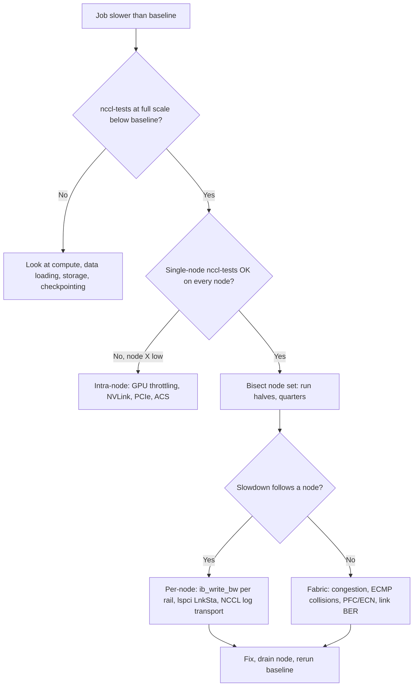

## Why this matters

The most common AI fabric ticket does not say "the network is down". It says "training got 18% slower since Tuesday" or "step time is jittery on job 4471". Nothing is broken in the alarm sense: every link is up, every GPU is healthy according to the scheduler, and every switch is green. Yet thousands of GPUs are now running at the speed of their slowest member, because data-parallel training ends every step with a **synchronous collective**. An all-reduce cannot finish until the last rank has sent its last chunk, so a single GPU that throttles, a single NIC that trained its PCIe link at half width, or a single node whose NCCL quietly fell back to TCP sockets turns into a cluster-wide tax.

These problems are expensive precisely because they hide. Averages look fine (one bad node out of 128 barely moves a fleet-wide mean), aggregate dashboards look fine, and the job does not crash. This lesson teaches you to think in terms of the **tail**: how to prove a slowdown is a straggler problem, how to bisect it down to one component, and which host-level evidence (lspci, nvidia-smi, NCCL logs, DCGM) nails the root cause.

## Concepts

### The slowest member sets the pace

In a ring all-reduce over *n* ranks, each rank sends and receives 2(*n*−1) chunks, and every step waits for its neighbour. The time of the whole ring is governed by its slowest hop. Tree and NVLS/CollNet algorithms change the shape but not the principle: a synchronous collective completes at the speed of its slowest participant.

```widget
allreduce-sim
```

A ring runs at the speed of its slowest link, so one link at half bandwidth slows the whole collective as much as halving every link. Try it in the simulator: halve the bandwidth and, with a large message (the bandwidth-dominated regime), the time roughly doubles. In a real cluster that is what a single degraded link does, even though 99% of the hardware is perfect.

### Two kinds of slow

| Kind | What you see | Typical causes |
|---|---|---|
| **Persistent straggler** | Step time permanently higher; nccl-tests busbw consistently low at large message sizes whenever a specific node is included | PCIe downtraining, NIC at lower link speed, GDR disabled, socket fallback, wrong NUMA binding, ACS redirect, bad cable with high corrected-error rate |
| **Intermittent straggler** | Step-time jitter, p99 step time far above p50, occasional NCCL timeouts | Thermal or power throttling, link flaps or BER bursts causing retransmissions, congestion hotspots, noisy neighbours on shared storage or frontend, host CPU contention (proxy thread starved) |

Intermittent stragglers get worse with scale even when each node is just as healthy as before. Grow the job in the widget below and watch a one-in-a-thousand event per GPU become something that hits almost every step, while each GPU's own average barely moves.

```widget
straggler-tail
```

### The component chain of one rank

Every byte a GPU contributes to an inter-node collective crosses a chain: **GPU HBM → (NVLink or PCIe switch) → NIC → cable/optic → leaf → spine → leaf → NIC → GPU**. A straggler is a weak link anywhere in that chain, plus the CPU-side software that drives it (NCCL proxy threads, the RDMA driver). Troubleshooting is the art of measuring each segment in isolation.

| Segment | Isolating test | Healthy reference (order of magnitude, check your generation) |
|---|---|---|
| GPU compute and HBM | `dcgmi diag`, single-GPU burn-in | Matches peer GPUs of the same SKU within a few percent |
| Intra-node GPU-GPU | nccl-tests on one node (NVLink/NVSwitch only) | Several hundred GB/s busbw on NVSwitch systems |
| GPU-NIC PCIe path | `lspci -vv` LnkSta, `ib_write_bw --use_cuda` loopback or to a known-good peer | Close to NIC line rate (e.g. ~390 Gb/s on a 400G port) |
| NIC-to-NIC over fabric | `ib_write_bw` between node pairs | Close to line rate per rail |
| Full collective | nccl-tests across growing node subsets | busbw plateau consistent with your rail count and link speed |

> [!ANALOGY]
> A convoy on a motorway travels at the speed of its slowest truck, no matter how many sports cars are in it. Classic enterprise networking rarely suffered from this: a slow web server affects its own users, not the whole data centre. Where the analogy breaks: in a ring all-reduce the "slow truck" also delays every other truck *behind it in the ring*, because each step waits for a neighbour's data, so the penalty propagates rather than staying local.

## How it works

### Why one slow node hurts so much: the arithmetic

nccl-tests reports **algbw** (bytes / time) and **busbw** (algbw × 2(*n*−1)/*n* for all-reduce), which normalises to the hardware bandwidth each rank actually needs. On a healthy rail-optimized cluster with eight 400G NICs per node, large-message inter-node all-reduce busbw often sits in the range of a few hundred GB/s per node, depending on generation, NCCL version and algorithm. If one node's NIC is limited to a quarter of line rate, the inter-node phase of the ring is limited to that rate on the affected rail. Because NCCL stripes data across channels and rails, the effect is not always a perfect fraction, but a single degraded NIC typically produces a **large, reproducible drop** that appears whenever that node participates and vanishes when it is excluded. That last property is the key to bisection.

Use the timeline below to see the same effect at the level of a whole training step: raise the straggler slider and watch the comm stream follow the slowest rank while every healthy rank waits.

```widget
training-step-timeline
```

### PCIe downtraining

PCIe links negotiate speed (GT/s) and width (lanes) at training time. A dirty or poorly seated riser, a marginal retimer, BIOS settings, or a failing slot can make a link train at a lower generation or narrower width. The device still works, so nothing alarms, but bandwidth collapses:

| Link | Approximate usable bandwidth per direction |
|---|---|
| Gen5 x16 | ~50-60 GB/s (≈ 400-480 Gb/s) |
| Gen4 x16 | ~25-30 GB/s (≈ 200-240 Gb/s) |
| Gen5 x8 | similar to Gen4 x16, ~25-30 GB/s |
| Gen4 x8 | ~12-15 GB/s (≈ 100-120 Gb/s) |

(Raw rates are 32 GT/s per lane for Gen5 and 16 GT/s for Gen4 with 128b/130b encoding; usable throughput is lower because of TLP overhead. Treat the table as order of magnitude.) A 400G NIC behind a Gen4 x8 link can never move more than roughly a quarter to a third of its line rate.

Downtraining can happen on the **NIC's** link, on the **GPU's** link, or on the **PCIe switch uplink** they share. Check all three.

### Thermal and power throttling

GPUs reduce clocks when they hit thermal or power limits. A single GPU with a failed fan, a blocked airflow path, or a mis-set power cap computes its share of the step more slowly, so it arrives late at the collective and everyone waits. From the network's point of view this looks like a straggler with a *perfectly healthy* fabric. NICs and optics can also overheat; transceivers report temperature via DDM, and some NICs throttle or log warnings at high temperature (check your NIC's firmware documentation).

### NUMA and CPU placement

NCCL moves data GPU-to-NIC directly when GPUDirect RDMA is available, but its **proxy threads** run on the CPU and post work requests for every network transfer. If those threads land on a socket far from the NIC, or are starved because the training process pinned its data loaders to the same cores, network progress slows. Without GPUDirect RDMA, data is staged in host memory, and a buffer on the wrong NUMA node crosses the inter-socket link (UPI/Infinity Fabric), adding latency and capping bandwidth.

```widget
pcie-topo
```

Use the widget to read an `nvidia-smi topo -m` matrix: a GPU-NIC pair marked `PIX` or `PXB` shares a PCIe switch (good); `NODE` crosses the host bridge within a socket; `SYS` crosses the inter-socket link (bad for GPUDirect RDMA traffic).

### ACS and peer-to-peer detours

PCIe **Access Control Services (ACS)** can force peer-to-peer transactions between devices under the same PCIe switch to be redirected up to the root complex (the `ReqRedir` / `CmpltRedir` controls) so the IOMMU can check them. That is useful for VM isolation, but on bare-metal training nodes it sends GPU↔NIC GPUDirect RDMA traffic on a detour through the CPU, cutting bandwidth sharply or, on some platforms, breaking P2P entirely. NCCL's troubleshooting guide recommends disabling ACS on bare-metal systems where it is not needed for isolation (via BIOS settings where possible). In virtualised environments, ACS and the IOMMU are part of the isolation model, and the fix is platform-specific (ATS, IOMMU passthrough modes); follow your hypervisor and NVIDIA's guidance.

### When NCCL falls back

NCCL picks a network plugin at init. If the IB/RoCE path is unusable it can silently fall back to the **socket transport** (TCP over the interface chosen by `NCCL_SOCKET_IFNAME` or auto-detection). Training continues at a small fraction of the expected speed. Common causes:

- `NCCL_IB_DISABLE=1` left in a job template or container image.
- The container has no access to `/dev/infiniband/*` devices or lacks `libibverbs`/the provider library (`libmlx5`).
- The RDMA devices are down, or `NCCL_IB_HCA` names devices that do not exist on this node.

A subtler partial fallback is **losing GPUDirect RDMA**: NCCL still uses IB/RoCE, but stages through host memory because the peer-memory path is unavailable (e.g. the `nvidia_peermem` module not loaded, or dma-buf support missing in the kernel/driver combination), or because NCCL decided the GPU-NIC distance is too large under its `NCCL_NET_GDR_LEVEL` policy.

## In practice

### Step 1: prove it is a straggler, then bisect

A triage flow that works on clusters from 16 to thousands of GPUs:



Run a single-node test on every node first (cheap, parallel, isolates intra-node problems), then bisect the inter-node set. Use a message-size sweep and focus on the large-message busbw plateau.

```bash
# Every node in parallel (e.g. via your scheduler): NVLink/NVSwitch only
./build/all_reduce_perf -b 8M -e 4G -f 2 -g 8
# Inter-node test across a subset (launcher syntax depends on your MPI/Slurm setup)
mpirun -np 64 -N 8 --hostfile half_A.txt ./build/all_reduce_perf -b 1G -e 4G -f 2 -g 1
```

Illustrative output (trimmed) for two halves of a 16-node set:

```text
# half_A (nodes 01-08)                            # half_B (nodes 09-16)
#  size     time(us)  algbw  busbw                #  size     time(us)  algbw  busbw
 4294967296  24410   175.9  346.4                  4294967296  61870    69.4  136.7
```

Interpretation: half A is at the expected plateau for this (illustrative) system; half B is at roughly 40% of it. Keep halving B until one node or one pair of nodes reproduces the drop. With binary search, 16 nodes need about four rounds; 1,024 nodes need about ten.

> [!TIP]
> Bisection is faster when you test many disjoint subsets *in parallel*: split 256 nodes into 32 groups of 8, run all 32 tests at once, and you have localised the bad node to a group of eight in one round. Keep a "golden" node set handy so every test has a known-good partner.

### Step 2: check the PCIe link of the suspect node

```bash
# Find the NIC and GPU PCI addresses, then inspect capability vs status
lspci -d 15b3: -nn                # Mellanox/NVIDIA NICs (vendor ID 15b3)
sudo lspci -vv -s 0000:3b:00.0 | grep -E 'LnkCap:|LnkSta:'
```

Illustrative output:

```text
LnkCap: Port #0, Speed 32GT/s, Width x16, ASPM not supported   <- what the device can do (Gen5 x16)
LnkSta: Speed 16GT/s (downgraded), Width x8 (downgraded)        <- what it trained at (Gen4 x8)
```

Recent pciutils versions print `(downgraded)` when status is below capability; older versions do not, so compare the numbers yourself. Also check the *upstream* bridge port, because the device can only train as high as the slot allows. For GPUs, `nvidia-smi` exposes the same information:

```bash
nvidia-smi --query-gpu=index,pci.bus_id,pcie.link.gen.current,pcie.link.gen.max,pcie.link.width.current,pcie.link.width.max --format=csv
```

> [!NOTE]
> GPUs and some NICs drop their PCIe generation at idle to save power and retrain to full speed under load. Read `pcie.link.gen.current` **while the GPU is busy** (or compare against the max value under load) before you raise a hardware ticket. Width reductions, by contrast, are not a normal power-saving behaviour on these platforms and almost always indicate a physical or firmware problem.

### Step 3: check for throttling

```bash
nvidia-smi -q -d PERFORMANCE
```

Illustrative output for a throttling GPU (section names vary by driver version: older drivers say "Clocks Throttle Reasons", newer ones "Clocks Event Reasons"):

```text
    Clocks Event Reasons
        Idle                              : Not Active
        Applications Clocks Setting       : Not Active
        SW Power Cap                      : Not Active
        HW Slowdown                       : Active        <- hardware-forced slowdown
            HW Thermal Slowdown           : Active        <- because it is too hot
            HW Power Brake Slowdown       : Not Active
        SW Thermal Slowdown               : Not Active
```

At fleet scale, stream these as DCGM fields (clock throttle reasons, temperatures, SM clock) into your telemetry system and alert on *deviation from peers*, not on absolute values. `dcgmi diag -r 2` (or `-r 3` for a longer run) is a reasonable gate before returning a node to service; check the DCGM documentation for what each run level covers on your version.

Also scan the kernel log for GPU Xid events, which the driver logs for GPU faults:

```bash
sudo dmesg -T | grep -i xid
```

### Step 4: read what NCCL actually chose

```bash
NCCL_DEBUG=INFO NCCL_DEBUG_SUBSYS=INIT,NET,GRAPH ./build/all_reduce_perf -b 1G -e 1G -g 1
```

Illustrative log lines, healthy:

```text
NCCL INFO NET/IB : Using [0]mlx5_0:1/RoCE [1]mlx5_1:1/RoCE ... ; OOB eth0:10.0.0.11<0>
NCCL INFO Using network IB
NCCL INFO Channel 00/0 : 3[3] -> 11[3] [send] via NET/IB/3/GDRDMA
```

Illustrative log lines, degraded:

```text
NCCL INFO NET/IB : No device found.
NCCL INFO NET/Socket : Using [0]eth0:10.0.0.11<0>
NCCL INFO Using network Socket                                  <- fell back to TCP
...
NCCL INFO Channel 00/0 : 3[3] -> 11[3] [send] via NET/IB/3      <- IB, but no /GDRDMA suffix
```

The exact wording changes between NCCL releases, so search for the transport name (`Socket` vs `IB`) and the `GDRDMA` marker rather than matching full strings. If GDR is missing, check that the peer-memory path exists:

```bash
lsmod | grep -E 'nvidia_peermem|nv_peer_mem'     # legacy peer-memory module
nvidia-smi topo -m                                 # GPU-NIC distance: PIX/PXB good, SYS bad
```

Note that recent driver/kernel combinations can use dma-buf instead of `nvidia_peermem`; check the NCCL and GPU driver release notes for which mechanism your stack expects.

### Step 5: check ACS and NUMA

```bash
sudo lspci -vvv | grep -E '^[0-9a-f]|ACSCtl' | grep -B1 ACSCtl
```

Illustrative output for a PCIe switch downstream port:

```text
0000:3a:02.0 PCI bridge: ... PCIe switch downstream port
		ACSCtl:	SrcValid+ TransBlk- ReqRedir+ CmpltRedir+ UpstreamFwd+ EgressCtrl- DirectTrans-
```

`ReqRedir+` and `CmpltRedir+` mean P2P requests between devices under this switch are redirected to the root complex. On a bare-metal training node, this is a classic cause of poor GPUDirect RDMA bandwidth. Disable ACS in BIOS if the platform offers the option; otherwise follow NVIDIA's documented procedure for your platform, and make it persistent (a runtime change is lost on reboot).

For NUMA placement:

```bash
cat /sys/class/infiniband/mlx5_0/device/numa_node      # NUMA node of the NIC
nvidia-smi topo -m                                      # includes CPU and NUMA affinity columns
numastat -p <pid>                                       # where a process's memory actually lives
```

### The decision table

| Symptom | Likely cause | Evidence command | Fix |
|---|---|---|---|
| busbw drops only when node X is included; single-node test on X is fine | NIC PCIe downtrained, NIC link at lower speed, or bad cable on one rail of X | `lspci -vv` LnkSta on X's NICs; `ib_write_bw` per rail X↔golden node; `ethtool <if>` / `ibstat` speed | Reseat/replace riser or NIC, replace cable/optic; verify with per-rail bandwidth test |
| Single-node all-reduce on X low | GPU PCIe or NVLink problem, throttling, ACS | `nvidia-smi -q -d PERFORMANCE`, `nvidia-smi nvlink --status`, `lspci -vv` | Fix cooling/power, field-replace GPU baseboard, disable ACS |
| Whole job at a few GB/s busbw | NCCL socket fallback | NCCL log shows `Using network Socket` | Remove `NCCL_IB_DISABLE`, pass `/dev/infiniband` into the container, install rdma-core provider libs, fix `NCCL_IB_HCA` |
| IB in use but busbw well below line rate on every node | GDR not active, staging through host memory | Channel lines lack `/GDRDMA`; `lsmod` lacks peer-mem; `topo -m` shows `SYS` | Load peer-memory module or enable dma-buf path, fix GPU-NIC affinity, review `NCCL_NET_GDR_LEVEL` |
| p99 step time spiky, p50 fine | Thermal throttling, intermittent BER bursts, congestion | DCGM throttle fields over time; switch/NIC error counters; ECN/PFC counters | Fix airflow, replace optic, tune congestion control |
| Bandwidth low only with GPU buffers, fine with host buffers | ACS redirect or IOMMU translation on P2P path | `ACSCtl` flags; compare `ib_write_bw` with and without `--use_cuda` | Disable ACS on bare metal; follow platform IOMMU guidance |

> [!INTERVIEW]
> "Your 512-GPU job is 30% slower than last week, and nothing is alarming. Walk me through it." A strong answer: confirm with a reproducible benchmark (nccl-tests at the job's scale vs a recorded baseline), separate compute from communication, then run single-node tests everywhere in parallel and bisect the inter-node set until the slowdown follows one node or link. On the suspect, check PCIe LnkSta, NIC link speed, NCCL transport and GDR status, GPU throttle reasons, and error counters. Close with "drain the node, fix, re-baseline, and add an automated check so this is caught at node admission next time".

## Common pitfalls

- **Trusting averages.** Symptom: fleet dashboard shows 99% healthy bandwidth while a job crawls. Cause: one node out of hundreds barely moves a mean. Fix: alert on per-node deviation from peers, and on min/p1 rather than averages.
- **Testing only small messages.** Symptom: "latency looks fine, so the network is fine". Cause: stragglers caused by bandwidth limits (PCIe, link speed) only show in the large-message busbw plateau. Fix: sweep to at least hundreds of MB per rank.
- **Reading idle PCIe generation as downtraining.** Symptom: GPU reports Gen1 or Gen3 at idle. Cause: power-saving link-speed reduction. Fix: read under load; worry about width reductions and under-load generation drops.
- **Missing the container boundary.** Symptom: bare-metal nccl-tests are fast, the training job in a container is slow. Cause: the container lacks RDMA devices or provider libraries, so NCCL uses sockets. Fix: compare NCCL INFO logs from inside the job; add the devices and libraries to the image/runtime spec.
- **Fixing at runtime only.** Symptom: ACS or a power cap "fixed" yesterday is back after a reboot. Cause: `setpci` or `nvidia-smi` changes are not persistent. Fix: put the setting into BIOS profiles or node provisioning, and test for it in admission checks.
- **Blaming the fabric for a compute straggler.** Symptom: network team chases ECN counters for days. Cause: one GPU throttles thermally and arrives late to every collective. Fix: check GPU clocks and throttle reasons on all ranks early; it is cheap.
- **Bisecting without a golden reference.** Symptom: every pairwise test looks "a bit low". Cause: no baseline for this hardware generation and NCCL version. Fix: record baselines at acceptance time and after every software upgrade.

## Key takeaways

- A synchronous collective runs at the speed of its slowest participant; one bad component taxes the entire job.
- Separate compute from communication, run single-node tests everywhere, then bisect the node set until the slowdown follows a node or link.
- PCIe downtraining (`LnkSta` below `LnkCap`, read under load), thermal or power throttling, wrong NUMA placement and ACS redirection are the classic host-side stragglers.
- Always read the NCCL INFO log: `Using network Socket` means a fallback, and missing `GDRDMA` on channel lines means GPUDirect RDMA is not in use.
- Alert on deviation from peers and on tail metrics, not on fleet averages.
- Every fix ends with a re-baseline and an automated admission check, so the same fault is caught before a job lands on it.
