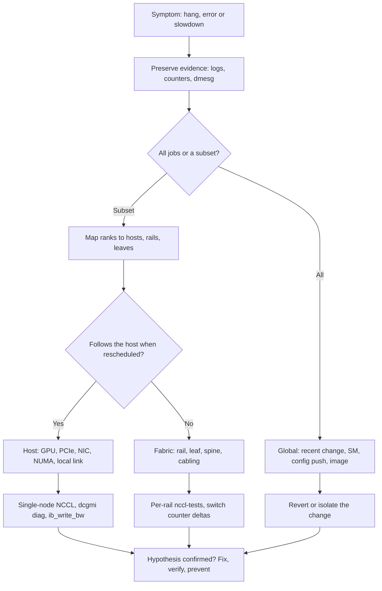

## Why this matters

An AI training cluster fails in a way an enterprise network rarely does: the symptom is almost never
"the network is down". It is "step time went from 1.9 s to 2.6 s", "the job hangs at iteration
41,200", or "NCCL reports a timeout on rank 1,377". A synchronous collective runs at the speed of its
slowest participant, so one degraded cable among 20,000, one GPU throttling, or one NIC trained at
PCIe x8 shows up as a whole-cluster slowdown. The blast radius is large and the signal is diffuse.

Without a method, teams fall into two failure modes. The first is **thrash**: five engineers change
five things at once (reset counters, reboot nodes, bump `NCCL_IB_TIMEOUT`, reseat optics), the
problem goes away, and nobody knows why, so it comes back next week. The second is **blame
ping-pong**: the ML team says "network", the network team says "the switches are clean", and a
multimillion-dollar cluster idles while both are partly right. This lesson gives you a repeatable
process: scope, bisect, correlate, prove, fix, prevent.

## Concepts

### The layers a collective crosses

Every byte of an all-reduce crosses a stack of components, and each of them can be the bottleneck:

| Layer | Component | Typical failure | First evidence |
|---|---|---|---|
| Application | Framework, data loader, checkpointing | Stalls that look like network waits | Per-step timing breakdown, profiler |
| Collective | NCCL algorithm, protocol, channels, env vars | Wrong transport (sockets), bad topology detection | `NCCL_DEBUG=INFO` init log |
| GPU | Clocks, thermals, ECC, NVLink | Throttling, Xid errors, one slow rank | `nvidia-smi`, DCGM, kernel log |
| Host I/O | PCIe link, NUMA, ACS/IOMMU | Downtrained link (x8, Gen3), P2P disabled | `lspci -vv`, `nvidia-smi topo -m` |
| NIC | Firmware, QoS, RDMA config, counters | Wrong GID/trust/PFC priority, out-of-buffer drops | `ethtool -S`, RDMA `hw_counters` |
| Link | Cable, optic, connector, FEC | High pre-FEC BER, flaps, symbol errors | `mlxlink`, `ethtool -m`, `perfquery` |
| Switch | Buffers, QoS, routing, ECMP/AR | Drops, pause storms, hash polarization | Switch counters, WJH-style drop events |
| Fabric control | Subnet manager, BGP, config pipeline | Wrong routes, partial config push | SM logs, BGP state, change log |

The skill is not knowing every counter. It is knowing **which layer to test next** so each test
eliminates as much of the search space as possible.

### Scope before you touch anything

Scoping questions turn "the cluster is slow" into a shape. Ask them in this order:

1. **What exactly is the symptom?** Hang, error, or slowdown? By how much, measured how?
2. **Who is affected?** One job or all jobs? Jobs that share a property (same nodes, same rail,
   same pod, same message sizes, same NCCL version)?
3. **Where?** Can you name the ranks, hosts, rails or leaves involved? NCCL timeouts and the
   slowest-rank reports usually point at a subset.
4. **When?** When did it start, is it constant or periodic, and what changed around that time?
5. **Is it reproducible** with a synthetic test (nccl-tests, perftest) that removes the model code?

A symptom shared by every job on every node points at something global (a fabric-wide config push, an
SM change, a software image). A symptom that follows a host when the job is rescheduled points at
that host. A symptom that appears only on jobs spanning two specific pods points at the links or
spines between them.

### Deltas, not absolutes

Counters on a long-running NIC or switch port are cumulative. A port showing 4,000,000
`rx_prio3_pause` events tells you nothing: it may have accumulated over 200 days of healthy
operation. What matters is the **rate during the bad window** compared with the **rate during a good
window** on the same port and on its healthy peers. Every evidence-collection step in this lesson is
"snapshot, wait a known interval, snapshot again, subtract".

> [!ANALOGY]
> Scoping an AI fabric incident is like a service-provider NOC isolating a customer complaint
> ("the VPN is slow"): you find which sites, which paths and since when before you open a router.
> Where the analogy breaks down: in a WAN, one slow path hurts the flows on it. In a synchronous
> training job, one slow path hurts **every** rank, because everyone waits at the next collective.
> The "complaint" arrives from thousands of ranks at once and points at almost none of them.

## How it works

### Step 1: stabilize and preserve evidence

Before remediation, capture state that a reboot or counter reset would destroy:

- NCCL logs from the failing job (ideally with `NCCL_DEBUG=INFO`; on timeouts the framework's own
  watchdog message, which often names the stuck collective and rank).
- Host snapshots for implicated nodes: `ethtool -S` for each RDMA NIC, the RDMA `hw_counters`
  directory, `dmesg` / kernel log (GPU Xid messages, PCIe AER errors, mlx5 driver warnings).
- Switch snapshots for the relevant ports: interface error and drop counters, PFC and ECN counters,
  buffer statistics, and any drop-reason telemetry (for example What Just Happened on NVIDIA
  Spectrum switches).
- The change log: what was deployed, upgraded, recabled or reconfigured in the last days.

If the cluster scheduler will drain and reboot the node automatically, ask for it to be held first.
A reboot is the single most effective way to destroy a root cause.

### Step 2: build the shape (scope)

Map the affected ranks to physical locations. In a rail-optimized fabric, GPU *n* of every server
connects to rail *n*, so "ranks 3, 11, 19, 27 are slow" usually means "GPU 3 / NIC 3 on several
servers": a rail problem (leaf or spine for rail 3). "Ranks 8-15 are slow" usually means a single
server. Keep an inventory (source of truth such as NetBox or Nautobot) that maps hostname, GPU index,
NIC name, switch and port, so this translation takes seconds, not hours.

### Step 3: bisect with targeted tests

Bisection means choosing tests that split the suspect set roughly in half. A practical ladder, from
the inside of one server to the whole fabric:

| Test | What it exercises | What a pass eliminates |
|---|---|---|
| `dcgmi diag` (levels vary by DCGM version) | GPU health, memory, PCIe, NVLink | GPU hardware as a sole cause |
| Single-node nccl-tests (`-g 8`) | NVLink/NVSwitch and intra-node NCCL | Intra-node path and GPUs |
| `ib_write_bw` per NIC pair, host to host | NIC, PCIe to NIC, link, one switch path | That NIC and its link |
| nccl-tests on 2 nodes, then 4, 8, 16... | Inter-node NCCL over the fabric | The tested set of nodes and paths |
| nccl-tests per rail (or per leaf) group | One rail's leaves and spines | That rail |
| Full-scale nccl-tests | Everything, including spine contention | Nothing new; it confirms |

Two rules make bisection efficient. **Hold everything else constant**: same NCCL version, same env
vars, same message sizes. And **include a known-good control**: run the same test on a set of nodes
you trust. A test that is "slow" with no control is an opinion.

### Step 4: correlate with changes and time

Most incidents in mature clusters follow a change: firmware, driver, NCCL or CUDA upgrade, a switch
config push, recabling after an RMA, a new tenant. Put the symptom start time and the change log on
one timeline. If the symptom is periodic (every 30 minutes, every checkpoint), correlate with periodic
events: checkpoint writes to storage, telemetry scrapes, cron jobs, link retraining.

> [!WARNING]
> Correlation is a strong lead, not proof. Two things changed on Tuesday; only one of them is the
> cause. Prove it by reverting or isolating the change and showing that the symptom follows it.

### Step 5: hypothesize, predict, test

Write each hypothesis down with the evidence that would **confirm** it and the evidence that would
**refute** it, then run the test. "If NIC mlx5_3 on gpu-node-112 is downtrained, `lspci -vv` will
show a lower `LnkSta` width or speed than `LnkCap`, and `ib_write_bw` from that NIC will top out
near half of its line rate." A good hypothesis predicts a number.

### Step 6: fix, verify, prevent

A fix is verified when the **same test that showed the problem now passes**, and the production
metric (step time, NCCL bus bandwidth) returns to baseline. Prevention means turning the evidence
into a check that runs automatically: a burn-in test, an alert on a counter rate, a CI rule on
configuration. Then write it up (timeline, evidence, root cause, fix, prevention), blameless.



### Why one slow component hurts everything

In a ring all-reduce every rank sends to its neighbour in lockstep; each step finishes only when the
slowest transfer finishes. A single link running at half rate roughly halves the effective bus
bandwidth of the whole ring. Tree and other algorithms have different exposure, but a synchronous
collective is still gated by its critical path. Use the widget below: set one link slower and watch
the completion time of the whole operation.

```widget
allreduce-sim
```

> [!INTERVIEW]
> "Training step time jumped 30% overnight on a 512-GPU job. Walk me through your first hour."
> A strong answer: confirm the metric and the start time; check what changed overnight; ask whether
> other jobs are affected; preserve logs and counters before anyone reboots; map slow ranks to hosts
> and rails; run nccl-tests on a known-good set as a control and on the suspect set; bisect by rail
> and by host; use counter deltas, not totals; prove the cause by reverting or isolating it. Weak
> answers jump straight to "I'd check PFC" or "I'd increase the NCCL timeout".

## In practice

### Capturing counter deltas on a host

A minimal snapshot script that records every ethtool and RDMA hardware counter, so you can diff two
captures. Counter names differ across drivers and firmware; the script just dumps whatever exists.

```bash
#!/usr/bin/env bash
# snap.sh <netdev> <rdma-dev> <port> > snap-$(date +%s).txt
ND=$1; RD=$2; P=$3
date +%s
ethtool -S "$ND"
for f in /sys/class/infiniband/"$RD"/ports/"$P"/hw_counters/*; do
  echo "hw_$(basename "$f"): $(cat "$f")"
done
for f in /sys/class/infiniband/"$RD"/ports/"$P"/counters/*; do
  echo "pma_$(basename "$f"): $(cat "$f")"
done
```

Take two snapshots 60 seconds apart while the slow job (or a synthetic test) runs, and subtract.
Illustrative delta on a suspect node versus a healthy peer during the same nccl-tests run:

```text
# Illustrative output: counter deltas over 60 s, same test, two nodes on rail 3
counter                     gpu-node-112   gpu-node-087 (control)
rx_prio3_pause                    812,450           3,120
tx_prio3_pause                          0               0
rx_discards_phy                         0               0
hw_np_cnp_sent                          0               0
hw_rp_cnp_handled                       0              14
hw_out_of_sequence                      0               0
hw_local_ack_timeout_err                0               0
```

Reading it: the suspect node is **receiving** a lot of pause on priority 3. It is not sending
pause, it is not dropping, and RDMA transport is clean. Something downstream (its leaf port, or the
path beyond it) is asserting backpressure toward this NIC. That moves the next test to the switch
side: which port is sending pause to gpu-node-112, and why is its queue full? (The `hw_` names here
are typical of mlx5 RDMA counters; check the mlx5 counters documentation for your driver release,
because names and availability vary.)

### Bisecting with nccl-tests

nccl-tests reports algorithm bandwidth and bus bandwidth per message size. A useful baseline run:

```bash
# 2 nodes x 8 GPUs, sizes 8 B to 8 GB doubling each step
mpirun -np 16 -N 8 -H nodeA:8,nodeB:8 \
  -x NCCL_DEBUG=INFO -x NCCL_DEBUG_SUBSYS=INIT,NET \
  ./build/all_reduce_perf -b 8 -e 8G -f 2 -g 1
```

```text
# Illustrative output (trimmed). Compare busbw at large sizes against your baseline.
# For all-reduce, busbw = algbw x 2(n-1)/n = 1.875 x algbw at n = 16 ranks.
#       size    count   type  redop   time   algbw   busbw  #wrong
   268435456 67108864  float    sum   2796   96.01  180.01      0
  1073741824 268435456 float    sum  11047   97.20  182.25      0
  8589934592 2147483648 float   sum  88102   97.50  182.81      0
# Avg bus bandwidth    : 98.6
```

Interpretation hinges on the baseline: if a healthy node pair on your platform reaches roughly twice
that large-message bus bandwidth, this pair is degraded and you bisect further (test each node with a
third, known-good node; then test individual NICs with `ib_write_bw`). Also read the init log: lines
showing the network plugin and transport (`NET/IB` versus `NET/Socket`) tell you whether NCCL is
using RDMA at all. Exact log wording varies by NCCL version.

### Mapping a NIC suspect with perftest

```bash
# On the server side (nodeB), NIC mlx5_3, GID index 3 (RoCEv2; check show_gids)
ib_write_bw -d mlx5_3 -x 3 --report_gbits -s 1048576 -D 10
# On the client side (nodeA)
ib_write_bw -d mlx5_3 -x 3 --report_gbits -s 1048576 -D 10 nodeB
```

Run it NIC by NIC (rail by rail). A single NIC far below its peers isolates the problem to that
NIC, its PCIe link, its cable, or its leaf port. Then look at `lspci -vv` for that NIC
(`LnkSta` versus `LnkCap`), the link with `mlxlink`, and the leaf port counters.

### The decision table

| Symptom | Likely cause | Evidence command | Fix direction |
|---|---|---|---|
| All jobs slower since a fixed time | Global change (firmware, config, NCCL image) | Change log, diff configs, nccl-tests vs old image | Revert or roll forward with fix |
| Slowness follows one host | GPU/PCIe/NIC on that host | `dcgmi diag`, `lspci -vv`, single-node nccl-tests | Drain host, repair, burn-in |
| Ranks on one GPU index across many hosts slow | One rail's leaf/spine/cabling | Per-rail nccl-tests, switch counter deltas | Isolate rail component, reroute |
| Large messages slow, small fine | Bandwidth path: link, PCIe, congestion | `ib_write_bw`, pause/ECN deltas | Fix link or congestion config |
| Small messages slow, large fine | Latency path: wrong transport, CPU affinity | NCCL init log, `numactl`, IRQ affinity | Correct NUMA/transport settings |
| Job hangs, NCCL timeout names a peer | Dead path, RDMA retry exhaustion, GPU fault | Kernel log, `hw_counters` retry/timeouts | Replace part, fix route or config |
| Periodic slowdowns | Periodic event (checkpoint, scrape, retrain) | Time-align telemetry with job metrics | Separate traffic classes, schedule |

Walk the same method as a decision tree: start from scoping, pick the branch your evidence supports, and note which command each leaf asks you to run.

```widget
troubleshooting-tree
```

### Running the incident

Keep a short, timestamped hypothesis log in the incident channel. An illustrative excerpt:

```text
# Illustrative incident log
14:02 SYMPTOM job 8812 step time 1.9s -> 2.6s since ~13:40. Other jobs: 2 of 9 also slower.
14:06 SCOPE affected jobs share pod B. Pod A jobs normal.
14:09 CHANGE 13:35 config push to pod B leaves (QoS template v42).
14:11 HYP-1 QoS template v42 changed buffer/ECN profile. Predict: ECN marks drop, pause up on B leaves.
14:18 EVIDENCE B leaves: ECN-marked packets ~0 (was high); PFC tx up 40x. Pod A unchanged.
14:20 CONFIRMED diff v41..v42: ECN min/max thresholds removed from RoCE queue.
14:24 FIX roll back to v41 on one leaf pair; nccl-tests on that leaf pair back to baseline.
14:40 FIX rolled back on all B leaves; job 8812 step time 1.9s.
FOLLOW-UP CI check: RoCE queue must have ECN profile; pre-push nccl-tests canary.
```

Note what this log does: every action is tied to a hypothesis, the prediction is explicit, and
the fix was verified on a small blast radius before being rolled out.

> [!TIP]
> Agree on one incident commander. Everyone else proposes tests to the commander instead of running
> them. It feels slower, and it is dramatically faster, because no two changes ever overlap.

## Common pitfalls

- **Resetting counters first.** Symptom: "everything looks clean" after someone ran `perfquery -R`
  or cleared switch counters. Cause: evidence destroyed. Fix: snapshot first; use deltas so you
  never need to reset.
- **Reading absolute counters.** Symptom: a team chases a port with millions of pause frames that
  has been healthy for months. Cause: cumulative counters without a rate. Fix: compare the rate in
  the bad window to the rate on healthy peers.
- **Testing without a control.** Symptom: endless arguing about whether 300 Gb/s is "slow". Cause:
  no baseline for that platform and test. Fix: keep baselines from acceptance testing; always run a
  known-good pair side by side.
- **Changing several things at once.** Symptom: the problem disappears and returns weeks later.
  Cause: no idea which change helped. Fix: one change at a time, verified with the same test.
- **Tuning around the fault.** Symptom: raising `NCCL_IB_TIMEOUT` or disabling a feature "fixes" a
  hang. Cause: the underlying link or config fault is masked, not fixed. Fix: use tuning only as a
  documented, temporary mitigation while the root cause is pursued.
- **Trusting the scheduler's view.** Symptom: a "healthy" node keeps appearing in slow jobs. Cause:
  health checks test reachability, not bandwidth. Fix: add short bandwidth and NCCL checks to node
  health gates.
- **Stopping at the first anomaly.** Symptom: you fix one bad cable and the job is still slow.
  Cause: in large fabrics there is always some anomaly; it may not be the one that matters. Fix:
  verify that the fix restores the original metric before you close.

## Key takeaways

- Scope first (what, who, where, when, reproducible?), then test; never start by changing things.
- Preserve evidence before remediation: logs, counter snapshots, kernel messages, change log.
- Bisect with tests that split the suspect set, hold all else constant, and always include a
  known-good control.
- Use counter deltas over a known interval and compare against healthy peers, not absolute totals.
- In a synchronous collective one slow component slows everyone, so map slow ranks to hosts and
  rails quickly with a source of truth.
- Prove a cause by reverting or isolating it; verify the fix with the same test that showed the fault.
- Close with prevention: an automated check, alert or CI rule that would have caught it earlier.
