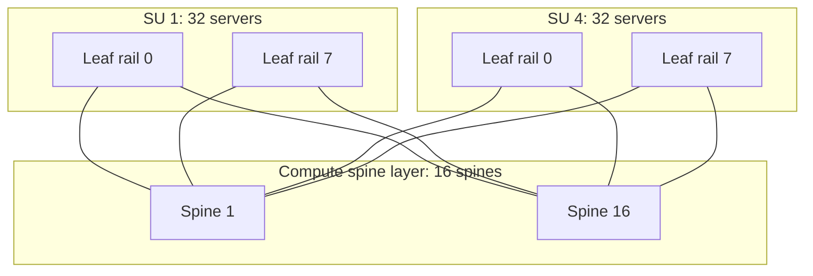

## Why this matters

Everything in this course converges on one moment: a room with a whiteboard (or a shared document), a
customer or a principal engineer, and the question "so what would you build, and why?". Knowing what
PFC does, how NCCL picks a ring or how ECMP hashes is necessary but not sufficient. A fabric architect
turns a vague brief ("we are buying 1,024 GPUs, make the network not the bottleneck") into numbers,
a bill of materials, a configuration standard and a test plan, and then defends each choice against
someone who is paid to find holes in it.

Teams that skip this discipline produce clusters that look fine on paper and fail in production: a
storage network sized for average load that stalls every checkpoint, a "non-blocking" fabric that
silently has 2:1 oversubscription because one SU was cabled differently, or a lossless configuration
that nobody can explain when the first PFC storm hits. This capstone gives you a realistic brief, a
rubric of the kind a review board uses, and a fully worked reference solution with every number
derived. Do the design yourself first, then compare.

## Concepts

### The brief

You are the network architect for a company building a dedicated training cluster.

**Compute**

- 128 GPU servers, 8 GPUs each: **1,024 GPUs** of a current HGX-class generation (think H100/H200/B200
  class; the exact SKU is not decided yet).
- Each server has **8 compute NIC ports at 400 Gb/s**, one per GPU, each NIC sharing a PCIe switch with
  its GPU (GPUDirect RDMA capable).
- Each server has **2 × 200 Gb/s** ports on a separate NIC/DPU for storage and front-end traffic, and a
  1 GbE BMC port.

**Workload**

- Primarily large-model pre-training (dense and mixture-of-experts transformers, up to roughly 70B
  parameters dense in year one), using tensor parallelism inside a server and data/pipeline/expert
  parallelism across servers.
- Jobs range from 64 GPUs (experiments) to the full 1,024 GPUs (flagship runs). Two to four teams
  share the cluster through a scheduler.

**Storage**

- A parallel file system with 16 storage servers, each with 2 × 400 Gb/s ports. The vendor quotes
  roughly **400 GB/s aggregate read** and **200 GB/s aggregate write** for this configuration.
- Requirement: a full checkpoint of the flagship model must be written in **under 60 seconds**.

**Constraints**

- The operations team is strong in Ethernet, BGP and Linux automation; it has no InfiniBand experience.
- Power and space allow at most **64 switch rack units per row** for networking, in 4 rows (one per
  32-server scalable unit).
- The fabric must be able to **grow to 2,048 GPUs** within two years without forklift replacement.
- Tenants (teams) must not be able to reach each other's storage namespaces over the front-end.

### Deliverables

1. **Requirements table**: every number the design must satisfy, with its source (brief, derived, assumption).
2. **Topology** for the compute (back-end), storage, front-end and out-of-band networks, with diagrams.
3. **Sizing workbook**: switch, link, transceiver and cable counts, with the arithmetic.
4. **Addressing and routing plan**: prefixes, ASNs, what is advertised where.
5. **QoS and lossless standard**: classes, DSCP/priority mapping, PFC/ECN intent, MTU.
6. **Failure analysis**: what one link, one leaf, one spine and one rack PDU failure does to a running job.
7. **Validation plan**: the tests and pass criteria that gate handover (link, RDMA, NCCL, storage).
8. **Decision log**: at least three significant alternatives you rejected, and why.

### The rubric

A review board scores the design out of 100. Use the same rubric on your own attempt.

| Criterion | Weight | What "excellent" looks like |
|---|---|---|
| Requirements captured and quantified | 10 | Every requirement has a number, a source and a way to test it. Assumptions are explicit. |
| Compute fabric topology and sizing | 25 | Correct non-blocking arithmetic, rail alignment, SU structure, growth path shown. |
| Storage and front-end design | 15 | Sized from the storage system's real capability, checkpoint math shown, tenant isolation designed. |
| Addressing, routing, QoS | 15 | Implementable plan; lossless class and CNP handling specified; MTU consistent end to end. |
| Resilience and failure analysis | 15 | Blast radius per failure is stated in GPUs and bandwidth, with an operational response. |
| Validation and operability | 10 | Acceptance tests with pass/fail thresholds; telemetry that will detect the known failure modes. |
| Communication and trade-offs | 10 | Clear diagrams, rejected alternatives with reasons, honest about risks and unknowns. |

> [!TIP]
> Before reading the reference solution, give yourself 90 minutes and produce at least deliverables
> 1, 2, 3 and 6. Use the `fabric-sizer` widget below to check your switch counts, not to produce them.

```widget
fabric-sizer
```

## How it works

This section is the reference solution. It is one good answer, not the only one; the review board
would accept other designs that are justified with the same rigour.

### Step 1: requirements, quantified

| ID | Requirement | Value | Source |
|---|---|---|---|
| R1 | GPUs on the compute fabric | 1,024 (128 servers × 8) | Brief |
| R2 | Compute NIC ports | 1,024 × 400 Gb/s | Brief |
| R3 | Compute fabric oversubscription | 1:1 (non-blocking) | Derived: full-cluster collectives cross the spine |
| R4 | Growth | 2,048 GPUs without replacing switches | Brief |
| R5 | Checkpoint write | < 60 s for the flagship model | Brief |
| R6 | Storage capability | ~400 GB/s read, ~200 GB/s write | Vendor quote (to be verified in acceptance) |
| R7 | Tenant isolation | No cross-tenant reachability on front-end/storage | Brief |
| R8 | Operability | Ethernet + BGP skill set | Brief constraint |

Derived numbers worth writing down early:

- **Compute injection bandwidth**: 1,024 × 400 Gb/s = 409.6 Tb/s ≈ **51.2 TB/s**.
- **Checkpoint size** (assumption, flagship 70B dense, mixed precision with Adam): BF16 weights (2 B)
  + FP32 master weights (4 B) + two FP32 Adam moments (4 B + 4 B) = **14 bytes per parameter**, so
  70 × 10⁹ × 14 B ≈ **0.98 TB**, call it 1 TB. State the assumption; the ML team must confirm it.
- **Checkpoint time at the quoted write rate**: 0.98 TB ÷ 200 GB/s = **4.9 s**, comfortably under R5
  even at 25% of the quoted rate (19.6 s). The storage *system*, not the network, is the real limiter,
  so the storage network only has to be able to carry ~200 GB/s writes without becoming the bottleneck.

### Step 2: choose the compute fabric technology

Both InfiniBand (NDR, 400 Gb/s per port) and RoCEv2 on a lossless Ethernet fabric with adaptive
routing can deliver this cluster; the topology arithmetic below is identical for both. The deciding
input is **R8**: the team operates Ethernet and BGP daily and would need to build InfiniBand skills
from zero. The reference solution therefore chooses **RoCEv2 over a routed Ethernet fabric**, with
switches and NICs that support adaptive routing / out-of-order tolerant transport, and DCQCN-style
congestion control. The decision log records the alternative.

### Step 3: size the compute fabric

Assume a **400 Gb/s, radix-64 switch** (64 ports at 400 Gb/s; the same arithmetic applies to an NDR
InfiniBand switch with 64 ports). Use the scalable unit (SU) of **32 servers = 256 GPUs**, so the
cluster is **4 SUs**.

**Leaves (rail-optimized).** In each SU, rail *r* (GPU/NIC index *r* = 0..7 on every server) lands on
its own leaf. Per leaf:

- Downlinks: 32 servers × 1 port = **32 ports**.
- Uplinks for 1:1: also **32 ports**. 32 + 32 = 64 = radix. 
- Leaves per SU: 8 rails → **8 leaves**. Cluster: 4 SUs × 8 = **32 leaves**.

**Spines.** Total leaf uplinks = 32 leaves × 32 = **1,024**. Each spine has 64 ports, so spines needed
= 1,024 ÷ 64 = **16 spines**. Each leaf has 32 uplinks spread over 16 spines = **2 links per
leaf-spine pair**; each spine port count checks out: 32 leaves × 2 = 64.

**Port and link totals.**

| Item | Arithmetic | Count |
|---|---|---|
| Switches | 32 leaves + 16 spines | 48 |
| Switch ports available | 48 × 64 | 3,072 |
| Server-to-leaf links | 128 × 8 | 1,024 |
| Leaf-to-spine links | 32 × 32 | 1,024 |
| Switch ports used | 1,024 (leaf down) + 1,024 (leaf up) + 1,024 (spine) | 3,072 (100%) |
| 400G link ends (for optics) | (1,024 + 1,024) × 2 | 4,096 |

**Transceivers.** Count link *ends* first, then convert to modules for your form factor. If the switch
uses twin-port 800G OSFP cages (two 400G ports per module, as on several current 64 × 400G switches;
check the datasheet), switch-side modules = (1,024 + 1,024 + 1,024) ÷ 2 = **1,536**. The server side
needs **1,024** single-port 400G modules if each NIC port has its own cage; some server platforms use
twin-port modules too, which halves that number. Add 3-5% spares. Leaf-to-server runs inside a row
are often short enough for multimode or DAC/ACC copper; leaf-to-spine runs between rows usually need
single-mode optics. Lengths drive the choice; measure them from the floor plan rather than guessing.

**Growth to 2,048 GPUs (R4).** A two-tier non-blocking fat tree of radix *k* supports at most
*k*²/2 endpoints: 64²/2 = **2,048**. So the switch choice meets R4 exactly, with zero headroom beyond it.
The growth plan has two options:

1. **Build 16 spines now** (above) with 2 links per leaf-spine pair; when SUs 5-8 arrive, add 16 spines
   and re-cable so each leaf has 1 link to each of 32 spines. Cheapest now, but re-cabling 1,024 links
   on a live cluster is a multi-day maintenance window.
2. **Build 32 spines now**, half-populated (32 ports used of 64), 1 link per leaf-spine pair. SUs 5-8
   then plug into empty spine ports with no re-cabling. Costs 16 extra spines up front.

The reference solution picks option 2 if the expansion is funded, option 1 if it is speculative, and
records the choice in the decision log. Either way, **reserve the spine rack positions and power now**.

**Space check (constraint: 64 RU per row).** Per row: 8 rail leaves + 4 spines (16 spines spread
across 4 rows; 8 per row in the 32-spine option) + 2 storage/front-end leaves + 2 OOB switches = 16 to
20 switches. At 1-2 RU each (check the actual model), that is at most about 40 RU, inside the budget,
but note that cable management and patch panels for 512 links per row also consume rack units.

> [!NOTE]
> With a 51.2 Tb/s Ethernet switch run as 128 × 400 Gb/s, the same cluster needs far fewer boxes: a
> leaf can take 64 servers per rail (64 down + 64 up), so 2 groups × 8 rails = 16 leaves, and
> 16 × 64 = 1,024 uplinks ÷ 128 = 8 spines. Radix drives everything; always redo the math for the real
> switch, including how ports break out.

### Step 4: check traffic locality

Rail optimization pays off when the scheduler places jobs sensibly. Example flagship layout:
TP = 8 (inside a server on NVLink), PP = 4, so DP = 1,024 ÷ (8 × 4) = **32**. If each data-parallel
group is placed on 32 servers of one SU, the gradient all-reduce for a given (TP rank, PP stage) runs
entirely on one rail leaf: one switch hop, no spine. Pipeline traffic between stages in different SUs
crosses the spine, which is why the spine still has to be non-blocking.

Order-of-magnitude all-reduce time per step for that DP group, ring algorithm, BF16 gradients:

- Gradient bytes per GPU: 70 × 10⁹ ÷ (8 × 4) = 2.1875 × 10⁹ parameters × 2 B = **4.375 GB**.
- Ring all-reduce moves 2(n−1)/n of the data per rank: 2 × 31 ÷ 32 = **1.9375**.
- Assume achievable bus bandwidth ≈ 45 GB/s per 400 Gb/s NIC (about 90% of the 50 GB/s line rate; your
  measured nccl-tests result replaces this number).
- Time ≈ 1.9375 × 4.375 GB ÷ 45 GB/s ≈ **0.19 s**, which frameworks overlap with backward compute.

This is the number to compare against step time when someone claims "the network is slow".

### Step 5: storage and front-end network

The reference design uses **one converged storage + front-end Ethernet fabric** on the servers'
2 × 200 Gb/s ports, separated into VRFs: `STORAGE`, `TENANT-<n>` (front-end per team) and `INBAND-MGMT`.
A physically separate storage fabric is also defensible (see decision log).

**Server leaves.** Each server dual-homes: port A to leaf A, port B to leaf B of its SU's leaf pair.
Per leaf: 32 servers × 200 Gb/s = **6.4 Tb/s** down, using 16 × 400G ports broken out as 2 × 200G.

**Oversubscription from data, not habit.** Server-side capacity is 128 × 2 × 200 Gb/s = 51.2 Tb/s
(6.4 TB/s), but the storage system can only deliver about 400 GB/s (3.2 Tb/s) of reads. Building the
server leaves at 1:1 would buy bandwidth nothing can fill. With **2:1** (8 × 400G = 3.2 Tb/s uplink per
leaf), the 8 server leaves give 8 × 3.2 = **25.6 Tb/s** of uplink, eight times the storage system's read
capability, leaving ample room for front-end traffic and for ECMP imperfection.

**Storage leaves.** 16 storage servers × 2 × 400 Gb/s = **32 ports**. Two storage leaves with 16 ports
down and 16 × 400G up each (1:1, because storage ports are the scarce resource and must never be
starved): 2 × 6.4 Tb/s = 12.8 Tb/s, matching the storage servers' line rate.

**Border leaves.** A pair of border leaves connects to the corporate network/WAN and hosts external
connectivity per tenant VRF (for example 4 × 100G each toward the WAN, sized from expected dataset
ingest).

**Spines.** Uplinks: 8 server leaves × 8 + 2 storage leaves × 16 + 2 border leaves × 4 = 64 + 32 + 8 =
**104 × 400G**. With 4 spines that is 26 ports each on a 64-port switch: room for growth, and losing one
spine removes only 25% of fabric capacity, still more than the storage system can use. Total: 8 + 2 + 2
leaves + 4 spines = **16 switches**.

**Isolation (R7).** EVPN-VXLAN with one L3 VNI per VRF. Tenant VRFs import only the routes of their own
storage namespace's front-end addresses through route-target policy, or, if the file system enforces
tenancy itself, tenants reach storage via a shared `STORAGE` VRF and isolation is enforced by the file
system's export and authentication rules. State which one you rely on; the review board will ask.

### Step 6: out-of-band management

Count ports: 128 server BMCs + 16 storage BMCs + 64 switch management ports (48 compute + 16 storage/FE)
+ PDUs and console servers (assume ~40) ≈ **250 ports**. Use 48-port 1 GbE switches: 2 per row
(8 total, ~384 ports) for growth, uplinked to a small aggregation pair. The OOB network must not
depend on the fabrics it manages, and must have its own path to the management servers and DHCP/ZTP.

### Step 7: addressing and routing

| Block | Use | Size |
|---|---|---|
| 10.0.0.0/21 | Compute NIC ↔ leaf /31s (1,024 links × 2 addresses = 2,048) | /21 |
| 10.0.8.0/21 | Leaf ↔ spine /31s (1,024 links) | /21 |
| 10.0.16.0/24 | Compute switch loopbacks (48, room for 2,048-GPU growth) | /24 |
| 10.1.0.0/16 | Storage/front-end fabric (per-VRF subnets, loopbacks, VTEPs) | /16 |
| 10.255.0.0/20 | Out-of-band management | /20 |

Reserve the *next* /21s now for SUs 5-8 so growth does not fragment the plan.

Routing follows RFC 7938: **eBGP underlay**, one private 4-byte ASN per leaf and one shared ASN for
the spine layer, BGP unnumbered or /31 numbered sessions, ECMP across all spine paths, and
`bestpath as-path multipath-relax` (or equivalent) where leaves in different ASNs advertise the same
prefix. Compute leaves advertise only their server /31s (summarised per rail leaf where the platform
allows) and loopbacks. No default route into the compute fabric: it should not reach anything except
itself.

### Step 8: QoS and lossless standard (compute fabric)

| Traffic | DSCP | Switch priority | Treatment |
|---|---|---|---|
| RoCEv2 data | 26 | 3 | Lossless (PFC on priority 3), ECN marking enabled |
| CNP | 48 | 6 | Strict priority or high-weight queue, lossy |
| Everything else (control, BGP, telemetry) | other | 0 | Lossy, ETS remainder |

- **Trust DSCP** on every switch port and on the NIC (`mlnx_qos --trust dscp` on NVIDIA NICs);
  set the RoCE traffic class/DSCP for RDMA-CM and NCCL consistently (for example `NCCL_IB_TC`, whose
  value is the full ToS byte, so DSCP 26 → 104, or 106 if the ECN-capable bit is also set, as some
  vendor guides show).
- **PFC** only on priority 3, on server-facing *and* fabric-facing ports. **ECN** marking thresholds
  set from the vendor's RoCE profile, with the ECN mark point well below the PFC XOFF point so DCQCN
  reacts before pause frames appear.
- **PFC watchdog** enabled on every port with a vendor-recommended detection time.
- **MTU**: 9216 on switch ports, 9000 on host interfaces, RoCE path MTU 4096.
- **Headroom sanity check** (order of magnitude): at 400 Gb/s over 100 m of fibre (≈ 5 ns/m),
  one-way propagation is 500 ns, i.e. 400 × 10⁹ × 500 × 10⁻⁹ = 200,000 bits = 25 KB in flight. Round trip
  is ~50 KB, plus up to two maximum-size frames (~18 KB) and the peer's response time: roughly
  **70-100 KB per lossless priority per port**. Vendor tooling computes the exact value from cable
  length; your job is to know when a default (sized for short cables) is wrong for a long spine run.

### Step 9: failure analysis

| Failure | Blast radius | Expected behaviour and response |
|---|---|---|
| One server-leaf link | 1 GPU's NIC | NCCL job on that server fails or degrades; job restarts from checkpoint excluding the node. Replace optic/cable, run link BER test before returning to service. |
| One leaf-spine link | 1/32 of one leaf's uplink (3.1%) | BGP withdraws, ECMP/adaptive routing rebalances; collectives slow slightly if the leaf is hot. Alert, fix in hours. |
| One rail leaf | Rail *r* of 32 servers (32 GPUs' NICs) | Every job using those servers loses a rail; NCCL cannot use that NIC. Scheduler drains the SU's 32 servers until repaired, or runs smaller jobs in the remaining SUs. Keep spare leaves on site. |
| One spine (16-spine build) | 1/16 of spine capacity (6.25%) | Traffic rebalances; cross-SU collectives see ~6% less bisection. Repair in a maintenance window. |
| One rack PDU | Depends on rack layout | Design so that a PDU feeds A-side PSUs only; dual-PSU switches survive. Verify in burn-in by pulling a feed. |

The board will push on the rail-leaf case. The honest answer is that in a rail-optimized design a leaf
failure removes one NIC from 32 servers, and most training jobs cannot continue without all eight NICs,
so the practical blast radius is those 32 servers (256 GPUs, 25% of the cluster) for jobs placed there.
Mitigations: fast leaf replacement (spares, pre-staged configs via ZTP), checkpoint frequency tuned to
that MTTR, and scheduler awareness of SU boundaries.

### Step 10: decision log (excerpt)

1. **RoCEv2 over InfiniBand.** Chosen for team skills (R8) and a single operational toolchain with the
   storage/front-end fabric. Rejected InfiniBand despite its mature congestion control and SM-managed
   routing because the skills gap is the larger risk. Revisit if acceptance busbw or tail latency misses targets.
2. **Converged storage + front-end fabric with VRFs.** Rejected a separate storage fabric: the storage
   system needs only ~3.2 Tb/s and the converged fabric gives 8× that; a second fabric doubles
   operations work for no measured benefit.
3. **Storage traffic off the compute fabric.** Rejected putting storage on the 400G compute NICs:
   checkpoint bursts would compete with collectives and the lossless class, and the storage system is
   the limiter anyway.

## In practice

### Running the design review

A good review is structured, time-boxed and adversarial in a friendly way. Present in this order:
requirements (5 min), topology diagrams (10 min), sizing workbook (10 min), failure analysis (10 min),
validation plan (5 min), then open questions. Bring the arithmetic as a spreadsheet the board can poke
at, not as screenshots.



### Validation plan that gates handover

The design is only as good as the evidence that the built fabric matches it. The reference acceptance
plan (all thresholds are examples; set yours from vendor guidance and your own baselines):

1. **Cabling and topology**: compare LLDP neighbours against the cabling plan for every port; any
   mismatch fails the SU. Rail swaps (server NIC 3 on rail-5 leaf) are the classic defect.
2. **Link health**: every 400G link up at the expected speed with FEC in the expected mode; pre- and
   post-FEC error counters read after a soak and compared with the optics vendor's limits.
3. **RDMA per NIC**: `ib_write_bw` between each server and a reference server on each rail, using the
   correct device and GID index, expecting close to line rate for large messages.
4. **NCCL**: `all_reduce_perf` within a server, within an SU (one rail leaf), and across the full
   cluster; record bus bandwidth at large message sizes and compare across SUs to find outliers.
5. **Lossless behaviour**: run an incast test and confirm ECN marks and CNPs appear before PFC pauses
   grow, and that no lossless-priority drops occur.
6. **Storage**: run the file system vendor's benchmark from all 128 servers and verify ~400 GB/s read
   and ~200 GB/s write; then time an actual checkpoint against R5.

Illustrative acceptance commands (adapt device names, GID indexes and host lists to your build):

```bash
# Per-NIC RDMA bandwidth to a reference host, rail 3, RoCEv2 GID index 3 (illustrative values)
ib_write_bw -d mlx5_3 -x 3 --report_gbits -s 1048576 -D 10 ref-host-r3

# Full-cluster all-reduce, one process per GPU (illustrative launcher syntax)
mpirun -np 1024 -N 8 --hostfile hosts.txt \
  -x NCCL_IB_HCA=mlx5_0,mlx5_1,mlx5_2,mlx5_3,mlx5_4,mlx5_5,mlx5_6,mlx5_7 \
  -x NCCL_IB_GID_INDEX=3 -x NCCL_IB_TC=104 \
  ./build/all_reduce_perf -b 8 -e 8G -f 2 -g 1
```

```text
# illustrative output tail, not a real capture
#       size    count   type  redop  root   time  algbw  busbw  #wrong
  4294967296 1073741824 float   sum    -1  ...    ...   ~360       0
  8589934592 2147483648 float   sum    -1  ...    ...   ~365       0
# Avg bus bandwidth    : ...
```

Read the bus bandwidth column (GB/s) against your design. When all eight GPUs of every server take
part, NCCL stripes its channels across all eight NICs, so the large-message multi-node all-reduce
busbw is bounded roughly by the server's aggregate NIC bandwidth: 8 × 50 GB/s = 400 GB/s, minus
protocol overhead (in-network or NVLink-assisted algorithms such as SHARP or NVLS change this). For a
rail-local group with one GPU per server, like the data-parallel groups in Step 4, the bound is one
NIC's 50 GB/s instead. The illustrative ~360 GB/s figures above are the kind of number to baseline
per SU and for the whole cluster, not a promise for every generation or NCCL version.

> [!INTERVIEW]
> "Your 1,024-GPU cluster's all-reduce busbw is 30% below the single-SU number. Walk me through it."
> A strong answer separates the scopes (one SU uses only rail leaves; the full cluster crosses spines),
> checks spine link counts and ECMP/adaptive routing first, then per-link errors and PFC pause counters
> on spine-facing ports, then job placement and NCCL topology, and finishes with how to bisect by
> running the test on two SUs at a time.

## Common pitfalls

- **Counting switches before counting ports.** Symptom: the BOM is off by a third. Cause: the design
  started from "we need N switches" instead of endpoints × ports. Fix: always derive from link ends,
  then radix, then breakout, then modules.
- **Forgetting the growth path.** Symptom: expanding from 1,024 to 2,048 GPUs needs a third tier or a
  re-cable of every spine link. Cause: the radix limit (*k*²/2) was not checked against the growth
  requirement. Fix: compute the two-tier maximum for the chosen switch on day one and reserve spine
  ports, space and power.
- **Sizing storage by server ports.** Symptom: an expensive 1:1 storage fabric whose links run at a few
  percent. Cause: oversubscription chosen by habit. Fix: size from the storage system's measured
  throughput and the checkpoint requirement, with explicit headroom.
- **Unstated assumptions.** Symptom: the board rejects the design because checkpoint size or
  achievable busbw was "obvious". Fix: label every assumption and name who confirms it.
- **Rail mis-cabling discovered in production.** Symptom: one SU's collectives are slower and cross the
  spine unexpectedly. Cause: a server's NIC *r* is plugged into the wrong rail leaf. Fix: LLDP-based
  cabling validation as an acceptance gate.
- **Lossless settings that do not match end to end.** Symptom: PFC pauses on some links, drops on
  others. Cause: NIC trust mode, DSCP, or switch PFC priority differs between SUs built by different
  crews. Fix: one QoS standard, applied by automation, verified by a config audit.
- **Ignoring blast radius of a rail leaf.** Symptom: one leaf failure takes out 25% of the cluster's
  usable capacity and nobody planned for it. Fix: spares, fast replacement, checkpoint cadence and
  scheduler awareness, stated in the design.

## Key takeaways

- A design is a chain of numbers: endpoints → ports → radix → leaves → spines → links → optics. Show
  every step so a reviewer can check it.
- For a radix-64, 400 Gb/s switch: 1,024 GPUs = 4 SUs × 8 rail leaves = 32 leaves, 16 spines, 1,024 +
  1,024 links, and a two-tier ceiling of 2,048 endpoints.
- Size storage and front-end networks from what the storage system can actually deliver and what the
  checkpoint requires, not from server port speed.
- Rail optimization keeps data-parallel traffic on one leaf when jobs are placed by SU; the spine still
  needs to be non-blocking for pipeline, expert and cross-SU traffic.
- State the blast radius of every failure in GPUs and bandwidth, and pair each with an operational
  response.
- Acceptance tests (cabling, links, RDMA, NCCL, lossless behaviour, storage) are part of the design,
  not an afterthought.
- Record the alternatives you rejected; that is what turns a diagram into a defensible design.
