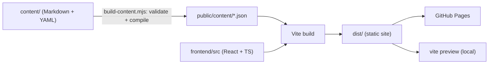

# Architecture

AI Networking Academy is a **static single-page application**. There is no server and no account:
everything runs in the browser, so the same build works from GitHub Pages, from `start-academy.bat`
on a laptop, or from any static file host.

## Repository layout

| Path | What |
|---|---|
| `content/modules/<module>/` | `module.yaml`, `lessons/*.md`, `quizzes/quiz-*.yaml` |
| `content/labs/sim/` | Fabric Simulator incidents (YAML) |
| `content/labs/handson/` | Hands-on Linux labs (Markdown), with files in `labs/<id>/` |
| `content/exams/` | Mock exams |
| `content/commands/`, `content/glossary.yaml` | Command reference and glossary (also the flashcards) |
| `frontend/scripts/build-content.mjs` | The content validator and compiler |
| `frontend/src/pages/` | One component per route |
| `frontend/src/components/` | Markdown renderer (callouts, mermaid, widgets), quiz card, terminal, layout |
| `frontend/src/widgets/` | Interactive visualizations, registered in `registry.tsx` |
| `frontend/src/sim/` | Fabric Simulator: model, shell, grading |
| `frontend/tests/` | Vitest: progress logic and every simulator lab |
| `frontend/e2e/` | Playwright browser tests: quiz, mock exam and timer, every sim lab solved through the UI, progress export/import/reset, Real HW Connect, flashcards, reference, theme, lessons, keyboard-only quiz |
| `content/hardware/` | Real HW track: `hardware.yaml` (tiers, requirements, lab-profile variables) and `guides/*.md` |
| `labs/` | Files for hands-on and hardware labs (topologies, scripts, `check.sh`) |
| `labs/hw-toolkit/` | `aina-hw` (inventory, checks, read-only agent), `lib.sh` for check scripts, `setup-rdma-host.sh`, Python tests |
| `frontend/src/hw/` | Lab profile, report parsing and health-review rules, check results (pure, unit-tested) |
| `docs/` | This documentation |

## Content pipeline

`build-content.mjs` parses every file, enforces the rules in [AUTHORING.md](AUTHORING.md) (IDs,
required sections and keys, quiz option rules, cross-references between lessons, labs and widgets), and
writes:

* `index.json`: metadata for everything (modules, lessons with table of contents, labs, exams,
  commands, glossary). Loaded once.
* `lessons/<id>.json`, `quizzes/<id>.json`, `exams/<id>.json`, `labs/<id>.json`: bodies, loaded on demand.
* `search.json`: the site-wide search index, built by `scripts/search-index.mjs` and fetched the first time
  the search dialog opens (see Search below). The build prints its size.

Labs declare which lessons they practise; the compiler derives each lesson's lab list from that, so the
relationship is maintained in one place.

## Front end

React 19, TypeScript (strict), Vite, Tailwind CSS v4, `react-markdown` with GFM and highlight.js,
Mermaid (lazy-loaded), lucide icons. A `HashRouter` keeps deep links working on static hosts without
rewrite rules. Routes and widgets are code-split.

Design tokens live in `src/index.css` as CSS variables with a light and a dark palette; SVG widgets use
the same variables so they follow the theme.

### Search

`/` or Ctrl/Cmd+K (or the header button) opens a search dialog over lessons (title, every `##`/`###`
section), quizzes, simulator labs, hands-on and hardware labs, hardware guides, commands, glossary terms,
widgets, modules and exams. The index is one entry per section: page, heading anchor, a ~180-character plain
text snippet, and the section's remaining distinct words (Markdown, code blocks, stop words and words that
prefix another word of the entry are dropped; words found in more than 3% of sections go to a shared
"common" list). Ranking (`src/search.ts`) is dependency-free: every query word must prefix-match a word of
the section (common words are optional), with boosts for title and heading matches and an exact title.
Results are grouped by type with the matches highlighted, and link to `#/lesson/<id>?s=<heading-id>`;
`useSectionParam` in `Markdown.tsx` scrolls to and focuses that heading. Heading ids come from `slug()`,
which the index builder duplicates; `tests/search.test.ts` keeps the two identical.

### Accessibility

Target: WCAG 2.2 AA, checked with axe-core in headless Chrome on every route in both themes.

* Landmarks: skip link, `header` (banner), sidebar `aside` with `nav "Main"`, `main#main-content`; one `h1`
  per page; `document.title` follows the page's `h1` (`Layout.tsx`). After client-side navigation focus
  moves to `main` unless the page placed it (deep-linked heading, terminal).
* Colours: light-theme signal colours are darkened so text in them is at least 4.5:1 on every surface;
  `--on-accent` is the text colour on solid accent fills. Check new colour pairs before using them.
* A global `:focus-visible` ring (unlayered, so it beats `outline-none`); `prefers-reduced-motion` stops
  animations, transitions and smooth scrolling (`goToSection()` respects it in JS too).
* Quiz options are an ARIA radio group (roving tab stop, arrow keys) or checkboxes; the verdict is stated
  in text and announced (`role="status"`); focus moves to the next question and to the result.
* The simulator terminal is a `log`; Tab completes, Escape then Tab leaves it (no keyboard trap).
* Mermaid diagrams get `role="img"` with a generated name (diagram kind plus its labels, or `accTitle`).
* Widgets: toggles expose `aria-pressed`, steppers `aria-current="step"`, SVGs a `role="img"` label that
  describes the current state (or `role="group"` when they contain controls, which are focusable and
  operable with Enter/Space), sliders an `aria-valuetext` with units, the main result readout a polite
  live region, colour-coded states a text equivalent, scrollable areas a tab stop, and targets at least
  24 px. Do not use headings inside widgets. New widgets follow the same checklist.

## Real hardware track

The browser cannot reach the learner's servers, so the toolkit does the work on the hosts and the app reads
its output. The learner's **lab profile** (`aina.hw.v1` in localStorage, separate from progress) fills
`{{VAR}}` placeholders in lab and guide Markdown and generates `lab.env`, which every check script sources.
`aina-hw collect-all` inventories the hosts (sysfs, `ethtool`, `mlnx_qos`/`dcb`, `rdma`, `nvidia-smi`) into
an `aina.hw.report/1` JSON file; `aina-hw check <lab>` saves an `aina.hw.check/1` result. The Connect page
imports both, either as files or from `aina-hw serve`, a read-only HTTP agent bound to 127.0.0.1 with an
origin allow-list, reached through an SSH tunnel. `src/hw/report.ts` runs the health review; a passing check
marks the lab solved with evidence (host, time). `labs/hw-toolkit/tests/make_demo_report.py` generates the
app's demo report from the same fake hosts the Python tests use.

## Progress

`src/progress.ts` holds pure, unit-tested functions (scoring, SM-2 scheduling, streaks); `src/store.tsx`
binds them to React and `localStorage` (`aina.progress.v1`), syncing across tabs. Simulator lab state is
stored per lab (`aina.sim.<lab id>`). Settings offers JSON export/import and reset. No data leaves the
browser.

A lesson counts as **mastered** only when it is read *and* its quiz is passed; a simulator lab counts as
solved only when the diagnosis is right *and* the fabric passes every check.

## Quality gates

`npm run validate` (content rules), `npm test` (progress logic plus every simulator lab: broken before
the fix, clean after it), `npm run build` (type check and bundle), `npm run e2e` (browser interaction
tests) and `bash -n` on every lab script. CI runs all of them on each push and pull request; the Pages
workflow deploys `main` once it is enabled (it is disabled while the repository is private).

`npm run e2e` runs Playwright against `vite preview` of `dist/` (run `npm run build` first) on a free
port. It drives the installed Google Chrome (`channel: 'chrome'`; set `CHROME_PATH` to use another
binary) and never downloads Playwright's own browsers, so install with `PLAYWRIGHT_SKIP_BROWSER_DOWNLOAD=1`.
Tests read the right answers from the compiled content in `dist/content` (option order is shuffled),
select elements by role, label and text, and fail on any uncaught page error or console error.
Traces of failed tests land in `frontend/test-results/`.
