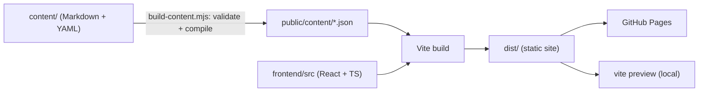

# Architecture

AI Networking Academy is a **static single-page application**. There is no server and no account:
everything runs in the browser, so the same build works from GitHub Pages, from `start-academy.bat`
on a laptop, or from any static file host.



## Design decisions

- **Static site, no backend.** The same build runs from GitHub Pages or from a laptop, progress stays in the
  browser, and there is no service to operate or to leak learner data.
- **A deterministic teaching model, not an emulator.** The simulator reproduces which counters move, which
  tests fail and roughly how much bandwidth each fault class costs. Performance comes from a fixed factor
  per fault class; no packets or queues are simulated. Being deterministic is what lets a test replay every
  lab and grade the state of the fabric ([SIMULATOR.md](SIMULATOR.md)).
- **Verified versus illustrative is part of the data model.** Output blocks are tagged as real captures per
  driver stack, hardware observations are `[!VERIFIED]` callouts collected onto one page, and a lab carries
  `verified: false` until it has been run end to end. The validator rejects a capture tagged with the
  wrong stack.
- **Two driver stacks as first-class variants.** Device names, tools and behaviour differ between the
  distribution's inbox RDMA stack and NVIDIA DOCA-OFED, so commands exist in both forms and the learner
  picks the stack once.
- **Lab checks as executable evidence.** A lab counts as verified only when its `check.sh` passed with
  every required measurement made. A run whose main measurement was skipped is INCONCLUSIVE, not a pass.
- **A local-only hardware agent.** The browser cannot reach a learner's servers, so `aina-hw serve` binds to
  127.0.0.1 by default, answers only read requests, checks the Host header and an origin allow-list, and is
  reached through an SSH tunnel. Importing JSON files works without it.
- **Documentation that is tested.** The counts the docs advertise, the command walkthrough in the tour and
  the images in the README are derived from the source tree or generated from the build (see Quality gates).

## Repository layout

| Path | What |
|---|---|
| `content/modules/<module>/` | `module.yaml`, `lessons/*.md`, `quizzes/quiz-*.yaml` |
| `content/labs/sim/` | Fabric Simulator incidents (YAML) |
| `content/labs/handson/` | Hands-on Linux labs (Markdown), with files in `labs/<id>/` |
| `content/exams/` | Mock exams |
| `content/commands/`, `content/glossary.yaml` | Command reference and glossary (also the flashcards) |
| `frontend/scripts/build-content.mjs` | The content validator and compiler (`--stats` prints the repository counts) |
| `frontend/scripts/doc-stats.mjs` | Checks the counts the docs advertise against the compiler's |
| `frontend/src/pages/` | One component per route |
| `frontend/scripts/figures.mjs` | The figure compiler: parses a figure's source and lays it out at build time |
| `frontend/src/components/` | Markdown renderer (callouts, figures, widgets), quiz card, terminal, layout |
| `frontend/src/widgets/` | Interactive visualizations, registered in `registry.tsx` |
| `frontend/src/sim/` | Fabric Simulator: model, shell, grading |
| `frontend/tests/` | Vitest: progress logic, every simulator lab, widget math, golden-format tests against real captures, doc counts |
| `frontend/e2e/` | Playwright browser tests: quiz, mock exam and timer, every sim lab solved through the UI, progress export/import/reset, Real HW Connect, flashcards, reference, theme, lessons, keyboard-only quiz |
| `content/hardware/` | Real HW track: `hardware.yaml` (tiers, requirements, lab-profile variables) and `guides/*.md` |
| `labs/` | Files for hands-on and hardware labs (topologies, scripts, `check.sh`) |
| `labs/hw-toolkit/` | `aina-hw` (inventory, checks, read-only agent), `lib.sh` for check scripts, `setup-rdma-host.sh`, Python tests |
| `frontend/src/hw/` | Lab profile, report parsing and health-review rules, check results (pure, unit-tested) |
| `docs/` | This documentation |

## Content pipeline

`build-content.mjs` parses every file, enforces the rules in [AUTHORING.md](AUTHORING.md) (IDs,
required sections and keys, quiz option rules, cross-references between lessons, labs and widgets), and
writes:

* `index.json`: metadata for everything (modules, lessons with table of contents, labs, exams,
  commands, glossary, and `verifiedNotes`: every `> [!VERIFIED]` callout with the section it sits in, shown on
  the "Verified on hardware" page `#/verified`). Loaded once.
* `lessons/<id>.json`, `quizzes/<id>.json`, `exams/<id>.json`, `labs/<id>.json`: bodies, loaded on demand.
* `search.json`: the site-wide search index, built by `scripts/search-index.mjs` and fetched the first time
  the search dialog opens (see Search below). The build prints its size.

Driver-stack variants (fences tagged `stack=inbox` / `stack=doca`, `real` capture labels; syntax in
[AUTHORING.md](AUTHORING.md)) are parsed by `scripts/stack-variants.mjs`, shared by the validator and the app:
`src/stackMarkdown.ts` is a remark plugin that groups adjacent tagged fences into one block, `Markdown.tsx`
renders it with a `StackToggle` bound to `progress.settings.stack`, and the command reference resolves an
entry's `stacks:` variants with `commandForStack`.

Labs declare which lessons they practise; the compiler derives each lesson's lab list from that, so the
relationship is maintained in one place.

Each lesson's `further_reading` entries are labelled with the kind of source they point to (standard, vendor
documentation, open-source project, paper, article). `scripts/source-kinds.mjs` derives the kind from the
link's host and is shared by the compiler, which rejects an unclassified host, and by the lesson page, which
shows the label next to each reference.

## Front end

React 19, TypeScript (strict), Vite, Tailwind CSS v4, `react-markdown` with GFM and highlight.js,
lucide icons. A `HashRouter` keeps deep links working on static hosts without rewrite rules. Routes and
widgets are code-split.

Design tokens live in `src/index.css` as CSS variables with a light and a dark palette; SVG widgets use
the same variables so they follow the theme.

### Figures

A lesson describes a figure in Mermaid syntax; the app does not ship Mermaid. `scripts/figures.mjs` compiles
each ` ```mermaid ` fence at build time:

1. **Parse.** A strict parser for the subset the content uses (flowcharts with boxes, decisions, stores,
   groups and labelled connections; sequence diagrams with participants, messages, replies and notes).
   Anything else fails `npm run validate` with the file and line.
2. **Measure.** Text is measured with the glyph widths of the app's own fonts (`figure-metrics.json`,
   recorded once from the browser), so no DOM is needed.
3. **Lay out.** Flowcharts go through ELK's layered algorithm with orthogonal routing (`elkjs`, a build
   dependency only). The compiler keeps the author's order where it can, breaks loops at the arrow that
   points back, puts labels on their connections, and redraws a figure that would be too wide: tighter
   first, then top to bottom. Sequence diagrams have a small layout of their own.
4. **Emit.** The fence in the compiled body becomes a ` ```figure ` fence holding the geometry and a text
   alternative as JSON. `src/components/Figure.tsx` draws it as inline SVG with the design tokens, so it
   follows the colour scheme, costs no layout work in the browser and never shifts while a page loads.

The source in the lesson is the content, and the compiler may not add, drop or reword any of it.
`tests/figures.test.ts` checks that for every figure: the labels drawn equal the labels written, boxes do
not overlap, text fits its box, connections reach their boxes. `tests/fixtures/figures-baseline.json` holds
what Mermaid itself read from each figure before it was replaced, and the parser must read the same.

### Search

`/` or Ctrl/Cmd+K (or the header button) opens a search dialog over lessons (title, every `##`/`###`
section), quizzes, simulator labs, hands-on and hardware labs, hardware guides, commands, glossary terms,
widgets, modules and exams. The index is one entry per section: page, heading anchor, a ~180-character plain
text snippet, and the section's remaining distinct words (Markdown, code blocks, stop words and words that
prefix another word of the entry are dropped; words found in more than 3% of sections go to a shared
"common" list). Ranking (`src/search.ts`) is dependency-free: every query word must prefix-match a word of
the section (common words are optional), with boosts for title and heading matches and an exact title.
Results are grouped by type with the matches highlighted, and link to `#/lesson/<id>?s=<heading-id>`;
`useSectionParam` in `Markdown.tsx` scrolls to and focuses that heading. Heading ids come from `slug()`,
which the index builder duplicates; `tests/search.test.ts` keeps the two identical.

### Accessibility

Target: WCAG 2.2 AA, checked with axe-core in headless Chrome on every route in both themes.

* Landmarks: skip link, `header` (banner), sidebar `aside` with `nav "Main"`, `main#main-content`; one `h1`
  per page; `document.title` follows the page's `h1` (`Layout.tsx`). After client-side navigation focus
  moves to `main` unless the page placed it (deep-linked heading, terminal).
* Colours: light-theme signal colours are darkened so text in them is at least 4.5:1 on every surface;
  `--on-accent` is the text colour on solid accent fills. Check new colour pairs before using them.
* A global `:focus-visible` ring (unlayered, so it beats `outline-none`); `prefers-reduced-motion` stops
  animations, transitions and smooth scrolling (`goToSection()` respects it in JS too).
* Quiz options are an ARIA radio group (roving tab stop, arrow keys) or checkboxes; the verdict is stated
  in text and announced (`role="status"`); focus moves to the next question and to the result.
* The simulator terminal is a `log`; Tab completes, Escape then Tab leaves it (no keyboard trap).
* Figures are `role="img"` with a text alternative written at build time from their boxes and connections
  (plus the author's `accTitle`). Their motion lasts under five seconds or starts on a button, and none of it
  runs with reduced motion. A figure wider than the page scrolls inside a focusable frame.
* Widgets: toggles expose `aria-pressed`, steppers `aria-current="step"`, SVGs a `role="img"` label that
  describes the current state (or `role="group"` when they contain controls, which are focusable and
  operable with Enter/Space), sliders an `aria-valuetext` with units, the main result readout a polite
  live region, colour-coded states a text equivalent, scrollable areas a tab stop, and targets at least
  24 px. Do not use headings inside widgets. New widgets follow the same checklist.

## Real hardware track

The browser cannot reach the learner's servers, so the toolkit does the work on the hosts and the app reads
its output. The learner's **lab profile** (`aina.hw.v1` in localStorage, separate from progress) fills
`{{VAR}}` placeholders in lab and guide Markdown and generates `lab.env`, which every check script sources.
`aina-hw collect-all` inventories the hosts (sysfs, `ethtool`, `mlnx_qos`/`dcb`, `rdma`, `nvidia-smi`) into
an `aina.hw.report/1` JSON file; `aina-hw check <lab>` saves an `aina.hw.check/1` result. The Connect page
imports both, either as files or from `aina-hw serve`, a read-only HTTP agent bound to 127.0.0.1 with an
origin allow-list, reached through an SSH tunnel. `src/hw/report.ts` runs the health review; a passing check
marks the lab solved with evidence (host, time). Check scripts mark the lab's tasks (`task N "title"` in
`lib.sh`, `TASK:` lines); `src/hw/checks.ts` folds full and `--task N` runs into per-task progress
(`aina.hw.v1` `tasks`) for the lab page's "Resume at Task N". Checks also declare required measurements
(`require` / `met` / `perf_ok` / `perf_low` in `lib.sh`; `REQUIRE:`, `MET:`, `PERF:` lines), and
`aina_hw.grade_check` and its twin `gradeCheck` in `checks.ts` grade a run as PASSED, FAILED, INCONCLUSIVE
(a required measurement or covered task missing) or BELOW_TARGET; only PASSED verifies a lab. The Live view (`/hw/live`, and a sidebar card
on hardware lab pages) polls `GET /api/live` (`aina.hw.live/1` counter snapshots, host B/C over one SSH
session with `serve --live-remote`); `src/hw/live.ts` turns deltas into rates. `labs/hw-toolkit/tests/make_demo_report.py` generates the
app's demo report from the same fake hosts the Python tests use.

## Progress

`src/progress.ts` holds pure, unit-tested functions (scoring, SM-2 scheduling, streaks); `src/store.tsx`
binds them to React and `localStorage` (`aina.progress.v1`), syncing across tabs. Simulator lab state is
stored per lab (`aina.sim.<lab id>`). Settings offers JSON export/import and reset. No data leaves the
browser.

A lesson counts as **mastered** only when it is read *and* its quiz is passed; a simulator lab counts as
solved only when the diagnosis is right *and* the fabric passes every check.

## Quality gates

`npm run validate` (content rules), `npm test` (progress logic plus every simulator lab: broken before
the fix, clean after it), `npm run build` (type check and bundle), `npm run e2e` (browser interaction
tests) and `bash -n` on every lab script. CI runs all of them on each push and pull request, plus the Python
toolkit tests; the Pages workflow builds `main` and deploys it to GitHub Pages.

Two tests guard the documentation itself. `tests/doc-stats.test.ts` compares every count the docs advertise
(README badges, "76 lessons", the status tables) with `build-content.mjs --stats`, the same compiler that
builds the site; `npm run stats` prints the counts and the phrases are listed in `scripts/doc-stats.mjs`.
`tests/portfolio-tour.test.ts` replays the command walkthrough in [PORTFOLIO_TOUR.md](PORTFOLIO_TOUR.md)
against the simulator. The screenshots in the README and the tour are generated from the build by
`npm run screenshots`, and the animations (the flagship incident, the ECMP modes, the ring all-reduce, the
driver-stack switch) by `npm run tour-gif` (Playwright frames, assembled with Python and Pillow).

`npm run e2e` runs Playwright against `vite preview` of `dist/` (run `npm run build` first) on a free
port. It drives the installed Google Chrome (`channel: 'chrome'`; set `CHROME_PATH` to use another
binary) and never downloads Playwright's own browsers, so install with `PLAYWRIGHT_SKIP_BROWSER_DOWNLOAD=1`.
Tests read the right answers from the compiled content in `dist/content` (option order is shuffled),
select elements by role, label and text, and fail on any uncaught page error or console error.
Traces of failed tests land in `frontend/test-results/`.
