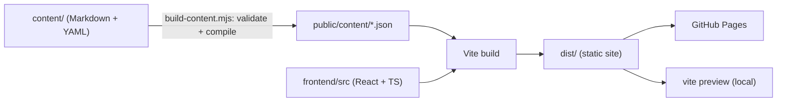

# Architecture

AI Networking Academy is a **static single-page application**. There is no server and no account:
everything runs in the browser, so the same build works from GitHub Pages, from `start-academy.bat`
on a laptop, or from any static file host.

## Repository layout

| Path | What |
|---|---|
| `content/modules/<module>/` | `module.yaml`, `lessons/*.md`, `quizzes/quiz-*.yaml` |
| `content/labs/sim/` | Fabric Simulator incidents (YAML) |
| `content/labs/handson/` | Hands-on Linux labs (Markdown), with files in `labs/<id>/` |
| `content/exams/` | Mock exams |
| `content/commands/`, `content/glossary.yaml` | Command reference and glossary (also the flashcards) |
| `frontend/scripts/build-content.mjs` | The content validator and compiler |
| `frontend/src/pages/` | One component per route |
| `frontend/src/components/` | Markdown renderer (callouts, mermaid, widgets), quiz card, terminal, layout |
| `frontend/src/widgets/` | Interactive visualizations, registered in `registry.tsx` |
| `frontend/src/sim/` | Fabric Simulator: model, shell, grading |
| `frontend/tests/` | Vitest: progress logic and every simulator lab |
| `labs/` | Files for hands-on labs (containerlab topologies, FRR configs, `check.sh`) |
| `docs/` | This documentation |

## Content pipeline

`build-content.mjs` parses every file, enforces the rules in [AUTHORING.md](AUTHORING.md) (IDs,
required sections and keys, quiz option rules, cross-references between lessons, labs and widgets), and
writes:

* `index.json`: metadata for everything (modules, lessons with table of contents, labs, exams,
  commands, glossary). Loaded once.
* `lessons/<id>.json`, `quizzes/<id>.json`, `exams/<id>.json`, `labs/<id>.json`: bodies, loaded on demand.

Labs declare which lessons they practise; the compiler derives each lesson's lab list from that, so the
relationship is maintained in one place.

## Front end

React 19, TypeScript (strict), Vite, Tailwind CSS v4, `react-markdown` with GFM and highlight.js,
Mermaid (lazy-loaded), lucide icons. A `HashRouter` keeps deep links working on static hosts without
rewrite rules. Routes and widgets are code-split.

Design tokens live in `src/index.css` as CSS variables with a light and a dark palette; SVG widgets use
the same variables so they follow the theme.

## Progress

`src/progress.ts` holds pure, unit-tested functions (scoring, SM-2 scheduling, streaks); `src/store.tsx`
binds them to React and `localStorage` (`aina.progress.v1`), syncing across tabs. Simulator lab state is
stored per lab (`aina.sim.<lab id>`). Settings offers JSON export/import and reset. No data leaves the
browser.

A lesson counts as **mastered** only when it is read *and* its quiz is passed; a simulator lab counts as
solved only when the diagnosis is right *and* the fabric passes every check.

## Quality gates

`npm run validate` (content rules), `npm test` (progress logic plus every simulator lab: broken before
the fix, clean after it), `npm run build` (type check and bundle), and `bash -n` on every lab script.
CI runs all four on each push and pull request; the Pages workflow deploys `main`.
