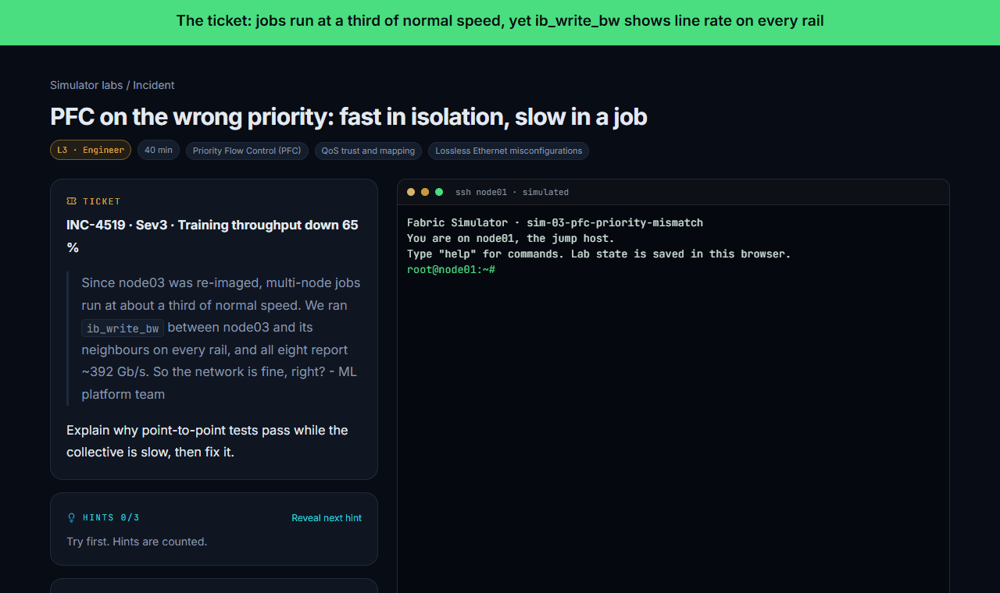
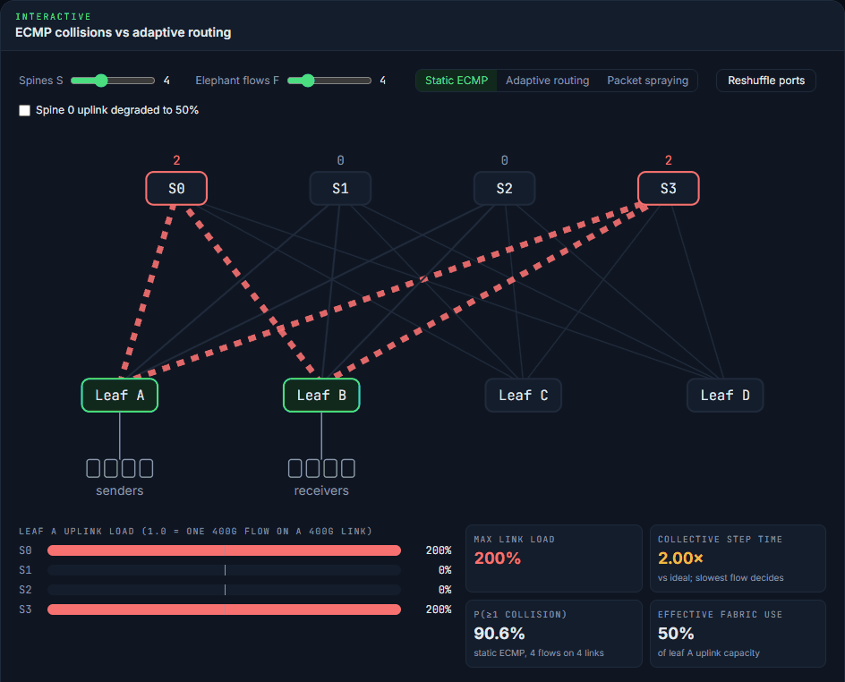
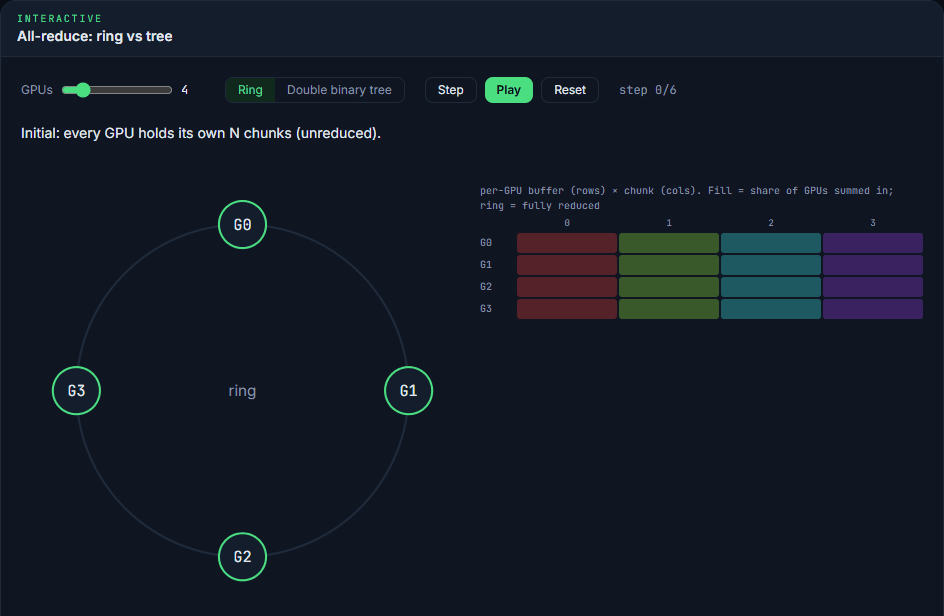
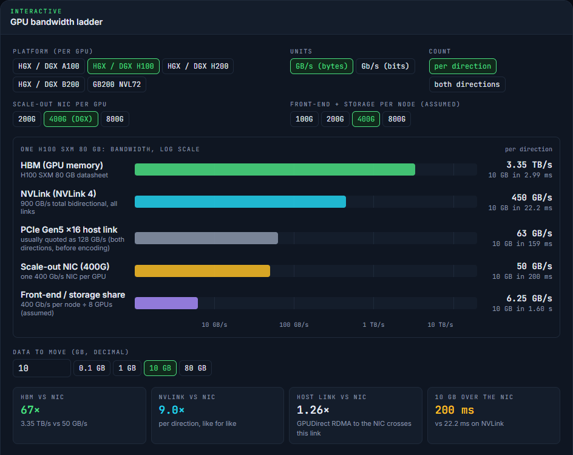
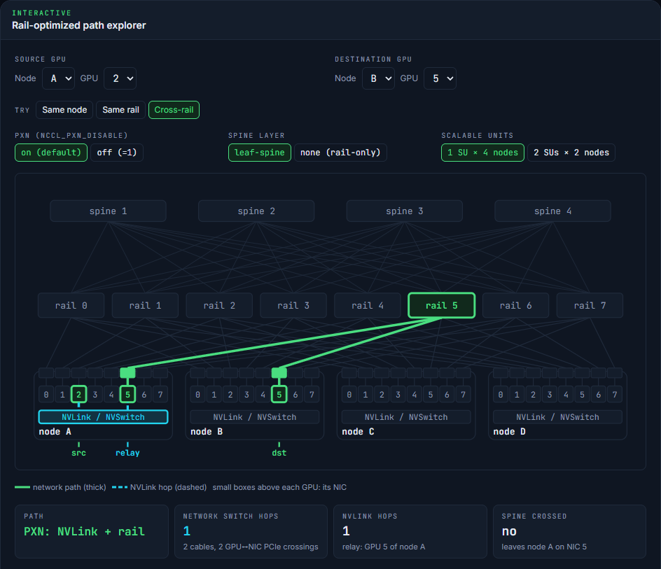
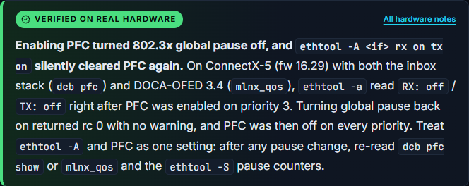
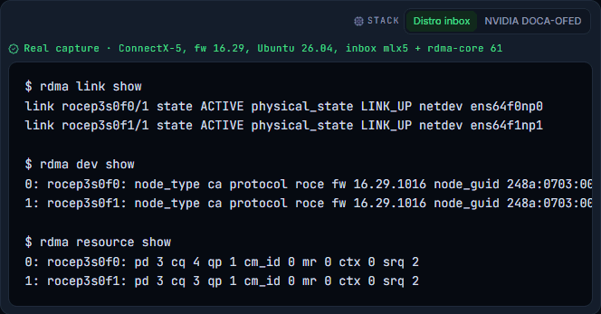
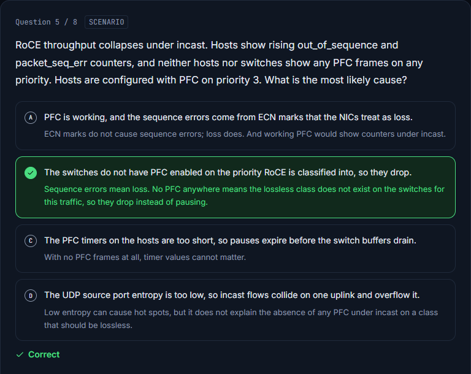
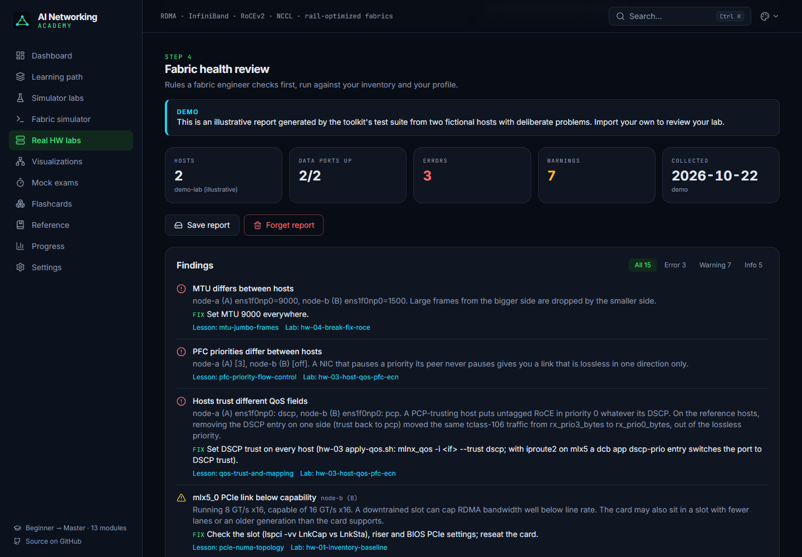

# The five-minute tour

AI Networking Academy teaches the network of a GPU cluster the way engineers actually learn it: by
watching it move, breaking it and fixing it. This page is the short version, in pictures. Every image
below is the real app, captured from the current build.

**[Open the live academy](https://jurajliskalc.github.io/ai-networking-academy/)** · no account, nothing to
install, your progress stays in your browser.

## Break a cluster. Then fix it.

<p align="center"><a href="https://jurajliskalc.github.io/ai-networking-academy/#/labs/sim-03-pfc-priority-mismatch"></a></p>

Every simulator lab starts the way a bad day does: a ticket, and a 32-GPU fabric that is quietly broken.
Here the training job runs at a third of its speed while every point-to-point test says the network is
fine. You investigate with the commands you would type on real hosts and switches, commit to a diagnosis,
apply the fix, and the lab grades the state of the fabric. Guessing the fix first does not work: grading
stays locked until you have committed a diagnosis.

There are 22 Fabric Simulator labs like this one, from a dark rail to a 3 a.m. incident with two faults and
a red herring. **[Try this incident](https://jurajliskalc.github.io/ai-networking-academy/#/labs/sim-03-pfc-priority-mismatch)**,
or browse [all simulator labs](https://jurajliskalc.github.io/ai-networking-academy/#/labs).

<details>
<summary><b>Want to solve it yourself? The ten commands</b></summary>

Type these in the lab's shell, in order. The lab's hints lead to the same place if you would rather find
the broken rail on your own.

<!-- tour-commands: sim-03-pfc-priority-mismatch (replayed by frontend/tests/portfolio-tour.test.ts) -->
```text
all_reduce_perf -b 8 -e 8G -f 2 -g 1
ssh leaf06
nv show interface swp3 counters
ssh node03
ethtool -S enp170s0np0 | grep pause
rdma statistic show link mlx5_5/1
mlnx_qos -i enp170s0np0
mlnx_qos -i enp170s0np0 --pfc 0,0,0,1,0,0,0,0
exit
all_reduce_perf -b 8 -e 8G -f 2 -g 1
```

What to look for in the output (simulated, trimmed to the lines that matter):

<!-- tour-evidence: every line below is printed by the simulator for the commands above -->
```text
# 1. Symptom: the collective peaks near 130 GB/s of bus bandwidth (a healthy fabric gives about 372)
  8589934592    2147483648     float     sum      -1    127864   67.18  130.16      0    127481   67.18  130.16      0

# 2. The leaf facing node03 on rail 5 is pausing priority 3 hard, and still dropping
TX drops           1886197
TX PFC pause       412377  (priority 3)

# 3. node03's NIC on that rail has pause counters for priority 4 only: it is not listening on priority 3
     rx_prio4_pause: 0

# 4. The RDMA transport sees the loss: go-back-N retransmissions
    out_of_sequence 1735301 

# 5. Root cause: PFC enabled on priority 4, where the fabric uses 3
	enabled     0   0   0   0   1   0   0   0   

# 6. After the fix the collective is back at full speed
  8589934592    2147483648     float     sum      -1     44777  191.84  371.68      0     44643  191.84  371.68      0
```

Then commit the diagnosis (the option that names PFC on priority 4) and press **Grade the fabric**.
A test replays this exact list against the simulator on every change, so the page cannot drift from the
lab.

</details>

## See it move

Some of this subject is hard to picture from a page of text. So the academy has 45 interactive
visualizations, embedded in the lessons and runnable on their own.

<p align="center"><a href="https://jurajliskalc.github.io/ai-networking-academy/#/visualize/ecmp-collision"></a></p>

**Why does a healthy fabric run at half speed?** Four big flows, four spines, plenty of capacity. Static
ECMP hashes them onto two spines anyway: those links run at 200 % and every GPU waits for the slowest
flow. Adaptive routing and packet spraying spread the same traffic evenly.
[Try it](https://jurajliskalc.github.io/ai-networking-academy/#/visualize/ecmp-collision): reshuffle the
ports and watch how rarely the hash gets lucky.

<p align="center"><a href="https://jurajliskalc.github.io/ai-networking-academy/#/visualize/allreduce-sim"></a></p>

**What is an all-reduce, really?** The operation at the heart of distributed training, one hop at a time:
each GPU passes a chunk to its neighbour until every GPU holds the full sum.
[Step through it](https://jurajliskalc.github.io/ai-networking-academy/#/visualize/allreduce-sim), then
switch from a ring to a tree.

<table>
<tr>
<td width="50%"><a href="https://jurajliskalc.github.io/ai-networking-academy/#/visualize/bandwidth-ladder"></a><br /><sub><b>The bandwidth ladder.</b> Around one H100, memory moves data 67 times faster than the 400G NIC, and NVLink 9 times faster. Whatever leaves the server squeezes through the slowest rung.</sub></td>
<td width="50%"><a href="https://jurajliskalc.github.io/ai-networking-academy/#/visualize/rail-path-explorer"></a><br /><sub><b>Which way does the data go?</b> Pick two GPUs and see the path: here one switch hop and no spine, because the data first hops over NVLink to the GPU on the right rail.</sub></td>
</tr>
</table>

[All 45 visualizations](https://jurajliskalc.github.io/ai-networking-academy/#/visualize), grouped by topic.

## Real adapters, real surprises

The lessons were checked against real hardware, and the hardware did not always agree with the manual.
What it did instead is written down next to the lesson it belongs to:

<p align="center"><a href="https://jurajliskalc.github.io/ai-networking-academy/#/verified"></a></p>

Turn pause back on, the command exits with code 0, and the lossless class is gone without a warning.
There are 32 verified-on-hardware notes like this one,
[collected on one page](https://jurajliskalc.github.io/ai-networking-academy/#/verified).

<p align="center"></p>

**One adapter, two names.** The same card is `rocep3s0f0` with the distribution's driver stack and `mlx5_0`
with NVIDIA DOCA-OFED, which trips people up as soon as a guide assumes the other one. Here you pick your
stack once and every command follows. Both outputs above are real captures; 259 output blocks are real captures, each
labelled with the stack it came from.

## Questions that explain themselves

<p align="center"></p>

The 568 quiz questions are mostly scenarios: here are the counters, what is wrong? After you answer,
every option says why it is right or wrong, so a wrong guess still teaches something. 3 mock exams score
you by domain when you want to know where you stand.

## Bring your own lab

<p align="center"><a href="https://jurajliskalc.github.io/ai-networking-academy/#/hw"></a></p>

Have a VM, two RDMA hosts, or more? There are 22 hands-on labs. Describe your lab once and their commands
are filled in with your addresses and device names. A small tool inventories your hosts, runs each lab's check
and reviews the fabric the way an engineer would: MTU, PFC and trust mismatches, firmware, PCIe. A lab
counts as done only when its check passed, and 19 of the 22 labs have been run end to end on a reference
VM or on real ConnectX-5 hardware. The three that have not need a lossless switch or GPU nodes, and say so.

## How it stays honest

- **Every simulator lab is replayed by tests** on every change: broken before its fix, clean after it.
- **Tool output is compared with real captures** from ConnectX-5 adapters, on two driver stacks.
- **What is not verified is labelled.** Switch output and GPU output follow vendor documentation and tool
  sources, and are marked illustrative.
- **Even the numbers are tested.** A count in the README that stops matching the source tree fails the build.
- **Built with AI coding agents, checked like any untrusted code.** Nothing they produce is kept until a
  primary source, a test or a hardware run supports it. See the
  [verification model](../README.md#ai-assisted-engineering-workflow).

## By the numbers

| | |
|---|---|
| Lessons | 76 lessons in 13 modules, Beginner to Master |
| Questions | 568 quiz questions and 3 mock exams, every option explained |
| Simulator | 22 Fabric Simulator labs on a 32-GPU rail-optimized cluster |
| Hands-on | 22 hands-on labs, from one VM to GPU nodes |
| Visual | 45 interactive visualizations |
| Reference | 165 annotated commands and a 241-term glossary with flashcards |

## Go deeper

- [README](../README.md): what is inside, and what was verified on real hardware
- [Architecture and design decisions](ARCHITECTURE.md): how the app, the simulator and the toolkit fit together
- [Hardware verification reference](HARDWARE_VERIFICATION.md): what the tools printed on real adapters
- [The simulator's model and its limits](SIMULATOR.md)
- [Implementation status](../IMPLEMENTATION_STATUS.md) and [roadmap](../ROADMAP.md)
